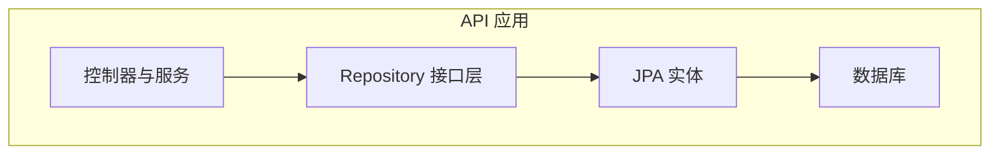
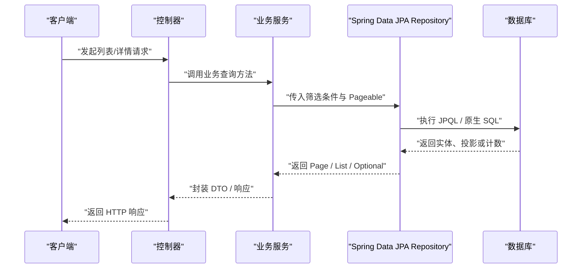
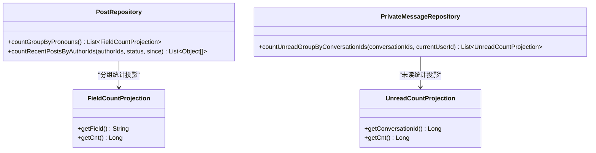
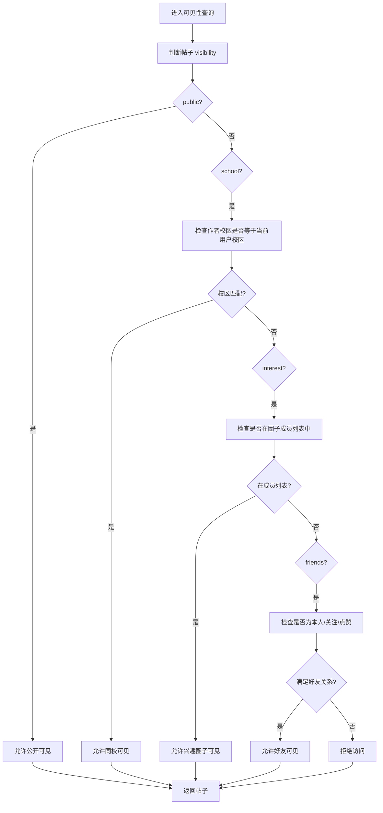
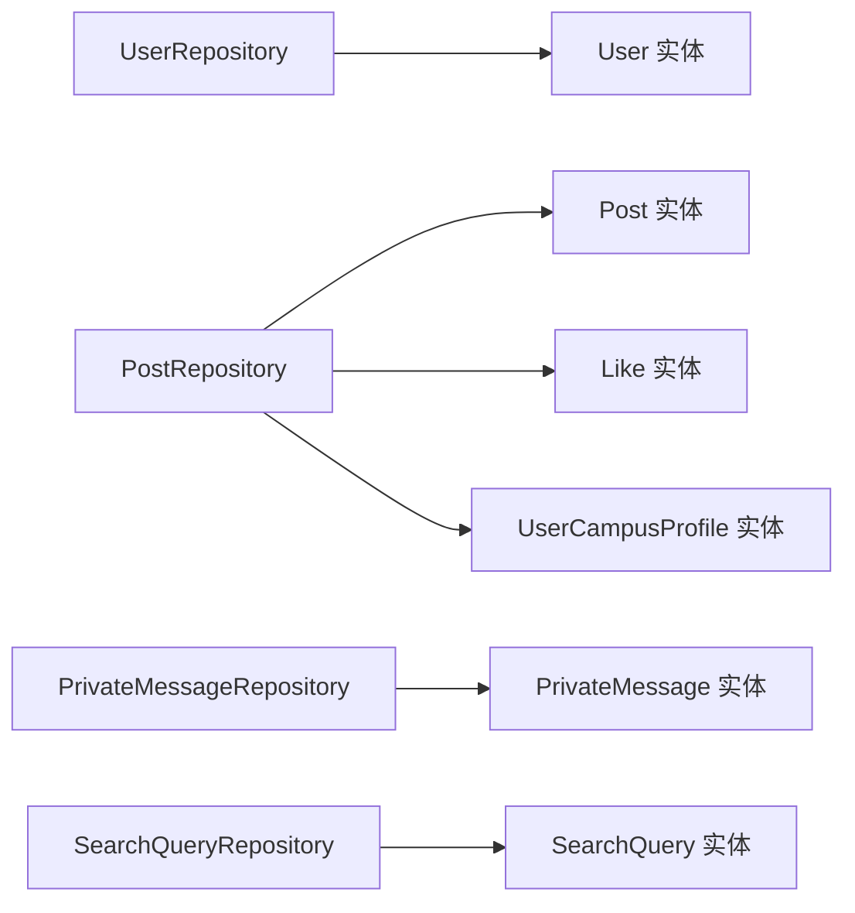
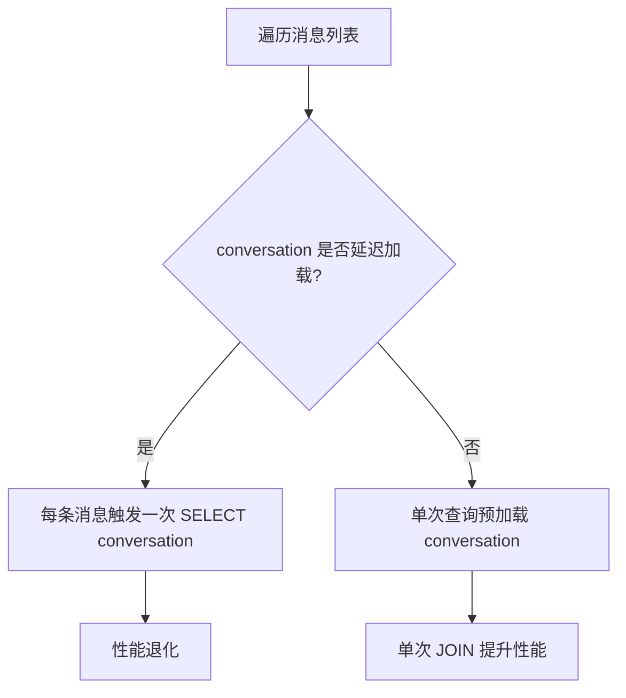
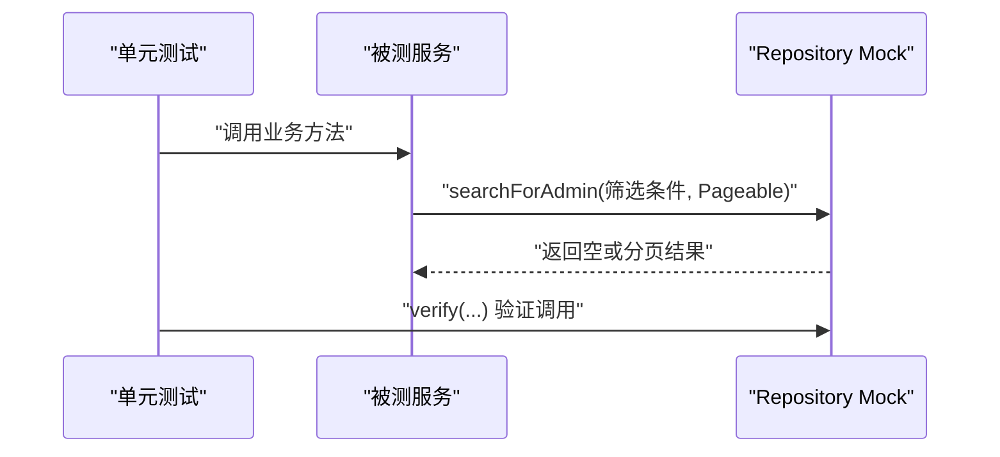

# Repository开发规范

<cite>
**本文引用的文件**   
- [UserRepository.java](file://apps/api/src/main/java/com/campuslove/api/repository/UserRepository.java)
- [PostRepository.java](file://apps/api/src/main/java/com/campuslove/api/repository/PostRepository.java)
- [ActivityRepository.java](file://apps/api/src/main/java/com/campuslove/api/repository/ActivityRepository.java)
- [PrivateMessageRepository.java](file://apps/api/src/main/java/com/campuslove/api/repository/PrivateMessageRepository.java)
- [SearchQueryRepository.java](file://apps/api/src/main/java/com/campuslove/api/repository/SearchQueryRepository.java)
- [FieldCountProjection.java](file://apps/api/src/main/java/com/campuslove/api/repository/FieldCountProjection.java)
- [application-real.yml](file://apps/api/src/main/resources/application-real.yml)
- [AdminMediaAssetControllerTest.java](file://apps/api/src/test/java/com/campuslove/api/admin/AdminMediaAssetControllerTest.java)
- [AdminAuditLogControllerTest.java](file://apps/api/src/test/java/com/campuslove/api/admin/AdminAuditLogControllerTest.java)
</cite>

## 目录
1. [引言](#引言)
2. [项目结构](#项目结构)
3. [核心组件](#核心组件)
4. [架构总览](#架构总览)
5. [详细组件分析](#详细组件分析)
6. [依赖关系分析](#依赖关系分析)
7. [性能与N+1优化](#性能与n1优化)
8. [单元测试与Mock策略](#单元测试与mock策略)
9. [结论](#结论)

## 引言
本规范面向 Campus Love API 的 Spring Data JPA Repository 层，目标是为后续开发与维护提供统一、可演进的查询建模方式。仓库已存在大量 `JpaRepository` 实现，涵盖用户、帖子、活动、私信、搜索词等核心域；同时包含分页、聚合统计、条件过滤、可见性校验、批量更新与投影映射等复杂查询模式。本文以仓库中已有实现为依据，总结方法命名约定、查询推导规则、自定义 JPQL 使用方式、扩展点设计以及测试策略，并给出 N+1 问题治理和性能调优建议。

## 项目结构
Repository 接口集中在 `apps/api/src/main/java/com/campuslove/api/repository` 包下，每个领域实体通常对应一个 Repository 接口：
- 用户域：`UserRepository`
- 内容域：`PostRepository`、`CommentRepository`、`PostTagRepository`、`PostLikeRepository`、`PostFavoriteRepository`、`PostShareRepository`、`PostViewHistoryRepository`
- 社交域：`UserFollowRepository`、`UserBlockRepository`、`NotificationRepository`、`HeartSignalRepository`
- 消息域：`PrivateMessageRepository`、`OfficialChatMessageRepository`、`WhisperMessageRepository`
- 运营/管理域：`SearchQueryRepository`、`MediaAssetRepository`、`SchoolRepository`、`RoleRepository`、`MenuRepository` 等
- 钱包域：`UserWalletRepository`、`WalletTransactionLogRepository`、`WalletUnlockRepository`
- 其他业务域：`ActivityRepository`、`CheckInRepository`、`DailyQuestionRepository`、`RecommendationPreferenceRepository` 等

图表来源
- [PostRepository.java:21-477](file://apps/api/src/main/java/com/campuslove/api/repository/PostRepository.java#L21-L477)
- [UserRepository.java:17-300](file://apps/api/src/main/java/com/campuslove/api/repository/UserRepository.java#L17-L300)
- [PrivateMessageRepository.java:18-161](file://apps/api/src/main/java/com/campuslove/api/repository/PrivateMessageRepository.java#L18-L161)

章节来源
- [PostRepository.java:1-477](file://apps/api/src/main/java/com/campuslove/api/repository/PostRepository.java#L1-L477)
- [UserRepository.java:1-300](file://apps/api/src/main/java/com/campuslove/api/repository/UserRepository.java#L1-L300)

## 核心组件
当前代码库中的 Repository 遵循以下通用模式：
- 所有 Repository 接口继承 `JpaRepository<Entity, Id>`，获得基础 CRUD 与分页能力。
- 简单单表查询优先使用方法名推导，如 `findByXxxOrderByCreatedAtDesc`、`findByStatusAndRole`、`findByIdIn`。
- 多条件、跨表关联、聚合统计使用 `@Query` + `@Param` 的 JPQL。
- 分页统一返回 `Page<T>`，排序通过 `Pageable` 或方法名中的 `OrderBy...` 控制。
- 批量更新使用 `@Modifying` + `@Query`，必要时加 `@Transactional`。
- 结果集投影使用接口投影（如 `FieldCountProjection`）或 `Object[]` 二元组。
- N+1 预加载使用 `@EntityGraph(attributePaths = "...")`。
- 复杂权限/可见性逻辑下沉到 JPQL 的 `EXISTS` 子查询与参数组合。

章节来源
- [UserRepository.java:17-300](file://apps/api/src/main/java/com/campuslove/api/repository/UserRepository.java#L17-L300)
- [PostRepository.java:21-477](file://apps/api/src/main/java/com/campuslove/api/repository/PostRepository.java#L21-L477)
- [PrivateMessageRepository.java:18-161](file://apps/api/src/main/java/com/campuslove/api/repository/PrivateMessageRepository.java#L18-L161)

## 架构总览
Repository 层在整体调用链中位于服务层之下、实体与数据库之上。典型调用顺序如下：

图表来源
- [PostRepository.java:21-477](file://apps/api/src/main/java/com/campuslove/api/repository/PostRepository.java#L21-L477)
- [UserRepository.java:17-300](file://apps/api/src/main/java/com/campuslove/api/repository/UserRepository.java#L17-L300)

## 详细组件分析

### 方法命名约定与查询推导
仓库广泛使用 Spring Data JPA 的方法名推导：
- 基本字段匹配：`findByOpenid`、`findByPhone`、`findByKeyword`、`findByUserIdAndKeywordAndSearchDate`
- 多条件组合：`findByStatusAndRole`、`findByAuthorIdInAndStatusOrderByCreatedAtDesc`、`findByConversationIdAndSenderIdNotAndIsRead`
- 集合操作：`findByIdIn`、`findByAuthorIdInAndCategoryAndStatusOrderByCreatedAtDesc`
- 排序与分页：方法名末尾带 `OrderByCreatedAtDesc`，配合 `Pageable` 参数返回 `Page<T>`
- 限制条数：`findTop12By...`、`findTop50By...`

这些方法清晰表达“按什么条件查”“按什么排序”，适合简单且稳定的查询路径。当条件组合变得复杂、需要跨表关联或聚合时，再迁移到 `@Query`。

章节来源
- [UserRepository.java:23-49](file://apps/api/src/main/java/com/campuslove/api/repository/UserRepository.java#L23-L49)
- [PostRepository.java:27-61](file://apps/api/src/main/java/com/campuslove/api/repository/PostRepository.java#L27-L61)
- [SearchQueryRepository.java:20-24](file://apps/api/src/main/java/com/campuslove/api/repository/SearchQueryRepository.java#L20-L24)
- [PrivateMessageRepository.java:24-33](file://apps/api/src/main/java/com/campuslove/api/repository/PrivateMessageRepository.java#L24-L33)

### 分页查询与排序
分页是仓库中最常见的查询形态。常见模式包括：
- 固定排序：方法名显式指定 `OrderByCreatedAtDesc`、`OrderByLikesCountDesc`、`OrderByActivityDateAsc`。
- 动态排序：通过 `Pageable` 传入，例如 `searchForAdmin`、`searchByKeyword`、`findVisiblePosts`。
- 特殊排序：置顶优先再按时间倒序，如 `ORDER BY p.isPinned DESC, p.createdAt DESC`。

最佳实践：
- 对高频列表接口，尽量在 Repository 层明确默认排序，避免服务层拼错排序。
- 对管理端模糊查询，将可选条件统一写成 `(:param IS NULL OR :param = '' OR 字段匹配)`，使 null 表示不筛选。
- 对大表统计接口，优先返回投影而非完整实体。

章节来源
- [PostRepository.java:27-61](file://apps/api/src/main/java/com/campuslove/api/repository/PostRepository.java#L27-L61)
- [PostRepository.java:117-155](file://apps/api/src/main/java/com/campuslove/api/repository/PostRepository.java#L117-L155)
- [UserRepository.java:147-199](file://apps/api/src/main/java/com/campuslove/api/repository/UserRepository.java#L147-L199)

### 条件查询与数据隔离
仓库中存在两类条件查询风格：
1. 简单条件：通过方法名推导，如 `findByStatusAndRole`。
2. 复杂条件：通过 JPQL 拼接多个可选条件，并配合 `@Param`。

典型场景包括：
- 管理后台用户搜索：支持角色、状态、注册时间范围、昵称前缀、校区隔离。
- 管理后台帖子搜索：支持审核状态、帖子状态、分类、作者、校区隔离。
- 村落动态管理搜索：支持审核状态、帖子状态、关键字、校区隔离。
- 发现子标签关键词过滤：支持多关键词 `OR` 匹配内容与标签。
- C 端用户搜索：昵称或校区名中缀匹配，仅返回普通活跃用户。

数据隔离常用 `EXISTS` 子查询关联 `UserCampusProfile.campusName`，确保校区管理员只能看到本校区数据。

章节来源
- [UserRepository.java:147-199](file://apps/api/src/main/java/com/campuslove/api/repository/UserRepository.java#L147-L199)
- [PostRepository.java:157-246](file://apps/api/src/main/java/com/campuslove/api/repository/PostRepository.java#L157-L246)
- [PostRepository.java:248-296](file://apps/api/src/main/java/com/campuslove/api/repository/PostRepository.java#L248-L296)

### 聚合统计与投影
仓库中使用多种投影方式承载聚合结果：
- 接口投影：`FieldCountProjection` 定义 `field` 与 `cnt`，用于按 pronouns、gradeLabel 分组统计。
- 数组投影：`List<Object[]>` 返回 `[authorId, postCount]`，用于推荐活跃度评分。
- 内部接口投影：`PrivateMessageRepository.UnreadCountProjection` 返回会话未读数。
- 标量统计：`countByCreatedAtAfter`、`sumLikesByAuthorId`、`countRecentPostsByAuthorIds`。

图表来源
- [FieldCountProjection.java:1-21](file://apps/api/src/main/java/com/campuslove/api/repository/FieldCountProjection.java#L1-L21)
- [PostRepository.java:97-115](file://apps/api/src/main/java/com/campuslove/api/repository/PostRepository.java#L97-L115)
- [PostRepository.java:298-323](file://apps/api/src/main/java/com/campuslove/api/repository/PostRepository.java#L298-L323)
- [PrivateMessageRepository.java:125-153](file://apps/api/src/main/java/com/campuslove/api/repository/PrivateMessageRepository.java#L125-L153)

章节来源
- [FieldCountProjection.java:1-21](file://apps/api/src/main/java/com/campuslove/api/repository/FieldCountProjection.java#L1-L21)
- [PostRepository.java:97-115](file://apps/api/src/main/java/com/campuslove/api/repository/PostRepository.java#L97-L115)
- [PostRepository.java:298-323](file://apps/api/src/main/java/com/campuslove/api/repository/PostRepository.java#L298-L323)
- [PrivateMessageRepository.java:125-153](file://apps/api/src/main/java/com/campuslove/api/repository/PrivateMessageRepository.java#L125-L153)

### 关联查询与可见性控制
帖子可见性是仓库中最复杂的关联查询之一。`findVisiblePosts`、`findVisiblePostsByCategory`、`findVisiblePostById` 根据帖子可见范围决定：
- 公开帖子：所有人可见。
- 同校帖子：需认证且作者校区与当前用户一致。
- 兴趣圈子帖子：当前用户所属圈子成员可见。
- 好友帖子：作者本人、互相关注、或点赞过作者。

该查询通过多个 `OR` 分支与 `EXISTS` 子查询组合完成，既表达业务语义，也尽可能把权限判断放在数据库层。

图表来源
- [PostRepository.java:325-477](file://apps/api/src/main/java/com/campuslove/api/repository/PostRepository.java#L325-L477)

章节来源
- [PostRepository.java:325-477](file://apps/api/src/main/java/com/campuslove/api/repository/PostRepository.java#L325-L477)

### 原生SQL与JPQL的使用边界
仓库主要使用 JPQL，而非纯原生 SQL。JPQL 的优势在于与实体模型绑定、类型安全、可移植性更好。使用场景包括：
- 条件过滤：`WHERE (:role IS NULL OR u.role = :role)`
- 关联过滤：`EXISTS (SELECT 1 FROM UserCampusProfile ...)`
- 聚合统计：`GROUP BY u.pronouns`、`SUM(searchCount)`
- 批量更新：`UPDATE Activity a SET a.enrollmentCount = a.enrollmentCount + 1`
- 批量删除：`DELETE FROM PrivateMessage m WHERE m.conversation.id = :conversationId`

使用建议：
- 能用 JPQL 表达的业务逻辑优先用 JPQL。
- 只有在涉及数据库方言特有函数、复杂窗口函数或跨库视图时才考虑原生 SQL。
- 所有参数必须使用 `@Param`，避免位置参数导致可读性下降。

章节来源
- [SearchQueryRepository.java:26-61](file://apps/api/src/main/java/com/campuslove/api/repository/SearchQueryRepository.java#L26-L61)
- [ActivityRepository.java:52-96](file://apps/api/src/main/java/com/campuslove/api/repository/ActivityRepository.java#L52-L96)
- [PrivateMessageRepository.java:139-161](file://apps/api/src/main/java/com/campuslove/api/repository/PrivateMessageRepository.java#L139-L161)

### Repository扩展性设计
当前仓库没有统一的自定义 Repository 基类，也没有使用 Specification 或 QueryDSL。这并不意味着不能扩展；相反，它更适合先沉淀稳定模式，再逐步引入：
- 可考虑抽象 `BaseRepository extends JpaRepository<T, ID>`，注入统一审计、软删除、数据权限等公共条件。
- 对于动态条件较多的管理端查询，可引入 Specification，但需注意不要过度抽象导致难以阅读。
- QueryDSL 适合强类型复杂查询，但会增加构建复杂度；建议在确有静态类型需求时引入。
- 当前仓库更偏向“按业务语义拆分 Repository 方法”，这是可接受的演进方向。

章节来源
- [PostRepository.java:21-477](file://apps/api/src/main/java/com/campuslove/api/repository/PostRepository.java#L21-L477)
- [UserRepository.java:17-300](file://apps/api/src/main/java/com/campuslove/api/repository/UserRepository.java#L17-L300)

## 依赖关系分析
Repository 直接依赖实体与 Spring Data JPA 运行时。外部依赖包括：
- `org.springframework.data.jpa.repository.JpaRepository`
- `org.springframework.data.domain.Page`、`Pageable`
- `org.springframework.data.jpa.repository.Query`、`Param`、`Modifying`、`EntityGraph`
- 实体间的关联关系由 JPA 注解驱动，Repository 通过 JPQL 或方法名触发关联加载。

图表来源
- [UserRepository.java:17-300](file://apps/api/src/main/java/com/campuslove/api/repository/UserRepository.java#L17-L300)
- [PostRepository.java:21-477](file://apps/api/src/main/java/com/campuslove/api/repository/PostRepository.java#L21-L477)
- [PrivateMessageRepository.java:18-161](file://apps/api/src/main/java/com/campuslove/api/repository/PrivateMessageRepository.java#L18-L161)
- [SearchQueryRepository.java:17-61](file://apps/api/src/main/java/com/campuslove/api/repository/SearchQueryRepository.java#L17-L61)

章节来源
- [PostRepository.java:21-477](file://apps/api/src/main/java/com/campuslove/api/repository/PostRepository.java#L21-L477)
- [UserRepository.java:17-300](file://apps/api/src/main/java/com/campuslove/api/repository/UserRepository.java#L17-L300)

## 性能与N+1优化

### N+1问题的识别与解决
仓库中存在多处 N+1 风险点，并通过以下方式治理：
- `PrivateMessageRepository.findWithConversationByConversationIdOrderByCreatedAtDesc` 使用 `@EntityGraph(attributePaths = "conversation")` 将 N 次 conversation 查询合并为一次 LEFT JOIN。
- `UserRepository.findByIdIn` 批量按 ID 查询用户，替代循环逐条加载。
- `PostRepository.countRecentPostsByAuthorIds` 一次性按 authorId 分组统计发帖数，避免推荐算法中对候选用户逐个 count。

图表来源
- [PrivateMessageRepository.java:46-73](file://apps/api/src/main/java/com/campuslove/api/repository/PrivateMessageRepository.java#L46-L73)
- [PostRepository.java:298-323](file://apps/api/src/main/java/com/campuslove/api/repository/PostRepository.java#L298-L323)
- [UserRepository.java:67-73](file://apps/api/src/main/java/com/campuslove/api/repository/UserRepository.java#L67-L73)

章节来源
- [PrivateMessageRepository.java:46-73](file://apps/api/src/main/java/com/campuslove/api/repository/PrivateMessageRepository.java#L46-L73)
- [PostRepository.java:298-323](file://apps/api/src/main/java/com/campuslove/api/repository/PostRepository.java#L298-L323)
- [UserRepository.java:67-73](file://apps/api/src/main/java/com/campuslove/api/repository/UserRepository.java#L67-L73)

### 索引与查询改写经验
仓库注释中记录了若干性能优化经验：
- 管理端用户昵称搜索从 `LIKE '%x%'` 改为 `LIKE 'x%'`，以命中 B-Tree 索引，代价是仅匹配前缀。
- 发现子标签关键词过滤仍使用 `LIKE '%kw%'`，因为校园规模下可接受；未来可扩展到全文索引或搜索引擎。
- 热门榜单、新鲜度段、关注段复用 `hotScore`、`createdAt` 等排序字段，减少内存排序成本。

章节来源
- [UserRepository.java:147-199](file://apps/api/src/main/java/com/campuslove/api/repository/UserRepository.java#L147-L199)
- [PostRepository.java:63-95](file://apps/api/src/main/java/com/campuslove/api/repository/PostRepository.java#L63-L95)
- [PostRepository.java:325-477](file://apps/api/src/main/java/com/campuslove/api/repository/PostRepository.java#L325-L477)

### 连接池与JPA配置
生产环境配置在 `application-real.yml` 中：
- HikariCP 最大连接数默认 20，最小空闲 10，连接超时、生命周期、空闲超时、泄漏检测均外部化。
- JPA `open-in-view` 关闭，避免长事务持有连接。
- Hibernate dialect 指向 MySQL。
- Flyway 迁移脚本启用，并在部署时校验 DDL。

章节来源
- [application-real.yml:1-175](file://apps/api/src/main/resources/application-real.yml#L1-L175)

## 单元测试与Mock策略
仓库中的单元测试主要采用 Mockito 验证 Repository 方法的调用行为，重点覆盖：
- 控制器或服务层是否正确传递 `Pageable`、筛选参数。
- Repository 是否被调用、是否未被错误调用。
- 某些用例使用 `any(Pageable.class)` 匹配分页参数，说明测试关注的是“业务路由正确”，而非具体分页实现细节。

示例模式：
- 使用 `verify(repository).searchForAdmin(...)` 确认管理端查询入口。
- 使用 `verify(repository, never()).save(...)` 确认不应写数据的分支。
- 使用 `any(Pageable.class)` 作为参数匹配器，降低分页实现变更对测试的影响。

图表来源
- [AdminMediaAssetControllerTest.java:103-150](file://apps/api/src/test/java/com/campuslove/api/admin/AdminMediaAssetControllerTest.java#L103-L150)
- [AdminAuditLogControllerTest.java:42-79](file://apps/api/src/test/java/com/campuslove/api/admin/AdminAuditLogControllerTest.java#L42-L79)

章节来源
- [AdminMediaAssetControllerTest.java:103-150](file://apps/api/src/test/java/com/campuslove/api/admin/AdminMediaAssetControllerTest.java#L103-L150)
- [AdminAuditLogControllerTest.java:42-79](file://apps/api/src/test/java/com/campuslove/api/admin/AdminAuditLogControllerTest.java#L42-L79)

## 结论
Campus Love 的 Repository 层已经形成一套以 `JpaRepository` 为基础、以 JPQL 为核心、以分页和投影为常态的实践体系。现有代码在方法命名、条件查询、聚合统计、关联可见性、批量更新、N+1 预加载等方面提供了良好范例。后续演进建议：
- 保持“简单查询方法名推导、复杂查询 JPQL”的分界。
- 对高频管理端查询，逐步沉淀统一的可空条件模板。
- 在确有静态类型与复杂表达式需求时，评估引入 Specification 或 QueryDSL。
- 持续监控 N+1 风险，优先通过 `@EntityGraph`、批量查询、聚合投影优化。
- 通过单元测试聚焦“调用契约”，避免过度耦合分页实现细节。