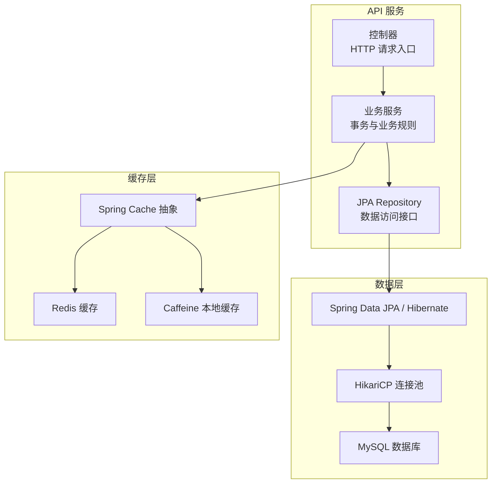
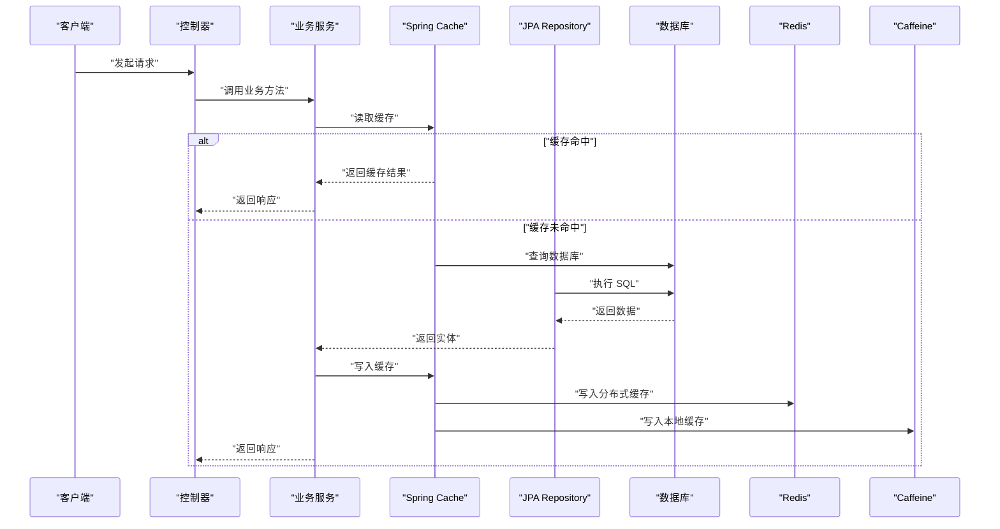
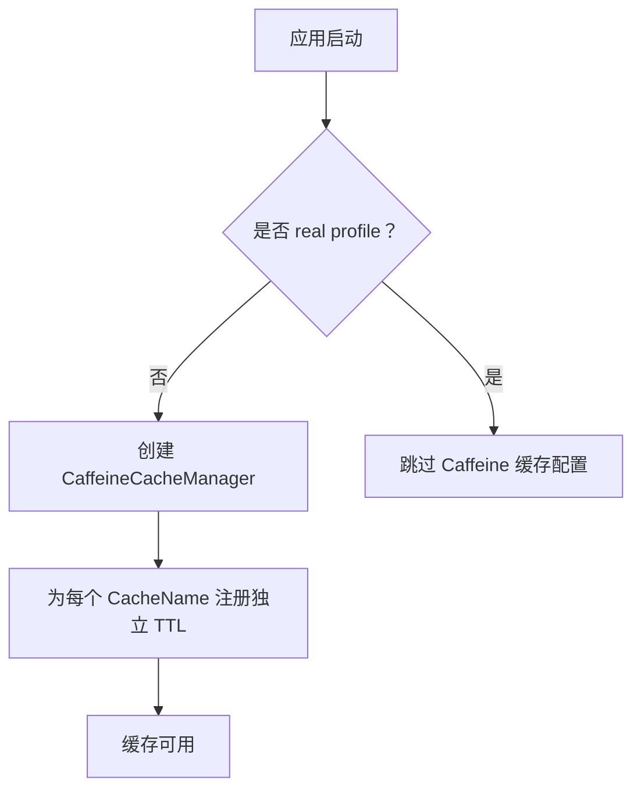
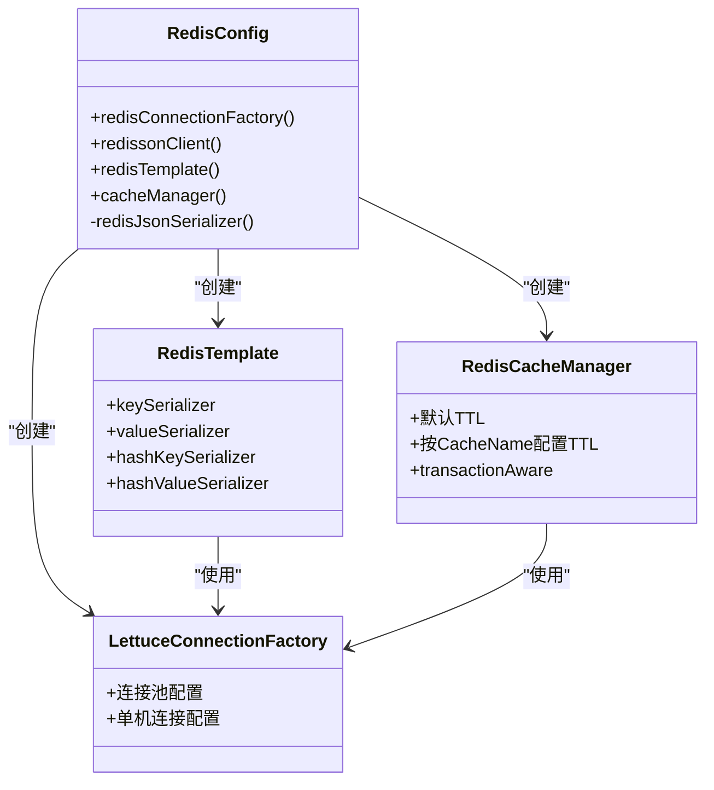
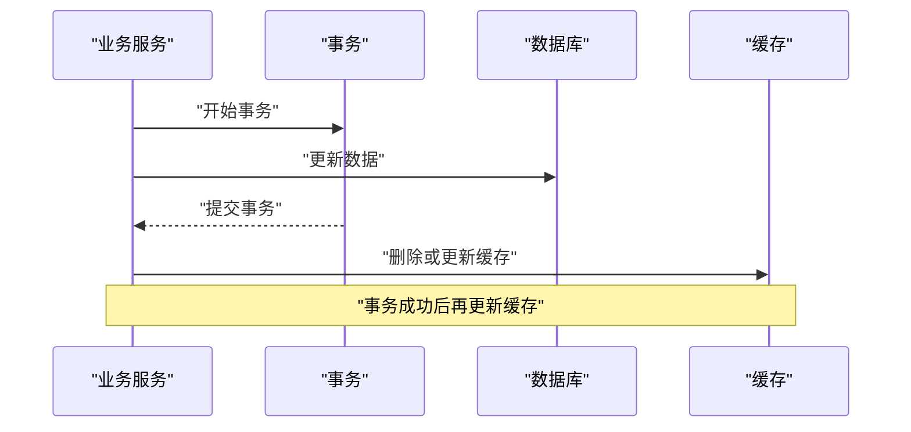
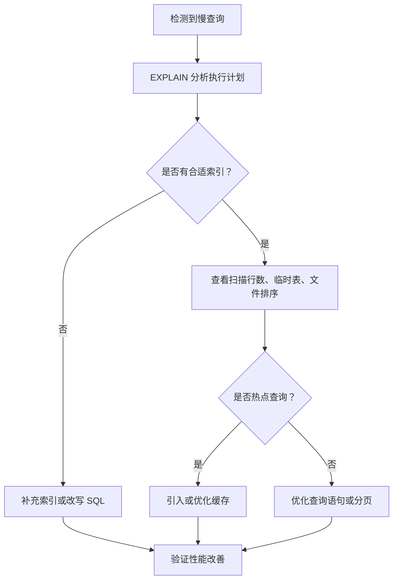
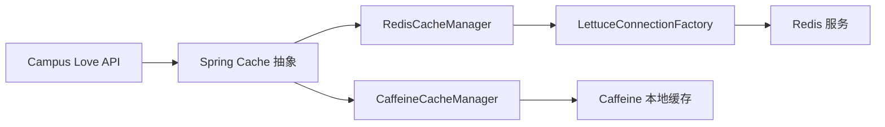
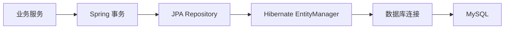

# 事务与缓存管理

<cite>
**本文引用的文件**   
- [RedisConfig.java](file://apps/api/src/main/java/com/campuslove/api/config/RedisConfig.java)
- [CaffeineCacheConfig.java](file://apps/api/src/main/java/com/campuslove/api/config/CaffeineCacheConfig.java)
- [CacheNames.java](file://apps/api/src/main/java/com/campuslove/api/config/CacheNames.java)
- [DatabaseConfigValidator.java](file://apps/api/src/main/java/com/campuslove/api/config/DatabaseConfigValidator.java)
- [Resilience4jConfig.java](file://apps/api/src/main/java/com/campuslove/api/config/Resilience4jConfig.java)
- [AsyncConfig.java](file://apps/api/src/main/java/com/campuslove/api/config/AsyncConfig.java)
- [WebConfig.java](file://apps/api/src/main/java/com/campuslove/api/config/WebConfig.java)
- [GlobalExceptionHandler.java](file://apps/api/src/main/java/com/campuslove/api/config/GlobalExceptionHandler.java)
- [CacheErrorHandlerConfig.java](file://apps/api/src/main/java/com/campuslove/api/config/CacheErrorHandlerConfig.java)
- [UserBasicProfileRepository.java](file://apps/api/src/main/java/com/campuslove/api/repository/UserBasicProfileRepository.java)
- [RecommendationPreferenceRepository.java](file://apps/api/src/main/java/com/campuslove/api/repository/RecommendationPreferenceRepository.java)
- [MatchConfigEntityRepository.java](file://apps/api/src/main/java/com/campuslove/api/repository/MatchConfigEntityRepository.java)
- [AdminAppConfigRepository.java](file://apps/api/src/main/java/com/campuslove/api/repository/AdminAppConfigRepository.java)
- [TokenBlacklistService.java](file://apps/api/src/main/java/com/campuslove/api/auth/TokenBlacklistService.java)
- [CheckInService.java](file://apps/api/src/main/java/com/campuslove/api/growth/CheckInService.java)
- [DoNotDisturbService.java](file://apps/api/src/main/java/com/campuslove/api/growth/DoNotDisturbService.java)
- [SocialProgressService.java](file://apps/api/src/main/java/com/campuslove/api/growth/SocialProgressService.java)
- [IcebreakerService.java](file://apps/api/src/main/java/com/campuslove/api/match/IcebreakerService.java)
- [InteractionEventService.java](file://apps/api/src/main/java/com/campuslove/api/chat/InteractionEventService.java)
</cite>

## 目录

1. [引言](#引言)
2. [项目结构定位](#项目结构定位)
3. [核心组件总览](#核心组件总览)
4. [架构总览](#架构总览)
5. [声明式事务管理机制](#声明式事务管理机制)
6. [事务边界划分原则](#事务边界划分原则)
7. [数据库连接池与连接安全](#数据库连接池与连接安全)
8. [本地缓存：Caffeine](#本地缓存caffeine)
9. [分布式缓存：Redis](#分布式缓存redis)
10. [缓存一致性设计](#缓存一致性设计)
11. [缓存失效、穿透防护与热点数据](#缓存失效穿透防护与热点数据)
12. [回滚场景、死锁预防与并发控制](#回滚场景死锁预防与并发控制)
13. [性能监控与慢查询分析](#性能监控与慢查询分析)
14. [依赖关系分析](#依赖关系分析)
15. [故障排查指南](#故障排查指南)
16. [结论与优化建议](#结论与优化建议)

## 引言

本文面向 Campus Love 后端数据访问层，聚焦事务管理与缓存管理两个关键横切面。目标包括：

- 解释 Spring 声明式事务在本项目中的使用方式、传播行为与隔离级别策略；
- 明确事务边界划分原则，覆盖读写分离、长事务优化和嵌套事务处理；
- 梳理数据库连接池配置、连接监控与连接泄漏检测思路；
- 阐述 Caffeine 本地缓存与 Redis 分布式缓存的分工、TTL 策略和一致性方案；
- 提供缓存失效、缓存穿透防护、热点数据处理、回滚与死锁预防、并发控制的最佳实践；
- 给出性能监控指标、慢查询分析与优化建议。

本项目后端 API 服务位于 `apps/api`，事务相关逻辑主要通过 Spring Data JPA Repository 与业务 Service 暴露；缓存则通过 Spring Cache 抽象统一接入 Redis 或 Caffeine。

## 项目结构定位

从仓库结构看，与事务和缓存直接相关的代码主要集中在：

| 类别 | 主要路径 | 职责 |
|---|---|---|
| 缓存配置 | `apps/api/src/main/java/com/campuslove/api/config/RedisConfig.java` | Redis 连接工厂、RedisTemplate、Spring Cache 管理器、序列化、TTL |
| 本地缓存配置 | `apps/api/src/main/java/com/campuslove/api/config/CaffeineCacheConfig.java` | 非 real profile 下的 Caffeine 缓存降级实现 |
| 缓存名称常量 | `apps/api/src/main/java/com/campuslove/api/config/CacheNames.java` | 各业务缓存命名空间 |
| 数据库校验 | `apps/api/src/main/java/com/campuslove/api/config/DatabaseConfigValidator.java` | 数据库连接与配置校验 |
| 缓存错误处理 | `apps/api/src/main/java/com/campuslove/api/config/CacheErrorHandlerConfig.java` | 缓存异常处理策略 |
| 异步与限流熔断 | `apps/api/src/main/java/com/campuslove/api/config/AsyncConfig.java`、`Resilience4jConfig.java` | 异步线程池、容错与重试 |
| 业务仓储 | `apps/api/src/main/java/com/campuslove/api/repository/*` | Spring Data JPA 数据访问接口 |
| 业务服务 | `apps/api/src/main/java/com/campuslove/api/growth/*`、`match/*`、`chat/*` 等 | 业务事务入口点 |

**图表来源**
- [RedisConfig.java:1-362](file://apps/api/src/main/java/com/campuslove/api/config/RedisConfig.java#L1-L362)
- [CaffeineCacheConfig.java:1-115](file://apps/api/src/main/java/com/campuslove/api/config/CaffeineCacheConfig.java#L1-L115)

**章节来源**
- [RedisConfig.java:1-362](file://apps/api/src/main/java/com/campuslove/api/config/RedisConfig.java#L1-L362)
- [CaffeineCacheConfig.java:1-115](file://apps/api/src/main/java/com/campuslove/api/config/CaffeineCacheConfig.java#L1-L115)

## 核心组件总览

### 缓存配置组件

| 组件 | 文件 | 作用 |
|---|---|---|
| Redis 配置类 | `RedisConfig.java` | 构建 Redis 连接工厂、RedisTemplate、CacheManager、序列化器、Redisson 客户端 |
| Caffeine 配置类 | `CaffeineCacheConfig.java` | 非 real profile 下提供本地缓存实现，与 Redis 的 CacheName 和 TTL 保持一致 |
| 缓存名称常量 | `CacheNames.java` | 定义用户资料、推荐列表、热门帖子、系统配置等缓存命名空间 |
| 缓存错误处理 | `CacheErrorHandlerConfig.java` | 对缓存异常进行统一处理，避免缓存失败直接破坏主流程 |

### 事务相关组件

| 组件 | 文件 | 作用 |
|---|---|---|
| 数据库配置校验 | `DatabaseConfigValidator.java` | 启动阶段校验数据库连接与必要配置 |
| 业务仓储 | 多个 `*Repository.java` | 封装 CRUD 与复杂查询，是事务的实际执行点 |
| 业务服务 | `CheckInService.java`、`DoNotDisturbService.java`、`SocialProgressService.java`、`IcebreakerService.java`、`InteractionEventService.java` | 聚合多步写操作，构成事务边界 |
| Token 黑名单服务 | `TokenBlacklistService.java` | 典型写操作入口，可结合缓存失效与事务语义分析 |

**章节来源**
- [RedisConfig.java:1-362](file://apps/api/src/main/java/com/campuslove/api/config/RedisConfig.java#L1-L362)
- [CaffeineCacheConfig.java:1-115](file://apps/api/src/main/java/com/campuslove/api/config/CaffeineCacheConfig.java#L1-L115)
- [DatabaseConfigValidator.java](file://apps/api/src/main/java/com/campuslove/api/config/DatabaseConfigValidator.java)
- [CheckInService.java](file://apps/api/src/main/java/com/campuslove/api/growth/CheckInService.java)
- [DoNotDisturbService.java](file://apps/api/src/main/java/com/campuslove/api/growth/DoNotDisturbService.java)
- [SocialProgressService.java](file://apps/api/src/main/java/com/campuslove/api/growth/SocialProgressService.java)
- [IcebreakerService.java](file://apps/api/src/main/java/com/campuslove/api/match/IcebreakerService.java)
- [InteractionEventService.java](file://apps/api/src/main/java/com/campuslove/api/chat/InteractionEventService.java)

## 架构总览

下图展示一次典型读多写少接口的数据访问与缓存协作流程：

**图表来源**
- [RedisConfig.java:120-362](file://apps/api/src/main/java/com/campuslove/api/config/RedisConfig.java#L120-L362)
- [CaffeineCacheConfig.java:40-115](file://apps/api/src/main/java/com/campuslove/api/config/CaffeineCacheConfig.java#L40-L115)

该流程体现以下设计：

- 读路径优先走缓存；
- 未命中时回源数据库；
- 写路径需要同时考虑数据库事务与缓存一致性；
- 生产环境默认启用 Redis，非生产环境使用 Caffeine 作为等价替代。

## 声明式事务管理机制

### Spring 事务注解使用位置

在当前代码中，事务通常由 Spring Data JPA 在 Repository 方法上隐式参与，或由业务 Service 方法显式标注。常见模式包括：

- **Repository 方法**：Spring Data JPA 为持久化方法自动创建事务，例如 `save`、`deleteById`、自定义 JPQL 查询方法；
- **Service 方法**：当单个方法内包含多个 Repository 调用、跨仓储更新、或需要与外部缓存/消息协同时，应显式标注事务边界；
- **组合写操作**：如签到、用户标签更新、匹配配置调整、互动事件记录等，适合放在 Service 层统一事务中。

### 传播行为配置

项目中没有看到大规模自定义传播行为配置，因此事务传播以 Spring 默认值为主：

| 传播行为 | 含义 | 适用场景 |
|---|---|---|
| `REQUIRED` | 如果当前存在事务则加入，否则新建事务 | 大多数业务方法默认选择 |
| `REQUIRES_NEW` | 总是新建独立事务 | 审计日志、统计计数、异步补偿任务等需要独立提交或回滚的场景 |
| `NESTED` | 在现有事务中创建嵌套事务 | 部分子步骤可单独回滚但不影响外层事务的场景 |
| `SUPPORTS` | 有事务则参与，无事务则以非事务方式运行 | 只读查询辅助方法 |

推荐原则：

- 默认使用 `REQUIRED`；
- 将必须独立提交的操作（如审计、埋点、统计）改为 `REQUIRES_NEW`；
- 谨慎使用 `NESTED`，因为嵌套事务依赖 JDBC Savepoint，不是所有数据库都支持；
- 纯查询方法可使用 `SUPPORTS` 或 `@Transactional(readOnly = true)` 提升性能。

### 隔离级别设置

项目未出现大量自定义隔离级别配置，因此默认使用数据库或框架默认隔离级别。对于高并发写表，建议按如下方式选择：

| 隔离级别 | 特点 | 建议 |
|---|---|---|
| `READ_COMMITTED` | 防止脏读，允许不可重复读 | 大多数 OLTP 场景默认选择 |
| `REPEATABLE_READ` | 防止脏读与不可重复读，可能出现幻读 | MySQL InnoDB 默认级别，适合强一致读场景 |
| `SERIALIZABLE` | 最高一致性，但并发最低 | 仅用于关键财务或配额场景 |

### 只读事务优化

对于纯查询 Service 方法，建议添加 `readOnly = true`，这样可以让底层连接池和数据库驱动知道该方法不会修改数据，从而获得更好性能。

**章节来源**
- [CheckInService.java](file://apps/api/src/main/java/com/campuslove/api/growth/CheckInService.java)
- [DoNotDisturbService.java](file://apps/api/src/main/java/com/campuslove/api/growth/DoNotDisturbService.java)
- [SocialProgressService.java](file://apps/api/src/main/java/com/campuslove/api/growth/SocialProgressService.java)
- [IcebreakerService.java](file://apps/api/src/main/java/com/campuslove/api/match/IcebreakerService.java)
- [InteractionEventService.java](file://apps/api/src/main/java/com/campuslove/api/chat/InteractionEventService.java)

## 事务边界划分原则

### 读写分离

本项目中：

- 读路径优先走缓存；
- 未命中缓存时再查数据库；
- 写路径先写数据库，再根据一致性策略更新或删除缓存。

建议的事务边界划分：

| 场景 | 事务范围 | 说明 |
|---|---|---|
| 单条用户信息更新 | Service 方法包裹单个 Repository 更新 | 事务短小，减少锁持有时间 |
| 签到 + 进度更新 | Service 方法包裹多个 Repository 写操作 | 保证原子性 |
| 推荐配置更新 | Service 方法包裹配置写 + 缓存失效 | 避免旧缓存被读到 |
| 评论、点赞、收藏 | 每个动作一个短事务 | 避免大事务导致锁竞争 |
| 批量导入或初始化脚本 | 专用批处理方法，必要时拆分为分片事务 | 防止长事务阻塞连接池 |

### 长事务优化

长事务会放大锁竞争、连接占用和死锁风险。优化策略包括：

- 将大事务拆分为多个小事务；
- 将非核心写操作移出事务，例如发送通知、记录日志、异步统计；
- 对批量操作采用分页处理；
- 避免在事务中调用远程 RPC、消息队列、第三方 HTTP 接口；
- 对耗时计算放到事务外完成。

### 嵌套事务处理

嵌套事务并非 Java 对象嵌套调用，而是 Spring AOP 代理层面对事务边界的控制。常见误区：

- 同一类内部方法互相调用不会触发事务增强；
- 子类重写父类事务方法时，AOP 代理行为可能不同；
- 捕获异常后不重新抛出，可能导致事务不回滚。

建议：

- 需要嵌套语义时，显式注入自身 Bean 调用；
- 对需要独立提交的操作使用 `REQUIRES_NEW`；
- 对不需要共享状态的操作拆分到独立 Service。

## 数据库连接池与连接安全

### 连接池总体思路

虽然当前仓库中没有直接暴露 HikariCP 的完整配置文件，但 Spring Boot JPA 默认使用 HikariCP。项目通过以下方式保障连接池安全：

- 使用 `DatabaseConfigValidator` 在启动阶段校验数据库连接；
- 通过 Redis 配置类可见项目对连接参数外部化的重视，数据库连接参数也应按同样方式通过环境变量或配置中心管理；
- 业务侧应避免长事务和连接泄漏。

### HikariCP 参数调优建议

| 参数 | 建议 | 说明 |
|---|---|---|
| `maximumPoolSize` | 根据 CPU 核数和数据库连接上限设置 | 一般设置为 `CPU 核数 × 2 + 磁盘设备数`，不宜过大 |
| `minimumIdle` | 可设为 `maximumPoolSize` 的一半 | 降低冷启动连接创建开销 |
| `connectionTimeout` | 2~5 秒 | 避免无限等待导致线程堆积 |
| `idleTimeout` | 比 `maxLifetime` 小 | 及时回收空闲连接 |
| `maxLifetime` | 小于数据库服务器连接超时 | 防止数据库主动断开后连接仍被使用 |
| `leakDetectionThreshold` | 测试环境开启，生产环境谨慎开启 | 用于发现连接泄漏 |

### 连接监控与泄漏检测

建议开启以下监控：

- Actuator 暴露 HikariCP 指标；
- Prometheus + Grafana 监控连接池活跃连接、等待连接、连接创建速率；
- 开启连接泄漏检测，定位长时间持有连接的方法栈；
- 监控慢查询日志，识别导致连接长时间占用的 SQL。

**章节来源**
- [DatabaseConfigValidator.java](file://apps/api/src/main/java/com/campuslove/api/config/DatabaseConfigValidator.java)

## 本地缓存：Caffeine

### 激活条件

Caffeine 缓存配置类在非 `real` profile 下生效，例如 `test`、`dev`、`mock`。其目的是：

- 让单元测试和开发环境无需 Redis 也能运行；
- 与 Redis 配置保持相同 CacheName 与 TTL 语义；
- 在生产环境中可通过 `spring.cache.type=caffeine` 强制降级。

### TTL 策略

Caffeine 中定义的缓存 TTL 与 Redis 基本一致：

| 缓存名称 | TTL | 说明 |
|---|---|---|
| 用户资料 | 10 分钟 | 用户信息变更频率较低 |
| 推荐人物列表 | 5 分钟 | 实时性要求较高 |
| 游客推荐列表 | 60 秒 | 新用户可见窗口较短 |
| 村口热门帖子 | 15 分钟 | 热点内容适度缓存 |
| 校园学校列表 | 1 小时 | 静态或低频变更 |
| 每日一问 | 1 小时 | 每日更新一次 |
| 敏感词列表 | 1 小时 | 管理员增删时主动失效 |
| 系统配置 | 30 分钟 | 后台更新后失效 |
| 用户标签 | 10 分钟 | 预置静态列表 |
| 客户端动态配置 | 5 分钟 | 登录用户共享，强调及时性 |
| 管理后台统计 | 5 分钟 | 避免频繁 COUNT 全表 |

### 缓存管理器实现

Caffeine 通过 `CaffeineCacheManager` 为每个 CacheName 注册独立 spec，从而支持不同 TTL。未注册的 CacheName 使用默认 TTL。

**图表来源**
- [CaffeineCacheConfig.java:1-115](file://apps/api/src/main/java/com/campuslove/api/config/CaffeineCacheConfig.java#L1-L115)

**章节来源**
- [CaffeineCacheConfig.java:1-115](file://apps/api/src/main/java/com/campuslove/api/config/CaffeineCacheConfig.java#L1-L115)
- [CacheNames.java](file://apps/api/src/main/java/com/campuslove/api/config/CacheNames.java)

## 分布式缓存：Redis

### 连接工厂与连接池

Redis 配置类基于 Lettuce 构建连接工厂，并启用 commons-pool2 连接池。关键特性包括：

- 支持主机、端口、密码、数据库索引的外部化配置；
- 连接池最大活跃连接、最大空闲连接、最小空闲连接、最大等待时间均可通过环境变量覆盖；
- 生产环境默认使用真实 Redis，本地开发可通过手动配置开关兼容旧版 Redis。

### RedisTemplate 序列化

RedisTemplate 使用：

- key：字符串序列化器，便于 CLI 可读；
- value：Jackson JSON 序列化器，支持 JSR310 时间类型和多态类型还原；
- hashKey/hashValue：同 value 序列化策略；
- 统一序列化器实例，确保 RedisTemplate 与 CacheManager 读写两侧 Jackson 配置一致。

### 缓存管理器与 TTL

RedisCacheManager 为每个 CacheName 配置独立 TTL，并启用 `transactionAware()`，以便与 Spring 事务感知集成。默认 TTL 为 30 分钟，禁用 null 值缓存。

### Redisson 客户端

Redisson 客户端仅在本地开发且手动配置开关开启时使用，主要解决：

- Spring Boot 3 与 Redisson 自动配置差异；
- 无密码本地 Redis 的 AUTH 问题；
- Windows 旧版 Redis 不支持 RESP3 的问题。

**图表来源**
- [RedisConfig.java:60-362](file://apps/api/src/main/java/com/campuslove/api/config/RedisConfig.java#L60-L362)

**章节来源**
- [RedisConfig.java:1-362](file://apps/api/src/main/java/com/campuslove/api/config/RedisConfig.java#L1-L362)

## 缓存一致性设计

### 一致性模型

项目采用“缓存旁路”模式：

- 读：先查缓存，未命中再查数据库，并将结果写入缓存；
- 写：先写数据库，再删除或更新缓存；
- 多节点共享：通过 Redis 实现跨进程一致性；
- 单进程加速：通过 Caffeine 实现本地缓存加速。

### 双写顺序

推荐写路径顺序：

1. 开始事务；
2. 更新数据库；
3. 提交事务；
4. 删除或更新缓存。

不建议：

- 先删缓存再写数据库；
- 先写缓存再写数据库；
- 在事务内执行远程缓存操作，除非已确认延迟容忍。

### 缓存与事务感知

RedisCacheManager 启用了 `transactionAware()`，这意味着 Spring 事务可以感知缓存操作，并在事务提交后再执行缓存写入或失效，减少事务回滚导致的缓存不一致。

**图表来源**
- [RedisConfig.java:240-362](file://apps/api/src/main/java/com/campuslove/api/config/RedisConfig.java#L240-L362)

**章节来源**
- [RedisConfig.java:200-362](file://apps/api/src/main/java/com/campuslove/api/config/RedisConfig.java#L200-L362)

## 缓存失效、穿透防护与热点数据

### 缓存失效策略

项目通过多种机制控制缓存失效：

- TTL 过期：所有缓存均有明确 TTL；
- 主动失效：管理员更新敏感词、系统配置后主动清除对应缓存；
- 多 CacheName 隔离：不同业务域使用不同缓存命名空间；
- 低延迟配置：客户端动态配置、管理后台统计等使用较短 TTL，提高时效性。

### 缓存穿透防护

缓存穿透指查询不存在的数据，导致每次请求都打到数据库。防护建议：

- 对空结果设置短 TTL；
- 使用布隆过滤器拦截明显不存在的 ID；
- 对高频非法参数做限流；
- 对接口输入参数做严格校验。

### 缓存击穿防护

缓存击穿指某个热点 key 过期瞬间大量请求同时到达数据库。防护建议：

- 使用互斥锁保护重建缓存的逻辑；
- 对热点 key 设置较长 TTL；
- 对热点接口做限流；
- 使用本地缓存与分布式缓存双层保护。

### 热点数据处理

热点数据应采用：

- 多级缓存：本地 Caffeine + 分布式 Redis；
- 合理 TTL：热点数据可适当延长 TTL；
- 预热机制：启动或运营活动前预热常用热点数据；
- 限流降级：超出阈值时返回兜底数据或提示。

**章节来源**
- [RedisConfig.java:80-362](file://apps/api/src/main/java/com/campuslove/api/config/RedisConfig.java#L80-L362)
- [CaffeineCacheConfig.java:20-115](file://apps/api/src/main/java/com/campuslove/api/config/CaffeineCacheConfig.java#L20-L115)

## 回滚场景、死锁预防与并发控制

### 常见回滚场景

| 场景 | 回滚原因 | 建议 |
|---|---|---|
| 唯一键冲突 | 插入重复数据 | 前置检查或使用幂等键 |
| 外键约束违反 | 关联数据不存在 | 先查关联数据，再写主数据 |
| 字段长度超限 | 输入数据过长 | 前端与后端双重校验 |
| 业务校验失败 | 状态不允许操作 | 抛出业务异常并回滚 |
| 缓存写入失败 | 网络或序列化异常 | 不影响主流程，记录日志 |
| 分布式事务补偿失败 | 异步消息或出队失败 | 使用 Outbox 或重试队列 |

### 死锁预防

死锁通常由以下原因引起：

- 多事务以不同顺序访问相同行；
- 长事务持有锁过久；
- 批量更新未按索引顺序排序；
- 热行频繁并发更新。

预防建议：

- 固定更新顺序，例如始终先更新小 ID 再更新大 ID；
- 缩短事务时间；
- 避免在事务中执行远程调用；
- 对热点行使用乐观锁；
- 对批量更新按主键排序；
- 监控数据库死锁日志。

### 并发控制最佳实践

| 技术 | 适用场景 | 注意事项 |
|---|---|---|
| 乐观锁 | 冲突概率低、读多写少 | 需要版本字段或时间戳 |
| 悲观锁 | 冲突概率高、强一致要求 | 注意锁粒度与超时 |
| Redis 分布式锁 | 跨进程互斥 | 需要看门狗和释放逻辑 |
| 幂等键 | 重复请求、重试场景 | 唯一键或去重表 |
| 分段更新 | 热点计数器 | 避免单行热点 |

**章节来源**
- [GlobalExceptionHandler.java](file://apps/api/src/main/java/com/campuslove/api/config/GlobalExceptionHandler.java)
- [CacheErrorHandlerConfig.java](file://apps/api/src/main/java/com/campuslove/api/config/CacheErrorHandlerConfig.java)

## 性能监控与慢查询分析

### 监控指标

建议监控以下指标：

| 指标 | 来源 | 意义 |
|---|---|---|
| 数据库连接池活跃连接数 | HikariCP | 判断连接是否耗尽 |
| 数据库连接池等待连接数 | HikariCP | 判断是否存在瓶颈 |
| 慢查询数量 | MySQL slow log | 定位低效 SQL |
| Redis 命中率 | Redis 监控 | 判断缓存有效性 |
| Redis 连接池大小 | Lettuce 连接池 | 判断连接是否不足 |
| 接口 P95/P99 耗时 | 应用指标 | 判断性能退化 |
| 事务平均时长 | APM 或数据库监控 | 判断事务是否过长 |
| 缓存异常率 | 应用日志 | 判断缓存稳定性 |

### 慢查询分析流程

### 优化建议

- 为高频查询字段建立复合索引；
- 避免 `SELECT *`；
- 对大表查询使用分页或游标；
- 对热点读数据使用多级缓存；
- 对热点写数据使用分片或异步落盘；
- 对批量操作使用分批提交；
- 对统计查询使用物化视图或离线计算。

**章节来源**
- [Resilience4jConfig.java](file://apps/api/src/main/java/com/campuslove/api/config/Resilience4jConfig.java)
- [AsyncConfig.java](file://apps/api/src/main/java/com/campuslove/api/config/AsyncConfig.java)

## 依赖关系分析

### 缓存依赖图

**图表来源**
- [RedisConfig.java:120-362](file://apps/api/src/main/java/com/campuslove/api/config/RedisConfig.java#L120-L362)
- [CaffeineCacheConfig.java:40-115](file://apps/api/src/main/java/com/campuslove/api/config/CaffeineCacheConfig.java#L40-L115)

### 事务依赖图

**图表来源**
- [CheckInService.java](file://apps/api/src/main/java/com/campuslove/api/growth/CheckInService.java)
- [UserBasicProfileRepository.java](file://apps/api/src/main/java/com/campuslove/api/repository/UserBasicProfileRepository.java)

**章节来源**
- [RedisConfig.java:120-362](file://apps/api/src/main/java/com/campuslove/api/config/RedisConfig.java#L120-L362)
- [CaffeineCacheConfig.java:40-115](file://apps/api/src/main/java/com/campuslove/api/config/CaffeineCacheConfig.java#L40-L115)

## 故障排查指南

### Redis 连接失败

现象：

- 缓存无法写入或读取；
- 启动时报连接超时；
- 本地开发报 AUTH 错误。

排查步骤：

1. 检查 Redis host、port、password、database 配置；
2. 检查 Redis 服务是否可达；
3. 检查是否误发 AUTH 命令；
4. 检查连接池是否耗尽；
5. 查看 Redis 日志和连接池监控。

### 缓存序列化异常

现象：

- 缓存命中后反序列化失败；
- 接口返回 500；
- LocalDateTime 类型序列化报错。

排查步骤：

1. 确认 RedisTemplate 与 CacheManager 使用同一 Jackson 序列化器；
2. 确认已注册 JSR310 模块；
3. 确认启用 default typing 且白名单允许 DTO 类型；
4. 清理 Redis 中旧格式缓存。

### 事务不回滚

现象：

- 业务异常后数据库仍有写入；
- 部分写成功、部分写失败。

排查步骤：

1. 确认异常未被捕获后吞掉；
2. 确认事务方法没有被同类内部调用绕过代理；
3. 确认异常类型属于运行时异常或显式配置的回滚规则；
4. 检查是否有 `REQUIRES_NEW` 子事务独立提交。

### 缓存不一致

现象：

- 写库后读到旧缓存；
- 多节点缓存不一致；
- 热点 key 过期后瞬时压力突增。

排查步骤：

1. 检查写库与删缓存顺序；
2. 检查事务是否已提交；
3. 检查缓存 TTL 是否过短；
4. 检查是否有多写入口；
5. 对热点 key 增加本地缓存或锁保护。

**章节来源**
- [RedisConfig.java:60-362](file://apps/api/src/main/java/com/campuslove/api/config/RedisConfig.java#L60-L362)
- [CacheErrorHandlerConfig.java](file://apps/api/src/main/java/com/campuslove/api/config/CacheErrorHandlerConfig.java)
- [GlobalExceptionHandler.java](file://apps/api/src/main/java/com/campuslove/api/config/GlobalExceptionHandler.java)

## 结论与优化建议

### 总结

本项目在数据访问层采用了较清晰的分层：

- 业务服务承担事务边界和一致性责任；
- Repository 负责数据访问细节；
- Spring Cache 抽象统一缓存入口；
- Redis 作为分布式缓存，Caffeine 作为本地缓存降级；
- 通过 TTL、CacheName 隔离和事务感知降低缓存不一致风险。

### 改进建议

1. **显式事务文档化**：为关键 Service 方法补充事务传播、隔离级别和只读标记说明；
2. **统一连接池监控**：将 HikariCP、Redis 连接池、慢查询纳入统一监控面板；
3. **缓存一致性增强**：对关键写路径增加缓存失效重试或补偿任务；
4. **热点数据治理**：对高频接口增加本地缓存、限流和降级；
5. **SQL 规范**：建立慢查询定期巡检机制，持续优化索引与查询；
6. **可观测性**：为事务、缓存、数据库、Redis 增加结构化日志和业务追踪 ID。