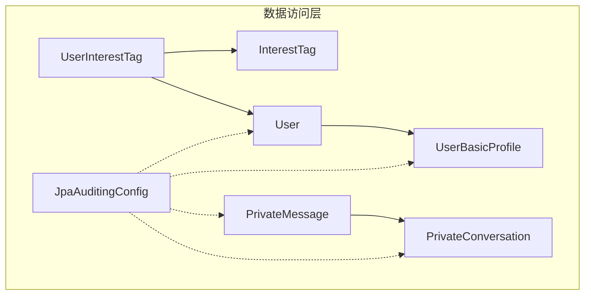
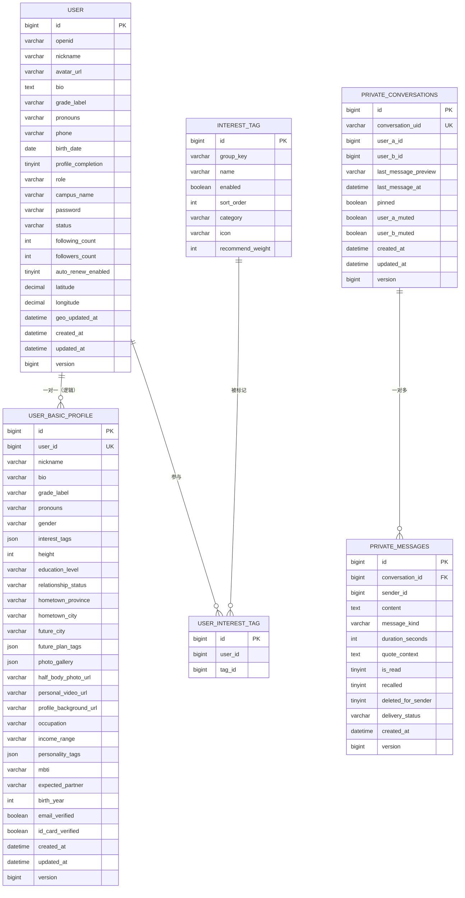
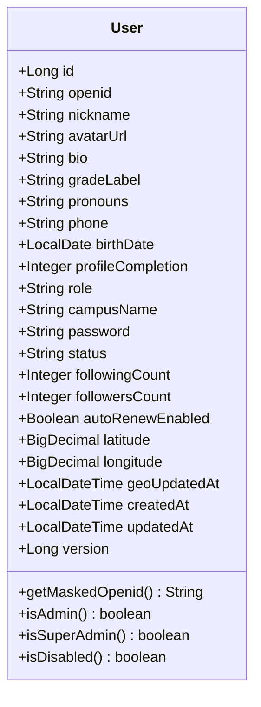
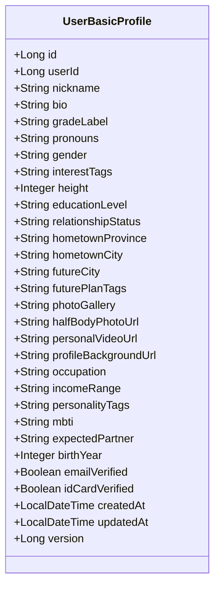
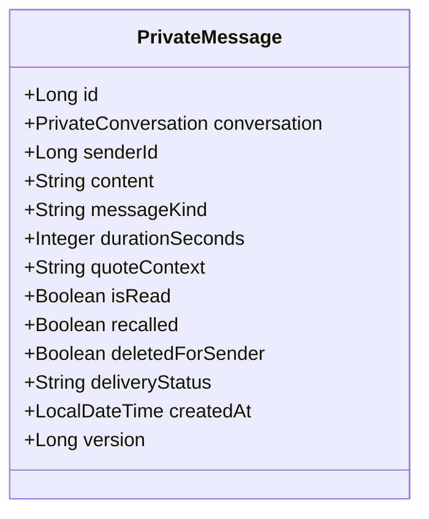
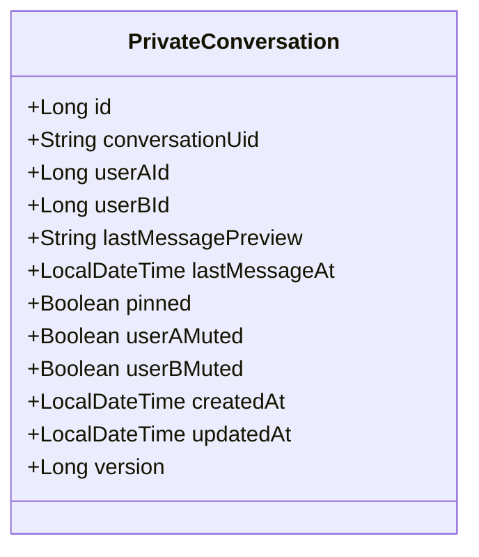
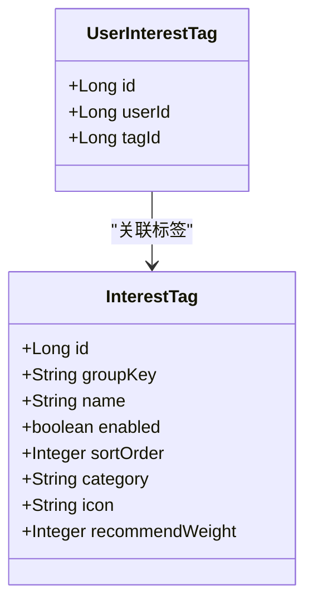
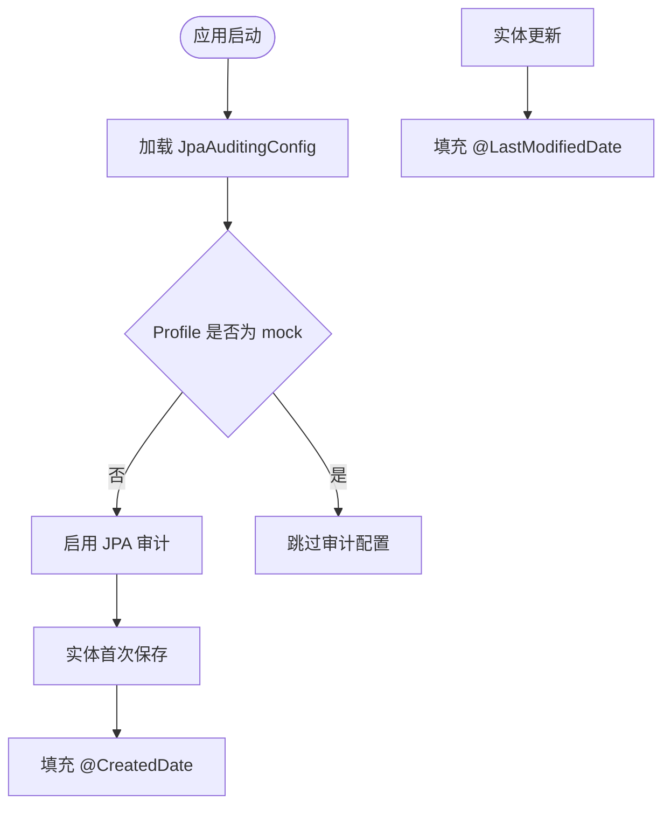
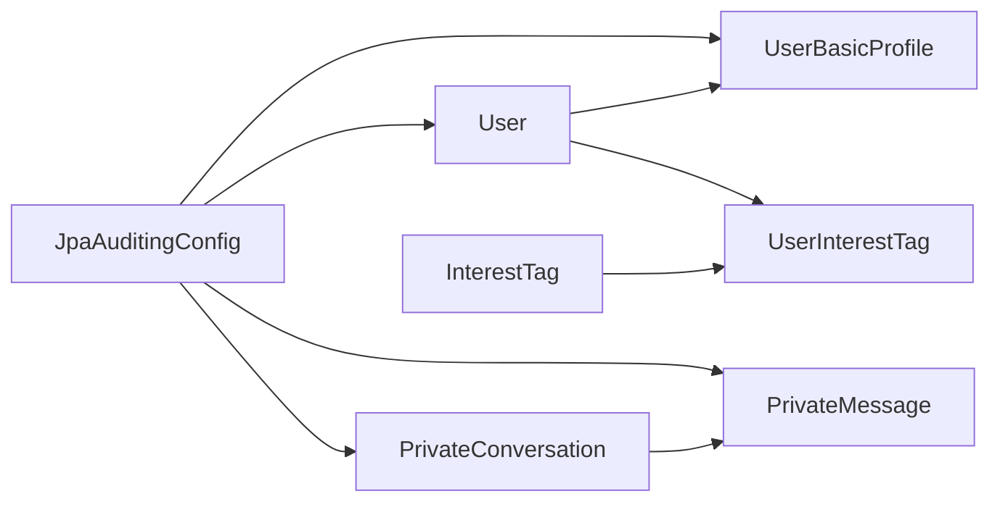

# 实体模型设计

<cite>
**本文引用的文件**   
- [User.java](file://apps/api/src/main/java/com/campuslove/api/entity/User.java)
- [UserBasicProfile.java](file://apps/api/src/main/java/com/campuslove/api/entity/UserBasicProfile.java)
- [PrivateMessage.java](file://apps/api/src/main/java/com/campuslove/api/entity/PrivateMessage.java)
- [PrivateConversation.java](file://apps/api/src/main/java/com/campuslove/api/entity/PrivateConversation.java)
- [InterestTag.java](file://apps/api/src/main/java/com/campuslove/api/entity/InterestTag.java)
- [UserInterestTag.java](file://apps/api/src/main/java/com/campuslove/api/entity/UserInterestTag.java)
- [JpaAuditingConfig.java](file://apps/api/src/main/java/com/campuslove/api/config/JpaAuditingConfig.java)
</cite>

## 目录
1. [引言](#引言)
2. [项目结构定位](#项目结构定位)
3. [核心实体总览](#核心实体总览)
4. [架构与关系总图](#架构与关系总图)
5. [基础注解与字段映射规范](#基础注解与字段映射规范)
6. [核心实体详细分析](#核心实体详细分析)
7. [实体关系映射设计](#实体关系映射设计)
8. [审计、乐观锁与数据完整性](#审计乐观锁与数据完整性)
9. [JSON 序列化与安全控制](#json-序列化与安全控制)
10. [依赖分析与耦合评估](#依赖分析与耦合评估)
11. [性能与索引设计](#性能与索引设计)
12. [常见陷阱与最佳实践](#常见陷阱与最佳实践)
13. [结论](#结论)

## 引言
本文聚焦 Campus Love 后端数据访问层中的用户域实体模型，系统说明 JPA 实体注解配置、实体关系映射、审计字段自动填充、乐观锁机制、枚举与 JSON 字段的存储策略，以及安全相关的 JSON 序列化控制。目标读者包括需要理解数据建模的开发者、测试工程师和后续维护者。

## 项目结构定位
Campus Love 的 Java 后端位于 `apps/api` 模块中，实体类集中在 `com.campuslove.api.entity` 包下，JPA 审计配置位于 `com.campuslove.api.config`。本次文档关注的核心实体包括：
- 用户主表：`User`
- 用户基础资料：`UserBasicProfile`
- 私信消息：`PrivateMessage`
- 私信会话：`PrivateConversation`
- 兴趣标签字典：`InterestTag`
- 用户兴趣关联：`UserInterestTag`
- JPA 审计配置：`JpaAuditingConfig`

**图示来源**
- [User.java:1-200](file://apps/api/src/main/java/com/campuslove/api/entity/User.java#L1-L200)
- [UserBasicProfile.java:1-200](file://apps/api/src/main/java/com/campuslove/api/entity/UserBasicProfile.java#L1-L200)
- [PrivateMessage.java:1-200](file://apps/api/src/main/java/com/campuslove/api/entity/PrivateMessage.java#L1-L200)
- [PrivateConversation.java:1-186](file://apps/api/src/main/java/com/campuslove/api/entity/PrivateConversation.java#L1-L186)
- [InterestTag.java:1-67](file://apps/api/src/main/java/com/campuslove/api/entity/InterestTag.java#L1-L67)
- [UserInterestTag.java:1-43](file://apps/api/src/main/java/com/campuslove/api/entity/UserInterestTag.java#L1-L43)
- [JpaAuditingConfig.java:1-32](file://apps/api/src/main/java/com/campuslove/api/config/JpaAuditingConfig.java#L1-L32)

**章节来源**
- [User.java:1-200](file://apps/api/src/main/java/com/campuslove/api/entity/User.java#L1-L200)
- [JpaAuditingConfig.java:1-32](file://apps/api/src/main/java/com/campuslove/api/config/JpaAuditingConfig.java#L1-L32)

## 核心实体总览
| 实体 | 数据库表 | 主要职责 | 关键注解特征 |
|---|---|---|---|
| `User` | `users` | 用户主表，包含微信登录标识、角色、状态、社交计数、坐标等 | `@Entity`、`@Table`、`@Id`、`@GeneratedValue`、`@Column`、`@Index`、`@UniqueConstraint`、`@Version`、`@CreatedDate`、`@LastModifiedDate`、`@JsonIgnore` |
| `UserBasicProfile` | `user_basic_profile` | 用户扩展基础资料，如昵称、简介、年级、代词、MBTI、认证标志等 | `@Entity`、`@Table`、`@Id`、`@Column`、`@Version`、`@CreatedDate`、`@LastModifiedDate` |
| `PrivateMessage` | `private_messages` | 私信消息，支持文本、图片、语音、引用等消息类型及投递状态 | `@Entity`、`@Table`、`@ManyToOne`、`@JoinColumn`、`@Index`、`@Version`、`@CreatedDate` |
| `PrivateConversation` | `private_conversations` | 两人之间的私信会话，记录预览、置顶、免打扰等会话级状态 | `@Entity`、`@Table`、`@Version`、`@CreatedDate`、`@LastModifiedDate` |
| `InterestTag` | `interest_tag` | 后台兴趣标签字典，用于运营配置 | `@Entity`、`@Table`、`@Id`、`@Column` |
| `UserInterestTag` | `user_interest_tag` | 用户与兴趣标签的多对多中间表 | `@Entity`、`@Table`、`@UniqueConstraint`、`@Id`、`@Column` |
| `JpaAuditingConfig` | 无 | 启用 Spring Data JPA 审计 | `@Configuration`、`@EnableJpaAuditing`、`@Profile("!mock")` |

**章节来源**
- [User.java:1-200](file://apps/api/src/main/java/com/campuslove/api/entity/User.java#L1-L200)
- [UserBasicProfile.java:1-200](file://apps/api/src/main/java/com/campuslove/api/entity/UserBasicProfile.java#L1-L200)
- [PrivateMessage.java:1-200](file://apps/api/src/main/java/com/campuslove/api/entity/PrivateMessage.java#L1-L200)
- [PrivateConversation.java:1-186](file://apps/api/src/main/java/com/campuslove/api/entity/PrivateConversation.java#L1-L186)
- [InterestTag.java:1-67](file://apps/api/src/main/java/com/campuslove/api/entity/InterestTag.java#L1-L67)
- [UserInterestTag.java:1-43](file://apps/api/src/main/java/com/campuslove/api/entity/UserInterestTag.java#L1-L43)
- [JpaAuditingConfig.java:1-32](file://apps/api/src/main/java/com/campuslove/api/config/JpaAuditingConfig.java#L1-L32)

## 架构与关系总图
从数据建模角度看，用户域由“用户主表 + 用户扩展资料 + 私信会话与消息 + 兴趣标签与用户兴趣关联”构成。其中：
- `User` 与 `UserBasicProfile` 是逻辑上的一对一关系；当前实现通过 `userId` 唯一列表达，而非 JPA `@OneToOne`。
- `PrivateMessage` 与 `PrivateConversation` 是一对多关系；一条会话对应多条消息。
- `User` 与 `InterestTag` 是多对多关系，通过 `UserInterestTag` 中间表实现。

**图示来源**
- [User.java:1-200](file://apps/api/src/main/java/com/campuslove/api/entity/User.java#L1-L200)
- [UserBasicProfile.java:1-200](file://apps/api/src/main/java/com/campuslove/api/entity/UserBasicProfile.java#L1-L200)
- [PrivateConversation.java:1-186](file://apps/api/src/main/java/com/campuslove/api/entity/PrivateConversation.java#L1-L186)
- [PrivateMessage.java:1-200](file://apps/api/src/main/java/com/campuslove/api/entity/PrivateMessage.java#L1-L200)
- [InterestTag.java:1-67](file://apps/api/src/main/java/com/campuslove/api/entity/InterestTag.java#L1-L67)
- [UserInterestTag.java:1-43](file://apps/api/src/main/java/com/campuslove/api/entity/UserInterestTag.java#L1-L43)

## 基础注解与字段映射规范
### `@Entity` 与 `@Table`
- 所有业务实体均使用 `@Entity` 声明为 JPA 实体。
- `@Table(name = "...")` 显式绑定数据库表名，避免依赖默认命名策略。
- `User` 在 `@Table` 中定义唯一约束和复合索引，例如 `openid` 唯一索引和 `phone`、`created_at` 查询索引。
- `PrivateMessage` 在 `@Table` 中集中定义多个复合索引，以支撑按发送者、会话、已读状态和时间分页查询。

### `@Id` 与 `@GeneratedValue`
- 所有实体统一使用自增主键策略 `GenerationType.IDENTITY`。
- 主键类型为 `Long`，便于后续分布式扩展时替换为雪花或分库分表方案。

### `@Column` 字段映射
- 短文本使用带长度限制的 `VARCHAR`，例如 `nickname`、`role`、`status`。
- 长文本使用 `TEXT`，例如 `bio`、`content`、`quote_context`。
- JSON 字段使用 `columnDefinition = "JSON DEFAULT '[]'"`，将数组型数据以 JSON 字符串持久化，例如 `interest_tags`、`future_plan_tags`、`photo_gallery`、`personality_tags`。
- 布尔位字段使用 `TINYINT(1)`，例如 `is_read`、`recalled`、`deleted_for_sender`、`auto_renew_enabled`。
- 时间字段使用 `LocalDateTime`，并配合 `@CreatedDate`、`@LastModifiedDate`。
- 经纬度使用 `BigDecimal`，精度 10 位、小数位 6 位，符合 LBS 坐标系精度需求。

**章节来源**
- [User.java:1-200](file://apps/api/src/main/java/com/campuslove/api/entity/User.java#L1-L200)
- [PrivateMessage.java:1-200](file://apps/api/src/main/java/com/campuslove/api/entity/PrivateMessage.java#L1-L200)
- [UserBasicProfile.java:1-200](file://apps/api/src/main/java/com/campuslove/api/entity/UserBasicProfile.java#L1-L200)

## 核心实体详细分析

### User 实体
`User` 是用户域的核心聚合根，承载身份、权限、状态、位置和历史时间戳。

- 主键：`id`，自增 `Long`。
- 登录标识：`openid`，长度 128，唯一约束，JSON 序列化忽略。
- 基础信息：`nickname`、`avatarUrl`、`bio`、`gradeLabel`、`pronouns`。
- 联系方式：`phone`，用于手机号登录与查询。
- 年龄保护：`birthDate`，注册阶段校验成年，存量允许空值。
- 资料完善度：`profileCompletion`，默认 0。
- 角色与校区：`role` 默认 `USER`，`campusName` 对齐管理端校区隔离语义。
- 密码哈希：`password`，BCrypt 哈希，JSON 序列化忽略。
- 账号状态：`status`，支持 `active`、`disabled`、`deactivated`。
- 社交计数：`followingCount`、`followersCount`。
- VIP 续费开关：`autoRenewEnabled`。
- 地理位置：`latitude`、`longitude`、`geoUpdatedAt`。
- 审计字段：`createdAt`、`updatedAt`。
- 并发控制：`version`，乐观锁。

**图示来源**
- [User.java:1-200](file://apps/api/src/main/java/com/campuslove/api/entity/User.java#L1-L200)
- [User.java:201-444](file://apps/api/src/main/java/com/campuslove/api/entity/User.java#L201-L444)

**章节来源**
- [User.java:1-200](file://apps/api/src/main/java/com/campuslove/api/entity/User.java#L1-L200)
- [User.java:201-444](file://apps/api/src/main/java/com/campuslove/api/entity/User.java#L201-L444)

### UserBasicProfile 实体
`UserBasicProfile` 是用户扩展资料表，承载展示面所需的基础资料与认证标志。

- 主键：`id`。
- 用户外键：`userId`，唯一且非空，表达一对一逻辑关系。
- 展示资料：`nickname`、`bio`、`gradeLabel`、`pronouns`、`gender`。
- 标签与画像：`interestTags`、`futurePlanTags`、`photoGallery`、`personalityTags`，均以 JSON 存储。
- 个人属性：`height`、`educationLevel`、`relationshipStatus`、`hometownProvince`、`hometownCity`、`futureCity`、`occupation`、`incomeRange`、`mbti`、`expectedPartner`、`birthYear`。
- 资源链接：`halfBodyPhotoUrl`、`personalVideoUrl`、`profileBackgroundUrl`。
- 认证标志：`emailVerified`、`idCardVerified`。
- 审计字段：`createdAt`、`updatedAt`。
- 并发控制：`version`。

**图示来源**
- [UserBasicProfile.java:1-200](file://apps/api/src/main/java/com/campuslove/api/entity/UserBasicProfile.java#L1-L200)

**章节来源**
- [UserBasicProfile.java:1-200](file://apps/api/src/main/java/com/campuslove/api/entity/UserBasicProfile.java#L1-L200)

### PrivateMessage 实体
`PrivateMessage` 表示私信消息，具备消息类型、语音时长、引用上下文、已读状态、撤回状态、发送者侧软删除、投递状态等完整聊天语义。

- 主键：`id`。
- 会话外键：`conversation_id`，通过 `@ManyToOne(fetch = FetchType.LAZY)` 关联 `PrivateConversation`。
- 发送者：`senderId`。
- 内容：`content`，`TEXT`。
- 消息类型：`messageKind`，默认 `text`。
- 语音时长：`durationSeconds`。
- 引用上下文：`quoteContext`，JSON 文本。
- 阅读与撤回：`isRead`、`recalled`。
- 发送者侧软删除：`deletedForSender`。
- 投递状态：`deliveryStatus`，默认 `sent`。
- 审计字段：`createdAt`。
- 并发控制：`version`。

**图示来源**
- [PrivateMessage.java:1-200](file://apps/api/src/main/java/com/campuslove/api/entity/PrivateMessage.java#L1-L200)

**章节来源**
- [PrivateMessage.java:1-200](file://apps/api/src/main/java/com/campuslove/api/entity/PrivateMessage.java#L1-L200)

### PrivateConversation 实体
`PrivateConversation` 表示两个用户之间的私信会话，保存会话预览、最后消息时间和会话级免打扰等元信息。

- 主键：`id`。
- 会话标识：`conversationUid`，唯一且非空。
- 用户标识：`userAId`、`userBId`。
- 预览字段：`lastMessagePreview`、`lastMessageAt`。
- 会话控制：`pinned`、`userAMuted`、`userBMuted`。
- 审计字段：`createdAt`、`updatedAt`。
- 并发控制：`version`。

**图示来源**
- [PrivateConversation.java:1-186](file://apps/api/src/main/java/com/campuslove/api/entity/PrivateConversation.java#L1-L186)

**章节来源**
- [PrivateConversation.java:1-186](file://apps/api/src/main/java/com/campuslove/api/entity/PrivateConversation.java#L1-L186)

### InterestTag 与 UserInterestTag
`InterestTag` 是兴趣标签字典，`UserInterestTag` 是用户与兴趣标签的多对多中间表。

- `InterestTag`：`id`、`groupKey`、`name`、`enabled`、`sortOrder`、`category`、`icon`、`recommendWeight`。
- `UserInterestTag`：`id`、`userId`、`tagId`，并通过 `uniqueConstraints` 保证 `(user_id, tag_id)` 唯一。

**图示来源**
- [InterestTag.java:1-67](file://apps/api/src/main/java/com/campuslove/api/entity/InterestTag.java#L1-L67)
- [UserInterestTag.java:1-43](file://apps/api/src/main/java/com/campuslove/api/entity/UserInterestTag.java#L1-L43)

**章节来源**
- [InterestTag.java:1-67](file://apps/api/src/main/java/com/campuslove/api/entity/InterestTag.java#L1-L67)
- [UserInterestTag.java:1-43](file://apps/api/src/main/java/com/campuslove/api/entity/UserInterestTag.java#L1-L43)

## 实体关系映射设计

### 一对一：User 与 UserBasicProfile
当前实现采用“逻辑一对一”而非 JPA `@OneToOne`：
- `UserBasicProfile.userId` 为非空且唯一，表达每个用户最多一个基础资料。
- 这种设计的优点是简单直接，适合早期迭代；缺点是缺少 JPA 级联、双向导航能力，需要通过 Repository 或 Service 层自行组装。

建议：
- 若未来需要强一致的双向导航，可在 `UserBasicProfile` 上增加 `@OneToOne(mappedBy = "...")` 并在 `User` 中增加对应字段，同时保持数据库唯一约束不变。
- 当前应保持 `userId` 的唯一性校验在服务层或数据库层双重保证。

**章节来源**
- [UserBasicProfile.java:1-200](file://apps/api/src/main/java/com/campuslove/api/entity/UserBasicProfile.java#L1-L200)

### 一对多：PrivateConversation 与 PrivateMessage
- `PrivateMessage.conversation` 使用 `@ManyToOne(fetch = FetchType.LAZY)`，延迟加载避免不必要的会话对象加载。
- `@JoinColumn` 指定外键列 `conversation_id`，并定义外键名称 `fk_private_messages_conversation`。
- 该设计符合“会话聚合多条消息”的领域语义。

需要注意：
- 由于未声明 `@OneToMany(mappedBy = "...")`，`PrivateConversation` 不会自动加载其消息列表，需在 Service 层根据 `conversationId` 查询。
- 若需级联删除会话及其消息，应明确在数据库层或通过事务控制实现，避免误删。

**章节来源**
- [PrivateMessage.java:1-200](file://apps/api/src/main/java/com/campuslove/api/entity/PrivateMessage.java#L1-L200)
- [PrivateConversation.java:1-186](file://apps/api/src/main/java/com/campuslove/api/entity/PrivateConversation.java#L1-L186)

### 多对多：User 与 InterestTag 通过 UserInterestTag
- `UserInterestTag` 作为中间表，保存 `userId` 与 `tagId`。
- 唯一约束 `uk_user_interest_tag` 防止重复标记。
- 当前没有 JPA 集合映射，属于“轻量中间表”模式，适合简单 CRUD。

优化建议：
- 若需要在 `User` 中直接获取兴趣标签集合，可考虑增加 `@ManyToMany` 映射，但需权衡 N+1 查询风险。
- 若只需统计或过滤，优先使用 Repository 查询中间表，而不是加载全部实体。

**章节来源**
- [InterestTag.java:1-67](file://apps/api/src/main/java/com/campuslove/api/entity/InterestTag.java#L1-L67)
- [UserInterestTag.java:1-43](file://apps/api/src/main/java/com/campuslove/api/entity/UserInterestTag.java#L1-L43)

## 审计、乐观锁与数据完整性

### JPA 审计字段自动填充
`JpaAuditingConfig` 通过 `@EnableJpaAuditing` 启用审计，使标注 `@CreatedDate` 和 `@LastModifiedDate` 的字段自动填充。

- `User`：`createdAt`、`updatedAt`。
- `UserBasicProfile`：`createdAt`、`updatedAt`。
- `PrivateMessage`：`createdAt`。
- `PrivateConversation`：`createdAt`、`updatedAt`。

配置还使用 `@Profile("!mock")`，避免 mock 测试环境因缺少 JPA 元模型导致上下文加载失败。

**图示来源**
- [JpaAuditingConfig.java:1-32](file://apps/api/src/main/java/com/campuslove/api/config/JpaAuditingConfig.java#L1-L32)
- [User.java:1-200](file://apps/api/src/main/java/com/campuslove/api/entity/User.java#L1-L200)
- [UserBasicProfile.java:1-200](file://apps/api/src/main/java/com/campuslove/api/entity/UserBasicProfile.java#L1-L200)
- [PrivateMessage.java:1-200](file://apps/api/src/main/java/com/campuslove/api/entity/PrivateMessage.java#L1-L200)
- [PrivateConversation.java:1-186](file://apps/api/src/main/java/com/campuslove/api/entity/PrivateConversation.java#L1-L186)

**章节来源**
- [JpaAuditingConfig.java:1-32](file://apps/api/src/main/java/com/campuslove/api/config/JpaAuditingConfig.java#L1-L32)

### 乐观锁版本控制
多个实体使用 `@Version` 字段 `version`，初始值为 `0L`，数据库默认 `BIGINT DEFAULT 0`。

作用：
- 每次实体更新时，JPA 自动递增 `version`。
- 并发更新冲突时抛出乐观锁异常，由全局异常处理器转换为 HTTP 409 Conflict。

适用场景：
- 用户基础资料编辑。
- 私信会话状态更新。
- 其他需要避免覆盖写入的实体。

**章节来源**
- [User.java:201-444](file://apps/api/src/main/java/com/campuslove/api/entity/User.java#L201-L444)
- [UserBasicProfile.java:1-200](file://apps/api/src/main/java/com/campuslove/api/entity/UserBasicProfile.java#L1-L200)
- [PrivateMessage.java:1-200](file://apps/api/src/main/java/com/campuslove/api/entity/PrivateMessage.java#L1-L200)
- [PrivateConversation.java:1-186](file://apps/api/src/main/java/com/campuslove/api/entity/PrivateConversation.java#L1-L186)

### 数据完整性保证
- 唯一性：`User.openid`、`UserBasicProfile.userId`、`PrivateConversation.conversationUid`、`UserInterestTag.(user_id, tag_id)`。
- 非空约束：多数业务字段使用 `nullable = false`，例如 `User.role`、`User.status`、`User.profileCompletion`、`UserBasicProfile.nickname`、`PrivateMessage.content`。
- 默认值：`User.role = "USER"`、`User.status = "active"`、`User.autoRenewEnabled = false`、`PrivateMessage.messageKind = "text"`、`PrivateMessage.deliveryStatus = "sent"`。
- 外键命名：`PrivateMessage` 明确定义外键名称，便于数据库层约束与维护。

**章节来源**
- [User.java:1-200](file://apps/api/src/main/java/com/campuslove/api/entity/User.java#L1-L200)
- [UserBasicProfile.java:1-200](file://apps/api/src/main/java/com/campuslove/api/entity/UserBasicProfile.java#L1-L200)
- [PrivateMessage.java:1-200](file://apps/api/src/main/java/com/campuslove/api/entity/PrivateMessage.java#L1-L200)
- [PrivateConversation.java:1-186](file://apps/api/src/main/java/com/campuslove/api/entity/PrivateConversation.java#L1-L186)
- [UserInterestTag.java:1-43](file://apps/api/src/main/java/com/campuslove/api/entity/UserInterestTag.java#L1-L43)

## JSON 序列化与安全控制
### 敏感字段忽略
`User` 中使用 `@JsonIgnore` 隐藏以下敏感字段：
- `openid`：微信登录唯一标识。
- `password`：BCrypt 密码哈希。

同时提供脱敏方法 `getMaskedOpenid()`，供日志、审计等非 JSON 输出场景使用。

### JSON 字段存储
`UserBasicProfile` 将数组型数据以 JSON 字符串存储，包括：
- `interestTags`
- `futurePlanTags`
- `photoGallery`
- `personalityTags`

这些字段在实体中仍为 `String`，由前端或上层服务负责 JSON 序列化和反序列化。

### 枚举映射现状
当前实体未使用 JPA `@Enumerated` 或自定义转换器，相关状态字段以字符串形式存储，例如：
- `User.role`、`User.status`
- `PrivateMessage.messageKind`、`PrivateMessage.deliveryStatus`
- `UserBasicProfile.educationLevel`、`UserBasicProfile.relationshipStatus`

建议：
- 对于固定取值集合，可在 Java 层引入枚举并提供转换逻辑，提升类型安全。
- 若保留字符串存储，应在 Service 层增加校验，防止非法值入库。

**章节来源**
- [User.java:1-200](file://apps/api/src/main/java/com/campuslove/api/entity/User.java#L1-L200)
- [User.java:201-444](file://apps/api/src/main/java/com/campuslove/api/entity/User.java#L201-L444)
- [UserBasicProfile.java:1-200](file://apps/api/src/main/java/com/campuslove/api/entity/UserBasicProfile.java#L1-L200)
- [PrivateMessage.java:1-200](file://apps/api/src/main/java/com/campuslove/api/entity/PrivateMessage.java#L1-L200)

## 依赖分析与耦合评估
- `User` 是用户域核心实体，不直接持有其他实体的 JPA 集合，耦合较低，主要通过 ID 与其他实体关联。
- `UserBasicProfile` 依赖 `User.id`，但无 JPA 双向关系，耦合可控。
- `PrivateMessage` 依赖 `PrivateConversation`，单向 `@ManyToOne`，适合消息追加写模式。
- `UserInterestTag` 仅依赖 `User` 与 `InterestTag` 的 ID，解耦良好。
- `JpaAuditingConfig` 通过 Spring 容器注入审计行为，不侵入实体内部逻辑。

**图示来源**
- [JpaAuditingConfig.java:1-32](file://apps/api/src/main/java/com/campuslove/api/config/JpaAuditingConfig.java#L1-L32)
- [User.java:1-200](file://apps/api/src/main/java/com/campuslove/api/entity/User.java#L1-L200)
- [UserBasicProfile.java:1-200](file://apps/api/src/main/java/com/campuslove/api/entity/UserBasicProfile.java#L1-L200)
- [PrivateMessage.java:1-200](file://apps/api/src/main/java/com/campuslove/api/entity/PrivateMessage.java#L1-L200)
- [PrivateConversation.java:1-186](file://apps/api/src/main/java/com/campuslove/api/entity/PrivateConversation.java#L1-L186)
- [InterestTag.java:1-67](file://apps/api/src/main/java/com/campuslove/api/entity/InterestTag.java#L1-L67)
- [UserInterestTag.java:1-43](file://apps/api/src/main/java/com/campuslove/api/entity/UserInterestTag.java#L1-L43)

**章节来源**
- [User.java:1-200](file://apps/api/src/main/java/com/campuslove/api/entity/User.java#L1-L200)
- [PrivateMessage.java:1-200](file://apps/api/src/main/java/com/campuslove/api/entity/PrivateMessage.java#L1-L200)
- [UserInterestTag.java:1-43](file://apps/api/src/main/java/com/campuslove/api/entity/UserInterestTag.java#L1-L43)

## 性能与索引设计
- `User`：
  - `openid` 唯一索引，保障微信登录唯一性。
  - `phone` 索引，支持手机号登录与查询。
  - `created_at` 索引，支持用户列表按时间排序。
- `PrivateMessage`：
  - `(sender_id, created_at)`：按发送者查询历史消息。
  - `(conversation_id, is_read, created_at)`：会话未读消息统计与分页。
  - `(conversation_id, is_read)`：轻量未读计数。
  - `(conversation_id, created_at)`：会话消息分页。
  - `created_at`：全局时间排序。
  - `delivery_status`：按投递状态过滤。

这些索引直接服务于高频查询路径，减少全表扫描，提高分页和统计效率。

**章节来源**
- [User.java:1-200](file://apps/api/src/main/java/com/campuslove/api/entity/User.java#L1-L200)
- [PrivateMessage.java:1-200](file://apps/api/src/main/java/com/campuslove/api/entity/PrivateMessage.java#L1-L200)

## 常见陷阱与最佳实践

### 常见陷阱
1. **直接返回实体导致敏感信息泄露**  
   `User` 的 `openid` 和 `password` 使用 `@JsonIgnore`，但若 Controller 直接返回实体，仍需确保序列化路径正确，避免绕过注解。
2. **逻辑一对一未使用 JPA 双向关系**  
   `User` 与 `UserBasicProfile` 通过 `userId` 唯一列表达，若错误假设存在 `@OneToOne`，可能导致懒加载或级联行为不符合预期。
3. **JSON 字段类型混淆**  
   `UserBasicProfile` 的 JSON 字段在 Java 中是 `String`，不应直接当作数组操作，应由上层 DTO 或工具类处理。
4. **乐观锁异常未正确处理**  
   并发更新可能抛出乐观锁异常，需确保全局异常处理器将其转换为合适的 HTTP 响应。
5. **枚举字段缺乏类型校验**  
   当前多处状态字段使用字符串，若无输入校验，可能产生脏数据。

### 最佳实践
1. **优先使用 DTO 暴露接口**  
   不要直接将实体返回给前端，使用专用 DTO 控制字段可见性与序列化。
2. **明确区分业务状态与物理状态**  
   例如 `User.status` 表示账号可用性，`deleted_for_sender` 表示发送者侧软删除，二者语义不同。
3. **谨慎使用级联删除**  
   私信会话与消息的关系应明确删除策略，避免误删历史消息。
4. **保持索引与查询一致**  
   新增查询条件时应同步评估是否需要新增复合索引。
5. **统一审计字段命名**  
   当前实体基本遵循 `created_at`、`updated_at`，新增实体应保持一致。
6. **为固定取值引入枚举与校验**  
   将 `role`、`status`、`messageKind`、`deliveryStatus` 等逐步迁移到枚举，并在 Service 层校验。

**章节来源**
- [User.java:1-200](file://apps/api/src/main/java/com/campuslove/api/entity/User.java#L1-L200)
- [UserBasicProfile.java:1-200](file://apps/api/src/main/java/com/campuslove/api/entity/UserBasicProfile.java#L1-L200)
- [PrivateMessage.java:1-200](file://apps/api/src/main/java/com/campuslove/api/entity/PrivateMessage.java#L1-L200)

## 结论
Campus Love 的用户域实体模型以 `User` 为核心，围绕用户基础资料、私信会话与消息、兴趣标签展开。整体设计强调：
- 明确的表名与字段映射。
- 合理的索引布局。
- 审计字段自动填充。
- 乐观锁并发控制。
- 敏感字段 JSON 序列化屏蔽。
- 逻辑关系清晰、耦合可控。

未来可优先考虑枚举化固定取值、完善一对一双向映射、加强 JSON 字段类型安全，以及持续对齐索引与查询需求，以提升数据层的稳定性、可读性和可维护性。