# 数据访问层

<cite>
**本文引用的文件**   
- [pom.xml](file://apps/api/pom.xml)
- [application.yml](file://apps/api/src/main/resources/application.yml)
- [application-real.yml](file://apps/api/src/main/resources/application-real.yml)
- [User.java](file://apps/api/src/main/java/com/campuslove/api/entity/User.java)
- [Post.java](file://apps/api/src/main/java/com/campuslove/api/entity/Post.java)
- [Comment.java](file://apps/api/src/main/java/com/campuslove/api/entity/Comment.java)
- [PrivateMessage.java](file://apps/api/src/main/java/com/campuslove/api/entity/PrivateMessage.java)
- [UserFollowRepository.java](file://apps/api/src/main/java/com/campuslove/api/repository/UserFollowRepository.java)
- [PrivateMessageRepository.java](file://apps/api/src/main/java/com/campuslove/api/repository/PrivateMessageRepository.java)
- [PostRepository.java](file://apps/api/src/main/java/com/campuslove/api/repository/PostRepository.java)
- [UserRepository.java](file://apps/api/src/main/java/com/campuslove/api/repository/UserRepository.java)
- [CaffeineCacheConfig.java](file://apps/api/src/main/java/com/campuslove/api/config/CaffeineCacheConfig.java)
- [RedisConfig.java](file://apps/api/src/main/java/com/campuslove/api/config/RedisConfig.java)
</cite>

## 目录

1. [引言](#引言)
2. [项目结构](#项目结构)
3. [核心组件](#核心组件)
4. [架构总览](#架构总览)
5. [详细组件分析](#详细组件分析)
6. [依赖关系分析](#依赖关系分析)
7. [性能与调优](#性能与调优)
8. [故障排查指南](#故障排查指南)
9. [结论](#结论)
10. [附录：关键设计对照表](#附录关键设计对照表)

## 引言

本技术文档聚焦 Campus Love API 的 **数据访问层**，覆盖以下范围：

- JPA 实体设计与关系映射，包括一对一、一对多和多对多的使用方式；
- Repository 层设计规范，包括 Spring Data JPA 命名查询和自定义 JPQL；
- 事务管理，包括声明式事务、传播行为、隔离级别与并发控制；
- 数据库连接池配置、监控与优化；
- 数据迁移管理，包括 Flyway 版本控制和回滚策略；
- 缓存策略，包括 Caffeine 本地缓存、Redis 分布式缓存及一致性保障；
- 审计字段自动填充、软删除实现和数据权限控制；
- 复杂业务查询案例与性能调优经验。

该项目基于 Spring Boot 3.3.1、Spring Data JPA、MySQL、HikariCP、Lettuce/Redisson、Flyway 构建，服务位于 `apps/api` 模块中。

## 项目结构

数据访问相关代码集中在 `apps/api/src/main/java/com/campuslove/api` 下，主要分层如下：

| 层次 | 包或路径 | 职责 |
|---|---|---|
| 实体层 | `entity/*.java`、`entity/circle/*.java` | 定义 JPA 实体、枚举、审计字段、乐观锁等 |
| 仓储层 | `repository/*.java`、`repository/circle/*.java` | 暴露 JPA 查询接口、自定义 JPQL、批量操作 |
| 服务层 | `profile/*Service.java`、`village/*Service.java`、`chat/*Service.java` 等 | 编排业务逻辑、调用 Repository 和外部依赖 |
| 配置层 | `config/*Config.java` | 配置 Redis、Caffeine、序列化、缓存 TTL |
| 资源层 | `resources/application*.yml` | 配置数据库、Redis、RabbitMQ、Tomcat、Actuator、Flyway |
| 迁移脚本 | `database/flyway/sql/*.sql` | Flyway 版本化数据库变更 |

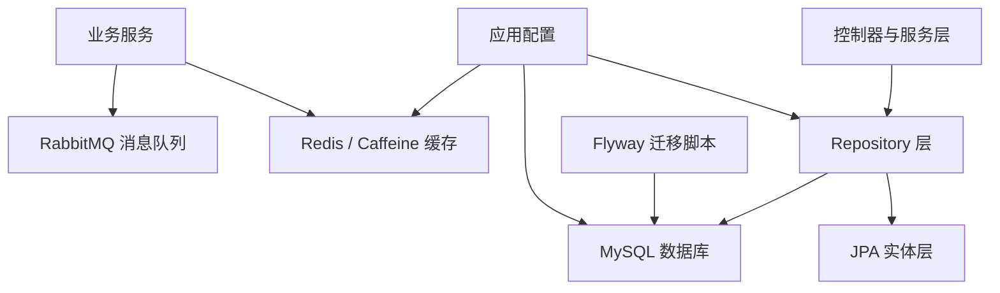

**图表来源**   
- [application.yml:1-120](file://apps/api/src/main/resources/application.yml#L1-L120)
- [application-real.yml:1-120](file://apps/api/src/main/resources/application-real.yml#L1-L120)
- [PostRepository.java:1-80](file://apps/api/src/main/java/com/campuslove/api/repository/PostRepository.java#L1-L80)

**章节来源**   
- [pom.xml:1-60](file://apps/api/pom.xml#L1-L60)
- [application.yml:1-120](file://apps/api/src/main/resources/application.yml#L1-L120)
- [application-real.yml:1-120](file://apps/api/src/main/resources/application-real.yml#L1-L120)

## 核心组件

数据访问层的核心组件可归纳为五类：

1. **JPA 实体**：用户、帖子、评论、私信、兴趣标签、圈子、媒体资产、钱包交易日志等。
2. **Repository 接口**：基于 `JpaRepository` 扩展出的查询接口，包含命名查询、JPQL、分页、投影和批量更新。
3. **事务与并发控制**：通过 `@Version` 乐观锁、`@Transactional` 方法级事务、Spring Data JPA 默认事务边界共同实现。
4. **连接与缓存基础设施**：HikariCP 连接池、Lettuce + Redisson、Caffeine 降级缓存。
5. **数据迁移**：Flyway 扫描 `database/flyway/sql`，按版本号执行 DDL/DML。

本节重点说明实体设计、Repository 规范、事务机制、连接池、迁移和缓存。

**章节来源**   
- [User.java:1-200](file://apps/api/src/main/java/com/campuslove/api/entity/User.java#L1-L200)
- [Post.java:1-120](file://apps/api/src/main/java/com/campuslove/api/entity/Post.java#L1-L120)
- [PrivateMessageRepository.java:1-60](file://apps/api/src/main/java/com/campuslove/api/repository/PrivateMessageRepository.java#L1-L60)
- [application-real.yml:1-80](file://apps/api/src/main/resources/application-real.yml#L1-L80)
- [application-real.yml:100-175](file://apps/api/src/main/resources/application-real.yml#L100-L175)

## 架构总览

Campus Love API 的数据访问架构采用典型三层模型：**控制器/服务层 → Repository 层 → JPA/Hibernate → MySQL**。同时引入 Redis 作为分布式缓存，Caffeine 作为非 real profile 下的降级缓存，Flyway 负责数据库版本演进。

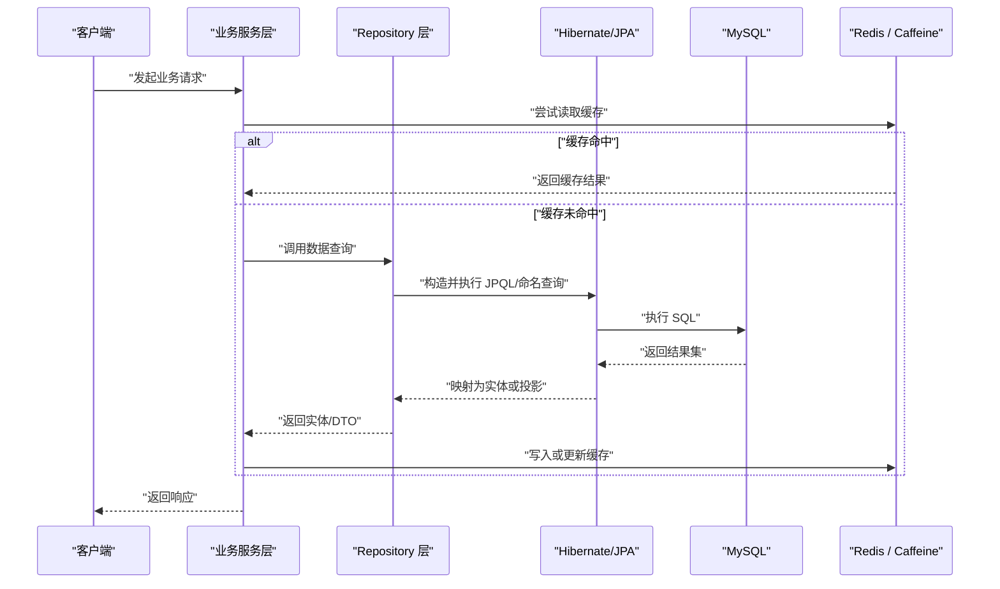

**图表来源**   
- [PostRepository.java:1-120](file://apps/api/src/main/java/com/campuslove/api/repository/PostRepository.java#L1-L120)
- [PrivateMessageRepository.java:1-120](file://apps/api/src/main/java/com/campuslove/api/repository/PrivateMessageRepository.java#L1-L120)
- [RedisConfig.java:1-120](file://apps/api/src/main/java/com/campuslove/api/config/RedisConfig.java#L1-L120)
- [CaffeineCacheConfig.java:1-115](file://apps/api/src/main/java/com/campuslove/api/config/CaffeineCacheConfig.java#L1-L115)

## 详细组件分析

### JPA 实体设计与关系映射

#### 用户实体

用户实体是平台核心主实体，承载登录标识、基础资料、角色、账号状态、地理坐标、社交计数和审计信息。

关键设计点：

- 主键使用自增 `Long id`；
- `openid` 使用唯一约束，保证微信登录唯一性；
- `phone`、`created_at` 建立索引；
- `role` 支持普通用户和管理员角色；
- `status` 表示账号可用状态，支持禁用和注销；
- `createdAt`、`updatedAt` 由 `AuditingEntityListener` 自动填充；
- `version` 使用 `@Version` 实现乐观锁；
- `openid` 和 `password` 通过 `@JsonIgnore` 防止 JSON 序列化泄露；
- 提供脱敏方法和角色判断方法，避免业务层重复实现安全逻辑。

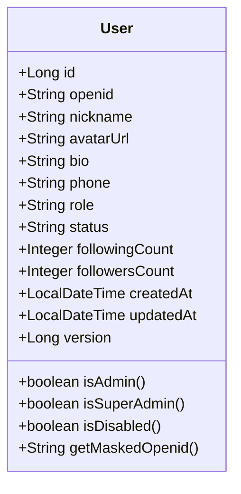

**图表来源**   
- [User.java:1-200](file://apps/api/src/main/java/com/campuslove/api/entity/User.java#L1-L200)
- [User.java:201-444](file://apps/api/src/main/java/com/campuslove/api/entity/User.java#L201-L444)

#### 帖子实体

帖子实体承载村口动态内容、分类、统计、审核状态、可见范围和圈子关联。

关键设计点：

- 分类、状态、审核状态、可见范围均使用枚举；
- `images`、`tags` 使用 JSON 列存储数组；
- 建立作者、分类、创建时间、状态、活动、圈子的复合索引；
- 热度分、运营倍率、禁止上榜字段用于推荐与榜单；
- 可见范围通过转换器将 Java 枚举名映射到数据库值；
- 同样启用审计字段和乐观锁。

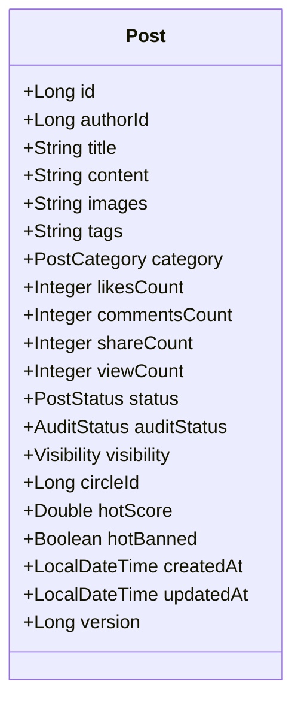

**图表来源**   
- [Post.java:1-200](file://apps/api/src/main/java/com/campuslove/api/entity/Post.java#L1-L200)
- [Post.java:201-472](file://apps/api/src/main/java/com/campuslove/api/entity/Post.java#L201-L472)

#### 评论实体

评论实体通过 `ManyToOne` 关联帖子，支持楼中楼回复和评论图片。

关键设计点：

- `post` 字段为懒加载的一对多反向引用；
- `parentId` 支持嵌套评论；
- `images` 使用 JSON 列；
- 审计字段和乐观锁统一接入。

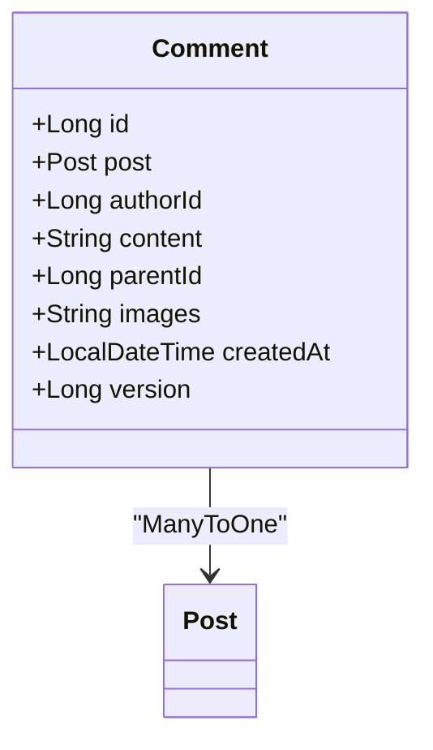

**图表来源**   
- [Comment.java:1-145](file://apps/api/src/main/java/com/campuslove/api/entity/Comment.java#L1-L145)

#### 私信实体

私信实体关联会话，支持发送者侧软删除、撤回、投递状态和消息类型。

关键设计点：

- `conversation` 为懒加载 `ManyToOne`；
- `deletedForSender` 实现“仅发送者本人隐藏”的微信语义软删；
- `deliveryStatus` 表达 sent/delivered/read 生命周期；
- `isRead` 支持已读标记；
- 审计字段和乐观锁统一接入。

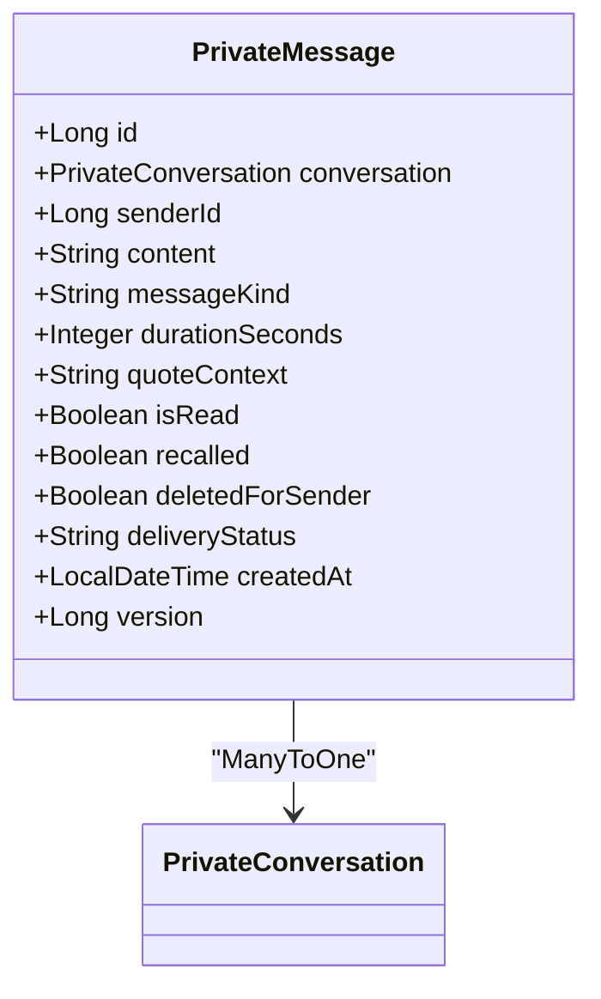

**图表来源**   
- [PrivateMessage.java:1-200](file://apps/api/src/main/java/com/campuslove/api/entity/PrivateMessage.java#L1-L200)
- [PrivateMessage.java:201-242](file://apps/api/src/main/java/com/campuslove/api/entity/PrivateMessage.java#L201-L242)

#### 一对一、一对多与多对多关系总结

| 关系类型 | 示例 | 实现方式 | 说明 |
|---|---|---|---|
| 一对多 | 帖子 → 评论 | `Comment.post` 使用 `@ManyToOne` | 评论属于帖子，外键在评论表 |
| 一对多 | 会话 → 私信 | `PrivateMessage.conversation` 使用 `@ManyToOne` | 私信属于会话，外键在私信表 |
| 多对多 | 用户 ↔ 兴趣标签 | 通过中间表 `user_interest_tag` 建模 | 关注关系、兴趣关系通常用中间实体或中间表 |
| 一对一 | 用户 ↔ 校区档案 | 通过 `UserCampusProfile.userId` 与用户主键关联 | 校区信息单独建模，用户侧通过 ID 引用 |

仓库层中关注关系通过中间表建模，例如 `UserFollowRepository` 对应关注关系表，体现多对多关系的常见实现方式。

**章节来源**   
- [Comment.java:1-145](file://apps/api/src/main/java/com/campuslove/api/entity/Comment.java#L1-L145)
- [PrivateMessage.java:1-200](file://apps/api/src/main/java/com/campuslove/api/entity/PrivateMessage.java#L1-L200)
- [UserFollowRepository.java:1-85](file://apps/api/src/main/java/com/campuslove/api/repository/UserFollowRepository.java#L1-L85)

### Repository 层设计规范

Repository 层以 `JpaRepository` 为基础，遵循以下规范：

1. **优先使用命名查询**：如 `findByAuthorIdAndStatusOrderByCreatedAtDesc`、`findByFollowerIdAndFollowingId`。
2. **复杂条件使用 JPQL**：如私信未读统计、帖子管理后台多条件搜索。
3. **分页优先使用 `Pageable`**：避免全量拉取大数据集合。
4. **批量更新使用 `@Modifying`**：如批量标记已读、批量删除会话消息。
5. **预加载关联对象**：使用 `@EntityGraph` 解决 N+1 查询问题。
6. **投影减少载荷**：如候选用户 ID 投影、未读数投影。
7. **Repository 不承载复杂业务逻辑**：仅暴露数据访问契约。

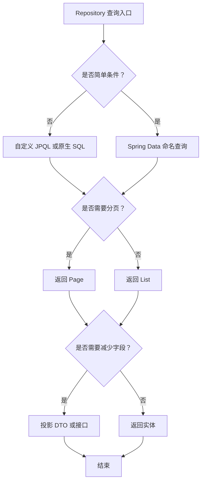

**图表来源**   
- [PostRepository.java:1-120](file://apps/api/src/main/java/com/campuslove/api/repository/PostRepository.java#L1-L120)
- [UserRepository.java:1-120](file://apps/api/src/main/java/com/campuslove/api/repository/UserRepository.java#L1-L120)
- [PrivateMessageRepository.java:1-120](file://apps/api/src/main/java/com/campuslove/api/repository/PrivateMessageRepository.java#L1-L120)

**章节来源**   
- [PostRepository.java:1-200](file://apps/api/src/main/java/com/campuslove/api/repository/PostRepository.java#L1-L200)
- [UserRepository.java:1-200](file://apps/api/src/main/java/com/campuslove/api/repository/UserRepository.java#L1-L200)
- [PrivateMessageRepository.java:1-161](file://apps/api/src/main/java/com/campuslove/api/repository/PrivateMessageRepository.java#L1-L161)
- [UserFollowRepository.java:1-85](file://apps/api/src/main/java/com/campuslove/api/repository/UserFollowRepository.java#L1-L85)

### 事务管理机制

当前数据访问层的事务管理以 **Spring Data JPA 默认事务边界** 和 **方法级声明式事务** 为主：

- 只读查询：由 Spring Data JPA 自动包装为只读事务；
- 写操作：Repository 的保存、修改、删除方法默认在事务中执行；
- 批量更新：使用 `@Modifying` 和 `@Transactional` 明确事务边界；
- 并发控制：通过 `@Version` 乐观锁处理并发更新冲突；
- 隔离级别：代码中未显式设置 `@Transactional(isolation = ...)`，因此使用数据库默认隔离级别；
- 传播行为：未显式指定时默认为 `REQUIRED`。

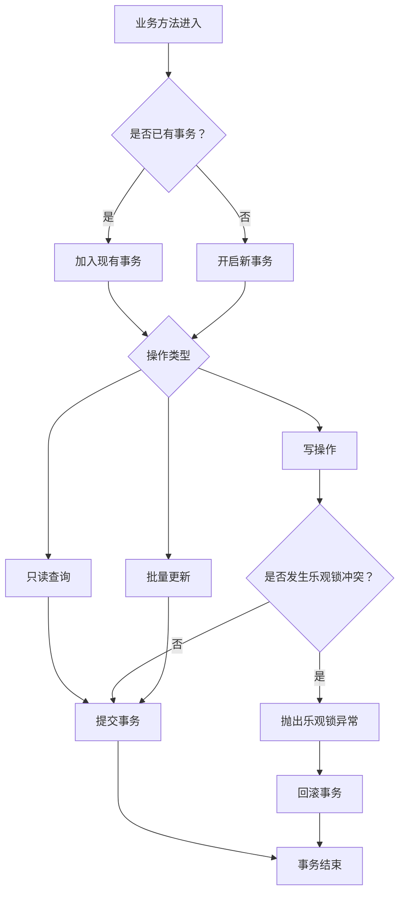

**图表来源**   
- [User.java:201-240](file://apps/api/src/main/java/com/campuslove/api/entity/User.java#L201-L240)
- [Comment.java:100-145](file://apps/api/src/main/java/com/campuslove/api/entity/Comment.java#L100-L145)
- [PrivateMessage.java:150-242](file://apps/api/src/main/java/com/campuslove/api/entity/PrivateMessage.java#L150-L242)
- [PrivateMessageRepository.java:120-161](file://apps/api/src/main/java/com/campuslove/api/repository/PrivateMessageRepository.java#L120-L161)

**章节来源**   
- [User.java:201-240](file://apps/api/src/main/java/com/campuslove/api/entity/User.java#L201-L240)
- [PrivateMessageRepository.java:120-161](file://apps/api/src/main/java/com/campuslove/api/repository/PrivateMessageRepository.java#L120-L161)

### 数据库连接池与监控

数据库连接池使用 HikariCP，配置集中在 `application-real.yml` 中，关键参数如下：

| 参数 | 默认值 | 含义 | 调优建议 |
|---|---:|---|---|
| `maximum-pool-size` | 20 | 最大连接数 | 建议按 CPU 核数和磁盘 IO 调整 |
| `minimum-idle` | 10 | 最小空闲连接数 | 避免频繁创建连接造成抖动 |
| `connection-timeout` | 30000 毫秒 | 获取连接超时 | 过短可能导致瞬时高并发失败 |
| `max-lifetime` | 1800000 毫秒 | 连接最大生命周期 | 应小于数据库 `wait_timeout` |
| `idle-timeout` | 600000 毫秒 | 空闲连接超时 | 合理释放无用连接 |
| `leak-detection-threshold` | 60000 毫秒 | 连接泄漏检测阈值 | 生产可开启定位泄漏 |
| `pool-name` | CampusLoveHikariPool | 连接池名称 | 便于监控区分 |

应用还启用了 Actuator、Prometheus、Micrometer 指标采集，可用于观察 HTTP 延迟、健康检查和外部依赖状态。

**章节来源**   
- [application-real.yml:1-80](file://apps/api/src/main/resources/application-real.yml#L1-L80)
- [application.yml:120-200](file://apps/api/src/main/resources/application.yml#L120-L200)

### 数据迁移与 Flyway 版本控制

Flyway 在 real profile 下启用，迁移脚本位于 `database/flyway/sql`，通过文件系统路径扫描。

关键配置：

- `flyway.enabled=true`；
- `locations=filesystem:../../database/flyway/sql`；
- `baseline-on-migrate=false`；
- 使用 `${...}` 占位符注入环境变量；
- 首次部署必须通过环境变量注入管理员密码哈希；
- 演示种子数据通过 `demo_seed` 开关控制。

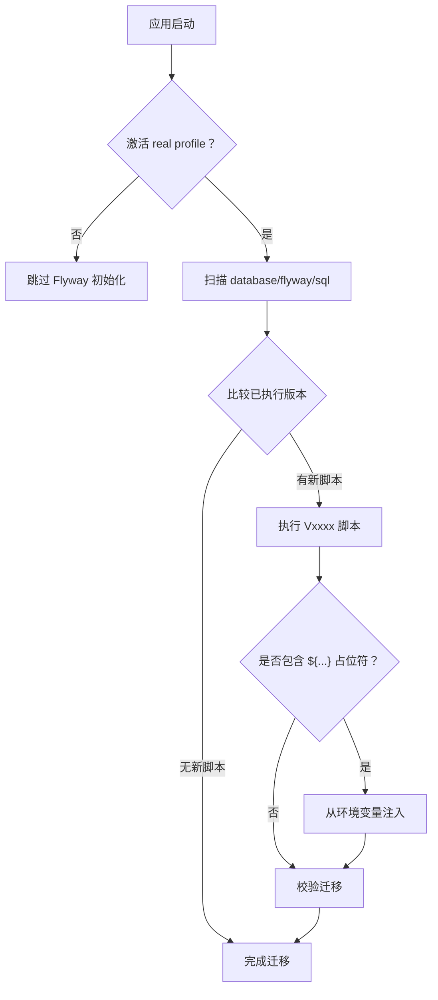

**图表来源**   
- [application-real.yml:100-175](file://apps/api/src/main/resources/application-real.yml#L100-L175)

**章节来源**   
- [application-real.yml:100-175](file://apps/api/src/main/resources/application-real.yml#L100-L175)

### 缓存策略设计

项目采用两级缓存：

| 缓存类型 | 使用场景 | 生命周期 | 一致性策略 |
|---|---|---|---|
| Caffeine 本地缓存 | 测试环境、开发环境、Redis 不可用时的降级 | 按 CacheName 独立 TTL | 进程内一致性 |
| Redis 分布式缓存 | 生产环境热点数据、推荐列表、系统配置 | 按 CacheName 独立 TTL | 通过主动失效和 TTL 过期保证最终一致 |

#### Caffeine 本地缓存

- 在非 real profile 下生效；
- 为每个 CacheName 注册独立 TTL；
- 默认 TTL 30 分钟；
- 作为 Redis 不可用时的降级方案；
- 与 Redis 缓存的 CacheName 和 TTL 保持一致。

#### Redis 分布式缓存

- 在 real profile 下生效；
- 使用 Lettuce 连接工厂和 commons-pool2 连接池；
- RedisTemplate 使用 String key 和 Jackson JSON value；
- CacheManager 使用 RedisCacheManager，默认 TTL 30 分钟；
- 各 CacheName 独立 TTL；
- 使用 Redisson 提供分布式锁能力（例如续费防并发）。

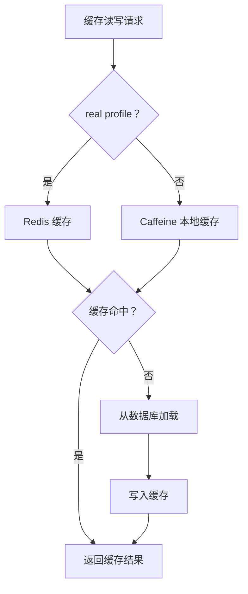

**图表来源**   
- [CaffeineCacheConfig.java:1-115](file://apps/api/src/main/java/com/campuslove/api/config/CaffeineCacheConfig.java#L1-L115)
- [RedisConfig.java:1-200](file://apps/api/src/main/java/com/campuslove/api/config/RedisConfig.java#L1-L200)
- [RedisConfig.java:201-362](file://apps/api/src/main/java/com/campuslove/api/config/RedisConfig.java#L201-L362)

**章节来源**   
- [CaffeineCacheConfig.java:1-115](file://apps/api/src/main/java/com/campuslove/api/config/CaffeineCacheConfig.java#L1-L115)
- [RedisConfig.java:1-362](file://apps/api/src/main/java/com/campuslove/api/config/RedisConfig.java#L1-L362)

### 审计字段、软删除与数据权限

#### 审计字段自动填充

实体普遍使用 `@CreatedDate` 和 `@LastModifiedDate`，配合 `AuditingEntityListener` 自动填充创建时间和更新时间。该机制适用于用户、帖子、评论、私信等实体。

#### 软删除实现

- 帖子使用 `status` 枚举表达 active/deleted/hidden；
- 私信使用 `deletedForSender` 实现发送者侧软删除；
- 用户使用 `status` 表达 active/disabled/deactivated；
- 查询侧需显式过滤已删除状态或软删标记。

#### 数据权限控制

- 用户角色字段 `role` 区分普通用户与管理员；
- 管理员管辖校区通过 `campusName` 字段参与数据隔离；
- Repository 中的管理端查询通过 EXISTS 子句按作者所属校区过滤；
- 昵称搜索从前缀匹配改为前缀索引友好模式，兼顾性能和权限隔离。

**章节来源**   
- [User.java:1-200](file://apps/api/src/main/java/com/campuslove/api/entity/User.java#L1-L200)
- [Post.java:1-200](file://apps/api/src/main/java/com/campuslove/api/entity/Post.java#L1-L200)
- [PrivateMessage.java:100-200](file://apps/api/src/main/java/com/campuslove/api/entity/PrivateMessage.java#L100-L200)
- [UserRepository.java:120-300](file://apps/api/src/main/java/com/campuslove/api/repository/UserRepository.java#L120-L300)
- [PostRepository.java:120-200](file://apps/api/src/main/java/com/campuslove/api/repository/PostRepository.java#L120-L200)

### 复杂业务查询案例与性能优化

#### 私信会话消息分页与 N+1 优化

私信列表需要避免逐条加载会话对象导致的 N+1 查询。Repository 使用 `@EntityGraph(attributePaths = "conversation")` 一次性 JOIN 加载会话。

优化点：

- 倒序分页用于聊天历史；
- 正序分页用于上拉加载更早历史；
- 软删过滤排除发送者本人删除的消息；
- 批量标记已读使用 `@Modifying` 减少循环 save；
- 未读数统计使用 GROUP BY 聚合，避免逐会话 COUNT。

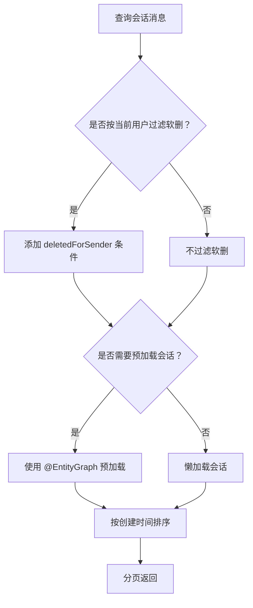

**图表来源**   
- [PrivateMessageRepository.java:1-120](file://apps/api/src/main/java/com/campuslove/api/repository/PrivateMessageRepository.java#L1-L120)

#### 帖子管理后台多条件查询

管理后台帖子查询支持审核状态、状态、分类、作者、校区等多条件组合，所有条件可为空；校区隔离通过 EXISTS 子句关联用户校区档案。

优化点：

- 使用 JPQL 条件拼接；
- 条件为空时不参与筛选；
- 按创建时间倒序；
- 分页返回。

**章节来源**   
- [PrivateMessageRepository.java:1-161](file://apps/api/src/main/java/com/campuslove/api/repository/PrivateMessageRepository.java#L1-L161)
- [PostRepository.java:120-200](file://apps/api/src/main/java/com/campuslove/api/repository/PostRepository.java#L120-L200)

## 依赖关系分析

数据访问层的外部依赖主要包括：

| 依赖 | 作用 | 风险或注意事项 |
|---|---|---|
| Spring Data JPA | 实体映射与 Repository 抽象 | Hibernate 代理依赖 byte-buddy |
| MySQL Connector | JDBC 驱动 | 需与数据库版本兼容 |
| HikariCP | 数据库连接池 | 高并发下需调优连接数 |
| Flyway | 数据库迁移 | 首次部署必须正确注入占位符 |
| Redis + Lettuce | 分布式缓存、令牌黑名单、限流、锁 | 连接池参数需根据负载调整 |
| Redisson | 分布式锁 | 旧版 Redis 可能不支持 RESP3 |
| Caffeine | 本地缓存 | 仅进程内有效 |
| RabbitMQ | 异步消息 | 可选降级，不影响主流程 |
| Actuator + Micrometer + Prometheus | 监控指标 | 生产需暴露必要端点 |

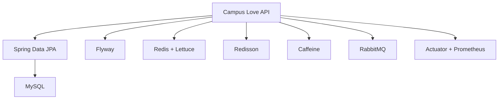

**图表来源**   
- [pom.xml:1-120](file://apps/api/pom.xml#L1-L120)
- [application.yml:1-120](file://apps/api/src/main/resources/application.yml#L1-L120)
- [application-real.yml:1-175](file://apps/api/src/main/resources/application-real.yml#L1-L175)

**章节来源**   
- [pom.xml:1-120](file://apps/api/pom.xml#L1-L120)
- [application.yml:1-120](file://apps/api/src/main/resources/application.yml#L1-L120)
- [application-real.yml:1-175](file://apps/api/src/main/resources/application-real.yml#L1-L175)

## 性能与调优

### 数据库查询优化

1. **合理使用索引**：用户手机号、创建时间，帖子作者、分类、状态、活动、圈子等均已建索引。
2. **避免 N+1 查询**：私信会话列表使用 `@EntityGraph` 预加载关联。
3. **使用投影减少载荷**：候选用户 ID 投影、未读数投影。
4. **批量更新替代循环保存**：私信已读标记、会话消息批量删除。
5. **分页查询**：关注列表、粉丝列表、帖子列表、用户列表均支持分页。
6. **聚合计算下沉到数据库**：点赞总数求和、未读数 GROUP BY。

### 连接池优化

- HikariCP 最大连接数默认 20，适合中小规模；
- 连接泄漏检测阈值可开启 60 秒帮助定位泄漏；
- 连接生命周期应小于数据库 `wait_timeout`；
- Redis 连接池默认 8，可根据并发量调整。

### 缓存优化

- Caffeine 与 Redis 的 CacheName 和 TTL 保持一致，便于切换；
- 热点数据使用较短 TTL，静态配置使用较长 TTL；
- Redis 序列化统一使用 Jackson JSON，避免反序列化失败；
- Redisson 手动配置仅在特定开发场景启用。

**章节来源**   
- [PostRepository.java:1-200](file://apps/api/src/main/java/com/campuslove/api/repository/PostRepository.java#L1-L200)
- [PrivateMessageRepository.java:1-161](file://apps/api/src/main/java/com/campuslove/api/repository/PrivateMessageRepository.java#L1-L161)
- [UserRepository.java:1-200](file://apps/api/src/main/java/com/campuslove/api/repository/UserRepository.java#L1-L200)
- [application-real.yml:1-80](file://apps/api/src/main/resources/application-real.yml#L1-L80)
- [RedisConfig.java:201-362](file://apps/api/src/main/java/com/campuslove/api/config/RedisConfig.java#L201-L362)

## 故障排查指南

### 数据库连接问题

常见问题：

- 未配置 `DB_URL`、`DB_USERNAME`、`DB_PASSWORD`；
- HikariCP 连接数不足；
- 连接泄漏导致连接耗尽；
- 数据库连接超时。

排查步骤：

1. 检查 real profile 是否激活；
2. 检查环境变量是否注入数据库连接信息；
3. 查看 HikariCP 连接池监控；
4. 开启连接泄漏检测；
5. 调整 `maximum-pool-size` 和 `connection-timeout`。

**章节来源**   
- [application-real.yml:1-80](file://apps/api/src/main/resources/application-real.yml#L1-L80)

### Redis 连接与序列化问题

常见问题：

- Redis 地址或密码错误；
- 无密码 Redis 被发送 AUTH 命令；
- 缓存反序列化失败；
- 缓存类型转换异常。

排查步骤：

1. 检查 `spring.data.redis.*` 配置；
2. 确认 Redisson 手动配置是否误启用；
3. 检查 RedisTemplate 和 CacheManager 是否共用同一 JSON 序列化器；
4. 检查 Jackson 是否注册 JSR310 时间模块；
5. 检查多态类型白名单。

**章节来源**   
- [RedisConfig.java:1-200](file://apps/api/src/main/java/com/campuslove/api/config/RedisConfig.java#L1-L200)
- [RedisConfig.java:201-362](file://apps/api/src/main/java/com/campuslove/api/config/RedisConfig.java#L201-L362)

### Flyway 迁移失败

常见问题：

- 首次部署未注入管理员密码哈希；
- 占位符语法错误；
- 演示种子数据误开；
- 迁移脚本版本冲突。

排查步骤：

1. 确认 Flyway 是否启用；
2. 检查占位符环境变量；
3. 检查 `demo_seed` 开关；
4. 核对迁移脚本文件名版本；
5. 查看 Flyway 执行日志。

**章节来源**   
- [application-real.yml:100-175](file://apps/api/src/main/resources/application-real.yml#L100-L175)

### 乐观锁冲突

常见问题：

- 同一记录并发更新；
- 业务层未处理乐观锁异常；
- 缓存未同步导致脏读。

排查步骤：

1. 检查实体是否包含 `@Version`；
2. 检查更新逻辑是否先读后写；
3. 检查全局异常处理是否返回 409；
4. 检查缓存更新时机。

**章节来源**   
- [User.java:201-240](file://apps/api/src/main/java/com/campuslove/api/entity/User.java#L201-L240)
- [Comment.java:100-145](file://apps/api/src/main/java/com/campuslove/api/entity/Comment.java#L100-L145)
- [PrivateMessage.java:150-242](file://apps/api/src/main/java/com/campuslove/api/entity/PrivateMessage.java#L150-L242)

## 结论

Campus Love API 的数据访问层以 Spring Data JPA 为核心，围绕用户、帖子、评论、私信等核心实体构建了清晰的实体—Repository—服务三层结构。项目在以下方面形成了较完整的实践：

- 实体层统一使用审计字段和乐观锁；
- Repository 层结合命名查询、JPQL、分页、投影和批量更新；
- 连接池和缓存基础设施通过配置文件外部化；
- Flyway 提供版本化数据库迁移；
- Caffeine 与 Redis 提供两级缓存；
- 私信软删、帖子状态、用户角色提供了灵活的数据权限和状态控制。

未来改进方向包括：

- 显式配置事务隔离级别；
- 对热点写路径引入更明确的缓存失效策略；
- 对复杂报表查询考虑物化视图或异步离线计算；
- 对 N+1 查询建立自动化检测规则；
- 对敏感字段增加统一的脱敏输出层。

## 附录：关键设计对照表

### 实体与表字段对照

| 实体 | 关键字段 | 映射特点 |
|---|---|---|
| User | id、openid、phone、role、status、createdAt、updatedAt、version | 唯一约束、索引、审计、乐观锁 |
| Post | authorId、content、category、status、auditStatus、visibility、circleId、hotScore、version | JSON 列、枚举、审计、乐观锁 |
| Comment | postId、authorId、parentId、images、version | ManyToOne、JSON、审计、乐观锁 |
| PrivateMessage | conversationId、senderId、messageKind、isRead、recalled、deletedForSender、deliveryStatus、version | ManyToOne、软删、投递状态、审计、乐观锁 |

### Repository 查询风格对照

| 查询类型 | 示例 | 适用场景 |
|---|---|---|
| 命名查询 | `findByAuthorIdAndStatusOrderByCreatedAtDesc` | 简单条件 + 排序 |
| JPQL 查询 | `searchForAdmin`、`countUnreadGroupByConversationIds` | 多条件组合、聚合统计 |
| 分页查询 | `Page<User>`、`Page<Post>` | 列表展示 |
| 投影查询 | `findCandidateIds`、`UnreadCountProjection` | 减少字段传输 |
| 批量更新 | `markAsReadByConversationAndSenderNot` | 提升写性能 |

**章节来源**   
- [User.java:1-444](file://apps/api/src/main/java/com/campuslove/api/entity/User.java#L1-L444)
- [Post.java:1-472](file://apps/api/src/main/java/com/campuslove/api/entity/Post.java#L1-L472)
- [Comment.java:1-145](file://apps/api/src/main/java/com/campuslove/api/entity/Comment.java#L1-L145)
- [PrivateMessage.java:1-242](file://apps/api/src/main/java/com/campuslove/api/entity/PrivateMessage.java#L1-L242)
- [PostRepository.java:1-200](file://apps/api/src/main/java/com/campuslove/api/repository/PostRepository.java#L1-L200)
- [UserRepository.java:1-300](file://apps/api/src/main/java/com/campuslove/api/repository/UserRepository.java#L1-L300)
- [PrivateMessageRepository.java:1-161](file://apps/api/src/main/java/com/campuslove/api/repository/PrivateMessageRepository.java#L1-L161)