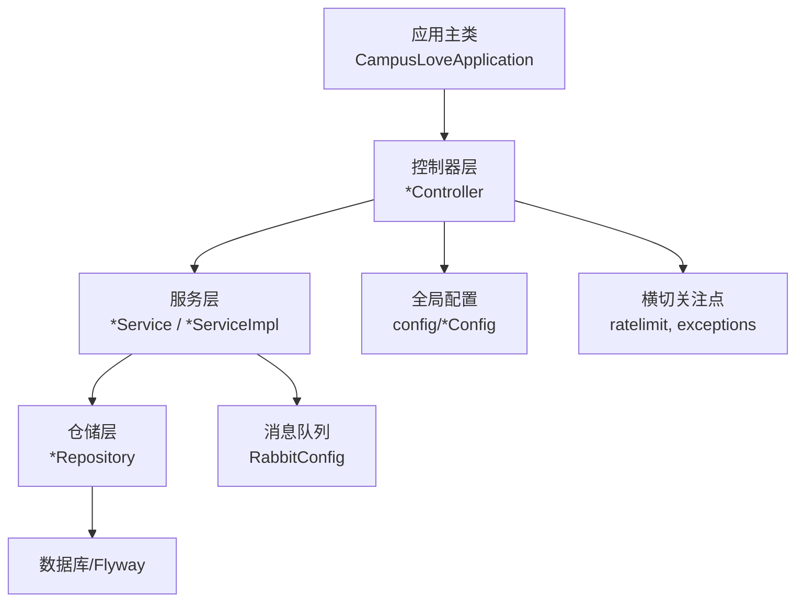
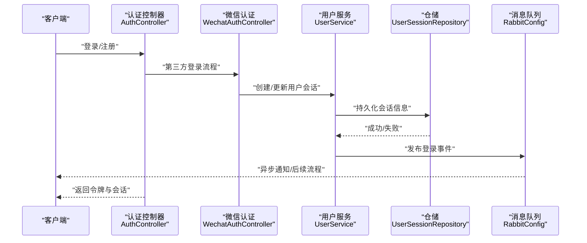
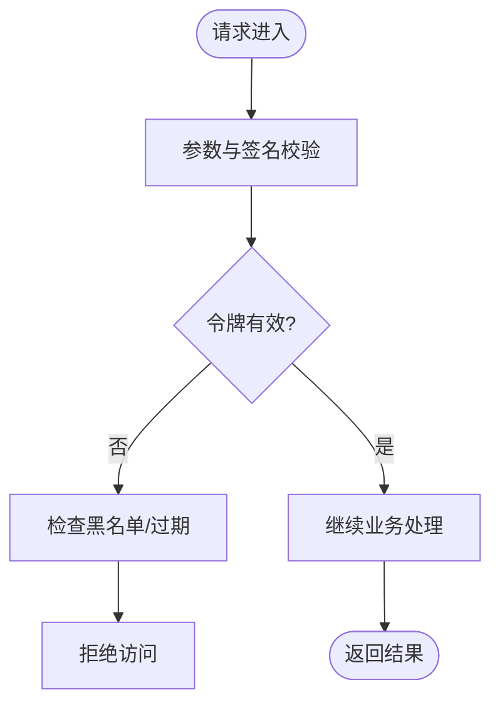
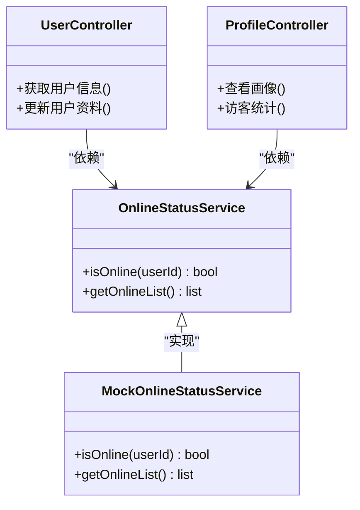
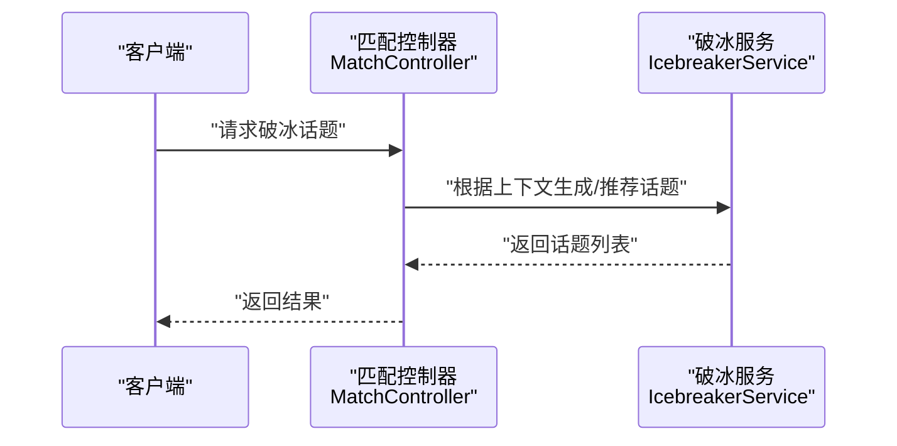
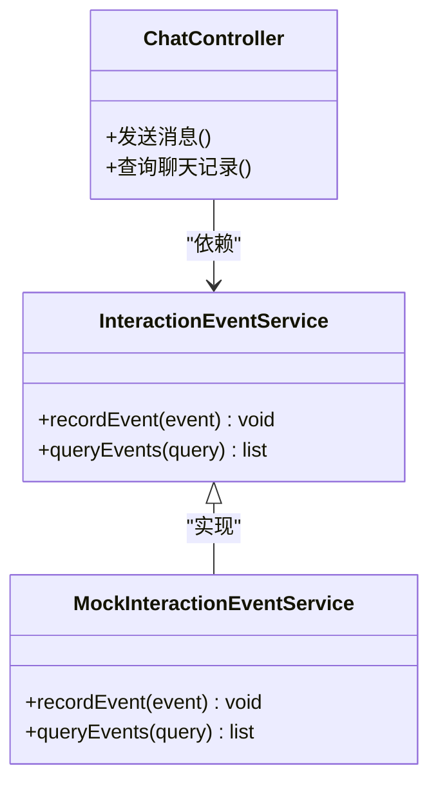
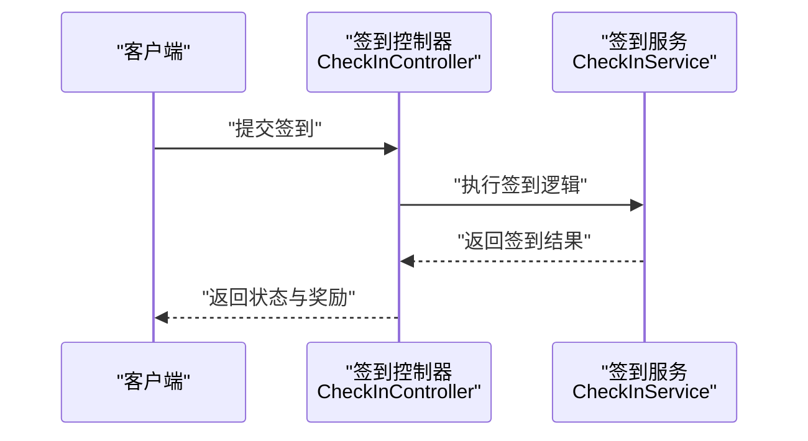
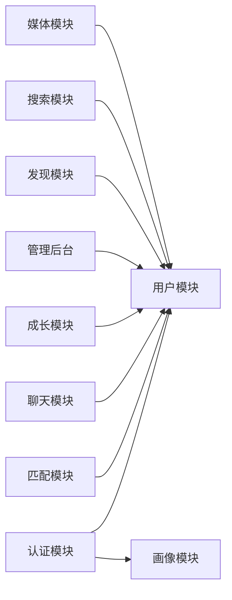

# 核心框架设计

<cite>
**本文引用的文件**
- [CampusLoveApplication.java](file://apps/api/src/main/java/com/campuslove/api/CampusLoveApplication.java)
- [AuthController.java](file://apps/api/src/main/java/com/campuslove/api/auth/AuthController.java)
- [WechatAuthController.java](file://apps/api/src/main/java/com/campuslove/api/auth/WechatAuthController.java)
- [UserController.java](file://apps/api/src/main/java/com/campuslove/api/user/UserController.java)
- [ProfileController.java](file://apps/api/src/main/java/com/campuslove/api/profile/ProfileController.java)
- [MatchController.java](file://apps/api/src/main/java/com/campuslove/api/match/MatchController.java)
- [ChatController.java](file://apps/api/src/main/java/com/campuslove/api/chat/ChatController.java)
- [RateLimit.java](file://apps/api/src/main/java/com/campuslove/api/ratelimit/RateLimit.java)
- [RateLimitExceededException.java](file://apps/api/src/main/java/com/campuslove/api/ratelimit/RateLimitExceededException.java)
- [TokenBlacklistService.java](file://apps/api/src/main/java/com/campuslove/api/auth/TokenBlacklistService.java)
- [JwtConfigTest.java](file://apps/api/src/test/java/com/campuslove/api/config/JwtConfigTest.java)
- [ChatConfig.java](file://apps/api/src/main/java/com/campuslove/api/config/ChatConfig.java)
- [MatchConfig.java](file://apps/api/src/main/java/com/campuslove/api/config/MatchConfig.java)
- [RabbitConfig.java](file://apps/api/src/main/java/com/campuslove/api/config/RabbitConfig.java)
- [FeedbackRepository.java](file://apps/api/src/main/java/com/campuslove/api/repository/FeedbackRepository.java)
- [DailyQuestionRepository.java](file://apps/api/src/main/java/com/campuslove/api/repository/DailyQuestionRepository.java)
- [UserSessionRepository.java](file://apps/api/src/main/java/com/campuslove/api/repository/UserSessionRepository.java)
- [MediaUploadController.java](file://apps/api/src/main/java/com/campuslove/api/media/MediaUploadController.java)
- [ErrorReportController.java](file://apps/api/src/main/java/com/campuslove/api/report/ErrorReportController.java)
- [MockInteractionEventService.java](file://apps/api/src/main/java/com/campuslove/api/chat/MockInteractionEventService.java)
- [CheckInController.java](file://apps/api/src/main/java/com/campuslove/api/growth/CheckInController.java)
- [DoNotDisturbController.java](file://apps/api/src/main/java/com/campuslove/api/growth/DoNotDisturbController.java)
- [SocialProgressController.java](file://apps/api/src/main/java/com/campuslove/api/growth/SocialProgressController.java)
- [AdminStatsController.java](file://apps/api/src/main/java/com/campuslove/api/admin/AdminStatsController.java)
- [AdminAccountController.java](file://apps/api/src/main/java/com/campuslove/api/admin/AdminAccountController.java)
- [AdminAuditLogController.java](file://apps/api/src/main/java/com/campuslove/api/admin/AdminAuditLogController.java)
- [AdminSensitiveWordController.java](file://apps/api/src/main/java/com/campuslove/api/admin/AdminSensitiveWordController.java)
- [RecommendationController.java](file://apps/api/src/main/java/com/campuslove/api/discover/RecommendationController.java)
- [VillageController.java](file://apps/api/src/main/java/com/campuslove/api/village/VillageController.java)
- [OfficialAccountController.java](file://apps/api/src/main/java/com/campuslove/api/official/OfficialAccountController.java)
- [WhisperController.java](file://apps/api/src/main/java/com/campuslove/api/whisper/WhisperController.java)
- [PostSearchController.java](file://apps/api/src/main/java/com/campuslove/api/search/PostSearchController.java)
- [UserSearchController.java](file://apps/api/src/main/java/com/campuslove/api/search/UserSearchController.java)
- [AiVideoController.java](file://apps/api/src/main/java/com/campuslove/api/ai/AiVideoController.java)
- [CheckInService.java](file://apps/api/src/main/java/com/campuslove/api/growth/CheckInService.java)
- [PushPreferenceService.java](file://apps/api/src/main/java/com/campuslove/api/growth/PushPreferenceService.java)
- [SocialProgressService.java](file://apps/api/src/main/java/com/campuslove/api/growth/SocialProgressService.java)
- [OnlineStatusService.java](file://apps/api/src/main/java/com/campuslove/api/user/OnlineStatusService.java)
- [MockOnlineStatusService.java](file://apps/api/src/main/java/com/campuslove/api/user/MockOnlineStatusService.java)
- [InteractionEventService.java](file://apps/api/src/main/java/com/campuslove/api/chat/InteractionEventService.java)
- [IcebreakerService.java](file://apps/api/src/main/java/com/campuslove/api/match/IcebreakerService.java)
- [MediaSizeLimitExceededException.java](file://apps/api/src/main/java/com/campuslove/api/media/MediaSizeLimitExceededException.java)
- [InvalidTokenException.java](file://apps/api/src/main/java/com/campuslove/api/auth/InvalidTokenException.java)
- [TokenRevokedException.java](file://apps/api/src/main/java/com/campuslove/api/auth/TokenRevokedException.java)
- [WechatLoginException.java](file://apps/api/src/main/java/com/campuslove/api/auth/WechatLoginException.java)
</cite>

## 目录
1. [简介](#简介)
2. [项目结构](#项目结构)
3. [核心组件](#核心组件)
4. [架构总览](#架构总览)
5. [详细组件分析](#详细组件分析)
6. [依赖分析](#依赖分析)
7. [性能考量](#性能考量)
8. [故障排查指南](#故障排查指南)
9. [结论](#结论)
10. [附录](#附录)

## 简介
本文件面向 Campus Love 后端核心框架，系统性阐述 Spring Boot 3 应用的启动与装配、组件扫描与依赖注入、Controller-Service-Repository 分层设计原则、AOP 切面在跨领域关注点中的应用（日志、审计、限流）、配置管理策略（环境隔离、类型安全、外部化）、统一异常处理与 HTTP 响应标准化、API 文档生成与契约管理、以及性能监控与健康检查等。文档以仓库中实际代码为依据，提供可视化图示与最佳实践指引，帮助读者快速理解并正确扩展系统。

## 项目结构
后端 API 应用基于 Maven + Spring Boot 组织，主要入口为应用主类，业务按领域分包（auth、user、profile、match、chat、growth、admin、discover、village、official、search、ai、media、report 等），基础设施与配置集中在 config 包，数据访问层集中在 repository 包，通用能力（如限流、异常）分布在各自子域或公共模块。

图表来源
- [CampusLoveApplication.java](file://apps/api/src/main/java/com/campuslove/api/CampusLoveApplication.java)
- [AuthController.java](file://apps/api/src/main/java/com/campuslove/api/auth/AuthController.java)
- [ChatConfig.java](file://apps/api/src/main/java/com/campuslove/api/config/ChatConfig.java)
- [RabbitConfig.java](file://apps/api/src/main/java/com/campuslove/api/config/RabbitConfig.java)
- [FeedbackRepository.java](file://apps/api/src/main/java/com/campuslove/api/repository/FeedbackRepository.java)

章节来源
- [CampusLoveApplication.java](file://apps/api/src/main/java/com/campuslove/api/CampusLoveApplication.java)

## 核心组件
- 应用启动与装配：由主类驱动 Spring Boot 自动装配与组件扫描，加载 Controller、Service、Repository、配置类等 Bean。
- 控制器层：暴露 REST 接口，负责参数校验、调用服务层、组装响应。
- 服务层：封装业务逻辑，协调多个 Repository、外部服务、消息队列等。
- 仓储层：基于 Spring Data JPA 的 Repository 抽象，定义数据访问契约。
- 配置中心：通过 application.yml 及 @ConfigurationProperties 进行类型安全的配置绑定；存在 ChatConfig、MatchConfig、RabbitConfig 等专用配置。
- 横切能力：限流注解 RateLimit、限流异常 RateLimitExceededException、令牌黑名单 TokenBlacklistService、各类业务异常（InvalidTokenException、TokenRevokedException、WechatLoginException、MediaSizeLimitExceededException）。

章节来源
- [AuthController.java:1-200](file://apps/api/src/main/java/com/campuslove/api/auth/AuthController.java)
- [RateLimit.java:1-200](file://apps/api/src/main/java/com/campuslove/api/ratelimit/RateLimit.java)
- [RateLimitExceededException.java:1-200](file://apps/api/src/main/java/com/campuslove/api/ratelimit/RateLimitExceededException.java)
- [TokenBlacklistService.java:1-200](file://apps/api/src/main/java/com/campuslove/api/auth/TokenBlacklistService.java)
- [ChatConfig.java:1-200](file://apps/api/src/main/java/com/campuslove/api/config/ChatConfig.java)
- [MatchConfig.java:1-200](file://apps/api/src/main/java/com/campuslove/api/config/MatchConfig.java)
- [RabbitConfig.java:1-200](file://apps/api/src/main/java/com/campuslove/api/config/RabbitConfig.java)
- [FeedbackRepository.java:1-200](file://apps/api/src/main/java/com/campuslove/api/repository/FeedbackRepository.java)

## 架构总览
整体采用典型的分层架构：Controller 仅做请求路由与响应包装，Service 承载业务编排，Repository 专注数据访问。横切关注点（鉴权、限流、审计、日志）通过 AOP 或拦截器方式切入，避免侵入业务代码。配置通过 @ConfigurationProperties 集中管理，支持多环境切换。

图表来源
- [AuthController.java:1-200](file://apps/api/src/main/java/com/campuslove/api/auth/AuthController.java)
- [WechatAuthController.java:1-200](file://apps/api/src/main/java/com/campuslove/api/auth/WechatAuthController.java)
- [UserSessionRepository.java:1-200](file://apps/api/src/main/java/com/campuslove/api/repository/UserSessionRepository.java)
- [RabbitConfig.java:1-200](file://apps/api/src/main/java/com/campuslove/api/config/RabbitConfig.java)

## 详细组件分析

### 认证与授权（Auth）
- 职责边界：对外暴露登录、注册、微信三方登录、账号安全等接口；内部协调用户会话、令牌签发与吊销、第三方平台交互。
- 关键交互：
  - 控制器调用服务完成用户认证与会话管理。
  - 令牌黑名单用于主动吊销或撤销权限。
  - 微信登录异常统一抛出，便于上层捕获与降级。
- 典型流程图：

图表来源
- [AuthController.java:1-200](file://apps/api/src/main/java/com/campuslove/api/auth/AuthController.java)
- [WechatAuthController.java:1-200](file://apps/api/src/main/java/com/campuslove/api/auth/WechatAuthController.java)
- [TokenBlacklistService.java:1-200](file://apps/api/src/main/java/com/campuslove/api/auth/TokenBlacklistService.java)
- [InvalidTokenException.java:1-200](file://apps/api/src/main/java/com/campuslove/api/auth/InvalidTokenException.java)
- [TokenRevokedException.java:1-200](file://apps/api/src/main/java/com/campuslove/api/auth/TokenRevokedException.java)
- [WechatLoginException.java:1-200](file://apps/api/src/main/java/com/campuslove/api/auth/WechatLoginException.java)

章节来源
- [AuthController.java:1-200](file://apps/api/src/main/java/com/campuslove/api/auth/AuthController.java)
- [WechatAuthController.java:1-200](file://apps/api/src/main/java/com/campuslove/api/auth/WechatAuthController.java)
- [TokenBlacklistService.java:1-200](file://apps/api/src/main/java/com/campuslove/api/auth/TokenBlacklistService.java)

### 用户与画像（User & Profile）
- 职责边界：用户基本信息管理、在线状态、个人画像与访客记录。
- 关键服务：
  - OnlineStatusService 抽象在线状态计算与展示，提供 Mock 实现便于测试。
  - ProfileController 聚合用户画像相关接口。
- 类关系图：

图表来源
- [UserController.java:1-200](file://apps/api/src/main/java/com/campuslove/api/user/UserController.java)
- [ProfileController.java:1-200](file://apps/api/src/main/java/com/campuslove/api/profile/ProfileController.java)
- [OnlineStatusService.java:1-200](file://apps/api/src/main/java/com/campuslove/api/user/OnlineStatusService.java)
- [MockOnlineStatusService.java:1-200](file://apps/api/src/main/java/com/campuslove/api/user/MockOnlineStatusService.java)

章节来源
- [UserController.java:1-200](file://apps/api/src/main/java/com/campuslove/api/user/UserController.java)
- [ProfileController.java:1-200](file://apps/api/src/main/java/com/campuslove/api/profile/ProfileController.java)
- [OnlineStatusService.java:1-200](file://apps/api/src/main/java/com/campuslove/api/user/OnlineStatusService.java)
- [MockOnlineStatusService.java:1-200](file://apps/api/src/main/java/com/campuslove/api/user/MockOnlineStatusService.java)

### 匹配与破冰（Match）
- 职责边界：匹配策略、破冰话题推荐、匹配结果视图等。
- 关键服务：IcebreakerService 提供破冰话题生成/推荐能力，配合 MatchController 暴露接口。
- 序列图（破冰推荐流程）：

图表来源
- [MatchController.java:1-200](file://apps/api/src/main/java/com/campuslove/api/match/MatchController.java)
- [IcebreakerService.java:1-200](file://apps/api/src/main/java/com/campuslove/api/match/IcebreakerService.java)

章节来源
- [MatchController.java:1-200](file://apps/api/src/main/java/com/campuslove/api/match/MatchController.java)
- [IcebreakerService.java:1-200](file://apps/api/src/main/java/com/campuslove/api/match/IcebreakerService.java)

### 聊天与互动（Chat）
- 职责边界：消息收发、视频通话、互动事件、通知等。
- 关键服务：InteractionEventService 抽象互动事件处理，提供 Mock 实现用于测试与降级。
- 类关系图：

图表来源
- [ChatController.java:1-200](file://apps/api/src/main/java/com/campuslove/api/chat/ChatController.java)
- [InteractionEventService.java:1-200](file://apps/api/src/main/java/com/campuslove/api/chat/InteractionEventService.java)
- [MockInteractionEventService.java:1-200](file://apps/api/src/main/java/com/campuslove/api/chat/MockInteractionEventService.java)

章节来源
- [ChatController.java:1-200](file://apps/api/src/main/java/com/campuslove/api/chat/ChatController.java)
- [InteractionEventService.java:1-200](file://apps/api/src/main/java/com/campuslove/api/chat/InteractionEventService.java)
- [MockInteractionEventService.java:1-200](file://apps/api/src/main/java/com/campuslove/api/chat/MockInteractionEventService.java)

### 成长与签到（Growth）
- 职责边界：签到、勿扰模式、社交进度、推送偏好等。
- 关键控制器与服务：
  - CheckInController 对接 CheckInService。
  - DoNotDisturbController 管理勿扰设置。
  - SocialProgressController 对接 SocialProgressService。
- 序列图（签到流程）：

图表来源
- [CheckInController.java:1-200](file://apps/api/src/main/java/com/campuslove/api/growth/CheckInController.java)
- [CheckInService.java:1-200](file://apps/api/src/main/java/com/campuslove/api/growth/CheckInService.java)

章节来源
- [CheckInController.java:1-200](file://apps/api/src/main/java/com/campuslove/api/growth/CheckInController.java)
- [DoNotDisturbController.java:1-200](file://apps/api/src/main/java/com/campuslove/api/growth/DoNotDisturbController.java)
- [SocialProgressController.java:1-200](file://apps/api/src/main/java/com/campuslove/api/growth/SocialProgressController.java)
- [CheckInService.java:1-200](file://apps/api/src/main/java/com/campuslove/api/growth/CheckInService.java)
- [PushPreferenceService.java:1-200](file://apps/api/src/main/java/com/campuslove/api/growth/PushPreferenceService.java)
- [SocialProgressService.java:1-200](file://apps/api/src/main/java/com/campuslove/api/growth/SocialProgressService.java)

### 管理与后台（Admin）
- 职责边界：运营数据、账户管理、审核日志、敏感词、活动与配置管理等。
- 关键控制器：AdminStatsController、AdminAccountController、AdminAuditLogController、AdminSensitiveWordController 等。
- 建议：后台接口应统一鉴权与审计，所有写操作需记录审计日志，便于追踪与回溯。

章节来源
- [AdminStatsController.java:1-200](file://apps/api/src/main/java/com/campuslove/api/admin/AdminStatsController.java)
- [AdminAccountController.java:1-200](file://apps/api/src/main/java/com/campuslove/api/admin/AdminAccountController.java)
- [AdminAuditLogController.java:1-200](file://apps/api/src/main/java/com/campuslove/api/admin/AdminAuditLogController.java)
- [AdminSensitiveWordController.java:1-200](file://apps/api/src/main/java/com/campuslove/api/admin/AdminSensitiveWordController.java)

### 发现与推荐（Discover）
- 职责边界：推荐算法入口、每日任务/活动、圈子等。
- 关键控制器：RecommendationController、VillageController、OfficialAccountController。
- 说明：推荐服务通常结合用户画像与行为数据进行排序与过滤，注意缓存与一致性。

章节来源
- [RecommendationController.java:1-200](file://apps/api/src/main/java/com/campuslove/api/discover/RecommendationController.java)
- [VillageController.java:1-200](file://apps/api/src/main/java/com/campuslove/api/village/VillageController.java)
- [OfficialAccountController.java:1-200](file://apps/api/src/main/java/com/campuslove/api/official/OfficialAccountController.java)

### 搜索与内容（Search & Content）
- 职责边界：帖子与用户搜索、私信与树洞等。
- 关键控制器：PostSearchController、UserSearchController、WhisperController。
- 建议：搜索接口应支持分页、过滤与排序，注意索引与查询性能。

章节来源
- [PostSearchController.java:1-200](file://apps/api/src/main/java/com/campuslove/api/search/PostSearchController.java)
- [UserSearchController.java:1-200](file://apps/api/src/main/java/com/campuslove/api/search/UserSearchController.java)
- [WhisperController.java:1-200](file://apps/api/src/main/java/com/campuslove/api/whisper/WhisperController.java)

### AI 与媒体（AI & Media）
- 职责边界：AI 视频生成/处理、媒体上传与访问控制。
- 关键控制器：AiVideoController、MediaUploadController。
- 建议：大文件上传需分片、断点续传与大小限制；媒体访问需鉴权与防盗链。

章节来源
- [AiVideoController.java:1-200](file://apps/api/src/main/java/com/campuslove/api/ai/AiVideoController.java)
- [MediaUploadController.java:1-200](file://apps/api/src/main/java/com/campuslove/api/media/MediaUploadController.java)
- [MediaSizeLimitExceededException.java:1-200](file://apps/api/src/main/java/com/campuslove/api/media/MediaSizeLimitExceededException.java)

## 依赖分析
- 组件耦合：Controller 对 Service 的依赖清晰，Service 对 Repository 的依赖明确；横切关注点通过注解或拦截器解耦。
- 外部依赖：数据库（JPA/MySQL）、消息队列（RabbitMQ）、第三方登录（微信）、对象存储（媒体）。
- 潜在风险：循环依赖应避免；Repository 方法需合理索引；消息队列消费者需幂等处理。

图表来源
- [AuthController.java:1-200](file://apps/api/src/main/java/com/campuslove/api/auth/AuthController.java)
- [UserController.java:1-200](file://apps/api/src/main/java/com/campuslove/api/user/UserController.java)
- [ProfileController.java:1-200](file://apps/api/src/main/java/com/campuslove/api/profile/ProfileController.java)
- [MatchController.java:1-200](file://apps/api/src/main/java/com/campuslove/api/match/MatchController.java)
- [ChatController.java:1-200](file://apps/api/src/main/java/com/campuslove/api/chat/ChatController.java)
- [CheckInController.java:1-200](file://apps/api/src/main/java/com/campuslove/api/growth/CheckInController.java)
- [AdminStatsController.java:1-200](file://apps/api/src/main/java/com/campuslove/api/admin/AdminStatsController.java)
- [RecommendationController.java:1-200](file://apps/api/src/main/java/com/campuslove/api/discover/RecommendationController.java)
- [PostSearchController.java:1-200](file://apps/api/src/main/java/com/campuslove/api/search/PostSearchController.java)
- [MediaUploadController.java:1-200](file://apps/api/src/main/java/com/campuslove/api/media/MediaUploadController.java)

章节来源
- [RabbitConfig.java:1-200](file://apps/api/src/main/java/com/campuslove/api/config/RabbitConfig.java)
- [FeedbackRepository.java:1-200](file://apps/api/src/main/java/com/campuslove/api/repository/FeedbackRepository.java)
- [DailyQuestionRepository.java:1-200](file://apps/api/src/main/java/com/campuslove/api/repository/DailyQuestionRepository.java)
- [UserSessionRepository.java:1-200](file://apps/api/src/main/java/com/campuslove/api/repository/UserSessionRepository.java)

## 性能考量
- 连接池与缓存：数据库连接池、Redis 缓存热点数据（用户画像、推荐结果）。
- 限流与熔断：使用 RateLimit 注解对高频接口限流，避免雪崩；对下游依赖引入熔断与重试策略。
- 异步与削峰：通过 RabbitMQ 异步处理耗时任务（如签到奖励发放、消息广播）。
- I/O 优化：媒体上传分片与压缩，CDN 加速静态资源。
- 健康检查：暴露 /actuator/health 端点，结合探针进行可用性检测。
- 优雅停机：关闭时等待活跃请求完成与消息消费完毕，保证数据一致性。

[本节为通用指导，不直接分析具体文件]

## 故障排查指南
- 常见异常分类：
  - 令牌相关：InvalidTokenException、TokenRevokedException。
  - 第三方登录：WechatLoginException。
  - 媒体上传：MediaSizeLimitExceededException。
  - 限流：RateLimitExceededException。
- 统一处理建议：
  - 在全局异常处理器中捕获上述异常，转换为标准错误码与消息。
  - 记录上下文（用户ID、接口、时间戳、堆栈），便于定位问题。
  - 对第三方依赖异常进行降级与重试，避免级联失败。
- 诊断工具：
  - ErrorReportController 用于上报运行时错误，配合日志系统进行追踪。
  - 使用 JWT 配置单元测试（JwtConfigTest）验证令牌配置的正确性。

章节来源
- [InvalidTokenException.java:1-200](file://apps/api/src/main/java/com/campuslove/api/auth/InvalidTokenException.java)
- [TokenRevokedException.java:1-200](file://apps/api/src/main/java/com/campuslove/api/auth/TokenRevokedException.java)
- [WechatLoginException.java:1-200](file://apps/api/src/main/java/com/campuslove/api/auth/WechatLoginException.java)
- [MediaSizeLimitExceededException.java:1-200](file://apps/api/src/main/java/com/campuslove/api/media/MediaSizeLimitExceededException.java)
- [RateLimitExceededException.java:1-200](file://apps/api/src/main/java/com/campuslove/api/ratelimit/RateLimitExceededException.java)
- [ErrorReportController.java:1-200](file://apps/api/src/main/java/com/campuslove/api/report/ErrorReportController.java)
- [JwtConfigTest.java:1-200](file://apps/api/src/test/java/com/campuslove/api/config/JwtConfigTest.java)

## 结论
该框架遵循清晰的层次划分与横切关注点解耦，具备良好的可扩展性与可维护性。通过类型安全的配置管理、统一的异常处理与限流机制、以及异步消息与缓存优化，能够满足高并发场景下的稳定性与性能要求。建议在后续迭代中持续完善 API 文档与契约管理，强化监控与可观测性，确保系统长期稳定演进。

## 附录
- 配置管理最佳实践：
  - 使用 application.yml 进行环境隔离（dev/test/prod）。
  - 通过 @ConfigurationProperties 绑定配置项，提供默认值与校验。
  - 将敏感配置外置到环境变量或密钥管理服务。
- API 文档与契约：
  - 集成 OpenAPI 生成接口文档，统一版本管理。
  - 通过契约测试保障前后端接口一致性。
- 监控与告警：
  - 采集核心指标（QPS、延迟、错误率、资源使用率）。
  - 配置健康检查与告警规则，及时发现异常。

[本节为通用指导，不直接分析具体文件]