# 配置管理与扩展

<cite>
**本文引用的文件**   
- [configuration_system.md](file://.qoder/repowiki/knowledge/zh/校园恋爱平台 Monorepo 根配置/configuration_system.md)
- [application.yml](file://apps/api/src/main/resources/application.yml)
- [application-mock.yml](file://apps/api/src/main/resources/application-mock.yml)
- [application-real.yml](file://apps/api/src/main/resources/application-real.yml)
- [application-wechat.yml](file://apps/api/src/main/resources/application-wechat.yml)
- [CampusLoveApplication.java](file://apps/api/src/main/java/com/campuslove/api/CampusLoveApplication.java)
- [GeoService.java](file://apps/api/src/main/java/com/campuslove/api/location/GeoService.java)
- [LocationController.java](file://apps/api/src/main/java/com/campuslove/api/location/LocationController.java)
- [WebSocketConfig.java](file://apps/api/src/main/java/com/campuslove/api/config/WebSocketConfig.java)
- [WxPayConfig.java](file://apps/api/src/main/java/com/campuslove/api/wxpay/WxPayConfig.java)
- [WxPayProperties.java](file://apps/api/src/main/java/com/campuslove/api/wxpay/WxPayProperties.java)
- [WxPayBootstrapChecker.java](file://apps/api/src/main/java/com/campuslove/api/wxpay/WxPayBootstrapChecker.java)
</cite>

## 目录
1. [引言](#引言)
2. [项目结构与配置边界](#项目结构与配置边界)
3. [核心概念：功能开关、环境配置与外部化配置](#核心概念功能开关环境配置与外部化配置)
4. [后端配置分档：档位文件矩阵与 profile 校验](#后端配置分档档位文件矩阵与-profile-校验)
5. [后端档位扩展机制：装配档位化、可选注入降级与条件属性](#后端档位扩展机制装配档位化可选注入降级与条件属性)
6. [LBS 位置端点的 mock 档降级实证](#lbs-位置端点的-mock-档降级实证)
7. [外部服务配置键的档位分布：微信支付配置](#外部服务配置键的档位分布微信支付配置)
8. [WebSocket Origin 校验的档位判定与命名偏差](#websocket-origin-校验的档位判定与命名偏差)
9. [架构总览](#架构总览)
10. [关键组件分析](#关键组件分析)
11. [依赖关系与数据流](#依赖关系与数据流)
12. [多环境与灰度发布](#多环境与灰度发布)
13. [第三方服务与中间件配置](#第三方服务与中间件配置)
14. [安全策略与审计](#安全策略与审计)
15. [验证机制、默认值与错误诊断](#验证机制默认值与错误诊断)
16. [性能与可维护性建议](#性能与可维护性建议)
17. [常见问题排查](#常见问题排查)
18. [已知偏差清单](#已知偏差清单)
19. [结论](#结论)

## 引言
本文面向 Campus Love 配置管理系统，重点梳理仓库中已确认的前端配置体系与编排层配置注入方式。文档围绕以下目标展开：
- 解释功能开关（Feature Switch）机制的设计原理和使用方式。
- 说明后端 Spring Boot 按 profile 分档运行的真实机制（mock / real / wechat 档），以及档位选择与启动期强校验。
- 阐述外部化配置策略：环境变量前缀、白名单校验、构建期静态替换与运行时降级。
- 描述档位差异的三种扩展方式：Bean 装配档位化、可选注入降级、条件属性装配。
- 汇总第三方服务与中间件的配置入口和约束。
- 总结配置安全、验证、默认值与错误处理策略。
- 提供最佳实践与常见问题解决方案。

**关于本文早期版本的一处事实纠正**：本文原依据知识库条目断言「仓库中未发现 Spring Boot 侧 `application.yml` 的直接实现证据」，该断言与仓库现状不符，已作废。实际情况是：`apps/api/src/main/resources` 下存在 4 个 Spring Boot 档位文件（`application.yml` 476 行、`application-mock.yml` 69 行、`application-real.yml` 195 行、`application-wechat.yml` 23 行），并有对应的启动期 profile 强校验代码。知识库条目 `configuration_system.md` 的「适用性说明」一节仍保留旧的范围限定（见其 [configuration_system.md:66-68](file://.qoder/repowiki/knowledge/zh/校园恋爱平台 Monorepo 根配置/configuration_system.md#L66-L68)），其结论只适用于前端与编排层，不代表后端配置体系不存在；本文后续「后端配置分档」等章节即为补上的实证内容。

**章节来源**
- [configuration_system.md:1-68](file://.qoder/repowiki/knowledge/zh/校园恋爱平台 Monorepo 根配置/configuration_system.md#L1-L68)
- [application.yml:1-15](file://apps/api/src/main/resources/application.yml#L1-L15)
- [CampusLoveApplication.java:34-44](file://apps/api/src/main/java/com/campuslove/api/CampusLoveApplication.java#L34-L44)

## 项目结构与配置边界
从已有文档可知，配置体系按“构建期 → 运行期 → 编排期”分层组织：
- 构建期环境：由 Vite 在打包阶段加载环境变量，并将受控键注入到前端可访问的对象中。
- 运行期配置入口：由前端 `config` 目录下的模块统一导出类型安全的常量、聚合对象和功能开关。
- 运行期服务层：解析 API Base URL、鉴权头、监控 DSN 等运行时信息。
- 容器编排：通过 `docker-compose.yml` 的环境变量段向各服务注入数据库、Redis、RabbitMQ、Nginx、监控等配置。

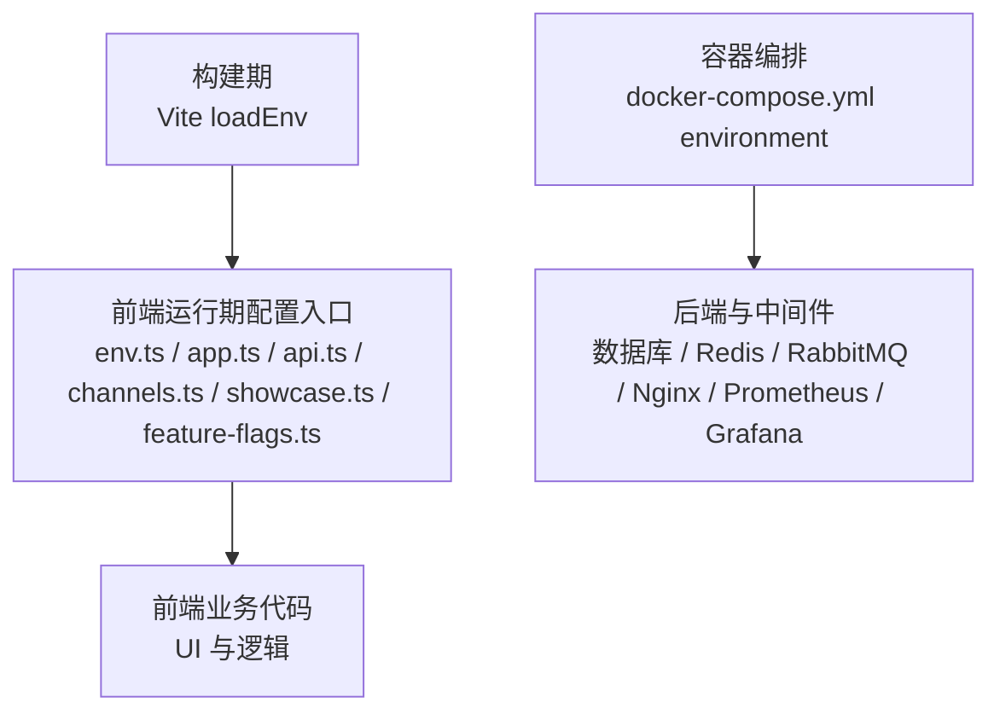

**图示来源**
- [configuration_system.md:1-20](file://.qoder/repowiki/knowledge/zh/校园恋爱平台 Monorepo 根配置/configuration_system.md#L1-L20)
- [configuration_system.md:21-40](file://.qoder/repowiki/knowledge/zh/校园恋爱平台 Monorepo 根配置/configuration_system.md#L21-L40)

**章节来源**
- [configuration_system.md:1-20](file://.qoder/repowiki/knowledge/zh/校园恋爱平台 Monorepo 根配置/configuration_system.md#L1-L20)

## 核心概念：功能开关、环境配置与外部化配置
### 功能开关（Feature Switch）
- 全局唯一真相源是 `feature-flags.ts` 暴露的 `featureFlags` 对象。
- 典型开关包括会员能力、心跳信号、同城村庄、匿名私语等。
- 业务 UI 通过判断这些布尔开关决定是否渲染某功能。
- 展示模式可在应用启动前改写该对象，从而在不修改源码的情况下打开全部开关。

### 环境配置
- 前端环境变量以 `VITE_` 为前缀。
- 白名单限定允许读取的键集合，新增键必须同步声明，否则编译期报错。
- 读取路径采用三层降级：Vite 静态替换、进程环境变量、调用方默认值或抛错。

### 外部化配置策略
- 所有客户端运行时环境变量必须以 `VITE_` 前缀命名。
- 构建期通过 Vite 将受控变量注入 `import.meta.env`，并配合 `define` 把部分变量写入进程环境变量供小程序等平台读取。
- 容器编排通过 `.env` 注入真实凭据，禁止在编排文件中写死敏感信息。

**章节来源**
- [configuration_system.md:21-68](file://.qoder/repowiki/knowledge/zh/校园恋爱平台 Monorepo 根配置/configuration_system.md#L21-L68)

## 后端配置分档：档位文件矩阵与 profile 校验
后端 `apps/api` 是 Spring Boot 应用，配置采用「基线 + profile 叠加」的分档模型：`application.yml` 提供所有档位共享的基线，`application-<profile>.yml` 按激活的 profile 追加或覆盖。仓库中实际存在的档位文件只有 4 个，行数口径为 `wc -l`：

| 档位文件 | 真实行数 | 角色 | 代表性内容 |
| --- | --- | --- | --- |
| `application.yml` | 476 | 基线档（所有档位共享） | `spring.profiles.default: mock`、Redis/RabbitMQ 环境变量占位、`app.*` 业务开关默认值 |
| `application-mock.yml` | 69 | mock 档（本地演示） | 排除 DataSource/Flyway/JPA/Redis/RabbitMQ/Redisson 自动配置；为本地提供 localhost 默认值与开发用 AES 密钥 |
| `application-real.yml` | 195 | real 档（生产/联调） | `spring.datasource`、`spring.data`、`spring.flyway`、`spring.jpa`、`spring.rabbitmq`、`app.wechat-pay.*` |
| `application-wechat.yml` | 23 | wechat 档（真实微信 API） | 仅 `app.wechat.*` 的环境变量占位，凭据一律外置 |

**不存在的档位文件（重要）**：仓库中**没有** `application-dev.yml`，也**没有** `application-test.yml`，任何文档、脚本或排障步骤都不应引用它们。同时要区分两个概念——启动校验的「合法 profile 名单」与「存在档位文件的 profile」并不等价：`ALLOWED_PROFILES` 为 `{mock, real, prod, dev, local, wechat}`（见 [CampusLoveApplication.java:30-32](file://apps/api/src/main/java/com/campuslove/api/CampusLoveApplication.java#L30-L32)），因此 `prod`/`dev`/`local` 能通过校验但不会加载任何档位文件（只得到基线配置），而 `test` 会被直接判为非法 profile 拒绝启动。

**默认值的适用边界**：`spring.profiles.default: mock` 只对「测试引导」生效——本地单元/集成测试用 `@SpringBootTest` 且未显式指定 profile 时依赖它加载 mock 配置（见 [application.yml:4-15](file://apps/api/src/main/resources/application.yml#L4-L15)）。真实启动路径不经过该默认值：`main()` 在 `SpringApplication.run` 之前先执行 `validateActiveProfile(args)`（见 [CampusLoveApplication.java:41-44](file://apps/api/src/main/java/com/campuslove/api/CampusLoveApplication.java#L41-L44)），按「命令行 `--spring.profiles.active` → JVM 系统属性 `-Dspring.profiles.active` → 环境变量 `SPRING_PROFILES_ACTIVE`」的优先级解析激活 profile（见 [CampusLoveApplication.java:84-100](file://apps/api/src/main/java/com/campuslove/api/CampusLoveApplication.java#L84-L100)），为空或含非法项时抛出 `IllegalStateException` 并 `log.error` 后终止（fail-fast，见 [CampusLoveApplication.java:60-81](file://apps/api/src/main/java/com/campuslove/api/CampusLoveApplication.java#L60-L81)）。设计动机写在注释里：防止生产漏配 `SPRING_PROFILES_ACTIVE` 时以 mock 数据模式启动——mock 数据为内存态重启即丢，且 `MockSecurityConfig` 免真实认证。

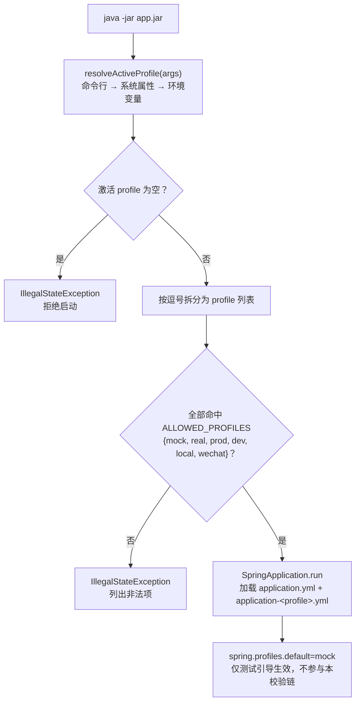

**图示来源**
- [CampusLoveApplication.java:30-32](file://apps/api/src/main/java/com/campuslove/api/CampusLoveApplication.java#L30-L32)
- [CampusLoveApplication.java:41-44](file://apps/api/src/main/java/com/campuslove/api/CampusLoveApplication.java#L41-L44)
- [CampusLoveApplication.java:60-100](file://apps/api/src/main/java/com/campuslove/api/CampusLoveApplication.java#L60-L100)
- [application.yml:4-15](file://apps/api/src/main/resources/application.yml#L4-L15)

**章节来源**
- [application.yml:1-15](file://apps/api/src/main/resources/application.yml#L1-L15)
- [application.yml:184-193](file://apps/api/src/main/resources/application.yml#L184-L193)
- [application-mock.yml:1-14](file://apps/api/src/main/resources/application-mock.yml#L1-L14)
- [application-mock.yml:36-39](file://apps/api/src/main/resources/application-mock.yml#L36-L39)
- [application-real.yml:176-195](file://apps/api/src/main/resources/application-real.yml#L176-L195)
- [application-wechat.yml:14-23](file://apps/api/src/main/resources/application-wechat.yml#L14-L23)
- [CampusLoveApplication.java:30-100](file://apps/api/src/main/java/com/campuslove/api/CampusLoveApplication.java#L30-L100)

## 后端档位扩展机制：装配档位化、可选注入降级与条件属性
在档位之上，后端提供三种互补的扩展手段，用来让同一份代码在不同档位呈现不同能力。

**手段一：Bean 装配档位化（`@Profile`）**。类级注解决定 Bean 是否进入容器，按源码统计（统计口径：行首类级 `@Profile` 注解，出现文件数）：`@Profile("real")` 169 个源文件、`@Profile("mock")` 50 个、`@Profile("!mock")` 4 个、`@Profile("!real")` 1 个。典型如 `GeoService` 与 `RecommendationRanker` 标注 `@Profile("real")`（见 [GeoService.java:23-25](file://apps/api/src/main/java/com/campuslove/api/location/GeoService.java#L23-L25)、[RecommendationRanker.java:59](file://apps/api/src/main/java/com/campuslove/api/discover/RecommendationRanker.java#L59)），原因是 mock 档排除了 JPA 自动配置、无仓库 Bean 可注入（见 [application-mock.yml:1-14](file://apps/api/src/main/resources/application-mock.yml#L1-L14)）；`DatabaseConfigValidator` 与 `AdminOpenidValidator` 等用 `@Profile("!mock")` 表示「非 mock 即启用」（见 [DatabaseConfigValidator.java:19-21](file://apps/api/src/main/java/com/campuslove/api/config/DatabaseConfigValidator.java#L19-L21)）。

**手段二：可选注入 + 运行时降级**。档位限定装配会带来「另一档缺 Bean」的引用问题，本仓库有三种写法：
- 字段 `@Autowired(required = false)`：`LocationController.geoService`，缺失时为 `null` 并在端点内降级（见 [LocationController.java:26-28](file://apps/api/src/main/java/com/campuslove/api/location/LocationController.java#L26-L28)）。
- 构造注入 `ObjectProvider<T>`：`FeatureSwitchService` 用 `switchRepositoryProvider` 包裹 `AdminAppSwitchRepository`，mock 档无 JPA 时 `getIfAvailable()` 返回 `null`，开关一律按 `false`（封存态）处理（见 [FeatureSwitchService.java:19-39](file://apps/api/src/main/java/com/campuslove/api/config/FeatureSwitchService.java#L19-L39)、[FeatureSwitchService.java:49-51](file://apps/api/src/main/java/com/campuslove/api/config/FeatureSwitchService.java#L49-L51)）。
- 同档 Bean 之间的强依赖：`BillingController` 自身 `@Profile("real")`，因此可以直接把同档的 `WxPayProperties` 声明为构造参数（见 [BillingController.java:64](file://apps/api/src/main/java/com/campuslove/api/vip/BillingController.java#L64)、[WxPayConfig.java:22-24](file://apps/api/src/main/java/com/campuslove/api/wxpay/WxPayConfig.java#L22-L24)）。

**手段三：条件属性装配（`@ConditionalOnProperty`）**。以「配置键是否给出」而非 profile 决定 Bean 存在性，读码可见 4 处：演示认证端点 `DemoCertificationSimulateController`（见 [DemoCertificationSimulateController.java:28](file://apps/api/src/main/java/com/campuslove/api/campus/DemoCertificationSimulateController.java#L28)）、Redisson 手工配置 `app.redisson.manual-config`（见 [RedisConfig.java:188](file://apps/api/src/main/java/com/campuslove/api/config/RedisConfig.java#L188)）、以及微信内容安全客户端与服务对 `app.content-security.wechat-secret` 的条件注册（见 [WeChatMsgSecCheckClient.java:33](file://apps/api/src/main/java/com/campuslove/api/config/WeChatMsgSecCheckClient.java#L33)、[WeChatImgSecCheckService.java:46](file://apps/api/src/main/java/com/campuslove/api/media/WeChatImgSecCheckService.java#L46)）。基线里对应键默认空，即「不配置就不启用」：`app.content-security.wechat-secret: ${CONTENT_SECURITY_WECHAT_SECRET:}`（见 [application.yml:256-257](file://apps/api/src/main/resources/application.yml#L256-L257)）。

**启动期收口（fail-fast 校验器）**。扩展点还包含一组 `@PostConstruct` / `InitializingBean` 校验器，把「配置缺失」提前到启动期暴露：`DatabaseConfigValidator` 校验数据库凭据（见 [DatabaseConfigValidator.java:41-49](file://apps/api/src/main/java/com/campuslove/api/config/DatabaseConfigValidator.java#L41-L49)）、`AesEncryptor.init()` 在密钥缺失时无条件拒绝启动（见 [AesEncryptor.java:85-102](file://apps/api/src/main/java/com/campuslove/api/config/AesEncryptor.java#L85-L102)）、`WxPayBootstrapChecker` 校验微信支付必填项（见 [WxPayBootstrapChecker.java:36-49](file://apps/api/src/main/java/com/campuslove/api/wxpay/WxPayBootstrapChecker.java#L36-L49)）、`WebSocketConfig` 校验 Origin（见 [WebSocketConfig.java:107-121](file://apps/api/src/main/java/com/campuslove/api/config/WebSocketConfig.java#L107-L121)）。

**章节来源**
- [GeoService.java:19-25](file://apps/api/src/main/java/com/campuslove/api/location/GeoService.java#L19-L25)
- [LocationController.java:26-28](file://apps/api/src/main/java/com/campuslove/api/location/LocationController.java#L26-L28)
- [FeatureSwitchService.java:17-38](file://apps/api/src/main/java/com/campuslove/api/config/FeatureSwitchService.java#L17-L38)
- [DatabaseConfigValidator.java:10-49](file://apps/api/src/main/java/com/campuslove/api/config/DatabaseConfigValidator.java#L10-L49)
- [AesEncryptor.java:85-106](file://apps/api/src/main/java/com/campuslove/api/config/AesEncryptor.java#L85-L106)
- [application-mock.yml:1-14](file://apps/api/src/main/resources/application-mock.yml#L1-L14)

## LBS 位置端点的 mock 档降级实证
提交 `20ebfcd7`（fix(api,bat)：GeoService 限定 real 档装配修复 mock 启动链）解决的问题是：`GeoService` 构造依赖 JPA 仓库 `UserRepository`，而 mock 档排除了 `DataSourceAutoConfiguration` / `HibernateJpaAutoConfiguration`，导致 mock 档容器化 `GeoService` 时找不到 Bean、整条启动链失败。修复方式是**两半**，缺一不可：

1. **装配侧限定**：`GeoService` 加 `@Profile("real")`，只在 real 档注册；类注释明确写出与 `RecommendationRanker` 同规格，并把 mock 档兜底责任交给控制器（见 [GeoService.java:19-25](file://apps/api/src/main/java/com/campuslove/api/location/GeoService.java#L19-L25)、[GeoService.java:35-39](file://apps/api/src/main/java/com/campuslove/api/location/GeoService.java#L35-L39)）。
2. **引用侧降级**：`LocationController` 改为可选注入，字段 `geoService` 在 mock 档为 `null`（见 [LocationController.java:26-28](file://apps/api/src/main/java/com/campuslove/api/location/LocationController.java#L26-L28)）。控制器本身**没有** `@Profile`，因此 `/api/v1/location/**` 路由在两档都存在，不会出现 404 路由消失。

两半落地后的可观察行为（读码核实）：

- `POST /api/v1/location/report`：校验顺序是「三项 400 参数校验」在前、「缺 Bean 降级」在后——依次检查经纬度非空（[LocationController.java:49-51](file://apps/api/src/main/java/com/campuslove/api/location/LocationController.java#L49-L51)）、纬度范围 `-90 ~ 90`（[LocationController.java:53-55](file://apps/api/src/main/java/com/campuslove/api/location/LocationController.java#L53-L55)）、经度范围 `-180 ~ 180`（[LocationController.java:56-58](file://apps/api/src/main/java/com/campuslove/api/location/LocationController.java#L56-L58)），全部通过后才判断 `geoService == null` 并返回 `ApiResponse.error(503, "LBS 功能未在当前环境开启")`（见 [LocationController.java:59-61](file://apps/api/src/main/java/com/campuslove/api/location/LocationController.java#L59-L61)）。这里的 `503` 是**响应体里的业务码，不是 HTTP 状态码**：`ApiResponse` 是 `record (int code, String message, T data, String traceId)`，`error(code, message)` 只填充 `code` 字段（成功码约定为 `0`），控制器直接返回该 record 而不带 `@ResponseStatus`，因此 mock 档下这条响应实际是 HTTP 200 + `{"code":503,...}`（见 [ApiResponse.java:34-40](file://apps/api/src/main/java/com/campuslove/api/common/ApiResponse.java#L34-L40)、[ApiResponse.java:83-85](file://apps/api/src/main/java/com/campuslove/api/common/ApiResponse.java#L83-L85)）。参数非法时同理是 `code=400` 的响应体。
- `GET /api/v1/location/nearby`：缺 Bean 时返回 `ApiResponse.ok(List.of())`，即 `code=0` 的空列表（见 [LocationController.java:80-82](file://apps/api/src/main/java/com/campuslove/api/location/LocationController.java#L80-L82)），正常路径则委托 `geoService.findNearby(lat, lng, radiusKm, 50)`（见 [LocationController.java:83-84](file://apps/api/src/main/java/com/campuslove/api/location/LocationController.java#L83-L84)）。

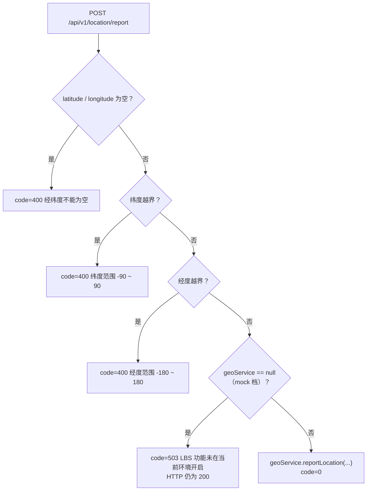

**降级语义的两处不对称**（读码所得，接入前端时需按此判断）：同一「功能未开启」状态下 `report` 走 `code=503` 显式告知、`nearby` 走 `code=0` + 空列表静默返回，客户端若仅凭列表为空无法区分「附近无人」与「当前档位未开启 LBS」；另外两档都存在的 `/ip-city` 路由不受影响，因为 `LocationService` 无 `@Profile`（类级注解仅 `@Service`），且只读取 `app.location.*` 两个配置键（见 [LocationService.java:25](file://apps/api/src/main/java/com/campuslove/api/location/LocationService.java#L25)、[LocationService.java:57-58](file://apps/api/src/main/java/com/campuslove/api/location/LocationService.java#L57-L58)、[LocationController.java:34-38](file://apps/api/src/main/java/com/campuslove/api/location/LocationController.java#L34-L38)）。

**图示来源**
- [LocationController.java:44-85](file://apps/api/src/main/java/com/campuslove/api/location/LocationController.java#L44-L85)
- [ApiResponse.java:34-85](file://apps/api/src/main/java/com/campuslove/api/common/ApiResponse.java#L34-L85)

**章节来源**
- [GeoService.java:19-39](file://apps/api/src/main/java/com/campuslove/api/location/GeoService.java#L19-L39)
- [LocationController.java:20-85](file://apps/api/src/main/java/com/campuslove/api/location/LocationController.java#L20-L85)
- [application-mock.yml:1-14](file://apps/api/src/main/resources/application-mock.yml#L1-L14)

## 外部服务配置键的档位分布：微信支付配置
提交 `bd3cdfbf` 把微信支付工程补齐的配置项收在**单一档位文件**里：`app.wechat-pay.*` 只出现在 `application-real.yml`，`application.yml` 基线与 `application-mock.yml` 均未定义该前缀（全仓检索 `wechat-pay` 在 `src/main/resources` 下仅命中 [application-real.yml:181](file://apps/api/src/main/resources/application-real.yml#L181)）。

**缺省安全**：`enabled` 取值为 `${APP_WXPAY_ENABLED:false}`，默认 `false`（封存态），代码侧字段默认值同为 `false`（见 [application-real.yml:176-195](file://apps/api/src/main/resources/application-real.yml#L176-L195)、[WxPayProperties.java:36-40](file://apps/api/src/main/java/com/campuslove/api/wxpay/WxPayProperties.java#L36-L40)）。全部敏感项走环境变量注入，不留默认值：`app-id`、`mchid`、`mch-serial-no`、`merchant-private-key`、`api-v3-key`、`notify-url`、`refund-notify-url`、`platform-cert`、`callback-ip-whitelist`，另有超时与关单周期三项带数值默认（`connect-timeout-ms:3000`、`read-timeout-ms:6000`、`order-expire-minutes:120`）。

**三道闸门**（按调用链顺序）：
1. **装配闸**：`WxPayConfig` 与 `BillingController` 均标注 `@Profile("real")`，mock 档不注册微信支付 Bean 与端点（见 [WxPayConfig.java:22-25](file://apps/api/src/main/java/com/campuslove/api/wxpay/WxPayConfig.java#L22-L25)、[BillingController.java:64](file://apps/api/src/main/java/com/campuslove/api/vip/BillingController.java#L64)）。
2. **配置闸**：`enabled=false` 时回调端点抛 `ResourceNotFoundException`，对外表现为 404；IP 白名单未命中同样按 404 处理以避免暴露端点存在性（见 [BillingController.java:121-131](file://apps/api/src/main/java/com/campuslove/api/vip/BillingController.java#L121-L131)）。
3. **启动闸**：`enabled=true` 但 `findMissingRequired()` 非空时抛 `IllegalStateException` 拒绝启动，随后本地解析商户私钥与平台证书公钥，格式非法同样 fail-fast，全程不发起网络调用；`callback-ip-whitelist` 为空只告警不阻断（见 [WxPayBootstrapChecker.java:36-49](file://apps/api/src/main/java/com/campuslove/api/wxpay/WxPayBootstrapChecker.java#L36-L49)、[WxPayBootstrapChecker.java:63-66](file://apps/api/src/main/java/com/campuslove/api/wxpay/WxPayBootstrapChecker.java#L63-L66)、[WxPayProperties.java:91-94](file://apps/api/src/main/java/com/campuslove/api/wxpay/WxPayProperties.java#L91-L94)、[WxPayProperties.java:104-108](file://apps/api/src/main/java/com/campuslove/api/wxpay/WxPayProperties.java#L104-L108)）。

**与 `app.wechat.*` 的区别**：同前缀家族的 `app.wechat.*`（微信登录 jscode2session）在基线 `application.yml` 有定义、并在 `application-wechat.yml` 中只做环境变量占位；而 `app.wechat-pay.*` 只在 real 档存在。两者键名相近但前缀独立（`wechat` 与 `wechat-pay`），排查时勿混用注入变量（见 [application.yml:263-279](file://apps/api/src/main/resources/application.yml#L263-L279)、[application-wechat.yml:14-23](file://apps/api/src/main/resources/application-wechat.yml#L14-L23)）。

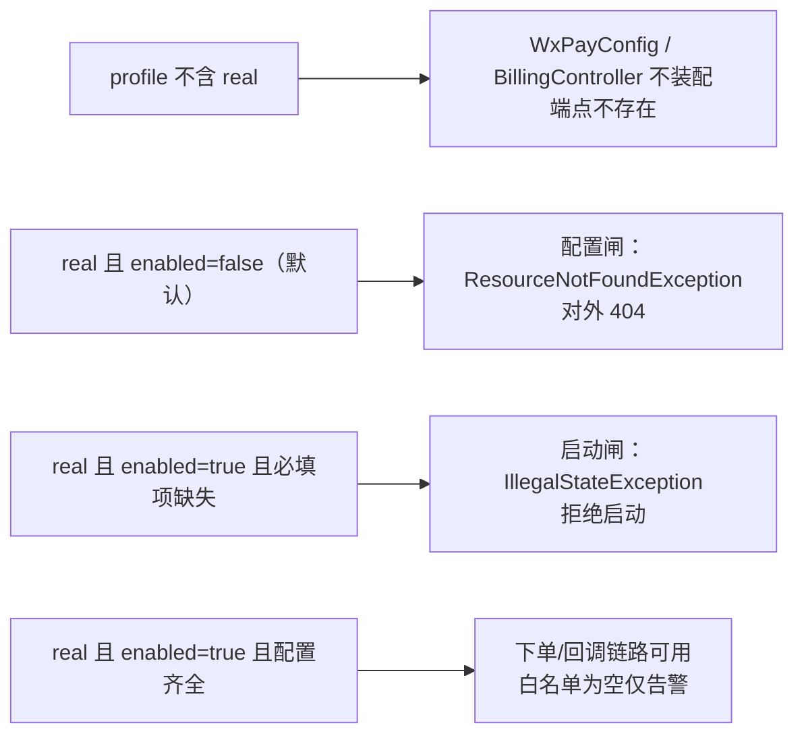

**图示来源**
- [WxPayConfig.java:22-36](file://apps/api/src/main/java/com/campuslove/api/wxpay/WxPayConfig.java#L22-L36)
- [BillingController.java:64-131](file://apps/api/src/main/java/com/campuslove/api/vip/BillingController.java#L64-L131)
- [WxPayBootstrapChecker.java:36-66](file://apps/api/src/main/java/com/campuslove/api/wxpay/WxPayBootstrapChecker.java#L36-L66)

**章节来源**
- [application-real.yml:176-195](file://apps/api/src/main/resources/application-real.yml#L176-L195)
- [WxPayProperties.java:33-108](file://apps/api/src/main/java/com/campuslove/api/wxpay/WxPayProperties.java#L33-L108)
- [WxPayConfig.java:8-37](file://apps/api/src/main/java/com/campuslove/api/wxpay/WxPayConfig.java#L8-L37)
- [WxPayBootstrapChecker.java:8-70](file://apps/api/src/main/java/com/campuslove/api/wxpay/WxPayBootstrapChecker.java#L8-L70)
- [BillingController.java:44-131](file://apps/api/src/main/java/com/campuslove/api/vip/BillingController.java#L44-L131)

## WebSocket Origin 校验的档位判定与命名偏差
`bd3cdfbf` 在 `WebSocketConfig` 新增 `@PostConstruct` 的 Origin 收口校验，逻辑是：从 `Environment.getActiveProfiles()` 取激活 profile 列表，**只要列表中包含 `mock` 就直接 return 放行**；否则解析 `allowedOriginPatternsRaw`，解析结果为空数组时抛 `IllegalStateException`（见 [WebSocketConfig.java:107-121](file://apps/api/src/main/java/com/campuslove/api/config/WebSocketConfig.java#L107-L121)）。

**必须如实指出的命名与语义不符**：该方法名为 `failFastWhenOriginUnconfiguredInRealProfile`（[WebSocketConfig.java:108](file://apps/api/src/main/java/com/campuslove/api/config/WebSocketConfig.java#L108)），字面含义是「real profile 下才校验」，但实现条件是「激活 profile **不含 mock**」——即判定的是「非 mock」而非「等于 real」。因此 `SPRING_PROFILES_ACTIVE=prod`、`local`、`wechat` 等**不含 real 也不含 mock** 的组合同样会触发该校验；反之 `SPRING_PROFILES_ACTIVE=real,mock` 这种混合组合会被 mock 分支放行而**跳过**校验。类内另一处 `isMockProfile()` 使用同样的 `contains("mock")` 判定，握手期 mock 跳过真实 JWT 校验也走这一条件（见 [WebSocketConfig.java:286-289](file://apps/api/src/main/java/com/campuslove/api/config/WebSocketConfig.java#L286-L289)）。

**Origin 取值的三层来源**：注入点用嵌套占位符 `${app.websocket.allowed-origin-patterns:${WEBSOCKET_ALLOWED_ORIGIN_PATTERNS:}}`，即「档位配置 → 环境变量 → 空」三级兜底（见 [WebSocketConfig.java:66-67](file://apps/api/src/main/java/com/campuslove/api/config/WebSocketConfig.java#L66-L67)）。基线把值置空（`application.yml` 的 `websocket.allowed-origin-patterns: ${WEBSOCKET_ALLOWED_ORIGIN_PATTERNS:}`，见 [application.yml:188-193](file://apps/api/src/main/resources/application.yml#L188-L193)），mock 档提供本地默认 `http://localhost:*,http://127.0.0.1:*`（见 [application-mock.yml:36-39](file://apps/api/src/main/resources/application-mock.yml#L36-L39)），real 档不写该键，因此必须由 `WEBSOCKET_ALLOWED_ORIGIN_PATTERNS` 显式注入，否则启动失败。

**空值与解析规则**：`parseOriginPatterns` 对 `null`/空白返回长度 0 的数组，否则按逗号切分、`trim` 并丢弃空项（见 [WebSocketConfig.java:164-172](file://apps/api/src/main/java/com/campuslove/api/config/WebSocketConfig.java#L164-L172)）；`registerStompEndpoints` 仅在解析结果非空时才调用 `setAllowedOriginPatterns`，为空时不设置该属性（见 [WebSocketConfig.java:146-156](file://apps/api/src/main/java/com/campuslove/api/config/WebSocketConfig.java#L146-L156)）。这正是该校验存在的原因——不设 AllowedOriginPatterns 在浏览器侧等价于不限制 Origin，构成跨站 WebSocket 劫持面。

**顺带的文档偏差**：类级注释仍写「Origin 限制: 仅允许 localhost 和 127.0.0.1 来源」（见 [WebSocketConfig.java:35](file://apps/api/src/main/java/com/campuslove/api/config/WebSocketConfig.java#L35)），与「默认清空、由配置注入、非 mock 未配置即拒绝启动」的现状不符，属过时描述。

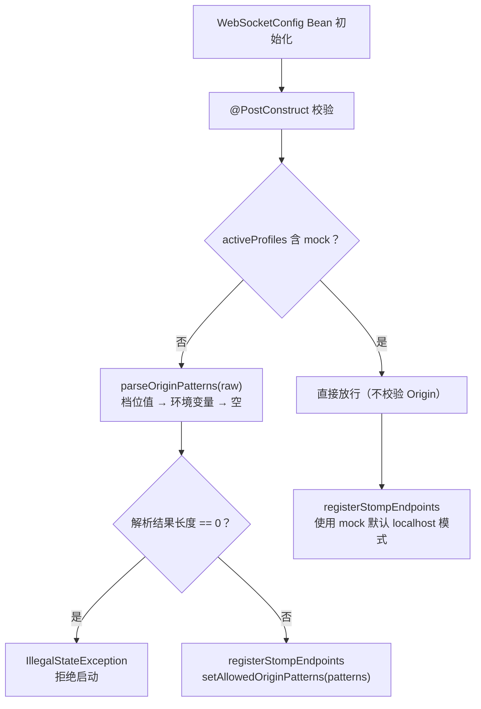

**图示来源**
- [WebSocketConfig.java:66-67](file://apps/api/src/main/java/com/campuslove/api/config/WebSocketConfig.java#L66-L67)
- [WebSocketConfig.java:107-121](file://apps/api/src/main/java/com/campuslove/api/config/WebSocketConfig.java#L107-L121)
- [WebSocketConfig.java:146-172](file://apps/api/src/main/java/com/campuslove/api/config/WebSocketConfig.java#L146-L172)

**章节来源**
- [WebSocketConfig.java:32-35](file://apps/api/src/main/java/com/campuslove/api/config/WebSocketConfig.java#L32-L35)
- [WebSocketConfig.java:55-121](file://apps/api/src/main/java/com/campuslove/api/config/WebSocketConfig.java#L55-L121)
- [WebSocketConfig.java:146-172](file://apps/api/src/main/java/com/campuslove/api/config/WebSocketConfig.java#L146-L172)
- [WebSocketConfig.java:286-289](file://apps/api/src/main/java/com/campuslove/api/config/WebSocketConfig.java#L286-L289)
- [application.yml:188-193](file://apps/api/src/main/resources/application.yml#L188-L193)
- [application-mock.yml:36-39](file://apps/api/src/main/resources/application-mock.yml#L36-L39)

## 架构总览
前端配置架构可以理解为“单一入口 + 白名单 + 三层降级 + 运行时开关”的组合：

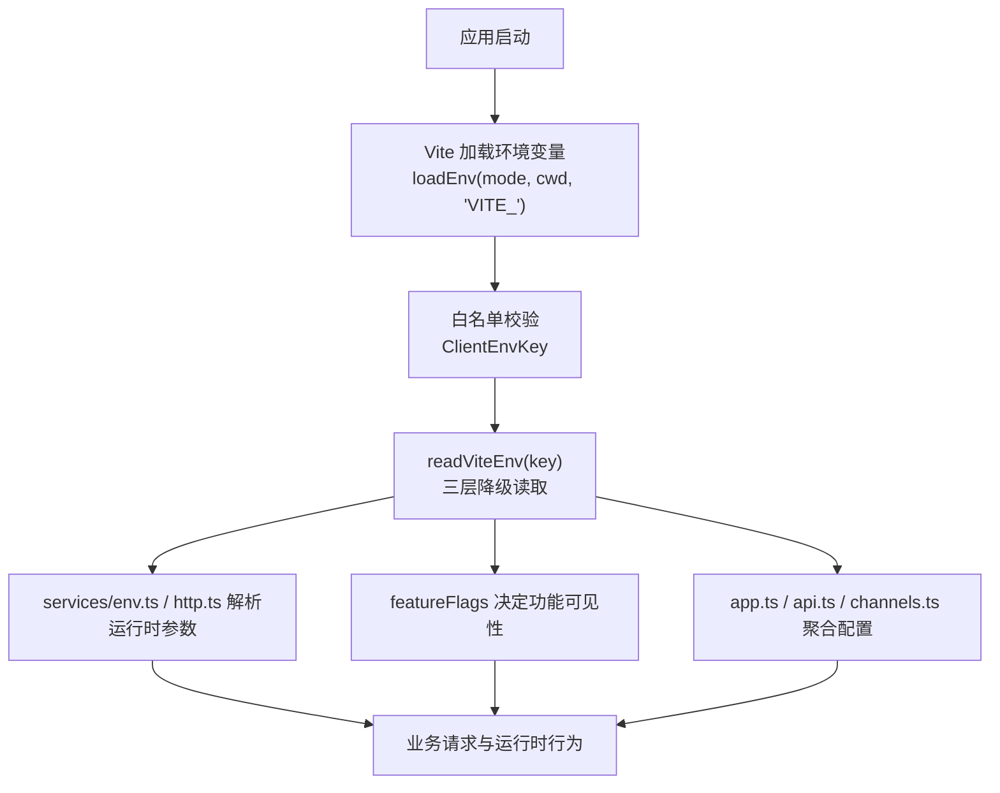

**图示来源**
- [configuration_system.md:1-20](file://.qoder/repowiki/knowledge/zh/校园恋爱平台 Monorepo 根配置/configuration_system.md#L1-L20)
- [configuration_system.md:21-40](file://.qoder/repowiki/knowledge/zh/校园恋爱平台 Monorepo 根配置/configuration_system.md#L21-L40)
- [configuration_system.md:41-68](file://.qoder/repowiki/knowledge/zh/校园恋爱平台 Monorepo 根配置/configuration_system.md#L41-L68)

## 关键组件分析
### 环境变量读取入口
- 作用：统一对外暴露 `readViteEnv(key)`，屏蔽不同平台对 `import.meta.env` 与 `process.env` 的差异。
- 策略：优先使用 Vite 构建期静态替换的值；若不可用则回退到进程环境变量；仍缺失时返回 `undefined`，由调用方提供默认值或抛出明确错误。
- 安全：生产环境缺少必要变量（例如 API Base URL）时应阻止启动，避免静默失败。

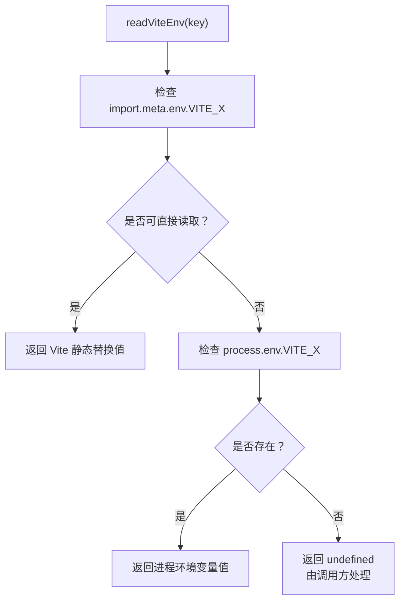

**图示来源**
- [configuration_system.md:21-40](file://.qoder/repowiki/knowledge/zh/校园恋爱平台 Monorepo 根配置/configuration_system.md#L21-L40)

**章节来源**
- [configuration_system.md:21-40](file://.qoder/repowiki/knowledge/zh/校园恋爱平台 Monorepo 根配置/configuration_system.md#L21-L40)

### 应用级配置与 API 配置
- `app.ts`：承载应用名称、版本、调试标签、支持邮箱等静态常量；版本号应单源来自构建期环境变量，避免多处维护。
- `api.ts`：聚合 HTTP 请求层配置，如超时、重试、401 处理、拦截器开关等，由常量模块提供原始数值。
- `channels.ts`：定义频道元数据与运行时行为参数，如数据源、分类、是否需要校园身份等。

这些模块共同构成前端运行期的“配置聚合层”，让业务代码无需直接关心底层环境变量。

**章节来源**
- [configuration_system.md:21-40](file://.qoder/repowiki/knowledge/zh/校园恋爱平台 Monorepo 根配置/configuration_system.md#L21-L40)

### 展示模式与功能开关
- `showcase.ts`：读取展示模式环境变量，并在应用创建前调用函数将所有功能开关设为启用状态，用于演示或超级管理员展示场景。
- `feature-flags.ts`：集中管理运行时功能开关，是业务 UI 判断功能可见性的唯一依据。

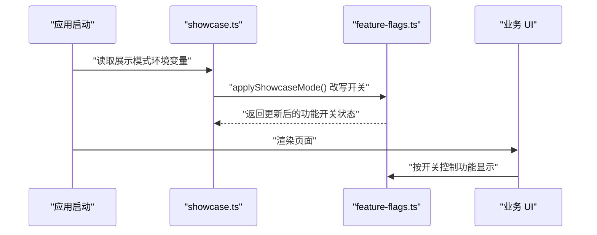

**图示来源**
- [configuration_system.md:21-40](file://.qoder/repowiki/knowledge/zh/校园恋爱平台 Monorepo 根配置/configuration_system.md#L21-L40)

**章节来源**
- [configuration_system.md:21-40](file://.qoder/repowiki/knowledge/zh/校园恋爱平台 Monorepo 根配置/configuration_system.md#L21-L40)

## 依赖关系与数据流
前端配置体系的依赖关系可概括为：
- Vite 构建脚本负责加载环境变量并进行静态替换。
- 配置入口模块负责类型校验、取值降级和默认值处理。
- 功能开关模块负责运行时策略控制。
- 服务层模块负责解析运行时网络与安全相关参数。
- 容器编排负责向后端与中间件注入环境变量。

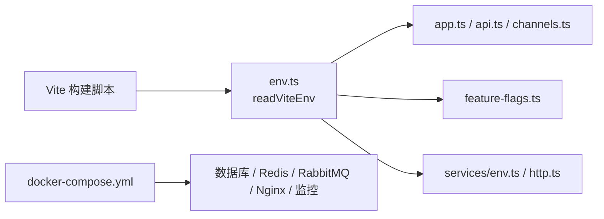

**图示来源**
- [configuration_system.md:1-20](file://.qoder/repowiki/knowledge/zh/校园恋爱平台 Monorepo 根配置/configuration_system.md#L1-L20)
- [configuration_system.md:41-68](file://.qoder/repowiki/knowledge/zh/校园恋爱平台 Monorepo 根配置/configuration_system.md#L41-L68)

**章节来源**
- [configuration_system.md:1-20](file://.qoder/repowiki/knowledge/zh/校园恋爱平台 Monorepo 根配置/configuration_system.md#L1-L20)
- [configuration_system.md:41-68](file://.qoder/repowiki/knowledge/zh/校园恋爱平台 Monorepo 根配置/configuration_system.md#L41-L68)

## 多环境与灰度发布
### 多环境差异
- 构建期通过 mode 选择不同 `.env.[mode]` 文件。
- H5 与小程序双端兼容：H5 走 `import.meta.env`，小程序走 `process.env`。
- 开发环境检测不依赖固定常量，而是结合运行位置与进程环境变量判断，避免在某些平台访问受限对象。

### 灰度与实验性功能控制
- 当前仓库证据显示，功能开关主要通过前端 `featureFlags` 控制，适合做前端功能的显隐灰度。
- 展示模式可将全部开关打开，常用于演示或内部验收。
- 仓库未提供后端远程下发开关、百分比灰度或按用户分桶的实验平台实现证据；如需更精细灰度，应在后端引入配置中心或开关服务，并由前端定期拉取或 WebSocket 推送。

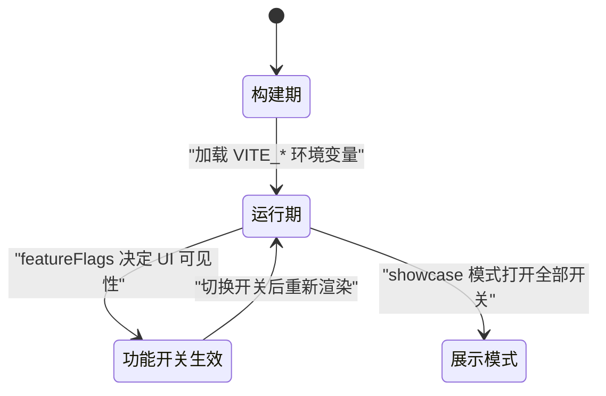

**图示来源**
- [configuration_system.md:21-40](file://.qoder/repowiki/knowledge/zh/校园恋爱平台 Monorepo 根配置/configuration_system.md#L21-L40)

**章节来源**
- [configuration_system.md:21-40](file://.qoder/repowiki/knowledge/zh/校园恋爱平台 Monorepo 根配置/configuration_system.md#L21-L40)

## 第三方服务与中间件配置
根据已有文档，容器编排层负责向多种服务注入环境变量：
- 数据库
- Redis
- RabbitMQ
- Nginx
- Prometheus
- Grafana

配置注入方式是通过 `docker-compose.yml` 的 `environment:` 段，并要求真实凭据通过 `.env` 文件注入，而不是直接写在编排文件中。

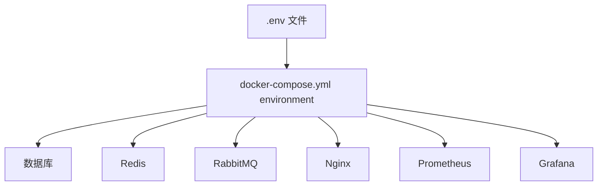

**图示来源**
- [configuration_system.md:1-20](file://.qoder/repowiki/knowledge/zh/校园恋爱平台 Monorepo 根配置/configuration_system.md#L1-L20)
- [configuration_system.md:41-68](file://.qoder/repowiki/knowledge/zh/校园恋爱平台 Monorepo 根配置/configuration_system.md#L41-L68)

**章节来源**
- [configuration_system.md:1-20](file://.qoder/repowiki/knowledge/zh/校园恋爱平台 Monorepo 根配置/configuration_system.md#L1-L20)
- [configuration_system.md:41-68](file://.qoder/repowiki/knowledge/zh/校园恋爱平台 Monorepo 根配置/configuration_system.md#L41-L68)

## 安全策略与审计
### 敏感信息保护
- 环境变量必须以 `VITE_` 前缀命名，并通过白名单限制可访问键集。
- `.env` 文件被排除在版本控制之外，禁止提交真实凭据。
- 容器编排文件中不得写死敏感信息，必须通过 `.env` 注入。
- 某些外部密钥存在占位符校验，未配置时应跳过外部请求，避免误连。

### 权限与审计
- 当前仓库证据未直接体现配置中心的权限模型或配置变更审计日志。
- 对于前端配置，安全重点在于“白名单 + 构建期注入 + 生产必填校验”。
- 对于后端与中间件配置，安全重点在于“环境变量隔离 + 凭据外置 + 部署凭据最小化”。

**章节来源**
- [configuration_system.md:41-68](file://.qoder/repowiki/knowledge/zh/校园恋爱平台 Monorepo 根配置/configuration_system.md#L41-L68)

## 验证机制、默认值与错误诊断
### 验证机制
- 环境变量键名由联合类型白名单限定，新增键需同步声明，否则 TypeScript 编译期报错。
- 生产环境缺少必要环境变量时抛出错误，阻止带错误地址的应用继续启动。
- 外部密钥若匹配占位符，视为未配置，调用方应跳过相应外部请求。

### 默认值处理
- `readViteEnv` 返回 `undefined` 时，由调用方决定默认值或错误行为。
- 版本号等静态配置强调单源化，避免多处维护导致不一致。

### 错误诊断
- 若前端无法读取环境变量，首先检查 Vite 是否将该键加入白名单。
- 若小程序平台无法读取，检查是否走 `process.env` 路径。
- 若生产包启动异常，检查是否遗漏必填环境变量。

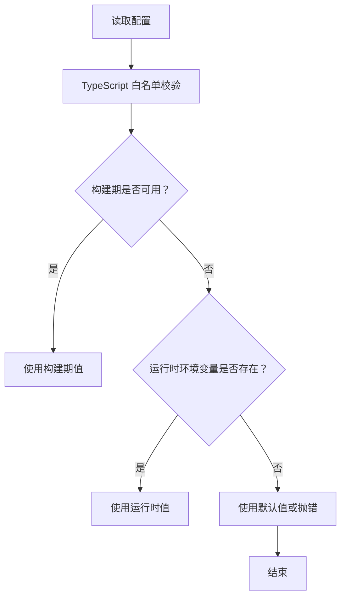

**图示来源**
- [configuration_system.md:21-40](file://.qoder/repowiki/knowledge/zh/校园恋爱平台 Monorepo 根配置/configuration_system.md#L21-L40)
- [configuration_system.md:41-68](file://.qoder/repowiki/knowledge/zh/校园恋爱平台 Monorepo 根配置/configuration_system.md#L41-L68)

**章节来源**
- [configuration_system.md:21-40](file://.qoder/repowiki/knowledge/zh/校园恋爱平台 Monorepo 根配置/configuration_system.md#L21-L40)
- [configuration_system.md:41-68](file://.qoder/repowiki/knowledge/zh/校园恋爱平台 Monorepo 根配置/configuration_system.md#L41-L68)

## 性能与可维护性建议
### 性能
- 功能开关在前端是布尔值判断，开销极低。
- 环境变量读取集中在入口模块，避免业务代码重复解析。
- 构建期静态替换可减少运行时分支判断成本。

### 可维护性
- 所有前端环境变量通过白名单集中管理，新增配置需同步类型、读取分支与构建脚本。
- 功能开关集中维护，便于统一灰度和下线。
- 版本号单源化，减少配置漂移。

**章节来源**
- [configuration_system.md:21-40](file://.qoder/repowiki/knowledge/zh/校园恋爱平台 Monorepo 根配置/configuration_system.md#L21-L40)
- [configuration_system.md:41-68](file://.qoder/repowiki/knowledge/zh/校园恋爱平台 Monorepo 根配置/configuration_system.md#L41-L68)

## 常见问题排查
### 问题一：新增环境变量后小程序或构建失败
- 原因：未在环境变量读取入口注册新键，或未在构建脚本白名单中添加。
- 解决：在类型白名单、读取分支、构建脚本三处同步添加。

### 问题二：生产环境启动时报缺少 API 地址
- 原因：生产包未配置必要环境变量。
- 解决：确保部署时注入 `VITE_API_BASE_URL` 等必填变量。

### 问题三：小程序无法读取环境变量
- 原因：小程序环境无 `window`，不能直接使用 H5 的路径读取环境变量。
- 解决：确保通过 `process.env` 路径读取，并在 Vite 配置中将受控变量注入进程环境变量。

### 问题四：外部服务请求异常
- 原因：密钥仍是占位符或未正确注入。
- 解决：检查环境变量是否已替换为真实值，并在未配置时跳过外部请求。

**章节来源**
- [configuration_system.md:21-40](file://.qoder/repowiki/knowledge/zh/校园恋爱平台 Monorepo 根配置/configuration_system.md#L21-L40)
- [configuration_system.md:41-68](file://.qoder/repowiki/knowledge/zh/校园恋爱平台 Monorepo 根配置/configuration_system.md#L41-L68)

## 结论
Campus Love 的配置系统在现有仓库证据中呈现为“前端为主、编排为辅”的结构：
- 前端通过 Vite 构建期环境变量加载、类型白名单、三层降级读取与集中式功能开关，形成稳定可控的配置入口。
- 容器编排通过 `docker-compose.yml` 的 `environment:` 段向数据库、缓存、消息队列、反向代理与监控系统注入环境变量。
- 功能开关目前主要支撑前端可见性与演示模式；如需更细粒度的灰度发布、远程下发与审计能力，应在后端引入配置中心或开关服务，并与前端拉取机制集成。
- 安全方面应坚持环境变量前缀、白名单、凭据外置、生产必填校验等原则。

**章节来源**
- [configuration_system.md:1-68](file://.qoder/repowiki/knowledge/zh/校园恋爱平台 Monorepo 根配置/configuration_system.md#L1-L68)