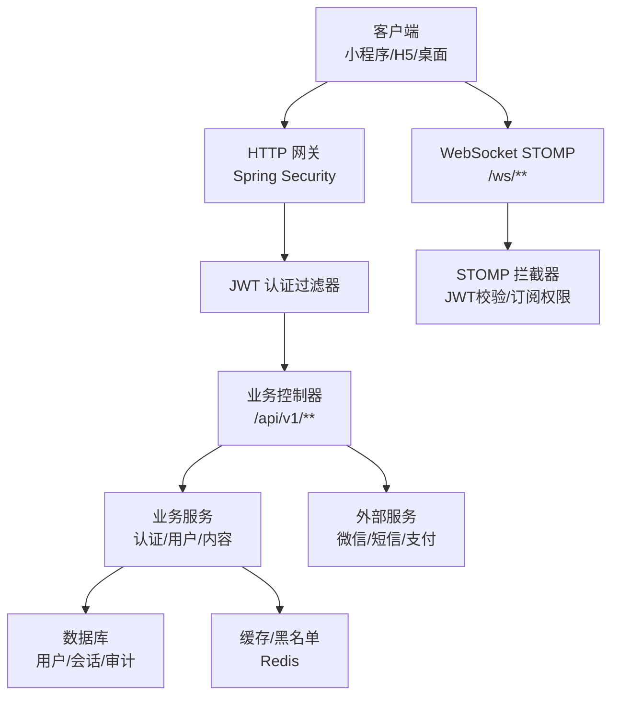
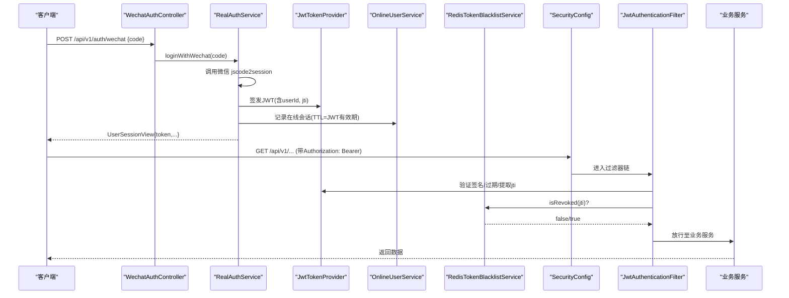
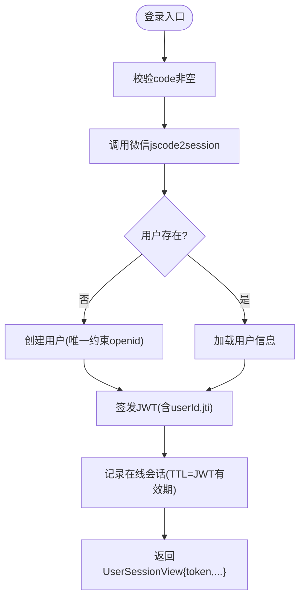
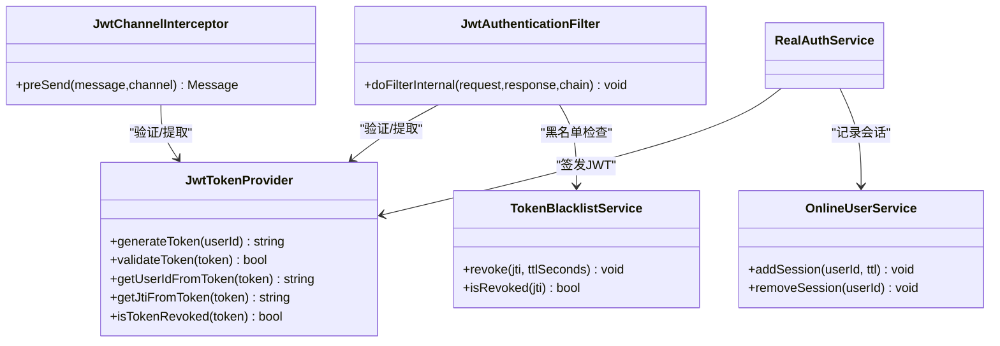
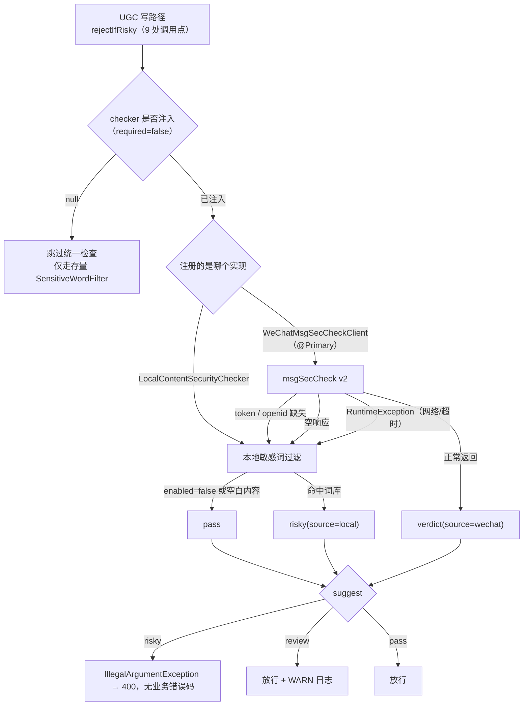
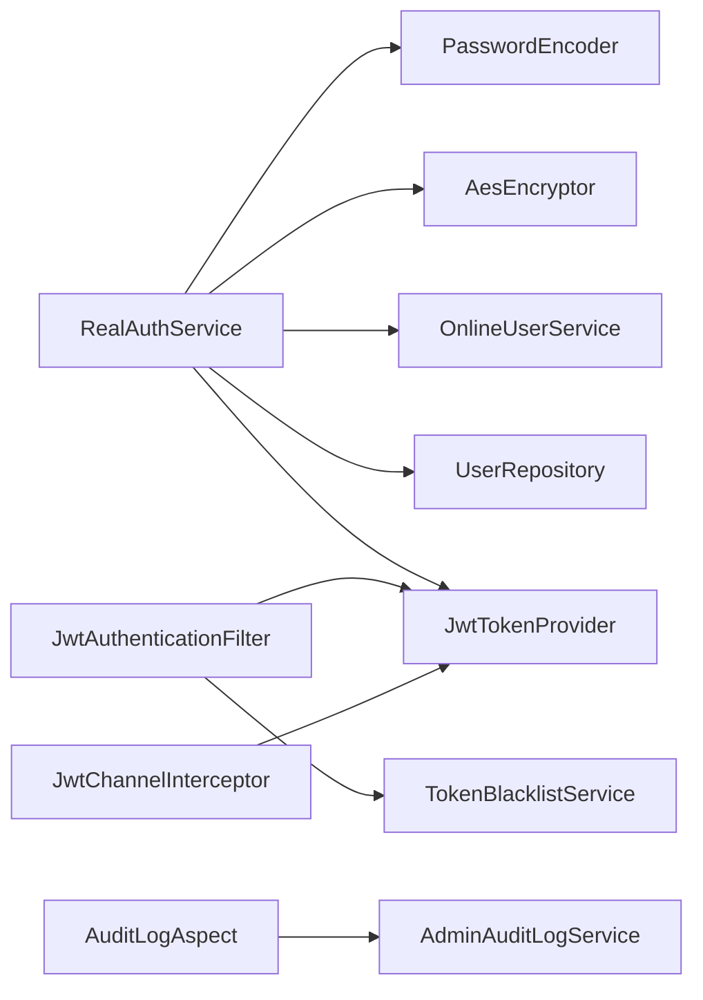

# 安全架构设计

<cite>
**本文引用的文件列表**
- [WechatAuthController.java](file://apps/api/src/main/java/com/campuslove/api/auth/WechatAuthController.java)
- [RealAuthService.java](file://apps/api/src/main/java/com/campuslove/api/auth/RealAuthService.java)
- [JwtAuthenticationFilter.java](file://apps/api/src/main/java/com/campuslove/api/config/JwtAuthenticationFilter.java)
- [SecurityConfig.java](file://apps/api/src/main/java/com/campuslove/api/config/SecurityConfig.java)
- [WebConfig.java](file://apps/api/src/main/java/com/campuslove/api/config/WebConfig.java)
- [PasswordEncoderConfig.java](file://apps/api/src/main/java/com/campuslove/api/config/PasswordEncoderConfig.java)
- [AesEncryptor.java](file://apps/api/src/main/java/com/campuslove/api/config/AesEncryptor.java)
- [SensitiveDataMasker.java](file://apps/api/src/main/java/com/campuslove/api/utils/SensitiveDataMasker.java)
- [RedisTokenBlacklistService.java](file://apps/api/src/main/java/com/campuslove/api/auth/RedisTokenBlacklistService.java)
- [JwtChannelInterceptor.java](file://apps/api/src/main/java/com/campuslove/api/config/JwtChannelInterceptor.java)
- [PrivacyFieldFilter.java](file://apps/api/src/main/java/com/campuslove/api/discover/PrivacyFieldFilter.java)
- [AuditLogAspect.java](file://apps/api/src/main/java/com/campuslove/api/admin/audit/AuditLogAspect.java)
- [SmsCodeService.java](file://apps/api/src/main/java/com/campuslove/api/auth/SmsCodeService.java)
- [ContentSecurityChecker.java](file://apps/api/src/main/java/com/campuslove/api/config/ContentSecurityChecker.java)
- [ContentSecurityVerdict.java](file://apps/api/src/main/java/com/campuslove/api/config/ContentSecurityVerdict.java)
- [LocalContentSecurityChecker.java](file://apps/api/src/main/java/com/campuslove/api/config/LocalContentSecurityChecker.java)
- [WeChatMsgSecCheckClient.java](file://apps/api/src/main/java/com/campuslove/api/config/WeChatMsgSecCheckClient.java)
- [WeChatImgSecCheckService.java](file://apps/api/src/main/java/com/campuslove/api/media/WeChatImgSecCheckService.java)
- [SensitiveWordFilter.java](file://apps/api/src/main/java/com/campuslove/api/config/SensitiveWordFilter.java)
- [SensitiveWordStartupLoader.java](file://apps/api/src/main/java/com/campuslove/api/config/SensitiveWordStartupLoader.java)
- [ContentFilterController.java](file://apps/api/src/main/java/com/campuslove/api/config/ContentFilterController.java)
- [ContentSecurityException.java](file://apps/api/src/main/java/com/campuslove/api/common/ContentSecurityException.java)
- [GlobalExceptionHandler.java](file://apps/api/src/main/java/com/campuslove/api/config/GlobalExceptionHandler.java)
- [LocalMediaStorageService.java](file://apps/api/src/main/java/com/campuslove/api/media/LocalMediaStorageService.java)
- [AdminSensitiveWordController.java](file://apps/api/src/main/java/com/campuslove/api/admin/AdminSensitiveWordController.java)
- [SensitiveWordImportService.java](file://apps/api/src/main/java/com/campuslove/api/admin/SensitiveWordImportService.java)
- [RealPrivateMessageService.java](file://apps/api/src/main/java/com/campuslove/api/chat/RealPrivateMessageService.java)
- [TempChatMessageService.java](file://apps/api/src/main/java/com/campuslove/api/chat/TempChatMessageService.java)
- [RealCircleService.java](file://apps/api/src/main/java/com/campuslove/api/discover/RealCircleService.java)
- [ProfileUpdateService.java](file://apps/api/src/main/java/com/campuslove/api/profile/ProfileUpdateService.java)
- [VillagePostService.java](file://apps/api/src/main/java/com/campuslove/api/village/VillagePostService.java)
- [RealWhisperService.java](file://apps/api/src/main/java/com/campuslove/api/whisper/RealWhisperService.java)
- [ContentSecurityCoverageTest.java](file://apps/api/src/test/java/com/campuslove/api/config/ContentSecurityCoverageTest.java)
- [application.yml](file://apps/api/src/main/resources/application.yml)
</cite>

## 目录
1. [引言](#引言)
2. [项目结构与安全边界](#项目结构与安全边界)
3. [核心安全组件](#核心安全组件)
4. [架构总览](#架构总览)
5. [详细组件分析](#详细组件分析)
6. [依赖与耦合分析](#依赖与耦合分析)
7. [性能与可用性考量](#性能与可用性考量)
8. [威胁建模与漏洞扫描策略](#威胁建模与漏洞扫描策略)
9. [故障排查指南](#故障排查指南)
10. [结论](#结论)

## 引言
本安全架构文档面向 Campus Love 项目的后端 API 服务，围绕身份认证（微信登录 → JWT）、权限控制、会话管理、敏感数据保护、传输安全、存储安全以及 Web 安全防护展开，并单列内容安全（UGC 文本/图片过滤）这一横切能力的组件、写路径接线现状与词库治理链路。同时覆盖 OAuth2.0/第三方集成要点、输入验证与输出过滤、安全审计日志、威胁建模、漏洞扫描策略和安全事件响应流程，为开发、运维与安全团队提供统一的安全基线与实践指引。

## 项目结构与安全边界
- API 层：以 Spring Security 为核心，统一入口为 /api/v1/**；WebSocket 使用 STOMP over WebSocket，路径 /ws/**。
- 认证与授权：JWT 过滤器在请求进入业务前完成鉴权；方法级注解实现细粒度权限控制。
- 会话管理：无状态 JWT + Redis 黑名单；在线用户与会话记录通过额外服务维护。
- 数据安全：密码采用 BCrypt 哈希；敏感字段（如 openid）采用 AES-GCM 加密存储；日志与审计脱敏。
- 内容安全：文本链路（msgSecCheck v2 + 本地敏感词兜底）与图片链路（imgSecCheck）相互独立，判定统一收敛到 `ContentSecurityVerdict`；词库由管理后台维护并同步到内存过滤器。
- 传输安全：强制 HSTS，CORS 白名单化，禁止直接访问上传资源，媒体访问走鉴权代理。
- 外部集成：微信小程序登录、短信验证码（模拟）、微信支付回调等。

**图表来源**
- [SecurityConfig.java:1-227](file://apps/api/src/main/java/com/campuslove/api/config/SecurityConfig.java#L1-L233)
- [JwtAuthenticationFilter.java:1-290](file://apps/api/src/main/java/com/campuslove/api/config/JwtAuthenticationFilter.java#L1-L290)
- [JwtChannelInterceptor.java:1-307](file://apps/api/src/main/java/com/campuslove/api/config/JwtChannelInterceptor.java#L1-L307)

**章节来源**
- [SecurityConfig.java:1-227](file://apps/api/src/main/java/com/campuslove/api/config/SecurityConfig.java#L1-L233)
- [WebConfig.java:1-282](file://apps/api/src/main/java/com/campuslove/api/config/WebConfig.java#L1-L282)

## 核心安全组件
- 微信登录与 JWT 签发：WechatAuthController → RealAuthService → JwtTokenProvider（令牌生成/解析）。
- HTTP 鉴权：JwtAuthenticationFilter 从 Authorization 头提取 Bearer token，校验签名、过期与黑名单 jti。
- WebSocket 鉴权：JwtChannelInterceptor 在 CONNECT/SUBSCRIBE 阶段校验 JWT 并限制订阅路径。
- 密码与敏感数据存储：PasswordEncoderConfig（BCrypt）、AesEncryptor（AES-GCM 加密 openid/phone）。
- 会话与撤销：RedisTokenBlacklistService（jti 黑名单），OnlineUserService（在线用户记录）。
- 输出脱敏与隐私过滤：SensitiveDataMasker（日志/审计脱敏），PrivacyFieldFilter（推荐视图白名单）。
- 安全响应头与 CORS：SecurityConfig.headers（HSTS/X-Frame-Options/Referrer-Policy），WebConfig.cors。
- 审计日志：AuditLogAspect 对标注 @Auditable 的管理操作异步落库，并对请求体脱敏。
- 内容安全统一入口：ContentSecurityChecker 接口 + LocalContentSecurityChecker（默认兜底）+ WeChatMsgSecCheckClient（条件装配、@Primary 优先）；判定值对象 ContentSecurityVerdict。
- 图片内容安全：WeChatImgSecCheckService（imgSecCheck）+ LocalMediaStorageService 落盘前拦截。
- 词库治理：SensitiveWordFilter（内存 HashSet/Pattern）、AdminSensitiveWordController、SensitiveWordImportService、SensitiveWordStartupLoader、ContentFilterController（前端预检）。

**章节来源**
- [WechatAuthController.java:1-97](file://apps/api/src/main/java/com/campuslove/api/auth/WechatAuthController.java#L1-L97)
- [RealAuthService.java:1-200](file://apps/api/src/main/java/com/campuslove/api/auth/RealAuthService.java#L1-L200)
- [JwtAuthenticationFilter.java:1-290](file://apps/api/src/main/java/com/campuslove/api/config/JwtAuthenticationFilter.java#L1-L290)
- [JwtChannelInterceptor.java:1-307](file://apps/api/src/main/java/com/campuslove/api/config/JwtChannelInterceptor.java#L1-L307)
- [PasswordEncoderConfig.java:1-87](file://apps/api/src/main/java/com/campuslove/api/config/PasswordEncoderConfig.java#L1-L87)
- [AesEncryptor.java:1-215](file://apps/api/src/main/java/com/campuslove/api/config/AesEncryptor.java#L1-L215)
- [RedisTokenBlacklistService.java:1-208](file://apps/api/src/main/java/com/campuslove/api/auth/RedisTokenBlacklistService.java#L1-L208)
- [SensitiveDataMasker.java:1-200](file://apps/api/src/main/java/com/campuslove/api/utils/SensitiveDataMasker.java#L1-L200)
- [PrivacyFieldFilter.java:1-213](file://apps/api/src/main/java/com/campuslove/api/discover/PrivacyFieldFilter.java#L1-L213)
- [AuditLogAspect.java:1-200](file://apps/api/src/main/java/com/campuslove/api/admin/audit/AuditLogAspect.java#L1-L200)

## 架构总览
下图展示一次微信登录到获取受保护资源的完整调用链，包括认证、授权、黑名单校验与在线会话记录。

**图表来源**
- [WechatAuthController.java:1-97](file://apps/api/src/main/java/com/campuslove/api/auth/WechatAuthController.java#L1-L97)
- [RealAuthService.java:1-200](file://apps/api/src/main/java/com/campuslove/api/auth/RealAuthService.java#L1-L200)
- [JwtAuthenticationFilter.java:1-290](file://apps/api/src/main/java/com/campuslove/api/config/JwtAuthenticationFilter.java#L1-L290)
- [RedisTokenBlacklistService.java:1-208](file://apps/api/src/main/java/com/campuslove/api/auth/RedisTokenBlacklistService.java#L1-L208)
- [SecurityConfig.java:1-227](file://apps/api/src/main/java/com/campuslove/api/config/SecurityConfig.java#L1-L233)

## 详细组件分析

### 身份认证流程（微信登录 → JWT）
- 入口：POST /api/v1/auth/wechat，接收前端 wx.login() 的临时 code。
- 处理：委托 AuthService 调用微信接口换取 openId/session_key，查找或创建用户，签发 JWT，记录在线会话。
- 错误码：INVALID_CODE（401）、WECHAT_API_ERROR（502）、USER_DISABLED（403）、RATE_LIMITED（429）。
- 速率限制：按 IP 限流，防止爆破。

**图表来源**
- [WechatAuthController.java:1-97](file://apps/api/src/main/java/com/campuslove/api/auth/WechatAuthController.java#L1-L97)
- [RealAuthService.java:1-200](file://apps/api/src/main/java/com/campuslove/api/auth/RealAuthService.java#L1-L200)

**章节来源**
- [WechatAuthController.java:1-97](file://apps/api/src/main/java/com/campuslove/api/auth/WechatAuthController.java#L1-L97)
- [RealAuthService.java:1-200](file://apps/api/src/main/java/com/campuslove/api/auth/RealAuthService.java#L1-L200)

### 用户权限控制与访问策略
- 全局策略：/api/v1/** 默认需要认证；/api/v1/auth/**、/ws/**、部分公开端点 permitAll。
- 角色控制：/api/v1/admin/** 要求 ADMIN 角色；Swagger/Actuator 按角色开放。
- 方法级安全：@EnableMethodSecurity 启用注解式鉴权。
- 媒体访问：/uploads/** 直接访问被拒绝；统一通过 /api/v1/media/** 鉴权代理，支持 Authorization 与 ?token= 查询参数。

**章节来源**
- [SecurityConfig.java:1-227](file://apps/api/src/main/java/com/campuslove/api/config/SecurityConfig.java#L1-L233)
- [WebConfig.java:1-282](file://apps/api/src/main/java/com/campuslove/api/config/WebConfig.java#L1-L282)

### 会话管理机制（JWT + 黑名单 + 在线用户）
- 无状态会话：JWT 携带 userId、jti、过期时间。
- 主动失效：登出时将 jti 加入 Redis 黑名单（TTL = JWT剩余有效期），本地内存降级。
- 在线用户：登录时写入在线会话（TTL = JWT有效期），管理后台可查/踢下线。
- WebSocket 长连接：CONNECT 阶段校验 JWT 与用户禁用状态，SUBSCRIBE 限制仅允许 /user/{自身}/queue/** 与 /topic/**。

**图表来源**
- [JwtAuthenticationFilter.java:1-290](file://apps/api/src/main/java/com/campuslove/api/config/JwtAuthenticationFilter.java#L1-L290)
- [JwtChannelInterceptor.java:1-307](file://apps/api/src/main/java/com/campuslove/api/config/JwtChannelInterceptor.java#L1-L307)
- [RedisTokenBlacklistService.java:1-208](file://apps/api/src/main/java/com/campuslove/api/auth/RedisTokenBlacklistService.java#L1-L208)
- [RealAuthService.java:1-200](file://apps/api/src/main/java/com/campuslove/api/auth/RealAuthService.java#L1-L200)

**章节来源**
- [JwtAuthenticationFilter.java:1-290](file://apps/api/src/main/java/com/campuslove/api/config/JwtAuthenticationFilter.java#L1-L290)
- [JwtChannelInterceptor.java:1-307](file://apps/api/src/main/java/com/campuslove/api/config/JwtChannelInterceptor.java#L1-L307)
- [RedisTokenBlacklistService.java:1-208](file://apps/api/src/main/java/com/campuslove/api/auth/RedisTokenBlacklistService.java#L1-L208)

### 敏感数据保护策略
- 密码加密：BCryptPasswordEncoder（cost=10），管理员密码环境变量配置为 BCrypt 哈希，禁止明文比较。
- 敏感字段加密：AesEncryptor 使用 AES-GCM，独立密钥 APP_AES_SECRET；生产未配置则启动失败。
- 日志与审计脱敏：SensitiveDataMasker 统一脱敏规则（openId/phone/idCard/realName/token/secret/email）；AuditLogAspect 对请求体字段脱敏并限制长度。
- 输出隐私过滤：PrivacyFieldFilter 对推荐视图执行白名单校验，防止隐私字段泄露。

**章节来源**
- [PasswordEncoderConfig.java:1-87](file://apps/api/src/main/java/com/campuslove/api/config/PasswordEncoderConfig.java#L1-L87)
- [AesEncryptor.java:1-215](file://apps/api/src/main/java/com/campuslove/api/config/AesEncryptor.java#L1-L215)
- [SensitiveDataMasker.java:1-200](file://apps/api/src/main/java/com/campuslove/api/utils/SensitiveDataMasker.java#L1-L200)
- [AuditLogAspect.java:1-200](file://apps/api/src/main/java/com/campuslove/api/admin/audit/AuditLogAspect.java#L1-L200)
- [PrivacyFieldFilter.java:1-213](file://apps/api/src/main/java/com/campuslove/api/discover/PrivacyFieldFilter.java#L1-L213)

### 数据传输安全（HTTPS、SSL、CORS、HSTS）
- HSTS：强制 HTTPS，max-age 一年，包含子域名。
- CORS：allowed-origins 来自配置，支持通配模式与凭据跨域；避免误开放 *。
- 安全响应头：X-Content-Type-Options nosniff、X-Frame-Options DENY、Referrer-Policy 严格、旧浏览器 XSS-Protection。
- 上传资源访问：/uploads/** 拒绝直接访问，必须通过鉴权代理 /api/v1/media/**。

**章节来源**
- [SecurityConfig.java:1-227](file://apps/api/src/main/java/com/campuslove/api/config/SecurityConfig.java#L1-L233)
- [WebConfig.java:1-282](file://apps/api/src/main/java/com/campuslove/api/config/WebConfig.java#L1-L282)

### Web 安全防护（XSS、CSRF、SQL注入）
- CSRF：无状态 JWT 不使用 cookie 会话，天然免疫 CSRF；显式关闭 CSRF。
- XSS：设置 X-XSS-Protection；建议前端渲染层采用转义/白名单；避免直接插入用户输入。
- SQL 注入：使用 ORM/Repository，参数化查询；避免拼接 SQL。
- 内容安全：`/api/v1/content-filter/check` 只做前端预检提示（permitAll + 按 IP 限流 + 只回布尔、不回显命中词），服务端强制拦截发生在各 UGC 写路径的 `rejectIfRisky` 调用点与存量 `SensitiveWordFilter` 上，详见「内容安全（UGC 文本与图片双链路）」与「UGC 写路径接线现状与验证边界」。

**章节来源**
- [SecurityConfig.java:95-126](file://apps/api/src/main/java/com/campuslove/api/config/SecurityConfig.java#L95-L126)
- [ContentFilterController.java:18-60](file://apps/api/src/main/java/com/campuslove/api/config/ContentFilterController.java#L18-L60)

### 输入验证、输出过滤与安全审计日志
- 输入验证：控制器层使用 @Valid 与 DTO 校验；微信登录接口限流。
- 输出过滤：PrivacyFieldFilter 对推荐列表进行白名单校验；敏感字段序列化层面使用 @JsonIgnore。
- 审计日志：@Auditable 切面记录操作者、目标对象、请求信息、请求体（脱敏）、耗时；异常信息单行化且不包含内部细节。

**章节来源**
- [WechatAuthController.java:1-97](file://apps/api/src/main/java/com/campuslove/api/auth/WechatAuthController.java#L1-L97)
- [PrivacyFieldFilter.java:1-213](file://apps/api/src/main/java/com/campuslove/api/discover/PrivacyFieldFilter.java#L1-L213)
- [AuditLogAspect.java:1-200](file://apps/api/src/main/java/com/campuslove/api/admin/audit/AuditLogAspect.java#L1-L200)

### 内容安全（UGC 文本与图片双链路）
文本与图片是两条互不复用的检查链路，共用同一个判定值对象 `ContentSecurityVerdict`。

- 统一入口抽象：`ContentSecurityChecker.check(content, userId, scene)`，约定返回 never null，并明确「risky 必须拦截、review 放行但记日志、检查失败降级本地过滤」的调用方契约。
- 默认实现（兜底）：`LocalContentSecurityChecker`（无条件 `@Component`）包装 `SensitiveWordFilter`：内容为空或 `sensitiveWordFilter.isEnabled()` 为 false 直接 pass；命中词库返回 `risky / sensitive-word / local`。
- 优选实现（条件装配）：`WeChatMsgSecCheckClient` 标注 `@Profile("real")` + `@ConditionalOnProperty(name = "app.content-security.wechat-secret")` + `@Primary`，注入时覆盖本地实现；文本超 2500 字符截断后调 msgSecCheck v2，`source=wechat`。application.yml 恒以 `${CONTENT_SECURITY_WECHAT_SECRET:}` 声明该 key，因此无论客户端是否被注册，secret 为空时 `obtainAccessToken()` 返回 null → 走本地兜底，两条路收敛到同一结果。
- 判定规范化（今日变更）：`ContentSecurityVerdict` 的紧凑构造器对 `suggest` 做 `trim().toLowerCase(Locale.ROOT)`，调用方一律用大小写敏感的 `"risky".equals(verdict.suggest())` 判定拦截，因此不再受微信返回 `Risky`/`RISKY` 影响；此前「客户端日志判断用 equalsIgnoreCase、调用方用 equals」两套口径不闭合的问题已在值对象层收口（客户端的 equalsIgnoreCase 现仅用于日志分支）。
- 场景枚举：1=资料、2=评论、3=论坛、4=社交日志，与 msgSecCheck v2 对齐。

**条件性 fail-closed（口径带前提）**：文本链路把「检查失败」降级为本地词库判定，触发降级的是微信侧取不到 access_token 或 openid、空响应、任何 `RuntimeException`（含网络/超时）三类；但下列三种情形并不会被拦截，写文档与排障时不可笼统称为 fail-closed：
1. `app.content-filter.enabled` 关闭时，本地检查器第一步即返回 pass（该开关 Java 侧默认值为 false，application.yml 显式置 true，故被 profile/配置覆盖为 false 时整条文本闸门空转）；
2. 服务里 checker 未注入（`@Autowired(required = false)`，主要出现在直接 new 服务的单测构造场景）时 `rejectIfRisky` 首行 return；
3. 微信返回 `suggest=review` 时调用方只记 WARN 日志、照常放行。
此外空内容/空白内容恒判 pass。

**图片链路是刻意的 fail-open**（与文本链路相反，且已在方法注释中写明）：`WeChatImgSecCheckService.checkImage` 在 access_token 获取失败、微信空响应、errcode 非 87014 的其他错误码、以及任何异常时都返回 pass 放行上传；仅 errcode=87014 返回 `risky / image_risky / wechat`。拦截点在 `LocalMediaStorageService`：只有 `normalizedType=image` 且该服务已注入（mock 模式为 null 即跳过）才检查，判定用 `!verdict.isPass()`（`isPass()` 仅认 `"pass"`），违规在文件落盘前抛 `ContentSecurityException`。

**错误语义分工（全仓唯一口径）**：
- 文本链路命中 risky 抛 `IllegalArgumentException`，由全局 handler 的 `@ExceptionHandler(IllegalArgumentException.class)` 收敛为 HTTP 400，响应体只有 `error / message / status`，**没有业务错误码**；且生产 profile 下 message 被统一替换为「请求参数错误」，内容违规文案不外露（开发 profile 保留原始 message 便于联调）。
- `ContentSecurityException`（继承 `BusinessException`，携带 `ERROR_CODE = "CONTENT_SECURITY"`、400）的**唯一抛出点**是上述图片路径；其 handler 走 `buildErrorResponseWithCode`，响应体含 `code=CONTENT_SECURITY`，前端可据此精细化分支。

**章节来源**
- [ContentSecurityChecker.java:18-28](file://apps/api/src/main/java/com/campuslove/api/config/ContentSecurityChecker.java#L18-L28)
- [ContentSecurityVerdict.java:13-38](file://apps/api/src/main/java/com/campuslove/api/config/ContentSecurityVerdict.java#L13-L38)
- [LocalContentSecurityChecker.java:12-30](file://apps/api/src/main/java/com/campuslove/api/config/LocalContentSecurityChecker.java#L12-L30)
- [WeChatMsgSecCheckClient.java:32-46](file://apps/api/src/main/java/com/campuslove/api/config/WeChatMsgSecCheckClient.java#L32-L46)
- [WeChatMsgSecCheckClient.java:73-123](file://apps/api/src/main/java/com/campuslove/api/config/WeChatMsgSecCheckClient.java#L73-L123)
- [WeChatImgSecCheckService.java:81-158](file://apps/api/src/main/java/com/campuslove/api/media/WeChatImgSecCheckService.java#L81-L158)
- [LocalMediaStorageService.java:216-231](file://apps/api/src/main/java/com/campuslove/api/media/LocalMediaStorageService.java#L216-L231)
- [LocalMediaStorageService.java:284-294](file://apps/api/src/main/java/com/campuslove/api/media/LocalMediaStorageService.java#L284-L294)
- [SensitiveWordFilter.java:24-34](file://apps/api/src/main/java/com/campuslove/api/config/SensitiveWordFilter.java#L24-L34)
- [ContentSecurityException.java:15-23](file://apps/api/src/main/java/com/campuslove/api/common/ContentSecurityException.java#L15-L23)
- [GlobalExceptionHandler.java:114-126](file://apps/api/src/main/java/com/campuslove/api/config/GlobalExceptionHandler.java#L114-L126)
- [GlobalExceptionHandler.java:250-257](file://apps/api/src/main/java/com/campuslove/api/config/GlobalExceptionHandler.java#L250-L257)
- [GlobalExceptionHandler.java:784-813](file://apps/api/src/main/java/com/campuslove/api/config/GlobalExceptionHandler.java#L784-L813)
- [application.yml:256-257](file://apps/api/src/main/resources/application.yml#L256-L257)
- [application.yml:333-338](file://apps/api/src/main/resources/application.yml#L333-L338)

### UGC 写路径接线现状与验证边界
接线与否的事实来源是各服务里写死的 `rejectIfRisky` 调用点，实测**恰好 9 处**，覆盖标题/正文/回复/私信/临时会话/昵称/简介：

| 服务 | 调用点 | msgSecCheck 场景 | 覆盖字段 | 定义行 |
|---|---|---|---|---|
| chat/RealPrivateMessageService.java | :247 | 4 社交日志 | 私信正文 | :502 |
| chat/TempChatMessageService.java | :121 | 4 社交日志 | 临时会话消息体 | :207 |
| discover/RealCircleService.java | :431 / :432 / :508 | 3 论坛 / 3 论坛 / 2 评论 | 话题标题、话题内容、话题回复 | :628 |
| profile/ProfileUpdateService.java | :152 / :153 | 1 资料 / 1 资料 | 昵称、简介 | :531 |
| village/VillagePostService.java | :198 / :199 | 3 论坛 / 3 论坛 | 帖子标题、帖子内容 | :274 |

另有 5 处 `private void rejectIfRisky(...)` 定义（上表末列），属于实现体而非调用点，不计入 9。

- 双轨并存：统一检查器是**叠加**在存量过滤之上的入口。社区类字段仍保留「命中即替换为 `***`」的体验型过滤（RealCircleService:436-437、RealPrivateMessageService:250、TempChatMessageService:124-126）；资料类昵称/简介则是「命中即拒绝」的从严策略，且 `rejectIfRisky` 之后还有独立的 `containsSensitive` 拒绝分支。
- 自动化保障边界：`ContentSecurityCoverageTest` **不建 Spring 容器**（无 `@SpringBootTest`）、**不使用反射**、**不实例化任何 UGC 服务**（该文件内这些关键字实测 0 命中）。它是纯 JUnit 5 + 手工 new 装配：`setUp` 直接 `new SensitiveWordFilter()` + `setEnabled(true)` + `setKeywords(...)` + `new LocalContentSecurityChecker(...)`；微信用例用 `new WeChatMsgSecCheckClient(mock(RestClient.Builder.class), 无 secret 的 WeChatConfig, localChecker, null, "")` 构造，验证的是「secret 缺失/微信不可用时降级本地并仍判 risky」以及 4 个场景值都能被本地词库拦截。
- 因此该测试的覆盖面是**降级链路语义**，不是接线完整性：新增一个 UGC 写入口若漏接 `rejectIfRisky`，不会有测试变红；接线状态只能按上表逐调用点核对。
- 读取范围内实测仍未接入统一检查器、只依赖存量过滤的 UGC 写入口：campus/RealCampusService（话题标题/正文、回复走 `filterWithLog` 替换策略）、village/VillageInteractionService（帖子评论替换策略）、whisper/RealWhisperService（悄悄话自行调用 `containsSensitive` 后抛 `IllegalArgumentException` 拒绝，不经 `ContentSecurityChecker`）。

**章节来源**
- [RealPrivateMessageService.java:244-250](file://apps/api/src/main/java/com/campuslove/api/chat/RealPrivateMessageService.java#L244-L250)
- [RealPrivateMessageService.java:502-516](file://apps/api/src/main/java/com/campuslove/api/chat/RealPrivateMessageService.java#L502-L516)
- [TempChatMessageService.java:119-126](file://apps/api/src/main/java/com/campuslove/api/chat/TempChatMessageService.java#L119-L126)
- [TempChatMessageService.java:207-220](file://apps/api/src/main/java/com/campuslove/api/chat/TempChatMessageService.java#L207-L220)
- [RealCircleService.java:429-437](file://apps/api/src/main/java/com/campuslove/api/discover/RealCircleService.java#L429-L437)
- [RealCircleService.java:505-512](file://apps/api/src/main/java/com/campuslove/api/discover/RealCircleService.java#L505-L512)
- [RealCircleService.java:628-642](file://apps/api/src/main/java/com/campuslove/api/discover/RealCircleService.java#L628-L642)
- [ProfileUpdateService.java:145-165](file://apps/api/src/main/java/com/campuslove/api/profile/ProfileUpdateService.java#L145-L165)
- [ProfileUpdateService.java:531-542](file://apps/api/src/main/java/com/campuslove/api/profile/ProfileUpdateService.java#L531-L542)
- [VillagePostService.java:195-200](file://apps/api/src/main/java/com/campuslove/api/village/VillagePostService.java#L195-L200)
- [VillagePostService.java:274-288](file://apps/api/src/main/java/com/campuslove/api/village/VillagePostService.java#L274-L288)
- [ContentSecurityCoverageTest.java:28-129](file://apps/api/src/test/java/com/campuslove/api/config/ContentSecurityCoverageTest.java#L28-L129)
- [RealWhisperService.java:130-135](file://apps/api/src/main/java/com/campuslove/api/whisper/RealWhisperService.java#L130-L135)
- [RealCampusService.java:147-148](file://apps/api/src/main/java/com/campuslove/api/campus/RealCampusService.java#L147-L148)
- [VillageInteractionService.java:406](file://apps/api/src/main/java/com/campuslove/api/village/VillageInteractionService.java#L406-L406)

### 敏感词词库治理与管理端入口
统一检查器的兜底能力完全取决于词库，词库的权威源是数据库、生效态是内存。

- 内存匹配结构：`SensitiveWordFilter` 以 `app.content-filter` 为配置前缀，`setKeywords` 时重建小写 HashSet（O(1) 包含判断）与按长度降序拼装的正则 Pattern（长词优先，`CASE_INSENSITIVE`）；`filter()` 替换为 `***`，`containsSensitive()` 只做命中判断，`filterWithLog()` 命中后按 INFO 记录累计计数且不落原始内容。
- 管理端入口：`AdminSensitiveWordController` 仅 `real` profile 生效，基路径 `/api/v1/admin/sensitive-words`，类级 `hasRole('ADMIN')`，新增/删除/批量导入再收紧到 `SUPER_ADMIN`；列表分页（默认 100、上限 1000）防止万级词库撑爆响应；新增按词面大小写不敏感去重、重复返回 409；分类只允许 `POLITICS|PORN|ABUSE|AD|OTHER` 白名单正则；写操作均带 `@Auditable` 与 `@CacheEvict`。
- 生效链路：`refreshFilterKeywords()` 先主动 clear `SENSITIVE_WORDS` 缓存再全量查询并 `setKeywords`（`@CacheEvict` 注解默认方法返回后才生效，覆盖不了方法体内的读取），DB 异常时吞掉并保持原内存词表可用。
- 批量导入：`SensitiveWordImportService` 异步受理（返回 taskId），每批 500 条、每批独立事务、内存 Set + DB `existsByWordIgnoreCase` 双层去重、单批失败不阻断后续，全部完成后失效缓存并刷新内存过滤器；任务状态存放在 `ConcurrentHashMap`，进程重启即丢，故只适合短期轮询。导入条数上限由 `MAX_IMPORT_WORDS = 10000` 与请求体 `@Size` 双重约束。
- 重启一致性：`SensitiveWordStartupLoader` 在 `ApplicationReadyEvent` 后从 DB 全量加载并刷新内存过滤器；DB 无词时保留配置内置词，加载失败仅 WARN 降级，不阻断启动。
- 前端预检：`ContentFilterController` 的 `POST /api/v1/content-filter/check` 在 SecurityConfig 中 permitAll，因此补了按 IP 限流；单次检测上限 5000 字符（超限抛 `IllegalArgumentException`）；只返回布尔命中，不回显命中的词，避免被枚举还原词库。

**章节来源**
- [SensitiveWordFilter.java:24-34](file://apps/api/src/main/java/com/campuslove/api/config/SensitiveWordFilter.java#L24-L34)
- [SensitiveWordFilter.java:62-116](file://apps/api/src/main/java/com/campuslove/api/config/SensitiveWordFilter.java#L62-L116)
- [SensitiveWordFilter.java:128-176](file://apps/api/src/main/java/com/campuslove/api/config/SensitiveWordFilter.java#L128-L176)
- [AdminSensitiveWordController.java:56-63](file://apps/api/src/main/java/com/campuslove/api/admin/AdminSensitiveWordController.java#L56-L63)
- [AdminSensitiveWordController.java:89-142](file://apps/api/src/main/java/com/campuslove/api/admin/AdminSensitiveWordController.java#L89-L142)
- [AdminSensitiveWordController.java:151-193](file://apps/api/src/main/java/com/campuslove/api/admin/AdminSensitiveWordController.java#L151-L193)
- [AdminSensitiveWordController.java:213-241](file://apps/api/src/main/java/com/campuslove/api/admin/AdminSensitiveWordController.java#L213-L241)
- [AdminSensitiveWordController.java:262-282](file://apps/api/src/main/java/com/campuslove/api/admin/AdminSensitiveWordController.java#L262-L282)
- [SensitiveWordImportService.java:26-72](file://apps/api/src/main/java/com/campuslove/api/admin/SensitiveWordImportService.java#L26-L72)
- [SensitiveWordImportService.java:265-310](file://apps/api/src/main/java/com/campuslove/api/admin/SensitiveWordImportService.java#L265-L310)
- [SensitiveWordStartupLoader.java:29-63](file://apps/api/src/main/java/com/campuslove/api/config/SensitiveWordStartupLoader.java#L29-L63)
- [ContentFilterController.java:18-60](file://apps/api/src/main/java/com/campuslove/api/config/ContentFilterController.java#L18-L60)
- [SecurityConfig.java:125-126](file://apps/api/src/main/java/com/campuslove/api/config/SecurityConfig.java#L125-L126)

### OAuth2.0 集成与第三方服务安全
- 微信小程序：code2session 换取 openId，唯一约束 uk_users_openid 保证唯一性。
- 短信验证码：模拟实现，Redis 存储验证码，一次性使用；生产替换为真实短信网关。
- 微信支付回调：/api/v1/vip/payment-callback 免登录但需在端点内验签；生产接入 SDK 后方可启用。
- 第三方绑定：/api/v1/auth/third-party/bindings 等受 @PreAuthorize 保护。

**章节来源**
- [WechatAuthController.java:1-97](file://apps/api/src/main/java/com/campuslove/api/auth/WechatAuthController.java#L1-L97)
- [SmsCodeService.java:1-112](file://apps/api/src/main/java/com/campuslove/api/auth/SmsCodeService.java#L1-L112)
- [SecurityConfig.java:1-227](file://apps/api/src/main/java/com/campuslove/api/config/SecurityConfig.java#L1-L233)

## 依赖与耦合分析
- 低耦合：认证/授权/存储/缓存通过接口与 Bean 注入解耦，便于替换与测试。
- 关键依赖：
  - JwtTokenProvider：JWT 生命周期管理。
  - TokenBlacklistService：jti 黑名单（Redis 优先，内存降级）。
  - UserRepository/UserBasicProfileRepository 等：用户资料持久化。
  - AesEncryptor/PasswordEncoder：敏感数据与密码安全。
  - AuditLogAspect：审计日志异步落库。
- 潜在循环依赖：RealAuthService 自引用代理用于事务生效；谨慎扩展以避免引入环。

**图表来源**
- [RealAuthService.java:1-200](file://apps/api/src/main/java/com/campuslove/api/auth/RealAuthService.java#L1-L200)
- [JwtAuthenticationFilter.java:1-290](file://apps/api/src/main/java/com/campuslove/api/config/JwtAuthenticationFilter.java#L1-L290)
- [JwtChannelInterceptor.java:1-307](file://apps/api/src/main/java/com/campuslove/api/config/JwtChannelInterceptor.java#L1-L307)
- [AuditLogAspect.java:1-200](file://apps/api/src/main/java/com/campuslove/api/admin/audit/AuditLogAspect.java#L1-L200)

**章节来源**
- [RealAuthService.java:1-200](file://apps/api/src/main/java/com/campuslove/api/auth/RealAuthService.java#L1-L200)
- [JwtAuthenticationFilter.java:1-290](file://apps/api/src/main/java/com/campuslove/api/config/JwtAuthenticationFilter.java#L1-L290)
- [JwtChannelInterceptor.java:1-307](file://apps/api/src/main/java/com/campuslove/api/config/JwtChannelInterceptor.java#L1-L307)

## 性能与可用性考量
- 用户认证快照缓存：每请求缓存用户角色/禁用状态 60 秒，减少 DB 压力。
- 黑名单降级：Redis 不可用时回退本地内存，保证主流程可用。
- 审计日志异步：避免阻塞主流程，写入失败不影响业务。
- CORS/HSTS：合理缓存与最小暴露面，提升安全性与兼容性。

[本节为通用性能建议，无需具体文件引用]

## 威胁建模与漏洞扫描策略
- 威胁建模要点：
  - 认证劫持：JWT 泄露/重放 → 加强传输安全（HTTPS/HSTS）、短期媒体令牌、黑名单机制。
  - 越权访问：水平/垂直越权 → 方法级权限注解、资源归属校验（媒体访问）。
  - 敏感数据泄露：日志/审计/响应 → 脱敏与白名单过滤。
  - 外部服务风险：微信/短信/支付 → 验签、超时重试、限流、监控告警。
- 漏洞扫描策略：
  - 静态分析：代码仓库集成 SAST（例如 .spectral.yaml 用于 OpenAPI 规范检查；结合 IDE/CI 插件）。
  - 动态扫描：DAST 针对 /api/v1/** 公开端点；对 Swagger/Actuator 限制访问。
  - 依赖扫描：SCA 检测第三方库漏洞（pom.xml、pnpm-lock.yaml）。
  - 渗透测试：定期红蓝对抗，覆盖登录、文件上传、WebSocket 等高风险场景。

[本节为概念性策略说明，不直接分析具体文件]

## 故障排查指南
- 登录失败：
  - INVALID_CODE：重新拉起 wx.login；检查网络与时钟。
  - WECHAT_API_ERROR：查看微信接口 errcode；检查 AppID/AppSecret 配置。
  - USER_DISABLED：管理员禁用了该用户；联系管理员解除。
- 认证失败：
  - 401/403：检查 Authorization 头格式；确认未被列入黑名单；确认角色权限。
  - WebSocket CONNECT 拒绝：检查 JWT 是否有效/已撤销；确认用户未被禁用。
- 数据泄露风险：
  - 日志/审计出现明文敏感信息：检查 SensitiveDataMasker 调用点；确认 AuditLogAspect 脱敏规则。
  - 推荐列表泄露隐私字段：检查 PrivacyFieldFilter 白名单与视图类字段。
- 上传资源访问异常：
  - 直接访问 /uploads/** 被拒：改用 /api/v1/media/{userId}/{path} 并通过 JWT 或短期令牌访问。

**章节来源**
- [WechatAuthController.java:1-97](file://apps/api/src/main/java/com/campuslove/api/auth/WechatAuthController.java#L1-L97)
- [JwtChannelInterceptor.java:1-307](file://apps/api/src/main/java/com/campuslove/api/config/JwtChannelInterceptor.java#L1-L307)
- [PrivacyFieldFilter.java:1-213](file://apps/api/src/main/java/com/campuslove/api/discover/PrivacyFieldFilter.java#L1-L213)
- [AuditLogAspect.java:1-200](file://apps/api/src/main/java/com/campuslove/api/admin/audit/AuditLogAspect.java#L1-L200)

## 结论
本安全架构以 Spring Security 为中心，围绕 JWT 无状态认证、细粒度权限控制、敏感数据加密与脱敏、传输安全加固、审计日志与黑名单机制构建了纵深防御体系。通过白名单化的 CORS、HSTS、受限的公开端点与严格的媒体访问控制，有效降低常见 Web 攻击面。未来应持续完善输入校验、输出过滤、第三方集成安全与自动化安全测试，确保在快速迭代中保持高安全水位。