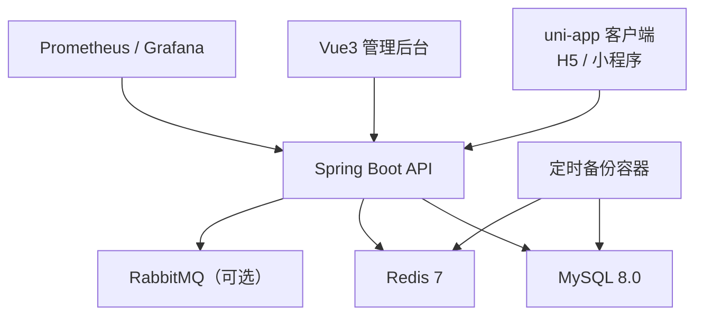
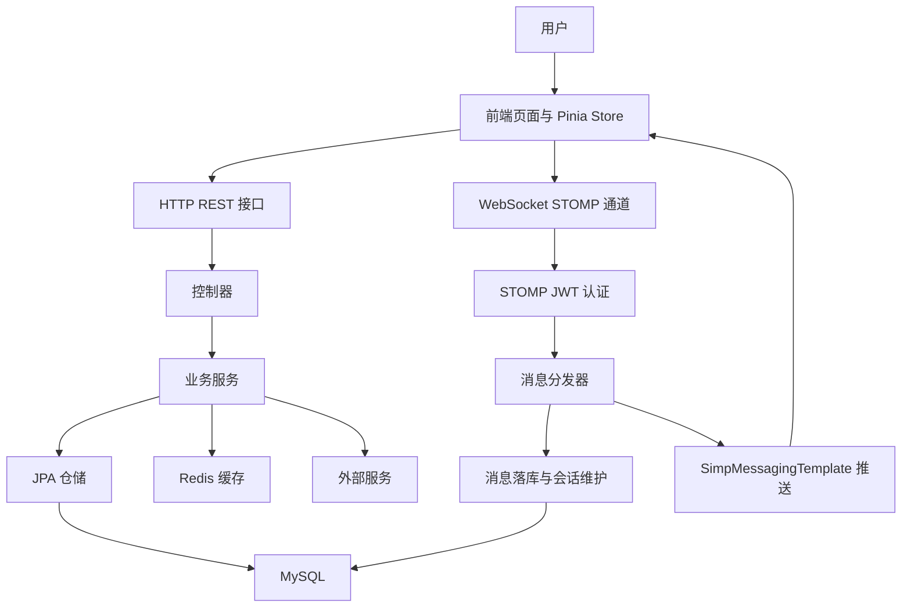
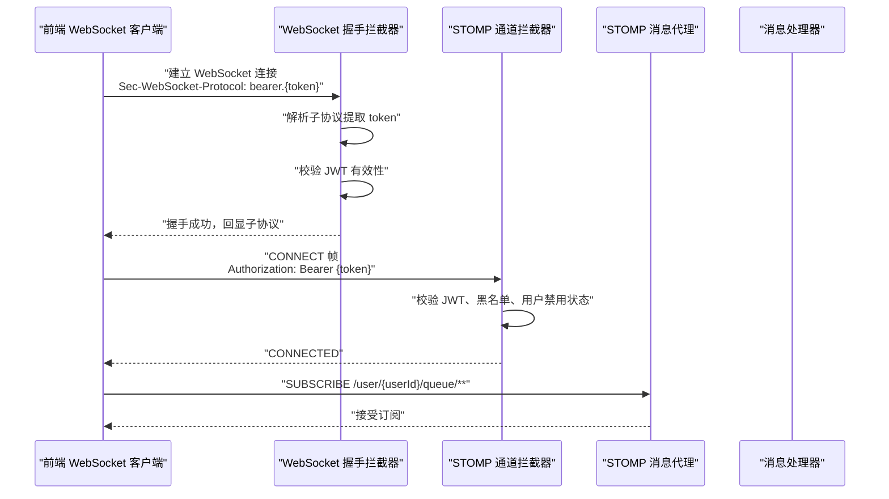
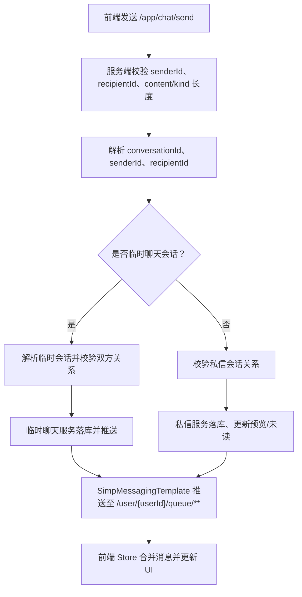
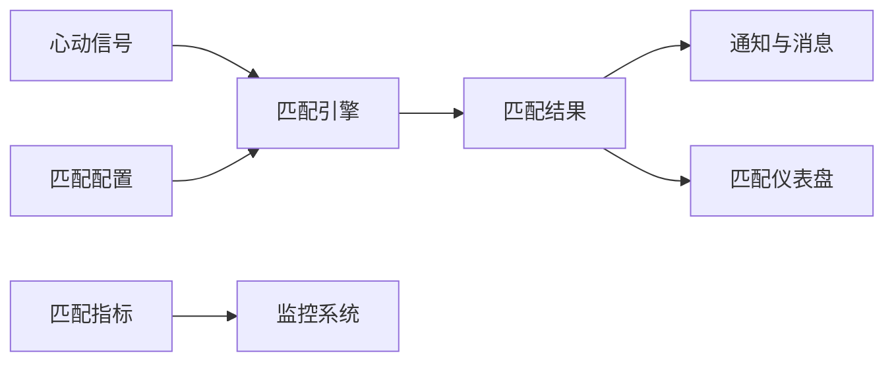
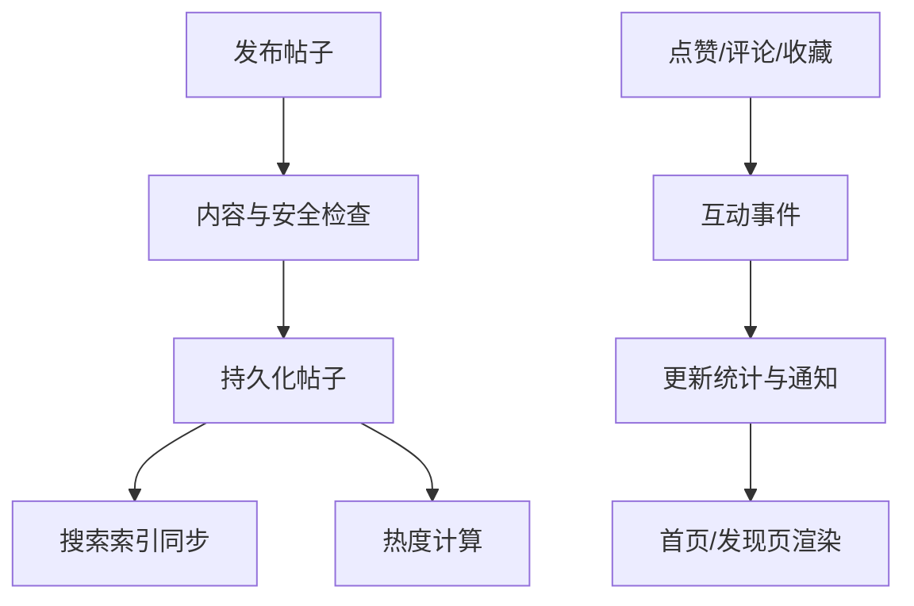
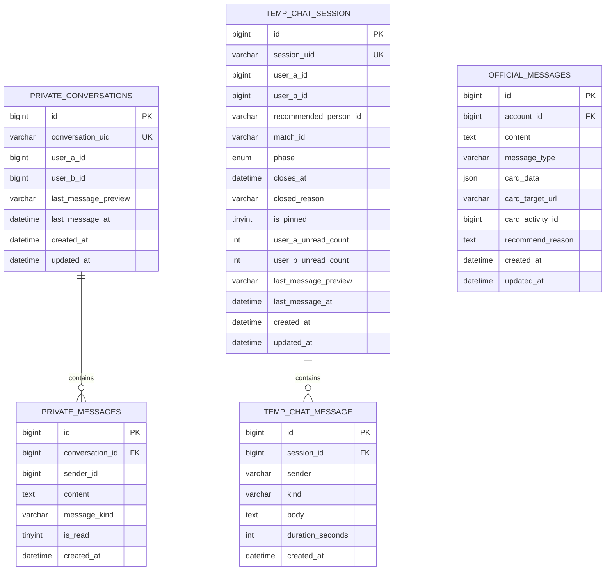
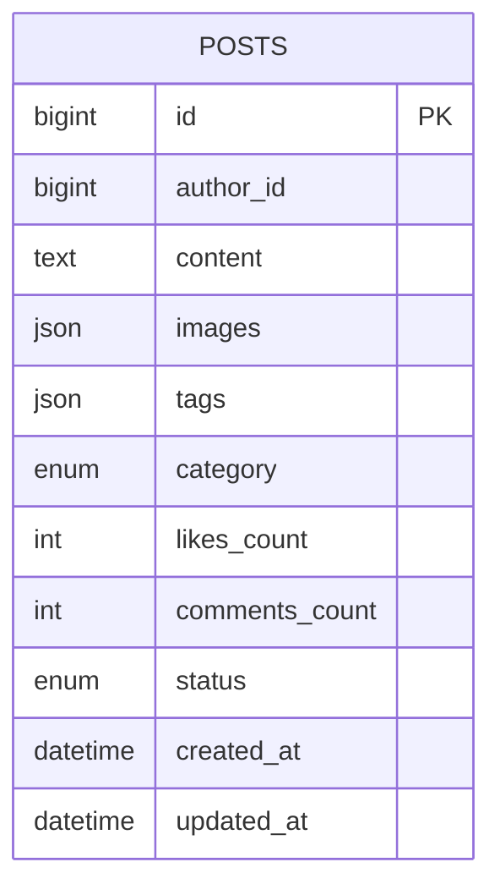
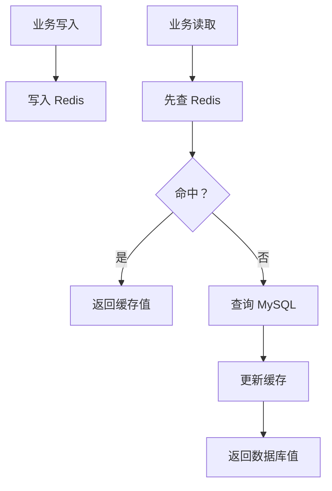
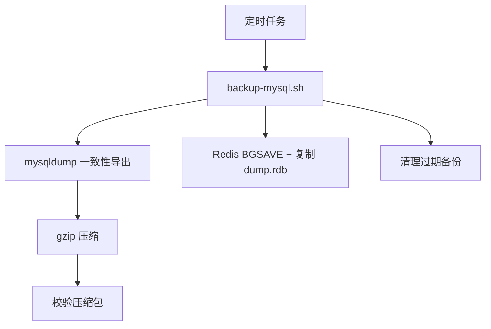

# 数据流设计

<cite>
**本文引用的文件**   
- [docker-compose.yml](file://docker-compose.yml)
- [package.json](file://package.json)
- [WebSocketConfig.java](file://apps/api/src/main/java/com/campuslove/api/config/WebSocketConfig.java)
- [JwtChannelInterceptor.java](file://apps/api/src/main/java/com/campuslove/api/config/JwtChannelInterceptor.java)
- [MessageWebSocketHandler.java](file://apps/api/src/main/java/com/campuslove/api/chat/MessageWebSocketHandler.java)
- [ws-index.ts](file://apps/client/src/services/websocket/index.ts)
- [messages-store.ts](file://apps/client/src/stores/messages.ts)
- [V2026.05.24.0002__create_private_conversations.sql](file://database/flyway/sql/V2026.05.24.0002__create_private_conversations.sql)
- [V2026.05.27.0001__create_temp_chat_tables.sql](file://database/flyway/sql/V2026.05.27.0001__create_temp_chat_tables.sql)
- [V2026.08.15.0004__message_v3_refactor.sql](file://database/flyway/sql/V2026.08.15.0004__message_v3_refactor.sql)
- [V2026.05.21.0003__create_posts_table.sql](file://database/flyway/sql/V2026.05.21.0003__create_posts_table.sql)
- [backup-mysql.sh](file://scripts/backup-mysql.sh)
</cite>

## 目录
1. [引言](#引言)
2. [项目结构与运行边界](#项目结构与运行边界)
3. [整体数据流架构](#整体数据流架构)
4. [核心组件与职责](#核心组件与职责)
5. [实时聊天数据流：WebSocket → STOMP → 消息分发](#实时聊天数据流websocket--stomp--消息分发)
6. [匹配算法数据流](#匹配算法数据流)
7. [社区内容数据流](#社区内容数据流)
8. [数据模型设计与实体关系](#数据模型设计与实体关系)
9. [缓存策略与一致性](#缓存策略与一致性)
10. [数据迁移、备份恢复与归档](#数据迁移备份恢复与归档)
11. [性能特征与优化建议](#性能特征与优化建议)
12. [故障排查指南](#故障排查指南)
13. [结论](#结论)

## 引言
本文件面向 Campus Love 项目的数据流设计，覆盖从用户交互到数据存储的完整路径。重点说明以下方面：
- 前端状态更新、HTTP 请求处理、业务逻辑执行和数据库操作的数据流向。
- 实时聊天数据流：客户端 WebSocket 连接、STOMP 认证、消息路由、会话校验与落库。
- 匹配算法数据流：心动信号、匹配记录、推荐与评分。
- 社区内容数据流：帖子、评论、互动事件及搜索索引同步。
- 数据模型原则、实体关系映射和数据验证规则。
- Redis 缓存层、数据同步机制与一致性保证。
- Flyway 数据迁移、MySQL 全量备份、Redis RDB 备份以及后续归档策略。

## 项目结构与运行边界
Campus Love 是一个多应用仓库，包含 uni-app 客户端、Spring Boot API、管理后台、MySQL、Redis、Prometheus/Grafana 等。顶层 `package.json` 定义 monorepo workspace，脚本同时驱动后端 mock/test、客户端 H5 开发、OpenAPI 校验和 Lighthouse 测试；`docker-compose.yml` 编排 MySQL、Redis、API、Admin、Client、监控和备份服务。

**图示来源**
- [docker-compose.yml:1-200](file://docker-compose.yml#L1-L200)
- [docker-compose.yml:201-400](file://docker-compose.yml#L201-L400)
- [package.json:1-48](file://package.json#L1-L48)

**章节来源**
- [docker-compose.yml:1-200](file://docker-compose.yml#L1-L200)
- [docker-compose.yml:201-400](file://docker-compose.yml#L201-L400)
- [package.json:1-48](file://package.json#L1-L48)

## 整体数据流架构
系统采用分层架构：
- 前端层：uni-app 客户端通过 HTTP REST 接口获取列表、详情、配置，并通过 WebSocket 订阅实时频道。
- 网关与接入层：API 暴露 REST 端点，并注册 `/ws` 作为 STOMP over WebSocket 端点，支持 SockJS 降级。
- 安全层：JWT 在 HTTP 握手和 STOMP CONNECT 阶段校验，登出后通过黑名单拒绝重连。
- 业务层：Controller 接收请求，Service 执行业务逻辑，必要时调用外部服务（微信安全检测、AI、短信）。
- 存储层：JPA Repository 访问 MySQL；Redis 用于缓存、在线用户、黑名单、临时状态。
- 异步层：可选 RabbitMQ 消费匹配、签到等事件；无 MQ 时自动降级。

**图示来源**
- [WebSocketConfig.java:102-154](file://apps/api/src/main/java/com/campuslove/api/config/WebSocketConfig.java#L102-L154)
- [JwtChannelInterceptor.java:1-120](file://apps/api/src/main/java/com/campuslove/api/config/JwtChannelInterceptor.java#L1-L120)
- [MessageWebSocketHandler.java:1-120](file://apps/api/src/main/java/com/campuslove/api/chat/MessageWebSocketHandler.java#L1-L120)

**章节来源**
- [WebSocketConfig.java:102-154](file://apps/api/src/main/java/com/campuslove/api/config/WebSocketConfig.java#L102-L154)
- [JwtChannelInterceptor.java:1-120](file://apps/api/src/main/java/com/campuslove/api/config/JwtChannelInterceptor.java#L1-L120)
- [MessageWebSocketHandler.java:1-120](file://apps/api/src/main/java/com/campuslove/api/chat/MessageWebSocketHandler.java#L1-L120)

## 核心组件与职责
- 前端消息状态：`messages-store.ts` 管理会话列表、当前消息、心跳信号、通知、分页游标、typing 状态、仪表盘聚合数据。它负责将 REST 拉取的数据与 WS 推送消息合并到本地 Pinia 状态，并提供未读数、置顶、免打扰、官方号会话等业务能力。
- WebSocket 客户端：`ws-index.ts` 封装 uni-app 的 `connectSocket`，实现简化 STOMP 帧编解码、连接状态机、心跳、重连、订阅与回调分发。Token 通过子协议和 CONNECT Authorization header 传递，不再使用 URL 参数。
- 服务端 WebSocket 配置：`WebSocketConfig.java` 启用 STOMP over WebSocket，配置 `/topic`、`/queue`、`/app`、`/user`，注册 `/ws` 端点，注入握手拦截器和通道拦截器。
- STOMP 安全拦截器：`JwtChannelInterceptor.java` 在 CONNECT 阶段校验 JWT、黑名单和用户禁用状态，在 SUBSCRIBE 阶段限制只能订阅 `/user/{自身}/queue/**` 或 `/topic/**`。
- 消息处理器：`MessageWebSocketHandler.java` 监听 `/app/chat/send`，校验发送者、长度、会话关系，区分临时聊天和私信场景，分别委托临时聊天服务或私信服务落库并推送。

**章节来源**
- [messages-store.ts:1-120](file://apps/client/src/stores/messages.ts#L1-L120)
- [ws-index.ts:1-120](file://apps/client/src/services/websocket/index.ts#L1-L120)
- [WebSocketConfig.java:23-154](file://apps/api/src/main/java/com/campuslove/api/config/WebSocketConfig.java#L23-L154)
- [JwtChannelInterceptor.java:1-120](file://apps/api/src/main/java/com/campuslove/api/config/JwtChannelInterceptor.java#L1-L120)
- [MessageWebSocketHandler.java:1-120](file://apps/api/src/main/java/com/campuslove/api/chat/MessageWebSocketHandler.java#L1-L120)

## 实时聊天数据流：WebSocket → STOMP → 消息分发
### 连接与认证时序

**图示来源**
- [WebSocketConfig.java:118-154](file://apps/api/src/main/java/com/campuslove/api/config/WebSocketConfig.java#L118-L154)
- [JwtChannelInterceptor.java:60-120](file://apps/api/src/main/java/com/campuslove/api/config/JwtChannelInterceptor.java#L60-L120)
- [ws-index.ts:120-220](file://apps/client/src/services/websocket/index.ts#L120-L220)

### 消息发送与分发流程

**图示来源**
- [MessageWebSocketHandler.java:80-200](file://apps/api/src/main/java/com/campuslove/api/chat/MessageWebSocketHandler.java#L80-L200)
- [messages-store.ts:120-260](file://apps/client/src/stores/messages.ts#L120-L260)

### 关键安全与校验规则
- 发送者必须来自 STOMP 认证用户，不信任客户端 payload。
- 禁止给自己发消息。
- content 最大长度与 REST 端保持一致，kind 也有限长保护。
- 临时聊天会话需满足双方关系约束；私信会话需存在且收发方匹配。
- 若落库失败，不转发消息，避免“只推送不落库”导致的历史消息、未读计数不一致。

**章节来源**
- [MessageWebSocketHandler.java:80-200](file://apps/api/src/main/java/com/campuslove/api/chat/MessageWebSocketHandler.java#L80-L200)
- [JwtChannelInterceptor.java:120-220](file://apps/api/src/main/java/com/campuslove/api/config/JwtChannelInterceptor.java#L120-L220)
- [ws-index.ts:200-320](file://apps/client/src/services/websocket/index.ts#L200-L320)

## 匹配算法数据流
匹配相关数据流涉及心动信号、匹配记录、匹配引擎、匹配配置与指标。其典型路径为：
- 用户产生心动信号 → 写入匹配表或中间结构 → 匹配引擎计算候选 → 生成匹配结果 → 通知与消息模块消费匹配事件 → 前端展示匹配卡片、心动信号、聊天记录入口。
- 匹配配置由管理员通过后台调整，影响匹配权重、阈值、展示策略。
- 匹配指标通过监控埋点输出，便于观察匹配成功率、延迟与异常。

**图示来源**
- [MatchController.java](file://apps/api/src/main/java/com/campuslove/api/match/MatchController.java)
- [RealMatchService.java](file://apps/api/src/main/java/com/campuslove/api/match/RealMatchService.java)
- [MatchEngine.java](file://apps/api/src/main/java/com/campuslove/api/match/MatchEngine.java)
- [MatchRecorder.java](file://apps/api/src/main/java/com/campuslove/api/match/MatchRecorder.java)

**章节来源**
- [MatchController.java](file://apps/api/src/main/java/com/campuslove/api/match/MatchController.java)
- [RealMatchService.java](file://apps/api/src/main/java/com/campuslove/api/match/RealMatchService.java)
- [MatchEngine.java](file://apps/api/src/main/java/com/campuslove/api/match/MatchEngine.java)
- [MatchRecorder.java](file://apps/api/src/main/java/com/campuslove/api/match/MatchRecorder.java)

## 社区内容数据流
社区内容主要围绕帖子、评论、点赞、收藏、浏览历史、标签、分类、活动、圈子等实体展开。典型数据流如下：
- 用户发布帖子 → 校验内容与安全 → 持久化到帖子表 → 更新作者信息、热度分数 → 触发搜索索引同步 → 首页/发现页聚合展示。
- 其他用户点赞、评论、收藏 → 写互动事件 → 更新帖子统计 → 可能触发通知 → 前端刷新互动状态。
- 搜索服务根据帖子、用户、标签构建可查询索引，供搜索接口返回。

**图示来源**
- [V2026.05.21.0003__create_posts_table.sql](file://database/flyway/sql/V2026.05.21.0003__create_posts_table.sql#L1-L17)
- [PostSearchController.java](file://apps/api/src/main/java/com/campuslove/api/search/PostSearchController.java)
- [RealPostSearchService.java](file://apps/api/src/main/java/com/campuslove/api/search/RealPostSearchService.java)

**章节来源**
- [V2026.05.21.0003__create_posts_table.sql:1-17](file://database/flyway/sql/V2026.05.21.0003__create_posts_table.sql#L1-L17)
- [PostSearchController.java](file://apps/api/src/main/java/com/campuslove/api/search/PostSearchController.java)
- [RealPostSearchService.java](file://apps/api/src/main/java/com/campuslove/api/search/RealPostSearchService.java)

## 数据模型设计与实体关系
### 消息与聊天模型
私信会话与消息：
- `private_conversations`：唯一键 `conversation_uid`，双用户组合唯一键，按用户 ID 建索引。
- `private_messages`：外键关联会话，按会话和时间排序，按发送者建索引。

临时聊天模型：
- `temp_chat_session`：会话 UID、双方用户 ID、推荐人/匹配 ID、阶段、关闭时间、未读数、最后消息预览和时间。
- `temp_chat_message`：会话 ID、发送者标识、消息类型、正文、语音时长。
- `temp_chat_contact_exchange`：交换联系人状态，会话级唯一。

官方号消息：
- 官方号统一为“寻觅助手”，停用旧推广号，历史消息迁移至助手号。
- `official_messages` 增加活动关联与推荐理由字段，用于活动卡展示。

**图示来源**
- [V2026.05.24.0002__create_private_conversations.sql:1-29](file://database/flyway/sql/V2026.05.24.0002__create_private_conversations.sql#L1-L29)
- [V2026.05.27.0001__create_temp_chat_tables.sql:1-58](file://database/flyway/sql/V2026.05.27.0001__create_temp_chat_tables.sql#L1-L58)
- [V2026.08.15.0004__message_v3_refactor.sql:1-43](file://database/flyway/sql/V2026.08.15.0004__message_v3_refactor.sql#L1-L43)

### 社区内容模型
帖子表包括作者、正文、图片 JSON、标签 JSON、分类、点赞数、评论数、状态与时间戳，并按作者、分类、创建时间建索引。

**图示来源**
- [V2026.05.21.0003__create_posts_table.sql:1-17](file://database/flyway/sql/V2026.05.21.0003__create_posts_table.sql#L1-L17)

**章节来源**
- [V2026.05.24.0002__create_private_conversations.sql:1-29](file://database/flyway/sql/V2026.05.24.0002__create_private_conversations.sql#L1-L29)
- [V2026.05.27.0001__create_temp_chat_tables.sql:1-58](file://database/flyway/sql/V2026.05.27.0001__create_temp_chat_tables.sql#L1-L58)
- [V2026.08.15.0004__message_v3_refactor.sql:1-43](file://database/flyway/sql/V2026.08.15.0004__message_v3_refactor.sql#L1-L43)
- [V2026.05.21.0003__create_posts_table.sql:1-17](file://database/flyway/sql/V2026.05.21.0003__create_posts_table.sql#L1-L17)

## 缓存策略与一致性
### Redis 缓存层
- 服务通过环境变量注入 Redis 主机、端口和密码；默认策略为 `allkeys-lru`，开启 AOF 持久化。
- 应用场景包括：JWT 黑名单、在线用户状态、消息分页缓存、推荐与热门帖缓存、临时聊天状态、验证码与限流计数。
- 客户端侧也有 TTL 缓存策略：消息页 bootstrap 30 秒新鲜度，官方号消息流 60 秒新鲜度，减少重复网络请求。

**图示来源**
- [docker-compose.yml:120-190](file://docker-compose.yml#L120-L190)
- [messages-store.ts:1-60](file://apps/client/src/stores/messages.ts#L1-L60)

### 一致性保证
- 消息落库优先于推送：临时聊天和私信均先落库再推送，避免“仅推送不落库”导致的历史消息与未读计数不一致。
- JWT 黑名单：登出或撤销令牌后，STOMP CONNECT 拒绝重连，确保被禁用用户无法维持长连接。
- 会话关系校验：临时聊天和私信都校验会话关系，防止越权消息。
- 内容长度限制：WS 与 REST 两端保持统一的 content/kind 长度上限，防止内存与带宽攻击。

**章节来源**
- [MessageWebSocketHandler.java:120-200](file://apps/api/src/main/java/com/campuslove/api/chat/MessageWebSocketHandler.java#L120-L200)
- [JwtChannelInterceptor.java:120-220](file://apps/api/src/main/java/com/campuslove/api/config/JwtChannelInterceptor.java#L120-L220)
- [docker-compose.yml:120-190](file://docker-compose.yml#L120-L190)
- [messages-store.ts:1-60](file://apps/client/src/stores/messages.ts#L1-L60)

## 数据迁移、备份恢复与归档
### 数据迁移
- 所有迁移脚本位于 `database/flyway/sql`，由 API 容器启动时通过 Flyway 执行。
- 迁移命名遵循日期+序号规范，例如 V2026.08.15.0004__message_v3_refactor.sql，用于官方号重构与消息 V3 变更。
- docker-compose 中挂载迁移目录为只读，避免 initdb.d 重复执行损坏数据。

**章节来源**
- [V2026.08.15.0004__message_v3_refactor.sql:1-43](file://database/flyway/sql/V2026.08.15.0004__message_v3_refactor.sql#L1-L43)
- [docker-compose.yml:201-280](file://docker-compose.yml#L201-L280)

### 备份与恢复
- MySQL 全量备份使用 `mysqldump --single-transaction` 实现 InnoDB 一致性快照，不锁表；结合 gzip 压缩，保留 7 天。
- Redis 备份通过 BGSAVE 后复制 dump.rdb，可通过环境变量控制是否执行。
- 备份脚本支持 dry-run、完整性校验、错误码区分（mysqldump 失败、gzip 失败、清理失败），并在 docker-compose backup 服务中调度。
- MySQL 开启 binlog，支撑 PITR（基于时间点恢复），配合定期全量备份形成完整 DR 方案。

**图示来源**
- [backup-mysql.sh:1-120](file://scripts/backup-mysql.sh#L1-L120)
- [docker-compose.yml:1-120](file://docker-compose.yml#L1-L120)

**章节来源**
- [backup-mysql.sh:1-120](file://scripts/backup-mysql.sh#L1-L120)
- [docker-compose.yml:1-120](file://docker-compose.yml#L1-L120)

### 归档方案
- 生产环境应把备份文件转移到对象存储或冷存储，保留策略可按法规与业务需求扩展（如 30 天滚动、长期归档）。
- 对离线归档包进行完整性校验与恢复演练，确保可恢复性。
- 对日志、堆转储、慢查询日志设置生命周期策略，避免磁盘占满。

[本节为通用实践说明，不直接分析具体代码文件]

## 性能特征与优化建议
- WebSocket 客户端具备自动重连、心跳检测、握手超时、订阅重放、回调精确移除等健壮性特性，适合弱网与小程序环境。
- 前端消息 Store 提供分页加载、TTL 缓存、typing 自动复位、未读数去重等优化，减少重复请求与状态抖动。
- 后端 WS 处理器对消息长度、会话关系、身份认证做严格校验，避免恶意请求和资源滥用。
- 建议进一步引入：
  - 消息分片与批量推送，降低高频消息下的广播开销。
  - 热点会话的本地缓存（Caffeine）+ Redis 二级缓存，缓解数据库压力。
  - 消息去重与幂等键，防止网络重试造成重复消息。
  - 监控与告警：连接数、消息延迟、失败率、内存占用、GC 停顿。

[本节为通用性能讨论，不直接分析具体代码文件]

## 故障排查指南
- WebSocket 连接失败：
  - 检查握手拦截器是否允许 Origin，确认子协议 `bearer.{token}` 是否正确传递。
  - 检查 STOMP CONNECT 是否携带 Authorization header，JWT 是否有效且未被撤销。
  - 查看连接日志中的 sessionId、userId、remoteAddress。
- 消息推送异常：
  - 检查 `/app/chat/send` 是否包含有效的 conversationId、recipientId、content。
  - 确认临时聊天或私信会话关系校验是否通过。
  - 检查落库是否成功，避免“仅推送不落库”。
- 前端状态不同步：
  - 检查 Store 的 fetchSessions、fetchHeartSignals、fetchMessages 是否并发竞态。
  - 检查 typing 状态是否在对方停止输入后复位。
  - 检查订阅回调是否正确移除，避免重复回调。
- 备份失败：
  - 检查 mysqldump 与 gzip 是否可用，环境变量是否注入正确。
  - 检查备份目录权限、文件大小是否为空、gzip 完整性是否通过。
  - 检查 Redis 是否配置了 HOST，否则跳过 Redis 备份。

**章节来源**
- [JwtChannelInterceptor.java:120-220](file://apps/api/src/main/java/com/campuslove/api/config/JwtChannelInterceptor.java#L120-L220)
- [MessageWebSocketHandler.java:120-200](file://apps/api/src/main/java/com/campuslove/api/chat/MessageWebSocketHandler.java#L120-L200)
- [messages-store.ts:120-260](file://apps/client/src/stores/messages.ts#L120-L260)
- [backup-mysql.sh:120-220](file://scripts/backup-mysql.sh#L120-L220)

## 结论
Campus Love 的数据流设计以清晰的分层和严格的校验为基础：前端通过 REST 与 WebSocket 协同获取数据与实时更新，后端通过 STOMP 完成认证与消息分发，业务层确保会话关系与消息落库一致性，存储层通过 MySQL 与 Redis 提供持久化与缓存能力。Flyway 迁移保障 schema 演进可控，备份脚本与 binlog 支撑恢复与归档。未来可在消息批量化、缓存层级、去重幂等、监控告警等方面继续优化，以提升高并发场景下的稳定性与性能。