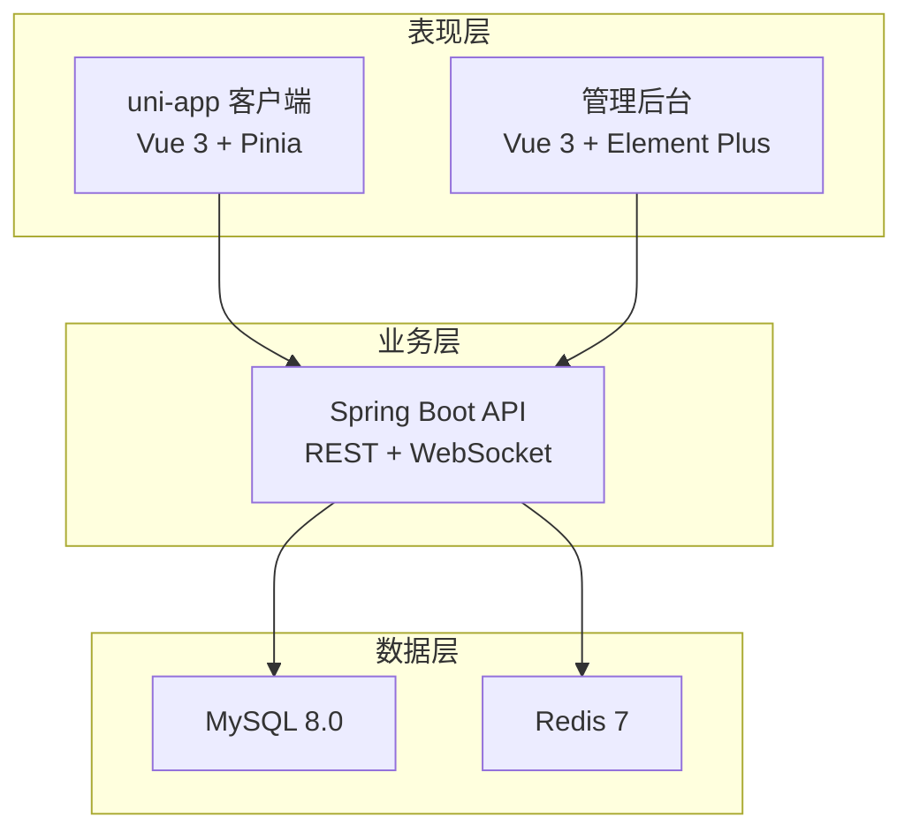
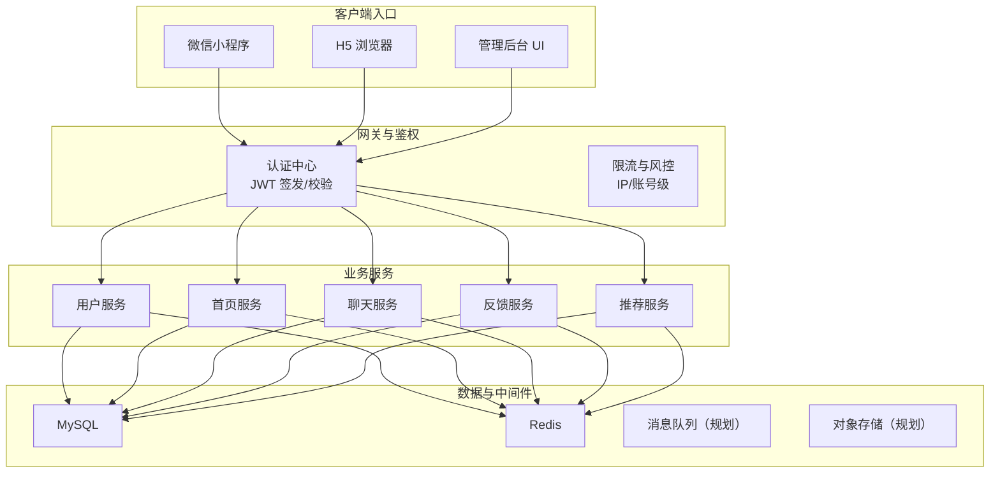
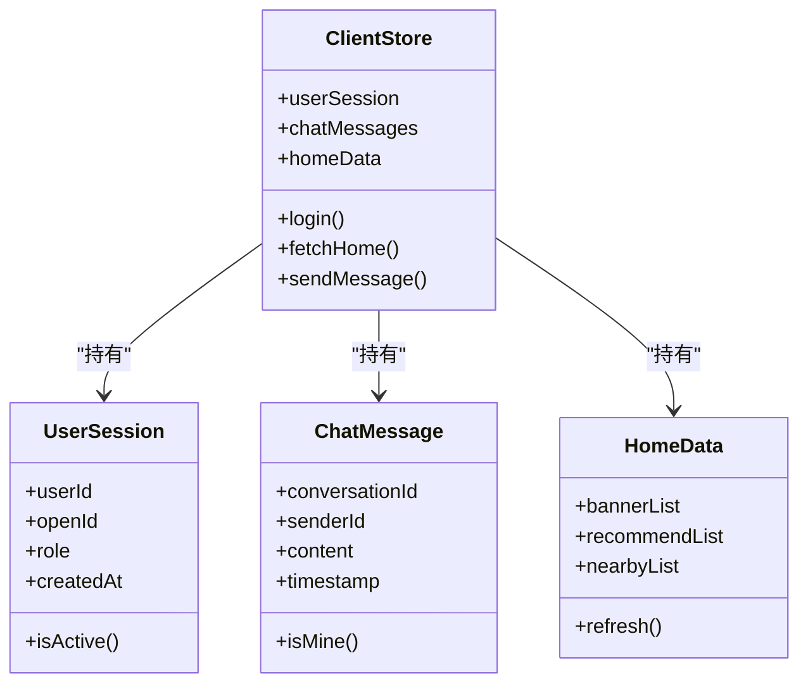
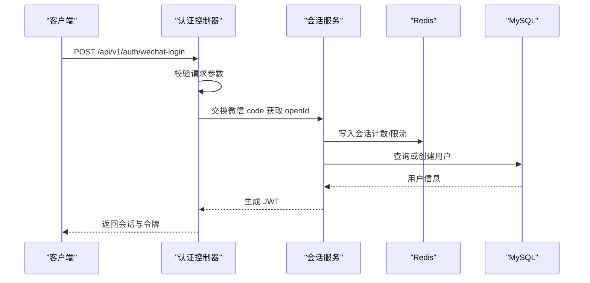
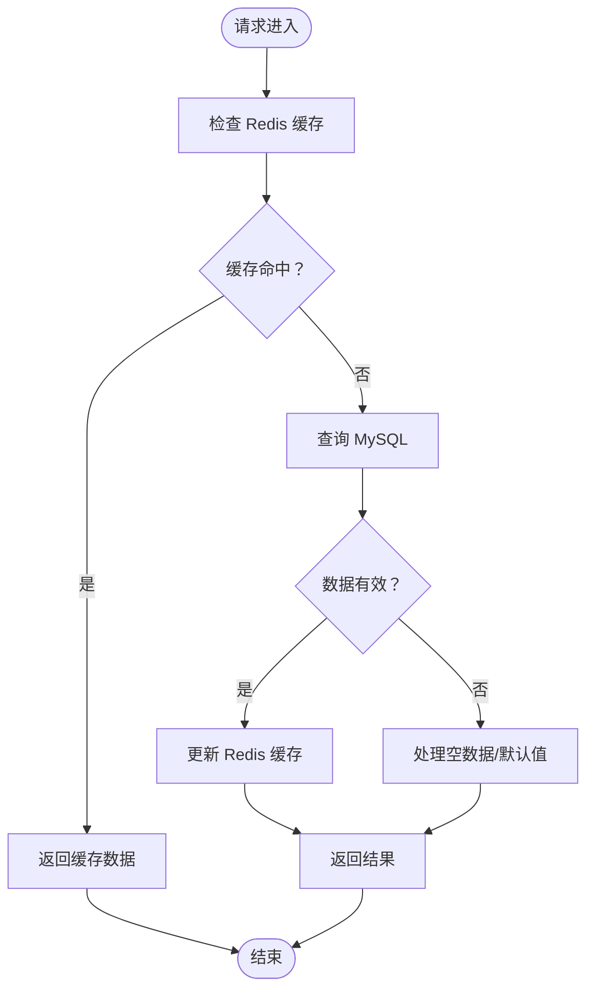
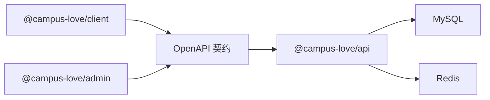
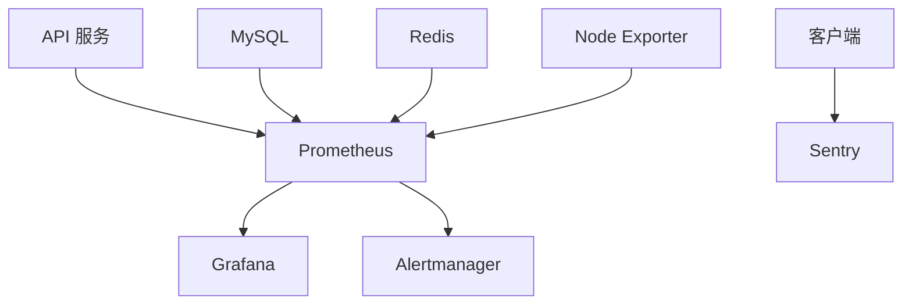

# 整体架构概览

<cite>
**本文引用的文件**   
- [package.json](file://package.json)
- [apps/client/package.json](file://apps/client/package.json)
- [apps/admin/package.json](file://apps/admin/package.json)
- [apps/api/pom.xml](file://apps/api/pom.xml)
- [docker-compose.yml](file://docker-compose.yml)
- [doc/overview.md](file://doc/overview.md)
- [docs/openapi/feedback-growth-and-auth.yaml](file://docs/openapi/feedback-growth-and-auth.yaml)
</cite>

## 目录
1. [引言](#引言)
2. [项目结构](#项目结构)
3. [核心组件](#核心组件)
4. [架构总览](#架构总览)
5. [详细组件分析](#详细组件分析)
6. [依赖关系分析](#依赖关系分析)
7. [性能与可扩展性](#性能与可扩展性)
8. [监控告警体系](#监控告警体系)
9. [故障排查指南](#故障排查指南)
10. [结论](#结论)

## 引言
Campus Love 是一个面向校园社交场景的多端应用系统，采用前后端分离、多应用工作区组织方式：
- 表现层：基于 Vue 3 + uni-app 的跨平台客户端，以及基于 Vue 3 + Element Plus 的管理后台。
- 业务层：基于 Spring Boot 3 的后端 API，提供认证、用户档案、首页、聊天、反馈等能力。
- 数据层：MySQL 持久化存储，Redis 作为缓存与状态支撑。

本概览文档重点说明三层架构、MVVM 设计模式、系统边界、API 契约、服务间通信机制、微服务拆分策略、可扩展性与性能优化思路，并给出上下文图和主要组件关系图。

## 项目结构
仓库为 monorepo，使用 pnpm workspaces 管理多个前端子应用和后端 API：
- `apps/client`：uni-app 客户端（H5、微信小程序），负责用户侧页面、交互、状态管理与 API 调用。
- `apps/admin`：Vue 3 管理后台，负责运营配置、内容审核、数据统计等后台功能。
- `apps/api`：Spring Boot 后端 API，聚合认证、用户、首页、聊天、推荐、反馈、管理等业务接口。
- `docs/openapi/*.yaml`：OpenAPI 3.0 契约定义，作为前后端接口契约来源。
- `docker-compose.yml`：本地与 CI 环境编排，包含 MySQL、Redis、API、Admin、Client、Prometheus、Grafana、Alertmanager 等。
- `scripts/`、`tests/`、`deliverables/`、`素材/`：脚本工具、测试、交付物与静态素材。

**图示来源**
- [docker-compose.yml:1-663](file://docker-compose.yml#L1-L663)
- [apps/client/package.json:1-104](file://apps/client/package.json#L1-L104)
- [apps/admin/package.json:1-45](file://apps/admin/package.json#L1-L45)
- [apps/api/pom.xml:1-80](file://apps/api/pom.xml#L1-L80)

**章节来源**
- [package.json:1-48](file://package.json#L1-L48)
- [apps/client/package.json:1-104](file://apps/client/package.json#L1-L104)
- [apps/admin/package.json:1-45](file://apps/admin/package.json#L1-L45)
- [docker-compose.yml:1-663](file://docker-compose.yml#L1-L663)

## 核心组件
- 客户端（uni-app）
  - 技术栈：Vue 3、Pinia、uni-app H5/小程序、Sentry 前端监控、Vitest 单元测试、Storybook 组件库。
  - 职责：页面渲染、表单校验、状态管理、API 调用、错误上报、构建产物输出。
- 管理后台
  - 技术栈：Vue 3、Element Plus、Vue Router、Pinia、i18n。
  - 职责：菜单权限、动态路由、数据看板、内容审核、配置管理。
- 后端 API
  - 技术栈：Spring Boot 3、JPA、Flyway、JWT、WebSocket、Validation。
  - 职责：认证授权、用户资料、首页数据、临时聊天、反馈提交、推荐与活动、管理接口。
- 数据层
  - MySQL：结构化数据、会话、用户、帖子、消息、审核记录等。
  - Redis：缓存热点数据、限流计数、临时会话状态等。

**章节来源**
- [apps/client/package.json:1-104](file://apps/client/package.json#L1-L104)
- [apps/admin/package.json:1-45](file://apps/admin/package.json#L1-L45)
- [apps/api/pom.xml:1-80](file://apps/api/pom.xml#L1-L80)
- [docker-compose.yml:1-663](file://docker-compose.yml#L1-L663)

## 架构总览
系统采用“前端多应用 + 单一 API 聚合”的架构形态。当前阶段以单体 API 为主，未来可按领域拆分为认证服务、用户服务、内容服务、聊天服务、推荐服务等。

**图示来源**
- [docker-compose.yml:1-663](file://docker-compose.yml#L1-L663)
- [docs/openapi/feedback-growth-and-auth.yaml:1-100](file://docs/openapi/feedback-growth-and-auth.yaml#L1-L100)

## 详细组件分析

### 表现层：uni-app 客户端（MVVM）
- 视图层（View）：Vue 组件与 uni-app 页面模板，负责展示登录、首页、附近、寻觅、匹配、消息、兴趣圈、校园圈等内容。
- 模型层（Model）：Pinia store 维护用户状态、会话、消息列表、圈子数据等；通过 OpenAPI 生成的类型约束数据结构。
- 视图模型（ViewModel）：组合逻辑在组件方法与 composable 中实现，处理表单校验、分页加载、错误提示、埋点上报。

**图示来源**
- [apps/client/package.json:1-104](file://apps/client/package.json#L1-L104)
- [docs/openapi/feedback-growth-and-auth.yaml:1-100](file://docs/openapi/feedback-growth-and-auth.yaml#L1-L100)

**章节来源**
- [apps/client/package.json:1-104](file://apps/client/package.json#L1-L104)
- [doc/overview.md:1-47](file://doc/overview.md#L1-L47)

### 业务层：Spring Boot API
- REST API：按领域划分控制器，如认证、用户、首页、聊天、反馈、管理等。
- WebSocket：用于实时聊天或通知推送。
- 安全：JWT 签发与校验，Bearer Token 鉴权，敏感接口限流。
- 数据访问：JPA + Flyway 迁移，MySQL 持久化。
- 缓存：Redis 缓存热点数据与限流计数。

**图示来源**
- [docs/openapi/feedback-growth-and-auth.yaml:1-100](file://docs/openapi/feedback-growth-and-auth.yaml#L1-L100)
- [apps/api/pom.xml:1-80](file://apps/api/pom.xml#L1-L80)

**章节来源**
- [apps/api/pom.xml:1-80](file://apps/api/pom.xml#L1-L80)
- [docs/openapi/feedback-growth-and-auth.yaml:1-100](file://docs/openapi/feedback-growth-and-auth.yaml#L1-L100)

### 数据层：MySQL 与 Redis
- MySQL
  - 角色：用户表、帖子表、消息表、审核记录表、配置表等。
  - 特性：utf8mb4 字符集、排序规则统一、binlog 开启支持增量恢复。
- Redis
  - 角色：缓存热点数据、会话状态、限流计数、临时聊天会话。
  - 策略：allkeys-lru 淘汰、AOF 持久化、密码保护、资源限制。

**图示来源**
- [docker-compose.yml:1-663](file://docker-compose.yml#L1-L663)

**章节来源**
- [docker-compose.yml:1-663](file://docker-compose.yml#L1-L663)

### 管理后台
- 角色：运营配置、内容审核、数据统计、用户管理。
- 特点：动态菜单、角色权限、多标签页、国际化。
- 部署：Vite 构建后由 Nginx 托管静态资源。

**章节来源**
- [apps/admin/package.json:1-45](file://apps/admin/package.json#L1-L45)
- [docker-compose.yml:1-663](file://docker-compose.yml#L1-L663)

## 依赖关系分析
- 客户端依赖后端 API 提供的 REST 接口，并通过 OpenAPI 契约生成类型定义，保证前后端数据结构一致。
- 管理后台同样依赖后端 API，用于后台数据操作。
- 后端依赖 MySQL 与 Redis，必要时可引入消息队列与对象存储扩展异步任务与静态资源托管。

**图示来源**
- [package.json:1-48](file://package.json#L1-L48)
- [apps/client/package.json:1-104](file://apps/client/package.json#L1-L104)
- [apps/admin/package.json:1-45](file://apps/admin/package.json#L1-L45)
- [apps/api/pom.xml:1-80](file://apps/api/pom.xml#L1-L80)
- [docs/openapi/feedback-growth-and-auth.yaml:1-100](file://docs/openapi/feedback-growth-and-auth.yaml#L1-L100)

**章节来源**
- [package.json:1-48](file://package.json#L1-L48)
- [docs/openapi/feedback-growth-and-auth.yaml:1-100](file://docs/openapi/feedback-growth-and-auth.yaml#L1-L100)

## 性能与可扩展性

### 技术选型决策
- Vue 3 + uni-app：一套代码覆盖 H5 与微信小程序，降低多端开发成本；配合 Pinia 进行状态管理，Sentry 进行前端监控。
- Spring Boot 3：成熟生态，便于快速迭代；结合 JPA/Flyway/JWT/WebSocket 满足常见业务需求。
- MySQL + Redis：稳定可靠的持久化与高性能缓存组合，满足读写分离与热点数据加速。

**章节来源**
- [apps/client/package.json:1-104](file://apps/client/package.json#L1-L104)
- [apps/api/pom.xml:1-80](file://apps/api/pom.xml#L1-L80)
- [docker-compose.yml:1-663](file://docker-compose.yml#L1-L663)

### 微服务拆分策略
- 初期以单体 API 聚合各域控制器，降低运维复杂度。
- 中期按领域拆分为认证服务、用户服务、内容服务、聊天服务、推荐服务、反馈服务。
- 后期引入消息队列与事件驱动，解耦异步任务（如邮件、短信、数据分析）。

### API 契约与服务间通信
- 外部 API：OpenAPI 3.0 定义，版本前缀 `/api/v1`，JWT Bearer 鉴权。
- 内部服务：建议采用 REST 或 gRPC，结合 API 网关做鉴权、限流、路由。
- 实时通信：WebSocket 用于聊天与通知。

**章节来源**
- [docs/openapi/feedback-growth-and-auth.yaml:1-100](file://docs/openapi/feedback-growth-and-auth.yaml#L1-L100)

### 性能优化策略
- 前端：静态资源预取、按需加载、SVG 优化、图片压缩、错误边界与降级。
- 后端：数据库索引优化、慢查询日志、连接池调优、Redis 缓存热点数据、接口限流。
- 部署：容器资源限制、健康检查、滚动升级、灰度发布。

### 架构约束
- 所有对外端口仅绑定本机地址，生产需通过反向代理暴露。
- 凭据通过环境变量注入，禁止硬编码。
- 镜像 TAG 使用确定性版本，禁止默认 latest。

**章节来源**
- [docker-compose.yml:1-663](file://docker-compose.yml#L1-L663)

## 监控告警体系
- Prometheus：采集 JVM、主机、MySQL、Redis 指标。
- Grafana：可视化仪表盘，展示关键业务与技术指标。
- Alertmanager：阈值触发告警，对接邮件、钉钉、企业微信等渠道。
- Sentry：前端错误与性能埋点，辅助定位线上问题。

**图示来源**
- [docker-compose.yml:1-663](file://docker-compose.yml#L1-L663)

**章节来源**
- [docker-compose.yml:1-663](file://docker-compose.yml#L1-L663)

## 故障排查指南
- 启动失败
  - 检查 `.env` 是否注入必要凭据（数据库、Redis、JWT Secret 等）。
  - 确认端口未被占用，网络隔离正确。
- 接口 401/403
  - 检查 JWT Token 是否有效、是否过期、是否携带正确的 Authorization 头。
- 数据库连接异常
  - 检查 MySQL 健康检查、字符集与排序规则、连接数限制。
- Redis 连接异常
  - 检查密码是否正确、内存策略与持久化配置。
- 前端报错
  - 查看 Sentry 错误报告，检查控制台日志与网络请求响应。

**章节来源**
- [docker-compose.yml:1-663](file://docker-compose.yml#L1-L663)
- [apps/client/package.json:1-104](file://apps/client/package.json#L1-L104)

## 结论
Campus Love 当前采用“多端前端 + 单体 API + MySQL/Redis”的架构，具备清晰的三层分层与 MVVM 实践。通过 OpenAPI 契约保障前后端一致性，借助 Docker Compose 统一管理依赖服务，并在监控与安全性方面做了基础加固。未来可按领域逐步拆分为微服务，引入消息队列与对象存储，提升系统的可扩展性与稳定性。