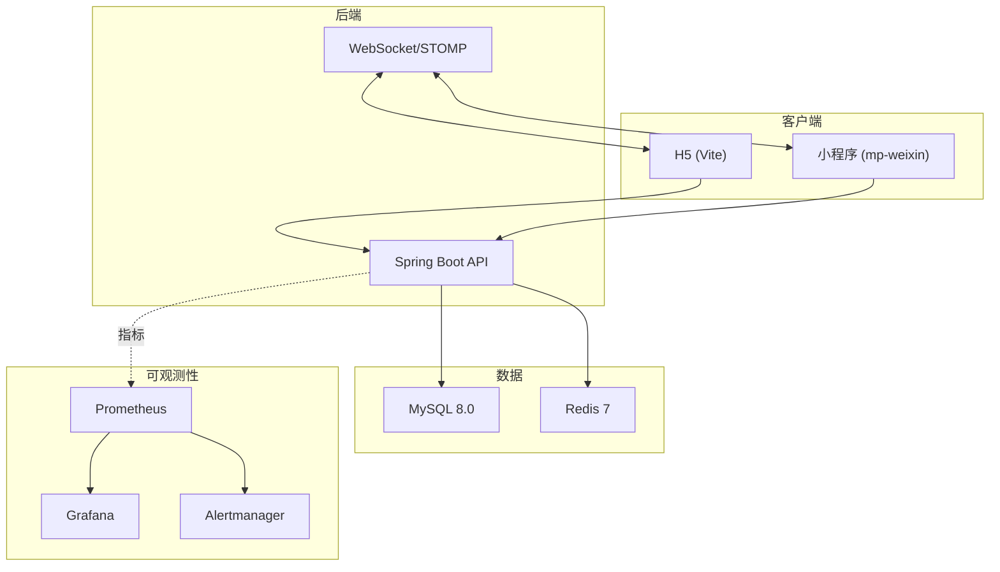
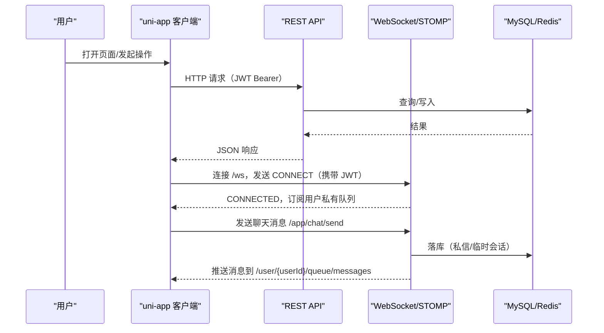
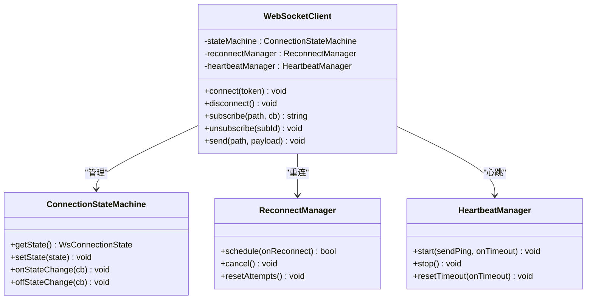
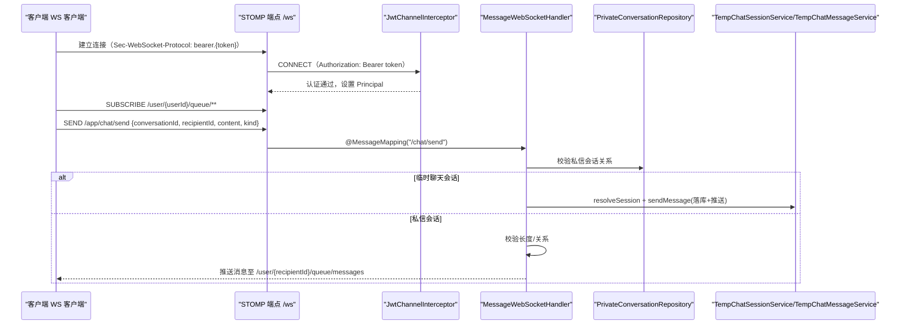
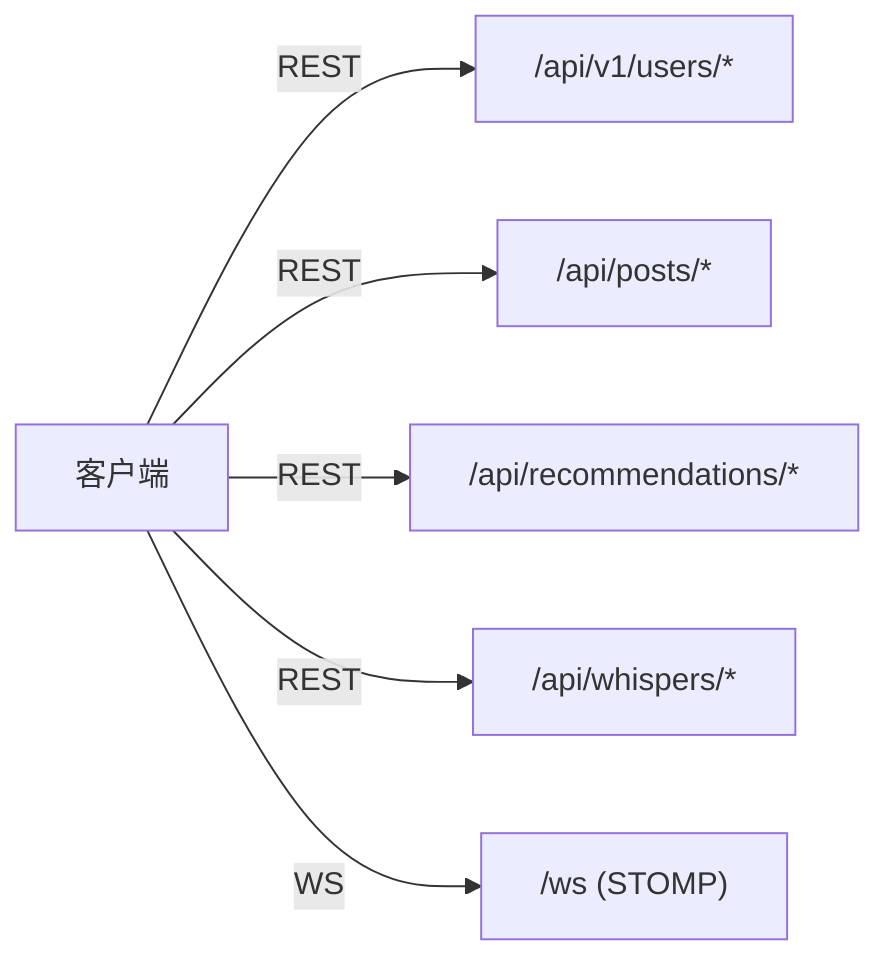
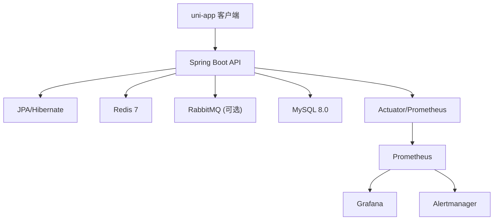
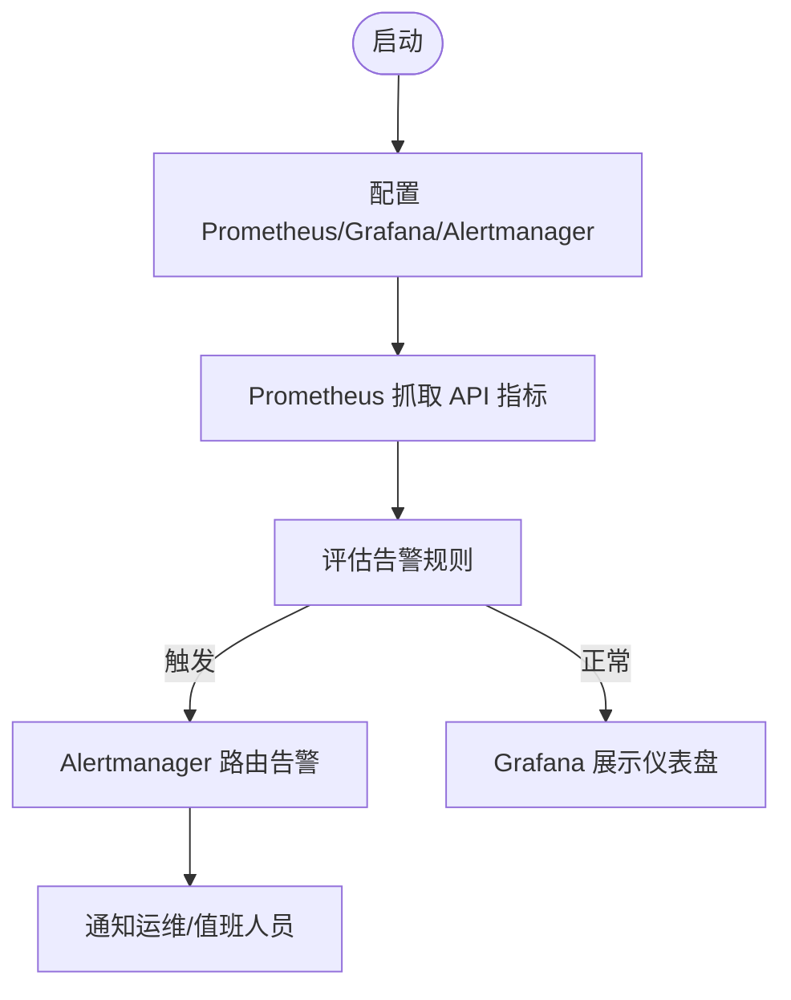

# 系统架构设计

<cite>
**本文引用的文件**
- [package.json](file://package.json)
- [pnpm-workspace.yaml](file://pnpm-workspace.yaml)
- [docker-compose.yml](file://docker-compose.yml)
- [doc/overview.md](file://doc/overview.md)
- [doc/proposal.md](file://doc/proposal.md)
- [doc/DEPLOYMENT.md](file://doc/DEPLOYMENT.md)
- [apps/client/package.json](file://apps/client/package.json)
- [apps/api/pom.xml](file://apps/api/pom.xml)
- [docs/openapi/users.yaml](file://docs/openapi/users.yaml)
- [docs/openapi/whispers.yaml](file://docs/openapi/whispers.yaml)
- [docs/openapi/village.yaml](file://docs/openapi/village.yaml)
- [docs/openapi/recommendations.yaml](file://docs/openapi/recommendations.yaml)
- [apps/api/src/main/java/com/campuslove/api/config/WebSocketConfig.java](file://apps/api/src/main/java/com/campuslove/api/config/WebSocketConfig.java)
- [apps/api/src/main/java/com/campuslove/api/chat/MessageWebSocketHandler.java](file://apps/api/src/main/java/com/campuslove/api/chat/MessageWebSocketHandler.java)
- [apps/api/src/main/java/com/campuslove/api/config/JwtChannelInterceptor.java](file://apps/api/src/main/java/com/campuslove/api/config/JwtChannelInterceptor.java)
- [apps/client/src/services/websocket.ts](file://apps/client/src/services/websocket.ts)
- [apps/client/src/services/websocket/index.ts](file://apps/client/src/services/websocket/index.ts)
- [apps/client/src/services/websocket/transport.ts](file://apps/client/src/services/websocket/transport.ts)
- [apps/client/src/services/websocket/state-machine.ts](file://apps/client/src/services/websocket/state-machine.ts)
- [apps/client/src/services/websocket/heartbeat.ts](file://apps/client/src/services/websocket/heartbeat.ts)
- [apps/client/src/services/websocket/reconnect.ts](file://apps/client/src/services/websocket/reconnect.ts)
- [apps/client/src/stores/session.ts](file://apps/client/src/stores/session.ts)
- [apps/api/src/main/resources/application.yml](file://apps/api/src/main/resources/application.yml)
- [docker/prometheus/prometheus.yml](file://docker/prometheus/prometheus.yml)
- [docker/prometheus/rules/alert-rules.yml](file://docker/prometheus/rules/alert-rules.yml)
- [docker/grafana/provisioning/dashboards/dashboards.yml](file://docker/grafana/provisioning/dashboards/dashboards.yml)
</cite>

## 目录
1. [简介](#简介)
2. [项目结构](#项目结构)
3. [核心组件](#核心组件)
4. [架构总览](#架构总览)
5. [详细组件分析](#详细组件分析)
6. [依赖关系分析](#依赖关系分析)
7. [性能与可扩展性](#性能与可扩展性)
8. [监控与告警](#监控与告警)
9. [部署拓扑与运维](#部署拓扑与运维)
10. [故障排查指南](#故障排查指南)
11. [结论](#结论)

## 简介
本项目 Campus Love 是一个面向在校大学生的社交恋爱平台，采用前后端分离、容器化编排的微服务化演进形态。前端基于 uni-app（Vue 3 + TypeScript）实现 H5 与微信小程序多端运行；后端基于 Spring Boot 提供 RESTful API 与 WebSocket/STOMP 实时通信；数据层使用 MySQL 8.0 与 Redis 7；可观测性通过 Prometheus + Grafana + Alertmanager 构成。整体遵循分层架构与 MVVM 模式，以 OpenAPI 驱动契约开发与校验，保障前后端一致性与可维护性。

## 项目结构
仓库为 pnpm monorepo，工作区包含：
- apps/client：uni-app 客户端（H5、微信小程序），含状态管理 Pinia、测试 Vitest、构建脚本与跨端适配。
- apps/admin：管理后台（Vue3 + Vite）。
- apps/api：Spring Boot 后端（REST + WebSocket/STOMP + Actuator + OpenAPI/Swagger）。
- docs/openapi：OpenAPI 规范定义（用户、村口、推荐、悄悄话等）。
- docker：compose 编排（MySQL、Redis、API、Admin、Client、Prometheus、Grafana、Alertmanager、备份 sidecar）。
- scripts/tools：开发、测试、审计、截图与质量检查工具集。
- database：Flyway 迁移与种子数据。

**图表来源**
- [docker-compose.yml:1-200](file://docker-compose.yml#L1-L200)
- [apps/api/pom.xml:1-200](file://apps/api/pom.xml#L1-L200)
- [apps/client/package.json:1-104](file://apps/client/package.json#L1-L104)

**章节来源**
- [package.json:1-48](file://package.json#L1-L48)
- [pnpm-workspace.yaml:1-13](file://pnpm-workspace.yaml#L1-L13)
- [doc/DEPLOYMENT.md:1-200](file://doc/DEPLOYMENT.md#L1-L200)

## 核心组件
- 客户端（uni-app）：H5/小程序双端，Pinia 状态管理，Vitest 单测，Sentry 埋点，WebSocket 客户端封装（自定义 STOMP）。
- 后端（Spring Boot）：REST 控制器、WebSocket/STOMP 配置与安全拦截器、消息处理器、Actuator/Prometheus 暴露指标、OpenAPI/Swagger 文档。
- 数据与缓存：MySQL 8.0（Flyway 迁移）、Redis（缓存、分布式锁、限流、Token 黑名单）。
- 可观测性：Prometheus 抓取、Grafana 仪表盘、Alertmanager 告警路由。
- 容器编排：docker-compose 统一拉起所有服务，网络按安全域拆分，强制环境变量注入凭据。

**章节来源**
- [apps/client/package.json:1-104](file://apps/client/package.json#L1-L104)
- [apps/api/pom.xml:1-200](file://apps/api/pom.xml#L1-L200)
- [apps/api/src/main/resources/application.yml:1-200](file://apps/api/src/main/resources/application.yml#L1-L200)
- [docker/prometheus/prometheus.yml:1-69](file://docker/prometheus/prometheus.yml#L1-L69)
- [docker/prometheus/rules/alert-rules.yml:1-200](file://docker/prometheus/rules/alert-rules.yml#L1-L200)

## 架构总览
系统采用分层架构与 MVVM 模式：
- 表现层：uni-app 页面（H5/小程序），Vue 组件 + Pinia Store。
- 应用层：前端业务逻辑（路由、状态、HTTP/WS 调用）。
- 接口层：OpenAPI 定义的 REST 与 WebSocket/STOMP 协议。
- 领域层：后端 Controller/Service/Repository。
- 基础设施：数据库、缓存、消息队列（RabbitMQ 可选）、对象存储（上传资源）。

**图表来源**
- [apps/api/src/main/java/com/campuslove/api/config/WebSocketConfig.java:95-128](file://apps/api/src/main/java/com/campuslove/api/config/WebSocketConfig.java#L95-L128)
- [apps/api/src/main/java/com/campuslove/api/chat/MessageWebSocketHandler.java:1-200](file://apps/api/src/main/java/com/campuslove/api/chat/MessageWebSocketHandler.java#L1-L200)
- [apps/client/src/services/websocket/index.ts:1-200](file://apps/client/src/services/websocket/index.ts#L1-L200)

## 详细组件分析

### 客户端（uni-app 多端与 MVVM）
- 技术栈：Vue 3 + TypeScript + Pinia + uni-app（H5/mp-weixin），Vitest 单元测试，Storybook（可选）。
- 构建流程：dev/build 脚本区分 mock/real 模式，生产构建执行安全检查与环境注入。
- 状态管理：Pinia store 管理会话、消息、未读角标等，登录后自动建立 WebSocket 连接，登出断开。
- 跨端适配：uni.connectSocket 原生 WebSocket，自行实现简化 STOMP 帧编解码，兼容小程序限制。

**图表来源**
- [apps/client/src/services/websocket/index.ts:1-200](file://apps/client/src/services/websocket/index.ts#L1-L200)
- [apps/client/src/services/websocket/state-machine.ts:1-121](file://apps/client/src/services/websocket/state-machine.ts#L1-L121)
- [apps/client/src/services/websocket/reconnect.ts:1-176](file://apps/client/src/services/websocket/reconnect.ts#L1-L176)
- [apps/client/src/services/websocket/heartbeat.ts:1-154](file://apps/client/src/services/websocket/heartbeat.ts#L1-L154)

**章节来源**
- [apps/client/package.json:1-104](file://apps/client/package.json#L1-L104)
- [apps/client/src/stores/session.ts:280-340](file://apps/client/src/stores/session.ts#L280-L340)
- [apps/client/src/services/websocket.ts:1-19](file://apps/client/src/services/websocket.ts#L1-L19)
- [apps/client/src/services/websocket/transport.ts:1-200](file://apps/client/src/services/websocket/transport.ts#L1-L200)

### 后端（Spring Boot 分层与实时通信）
- 分层：Controller -> Service -> Repository -> JPA/Redis/RabbitMQ。
- 安全：Spring Security + JWT，Access Log 不记录敏感 query；Swagger UI 默认关闭，按需启用并仅 ADMIN 访问。
- 实时通信：WebSocket/STOMP 端点 /ws，握手阶段子协议 bearer.{token} 校验，CONNECT/SUBSCRIBE 通道拦截器鉴权。
- 消息处理：MessageWebSocketHandler 处理 /app/chat/send，支持私信与临时会话落库与推送，严格长度与关系校验。

**图表来源**
- [apps/api/src/main/java/com/campuslove/api/config/WebSocketConfig.java:95-128](file://apps/api/src/main/java/com/campuslove/api/config/WebSocketConfig.java#L95-L128)
- [apps/api/src/main/java/com/campuslove/api/config/JwtChannelInterceptor.java:1-200](file://apps/api/src/main/java/com/campuslove/api/config/JwtChannelInterceptor.java#L1-L200)
- [apps/api/src/main/java/com/campuslove/api/chat/MessageWebSocketHandler.java:1-200](file://apps/api/src/main/java/com/campuslove/api/chat/MessageWebSocketHandler.java#L1-L200)

**章节来源**
- [apps/api/src/main/resources/application.yml:1-200](file://apps/api/src/main/resources/application.yml#L1-L200)
- [apps/api/src/main/java/com/campuslove/api/config/WebSocketConfig.java:95-128](file://apps/api/src/main/java/com/campuslove/api/config/WebSocketConfig.java#L95-L128)
- [apps/api/src/main/java/com/campuslove/api/chat/MessageWebSocketHandler.java:1-200](file://apps/api/src/main/java/com/campuslove/api/chat/MessageWebSocketHandler.java#L1-L200)
- [apps/api/src/main/java/com/campuslove/api/config/JwtChannelInterceptor.java:1-200](file://apps/api/src/main/java/com/campuslove/api/config/JwtChannelInterceptor.java#L1-L200)

### API 契约与微服务边界
- 用户关注/在线状态：/api/v1/users/*（需 JWT）。
- 村口社区：/api/posts/*（列表、详情、点赞、评论、分享）。
- 推荐/每日问题：/api/recommendations/*、/api/daily-question/*。
- 付费悄悄话：/api/whispers/*（幂等 clientRequestId、钱包扣费事务一致性）。
- 边界说明：当前单体 API 内按包划分领域（auth、chat、village、discover、admin 等），未来可按业务拆分为独立微服务并通过 API Gateway 聚合。

**图表来源**
- [docs/openapi/users.yaml:1-200](file://docs/openapi/users.yaml#L1-L200)
- [docs/openapi/village.yaml:1-200](file://docs/openapi/village.yaml#L1-L200)
- [docs/openapi/recommendations.yaml:1-200](file://docs/openapi/recommendations.yaml#L1-L200)
- [docs/openapi/whispers.yaml:1-128](file://docs/openapi/whispers.yaml#L1-L128)
- [apps/api/src/main/java/com/campuslove/api/config/WebSocketConfig.java:95-128](file://apps/api/src/main/java/com/campuslove/api/config/WebSocketConfig.java#L95-L128)

**章节来源**
- [docs/openapi/users.yaml:1-200](file://docs/openapi/users.yaml#L1-L200)
- [docs/openapi/village.yaml:1-200](file://docs/openapi/village.yaml#L1-L200)
- [docs/openapi/recommendations.yaml:1-200](file://docs/openapi/recommendations.yaml#L1-L200)
- [docs/openapi/whispers.yaml:1-128](file://docs/openapi/whispers.yaml#L1-L128)

### 跨平台适配策略（uni-app 多端）
- H5：Vite + uni-h5，浏览器原生 WebSocket 与 STOMP 文本帧。
- 微信小程序：uni.connectSocket，不支持 SockJS/STOMP 库，自定义实现 STOMP 帧编解码与心跳/重连。
- 构建差异：dev/h5、build:h5、build:mp-weixin、build:mp-weixin:real 等脚本链式执行静态准备、SVG 转 PNG、环境校验与产物大小检查。

**章节来源**
- [apps/client/package.json:1-104](file://apps/client/package.json#L1-L104)
- [apps/client/src/services/websocket/transport.ts:1-200](file://apps/client/src/services/websocket/transport.ts#L1-L200)

### 实时通信架构（WebSocket/STOMP）
- 握手：Sec-WebSocket-Protocol 传递 bearer.{token}，HandshakeInterceptor 校验后回显子协议。
- 会话：CONNECT 帧 Authorization: Bearer token，JwtChannelInterceptor 校验 JWT 并设置 Principal。
- 订阅：/user/{userId}/queue/** 用户专属队列，/topic/** 公共广播。
- 消息：/app/chat/send 处理私信与临时聊天，统一内容长度校验与会话关系校验。
- 心跳/重连：客户端周期性 ping（JSON {"type":"ping"}），超时连续计数达到阈值触发指数退避重连。

**章节来源**
- [apps/api/src/main/java/com/campuslove/api/config/WebSocketConfig.java:95-128](file://apps/api/src/main/java/com/campuslove/api/config/WebSocketConfig.java#L95-L128)
- [apps/api/src/main/java/com/campuslove/api/config/JwtChannelInterceptor.java:1-200](file://apps/api/src/main/java/com/campuslove/api/config/JwtChannelInterceptor.java#L1-L200)
- [apps/api/src/main/java/com/campuslove/api/chat/MessageWebSocketHandler.java:1-200](file://apps/api/src/main/java/com/campuslove/api/chat/MessageWebSocketHandler.java#L1-L200)
- [apps/client/src/services/websocket/heartbeat.ts:1-154](file://apps/client/src/services/websocket/heartbeat.ts#L1-L154)
- [apps/client/src/services/websocket/reconnect.ts:1-176](file://apps/client/src/services/websocket/reconnect.ts#L1-L176)

### 安全架构设计
- 认证：JWT access + refresh，登录态变化时同步 WebSocket 连接生命周期。
- 授权：Spring Security 保护 REST；WebSocket 握手与 STOMP 通道双重鉴权。
- 传输：HTTPS 终止于反向代理；日志避免记录敏感 query；Origin 白名单控制。
- 数据安全：密码 BCrypt；Redis 作为 Token 黑名单与分布式锁；最小权限原则。

**章节来源**
- [apps/api/src/main/resources/application.yml:1-200](file://apps/api/src/main/resources/application.yml#L1-L200)
- [apps/client/src/stores/session.ts:280-340](file://apps/client/src/stores/session.ts#L280-L340)
- [apps/api/src/main/java/com/campuslove/api/config/JwtChannelInterceptor.java:1-200](file://apps/api/src/main/java/com/campuslove/api/config/JwtChannelInterceptor.java#L1-L200)

## 依赖关系分析
- 前端依赖：uni-app SDK、Pinia、Vitest、Sentry、GSAP 等。
- 后端依赖：Spring Boot Web/Security/Data/Actuator、JPA、Flyway、Redis、RabbitMQ、Resilience4j、Micrometer/Prometheus、Bucket4j、Redisson。
- 基础设施：MySQL、Redis、Nginx（反向代理）、Prometheus/Grafana/Alertmanager。

**图表来源**
- [apps/client/package.json:1-104](file://apps/client/package.json#L1-L104)
- [apps/api/pom.xml:1-200](file://apps/api/pom.xml#L1-L200)
- [docker/prometheus/prometheus.yml:1-69](file://docker/prometheus/prometheus.yml#L1-L69)

**章节来源**
- [apps/client/package.json:1-104](file://apps/client/package.json#L1-L104)
- [apps/api/pom.xml:1-200](file://apps/api/pom.xml#L1-L200)
- [docker/prometheus/prometheus.yml:1-69](file://docker/prometheus/prometheus.yml#L1-L69)

## 性能与可扩展性
- 性能优化：
  - 前端：静态资源预处理、图片压缩、分包加载、Vitest 单元验证。
  - 后端：连接池（HikariCP）、Redis 缓存、限流（Bucket4j）、熔断重试（Resilience4j）、Tomcat 线程池调优。
  - 数据库：Flyway 迁移、慢查询日志、索引优化建议。
- 可扩展性：
  - 单体 API 按包划分领域，便于拆分为独立微服务（如 chat、village、recommendation）。
  - 消息队列异步解耦（匹配通知、签到通知、私信投递）。
  - 水平扩展：无状态 API 实例，外部化配置与持久化数据。

**章节来源**
- [apps/api/pom.xml:1-200](file://apps/api/pom.xml#L1-L200)
- [apps/api/src/main/resources/application.yml:1-200](file://apps/api/src/main/resources/application.yml#L1-L200)
- [apps/client/package.json:1-104](file://apps/client/package.json#L1-L104)

## 监控与告警
- 指标采集：Actuator 暴露 /actuator/prometheus，Prometheus 定期抓取。
- 告警规则：API 可用性、延迟 P99/P95、错误率、JVM 内存/线程、Full GC、数据库连接池等。
- 可视化：Grafana 自动加载仪表板，统一查看业务与系统指标。
- 告警路由：Alertmanager 接收并分发告警（邮件/企业微信/钉钉等，按需配置）。

**图表来源**
- [docker/prometheus/prometheus.yml:1-69](file://docker/prometheus/prometheus.yml#L1-L69)
- [docker/prometheus/rules/alert-rules.yml:1-200](file://docker/prometheus/rules/alert-rules.yml#L1-L200)
- [docker/grafana/provisioning/dashboards/dashboards.yml:1-23](file://docker/grafana/provisioning/dashboards/dashboards.yml#L1-L23)

**章节来源**
- [docker/prometheus/prometheus.yml:1-69](file://docker/prometheus/prometheus.yml#L1-L69)
- [docker/prometheus/rules/alert-rules.yml:1-200](file://docker/prometheus/rules/alert-rules.yml#L1-L200)
- [docker/grafana/provisioning/dashboards/dashboards.yml:1-23](file://docker/grafana/provisioning/dashboards/dashboards.yml#L1-L23)

## 部署拓扑与运维
- 容器编排：docker-compose 统一拉起 MySQL、Redis、API、Admin、Client、Prometheus、Grafana、Alertmanager、备份 sidecar。
- 网络隔离：data-net（数据服务）、app-net（应用服务），API 同时接入两网。
- 安全加固：端口仅绑定 127.0.0.1，强制环境变量注入凭据，禁止 latest 标签默认上线。
- 版本与发布：TAG 使用 ci-<sha> 或 release tag；前端构建产物由 Nginx 静态托管。
- 运维监控：Prometheus 抓取、Grafana 面板、Alertmanager 告警；日志滚动输出。

**章节来源**
- [docker-compose.yml:1-200](file://docker-compose.yml#L1-L200)
- [doc/DEPLOYMENT.md:1-200](file://doc/DEPLOYMENT.md#L1-L200)

## 故障排查指南
- WebSocket 连接失败：
  - 检查握手阶段是否携带正确的子协议与 Authorization 头。
  - 确认 JwtChannelInterceptor 允许 Origin 与 Token 有效。
  - 查看服务端日志中 CONNECT/SUBSCRIBE 拒绝原因。
- 消息未送达：
  - 确认 MessageWebSocketHandler 会话关系校验通过。
  - 检查私信/临时聊天落库与推送路径是否正确。
- 性能告警：
  - 关注 P99/P95 延迟、5xx 错误率、JVM 堆内存、Full GC 频率。
  - 检查数据库连接池使用率与慢查询。

**章节来源**
- [apps/api/src/main/java/com/campuslove/api/config/JwtChannelInterceptor.java:1-200](file://apps/api/src/main/java/com/campuslove/api/config/JwtChannelInterceptor.java#L1-L200)
- [apps/api/src/main/java/com/campuslove/api/chat/MessageWebSocketHandler.java:1-200](file://apps/api/src/main/java/com/campuslove/api/chat/MessageWebSocketHandler.java#L1-L200)
- [docker/prometheus/rules/alert-rules.yml:1-200](file://docker/prometheus/rules/alert-rules.yml#L1-L200)

## 结论
本系统通过分层架构与 MVVM 模式实现了高内聚、低耦合的前后端分离方案；基于 OpenAPI 的契约驱动确保了接口一致性；WebSocket/STOMP 提供了可靠的实时通信能力；容器化编排与可观测性体系保障了系统的可维护性与稳定性。未来可按业务域拆分微服务、引入 API Gateway 与更完善的链路追踪，进一步提升可扩展性与运维效率。