# 部署架构设计

<cite>
**本文引用的文件**   
- [docker-compose.yml](file://docker-compose.yml)
- [doc/DEPLOYMENT.md](file://doc/DEPLOYMENT.md)
- [.github/workflows/ci.yml](file://.github/workflows/ci.yml)
- [apps/api/Dockerfile](file://apps/api/Dockerfile)
- [docker/prometheus/prometheus.yml](file://docker/prometheus/prometheus.yml)
- [docker/prometheus/rules/alert-rules.yml](file://docker/prometheus/rules/alert-rules.yml)
- [docker/grafana/provisioning/datasources/datasources.yml](file://docker/grafana/provisioning/datasources/datasources.yml)
- [docker/grafana/provisioning/dashboards/dashboards.yml](file://docker/grafana/provisioning/dashboards/dashboards.yml)
- [docker/grafana/dashboards/api-overview.json](file://docker/grafana/dashboards/api-overview.json)
- [docker/grafana/dashboards/business-metrics.json](file://docker/grafana/dashboards/business-metrics.json)
- [docker/grafana/dashboards/jvm-health.json](file://docker/grafana/dashboards/jvm-health.json)
- [docker/client-nginx.conf](file://docker/client-nginx.conf)
- [scripts/backup-mysql.sh](file://scripts/backup-mysql.sh)
- [package.json](file://package.json)
</cite>

## 目录
1. [引言](#引言)
2. [项目结构](#项目结构)
3. [核心组件](#核心组件)
4. [架构总览](#架构总览)
5. [详细组件分析](#详细组件分析)
6. [依赖与网络分析](#依赖与网络分析)
7. [CI/CD 流水线与发布策略](#cicd-流水线与发布策略)
8. [生产环境部署拓扑](#生产环境部署拓扑)
9. [监控、告警与日志](#监控告警与日志)
10. [环境与配置管理](#环境与配置管理)
11. [灾备恢复与扩容策略](#灾备恢复与扩容策略)
12. [性能与容量规划](#性能与容量规划)
13. [故障排查指南](#故障排查指南)
14. [结论](#结论)

## 引言
本部署架构设计面向 Campus Love 项目的容器化生产运行，覆盖 MySQL、Redis、Spring Boot API、Nginx 反向代理、Prometheus、Grafana、Alertmanager 等服务的编排、健康检查、监控告警、备份恢复、CI/CD 流水线、环境隔离和运维最佳实践。文档以仓库中 `docker-compose.yml`、`apps/api/Dockerfile`、Prometheus/Grafana 配置、GitHub Actions CI 脚本及部署说明为依据，帮助读者理解“从代码到可观测的生产系统”的完整路径。

## 项目结构
Campus Love 采用多应用工作区 + 容器编排的组织方式：
- `apps/api`：Spring Boot 后端，通过 Maven 构建 Docker 镜像。
- `apps/client`、`apps/admin`：前端应用，由 pnpm 构建静态资源，通常由 Nginx 托管。
- `docker/`：编排相关配置文件，包括 Prometheus、Grafana、Nginx 客户端反向代理配置等。
- `.github/workflows/ci.yml`：统一 CI 门禁与安全扫描。
- `scripts/backup-mysql.sh`：MySQL 与 Redis 定时备份脚本。
- `doc/DEPLOYMENT.md`：部署前置条件、启动顺序、环境变量和生产部署说明。

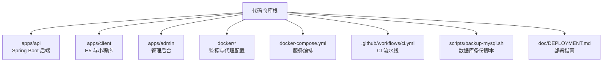

**图示来源**
- [docker-compose.yml:1-40](file://docker-compose.yml#L1-L40)
- [apps/api/Dockerfile:1-20](file://apps/api/Dockerfile#L1-L20)
- [.github/workflows/ci.yml:1-30](file://.github/workflows/ci.yml#L1-L30)
- [scripts/backup-mysql.sh:1-30](file://scripts/backup-mysql.sh#L1-L30)
- [doc/DEPLOYMENT.md:1-40](file://doc/DEPLOYMENT.md#L1-L40)

**章节来源**
- [docker-compose.yml:1-40](file://docker-compose.yml#L1-L40)
- [apps/api/Dockerfile:1-20](file://apps/api/Dockerfile#L1-L20)
- [.github/workflows/ci.yml:1-30](file://.github/workflows/ci.yml#L1-L30)
- [scripts/backup-mysql.sh:1-30](file://scripts/backup-mysql.sh#L1-L30)
- [doc/DEPLOYMENT.md:1-40](file://doc/DEPLOYMENT.md#L1-L40)

## 核心组件
| 组件 | 作用 | 关键实现位置 | 部署要点 |
|---|---|---|---|
| MySQL | 持久关系型数据，支撑用户、帖子、消息、圈子等业务表 | `docker-compose.yml` 中 mysql 服务 | UTF-8 字符集、排序规则、慢查询日志、binlog；端口仅绑定本地环回；强制密码注入 |
| Redis | 缓存与会话存储 | `docker-compose.yml` 中 redis 服务 | LRU 淘汰、AOF、密码保护、内存上限 |
| API | Spring Boot 业务接口，暴露 `/actuator` 指标与健康检查 | `apps/api/Dockerfile`、`docker-compose.yml` | 分层打包、非 root 运行、JVM 参数、Docker HEALTHCHECK |
| Nginx（Client H5） | 静态资源托管、SPA fallback、API 反代与限流 | `docker/client-nginx.conf` | gzip、安全头、`/api` 反向代理、限流 |
| Prometheus | 抓取 API Actuator 指标与自身状态 | `docker/prometheus/prometheus.yml` | 抓取间隔 15s、超时小于间隔、外部标签通过 compose 注入 |
| Grafana | 可视化仪表板与 Alertmanager 集成 | `docker/grafana/provisioning/*.yml`、dashboard JSON | 自动数据源、禁止 UI 删除文件管理面板 |
| Alertmanager | 告警路由与通知 | `docker-compose.yml` 中 alertmanager 服务 | 与 Prometheus 集成，默认无认证仅限本机访问 |
| Node Exporter | 主机级指标采集 | `docker/prometheus/prometheus.yml`（按 profile 启用） | 可选，需显式启用 monitoring profile |
| Backup Sidecar | 定时全量备份 MySQL 与 Redis RDB | `scripts/backup-mysql.sh` | 单事务一致性导出、gzip 校验、滚动保留天数 |

**章节来源**
- [docker-compose.yml:40-220](file://docker-compose.yml#L40-L220)
- [apps/api/Dockerfile:1-131](file://apps/api/Dockerfile#L1-L131)
- [docker/client-nginx.conf:1-68](file://docker/client-nginx.conf#L1-L68)
- [docker/prometheus/prometheus.yml:1-69](file://docker/prometheus/prometheus.yml#L1-L69)
- [docker/grafana/provisioning/datasources/datasources.yml:1-33](file://docker/grafana/provisioning/datasources/datasources.yml#L1-L33)
- [docker/grafana/provisioning/dashboards/dashboards.yml:1-23](file://docker/grafana/provisioning/dashboards/dashboards.yml#L1-L23)
- [scripts/backup-mysql.sh:1-80](file://scripts/backup-mysql.sh#L1-L80)

## 架构总览
Campus Love 的运行时包含边缘层、应用层、数据层、可观测层与备份侧车。Nginx 作为边缘入口负责 SSL 终止与请求分发；API 连接 MySQL 与 Redis；Prometheus 抓取 API 指标；Grafana 提供可视化面板并对接 Alertmanager；Backup Sidecar 定期执行数据库与缓存备份。

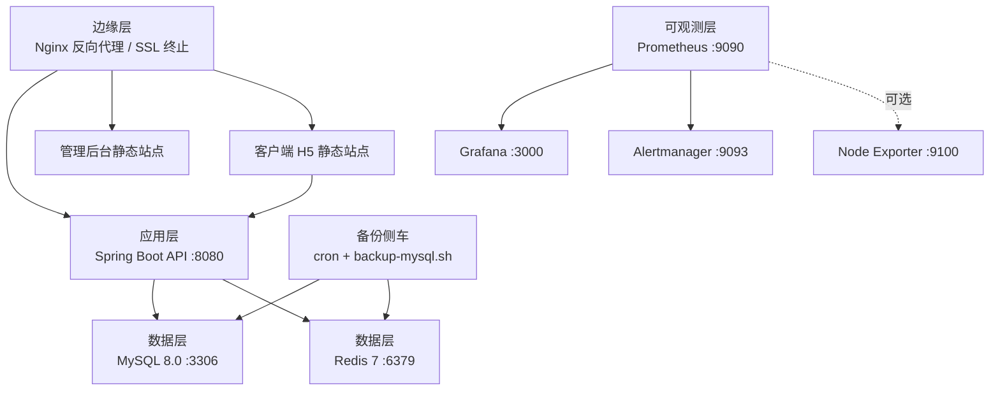

**图示来源**
- [doc/DEPLOYMENT.md:40-120](file://doc/DEPLOYMENT.md#L40-L120)
- [docker/prometheus/prometheus.yml:40-69](file://docker/prometheus/prometheus.yml#L40-L69)
- [docker/client-nginx.conf:20-68](file://docker/client-nginx.conf#L20-L68)
- [scripts/backup-mysql.sh:1-40](file://scripts/backup-mysql.sh#L1-L40)

## 详细组件分析

### MySQL 组件
MySQL 服务使用固定版本镜像，开启 UTF-8 字符集与标准排序规则，启用慢查询日志与 binlog，限制最大连接数与 InnoDB buffer pool，并通过环境变量强制注入 root 密码与普通用户密码。数据卷持久化，初始化 SQL 通过只读挂载注入，Flyway 迁移目录不挂载到 `initdb.d` 以避免重复执行。健康检查通过 `MYSQL_PWD` 传递密码，避免进程参数泄露。

- 安全加固：端口仅绑定 `127.0.0.1`，禁用新特权，丢弃危险能力。
- 资源限制：CPU 与内存上限防止 JVM 或数据库无界占用宿主机资源。
- 灾难恢复：binlog 与 ROW 格式为 PITR 提供基础。

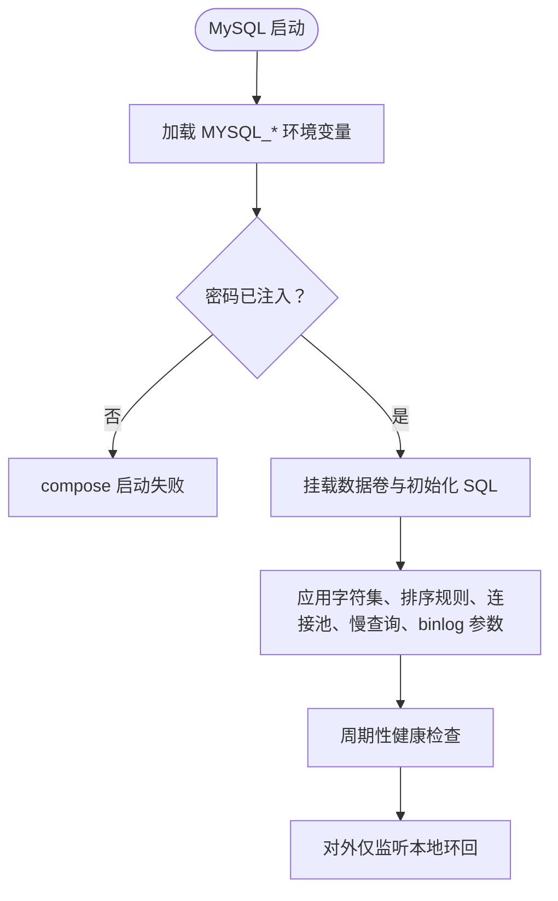

**图示来源**
- [docker-compose.yml:40-120](file://docker-compose.yml#L40-L120)

**章节来源**
- [docker-compose.yml:40-120](file://docker-compose.yml#L40-L120)

### Redis 组件
Redis 使用 Alpine 基础镜像，设置强密码、最大内存、LRU 淘汰策略与 AOF 持久化，保存策略为每 60 秒 1000 次写操作触发快照。健康检查通过 `REDISCLI_AUTH` 读取密码进行 ping 测试。端口同样仅绑定本地环回。

- 安全加固：requirepass、drop capabilities、no-new-privileges。
- 资源限制：CPU 与内存上限。
- 备份联动：脚本可通过 REDIS_HOST 选择是否备份 RDB。

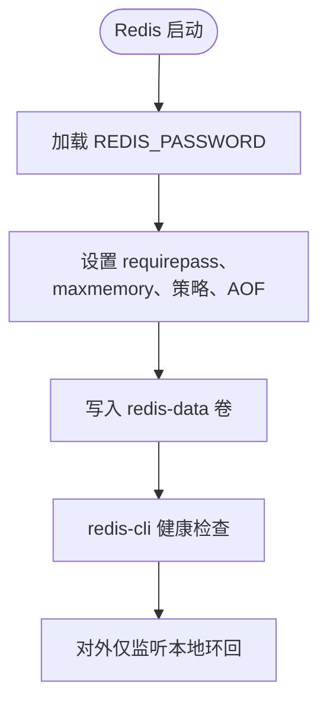

**图示来源**
- [docker-compose.yml:120-180](file://docker-compose.yml#L120-L180)

**章节来源**
- [docker-compose.yml:120-180](file://docker-compose.yml#L120-L180)

### API 组件
API 镜像采用多阶段构建：builder 阶段使用 JDK 与 Maven Wrapper 编译，跳过测试；runtime 阶段基于 JRE，安装 dumb-init 与 curl，创建非 root 用户，按 Spring Boot layers 分层复制 jar 内容，设置 JVM 堆大小、GC、OOM dump、时区与编码。健康检查调用 `/actuator/health`，默认 profile 为 real，端口 8080。

- 构建优化：分层打包复用依赖缓存，m2 缓存卷加速重复构建。
- 运行安全：非 root 用户、最小运行时镜像。
- 可观测性：Actuator Prometheus 端点被 Prometheus 抓取。

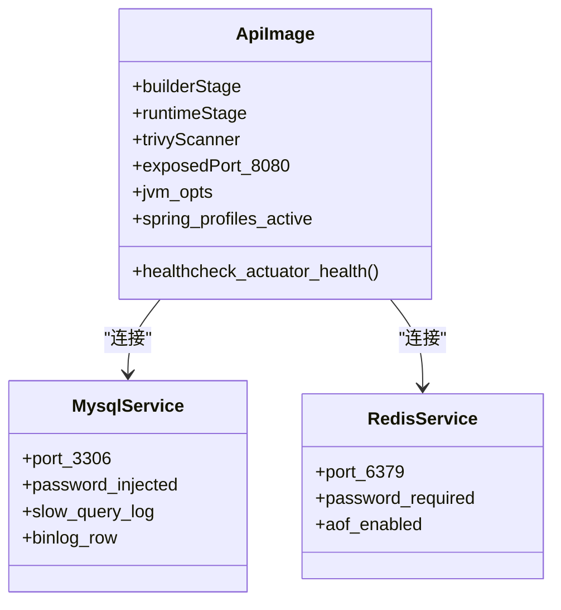

**图示来源**
- [apps/api/Dockerfile:1-131](file://apps/api/Dockerfile#L1-L131)
- [docker-compose.yml:180-260](file://docker-compose.yml#L180-L260)

**章节来源**
- [apps/api/Dockerfile:1-131](file://apps/api/Dockerfile#L1-L131)
- [docker-compose.yml:180-260](file://docker-compose.yml#L180-L260)

### Nginx 客户端反向代理
Nginx 用于 H5 预览与静态资源托管，配置 gzip、安全响应头、SPA history fallback、静态资源长期缓存，并将 `/api/` 反向代理到 compose 内部 `api:8080`。对 `/api` 增加基于 IP 的请求速率限制，防暴力破解。

- 安全响应头：`X-Content-Type-OPTIONS`、`X-Frame-OPTIONS`、`Referrer-Policy`。
- 限流：`limit_req_zone` 与 `burst` 控制登录等敏感接口频率。
- 健康探针：提供 `/healthz` 返回 200。

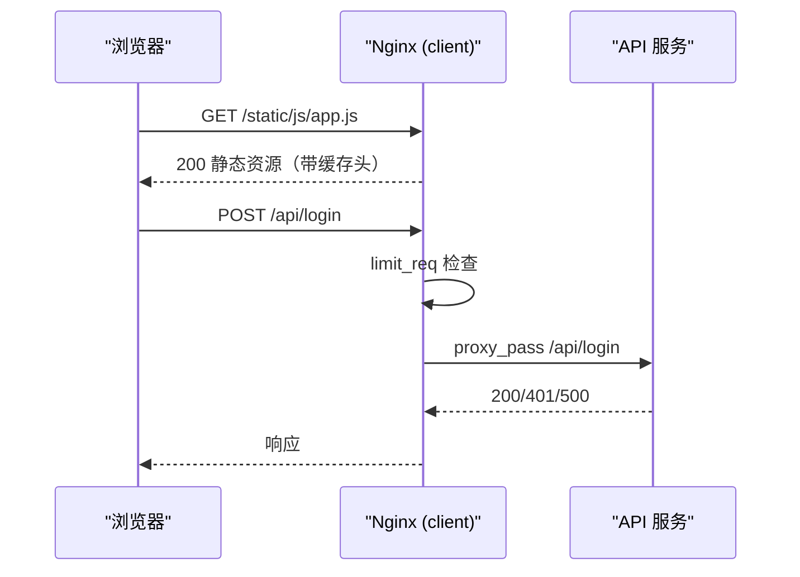

**图示来源**
- [docker/client-nginx.conf:1-68](file://docker/client-nginx.conf#L1-L68)

**章节来源**
- [docker/client-nginx.conf:1-68](file://docker/client-nginx.conf#L1-L68)

### Prometheus 与 Grafana
Prometheus 全局抓取间隔 15 秒、评估间隔 30 秒，抓取自身与 API 的 `/actuator/prometheus`，并预留 node-exporter 任务。Grafana 通过 provisioning 自动注册 Prometheus 与 Alertmanager 数据源，并加载 dashboard JSON 文件。仪表板包括 API 概览、业务指标与 JVM 健康视图。

- 数据源固定 uid：便于 dashboard JSON 绑定。
- 仪表板禁用 UI 删除：防止误改。
- 外部标签：cluster/environment 通过 compose 启动参数注入，不在 yml 硬编码。

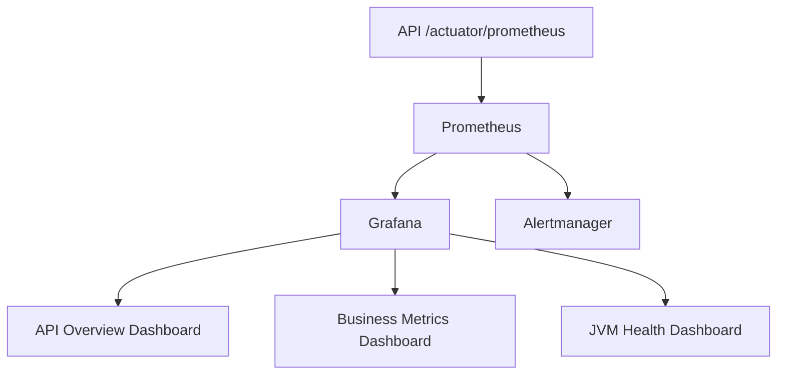

**图示来源**
- [docker/prometheus/prometheus.yml:1-69](file://docker/prometheus/prometheus.yml#L1-L69)
- [docker/grafana/provisioning/datasources/datasources.yml:1-33](file://docker/grafana/provisioning/datasources/datasources.yml#L1-L33)
- [docker/grafana/provisioning/dashboards/dashboards.yml:1-23](file://docker/grafana/provisioning/dashboards/dashboards.yml#L1-L23)
- [docker/grafana/dashboards/api-overview.json:1-40](file://docker/grafana/dashboards/api-overview.json#L1-L40)
- [docker/grafana/dashboards/business-metrics.json:1-40](file://docker/grafana/dashboards/business-metrics.json#L1-L40)
- [docker/grafana/dashboards/jvm-health.json:1-40](file://docker/grafana/dashboards/jvm-health.json#L1-L40)

**章节来源**
- [docker/prometheus/prometheus.yml:1-69](file://docker/prometheus/prometheus.yml#L1-L69)
- [docker/grafana/provisioning/datasources/datasources.yml:1-33](file://docker/grafana/provisioning/datasources/datasources.yml#L1-L33)
- [docker/grafana/provisioning/dashboards/dashboards.yml:1-23](file://docker/grafana/provisioning/dashboards/dashboards.yml#L1-L23)
- [docker/grafana/dashboards/api-overview.json:1-60](file://docker/grafana/dashboards/api-overview.json#L1-L60)
- [docker/grafana/dashboards/business-metrics.json:1-60](file://docker/grafana/dashboards/business-metrics.json#L1-L60)
- [docker/grafana/dashboards/jvm-health.json:1-60](file://docker/grafana/dashboards/jvm-health.json#L1-L60)

### 备份 Sidecar
备份脚本支持 mysqldump 全量备份与 Redis RDB 备份，输出 gzip 压缩文件，校验完整性，并滚动清理超过保留天数的备份。环境变量包括 MySQL/Redis 连接信息、备份目录、保留天数与压缩级别。脚本通过 `MYSQL_PWD` 传参避免命令行泄露密码。

- 一致性：mysqldump 使用 `--single-transaction` 与 `--quick`。
- 安全性：环境变量传密码、PATH 明确、工具存在性检查。
- 可测试：支持 `--dry-run` 模式。

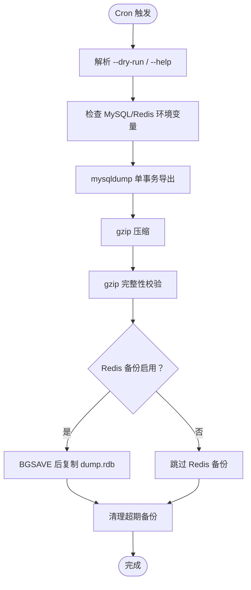

**图示来源**
- [scripts/backup-mysql.sh:1-120](file://scripts/backup-mysql.sh#L1-L120)

**章节来源**
- [scripts/backup-mysql.sh:1-120](file://scripts/backup-mysql.sh#L1-L120)

## 依赖与网络分析
Compose 定义两个网络：`data-net`（MySQL、Redis、Backup）与 `app-net`（API、Admin、Client、Prometheus、Grafana、Alertmanager）。API 同时接入两个网络，从而既能访问数据服务，又能被应用层服务发现。所有外部端口仅绑定 `127.0.0.1`，确保只有外层 Nginx 或本地调试可访问。

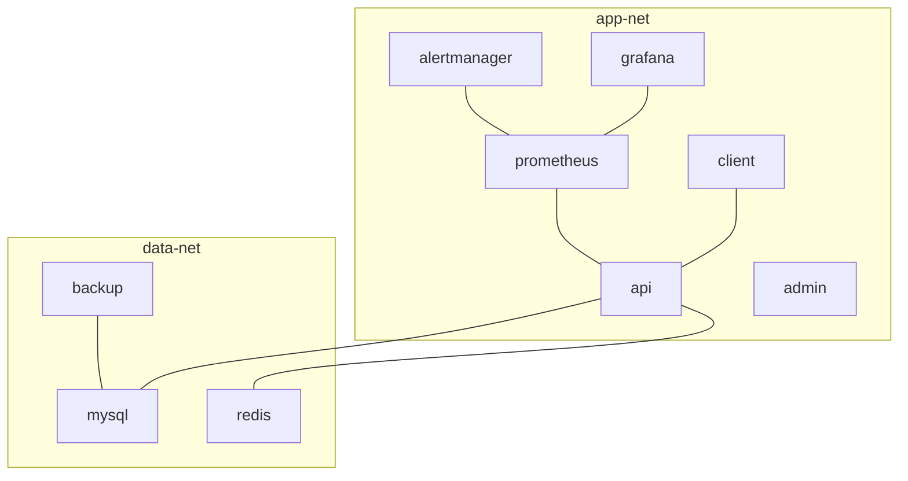

**图示来源**
- [docker-compose.yml:1-40](file://docker-compose.yml#L1-L40)
- [docker/prometheus/prometheus.yml:40-69](file://docker/prometheus/prometheus.yml#L40-L69)

**章节来源**
- [docker-compose.yml:1-40](file://docker-compose.yml#L1-L40)
- [docker/prometheus/prometheus.yml:40-69](file://docker/prometheus/prometheus.yml#L40-L69)

## CI/CD 流水线与发布策略
CI 流水线在 pull_request、push 到 main/develop 以及 tag v* 时触发，支持 workflow_dispatch。关键 job 包括：
- gitleaks-scan：扫描密钥泄露。
- lint-and-structure：pnpm 依赖审计、ESLint、OpenAPI lint、Spectral、结构测试。
- client-typecheck-and-build：客户端类型检查与 H5、小程序构建。
- client-test：客户端单元测试。
- admin-typecheck-and-build：管理后台类型检查与构建。
- api-test、e2e、security-scan 等在后续 job 中衔接（文件截断处未展示完整后续 job，但注释说明了 security-scan、Trivy、cosign、GHCR 推送等意图）。

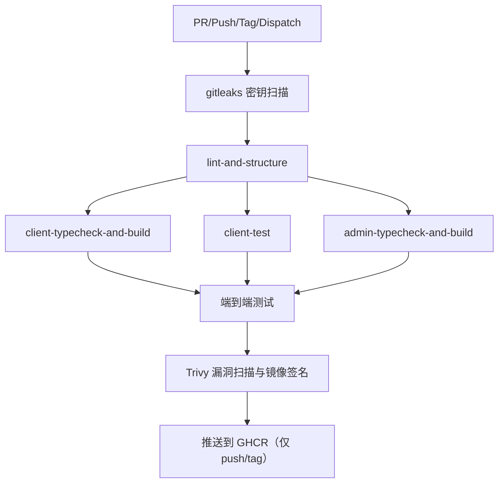

**图示来源**
- [.github/workflows/ci.yml:1-120](file://.github/workflows/ci.yml#L1-L120)

**章节来源**
- [.github/workflows/ci.yml:1-120](file://.github/workflows/ci.yml#L1-L120)

## 生产环境部署拓扑
生产环境推荐 Linux 服务器，最小资源建议参考部署指南。入网仅开放 80/443（Web）与受限 SSH；MySQL、Redis、监控端口不对外。部署拓扑应遵循“边缘 Nginx → API → MySQL/Redis”，监控独立部署于内网。

- 小型规模：API + MySQL + Redis + 监控同机。
- 中型规模：MySQL/Redis 独立节点。
- 大型规模：拆分节点、读写分离、对象存储。

磁盘需预留至少 3 倍 MySQL 数据卷大小，用于备份、回滚与日志归档。

**章节来源**
- [doc/DEPLOYMENT.md:1-80](file://doc/DEPLOYMENT.md#L1-L80)

## 监控、告警与日志
监控体系基于 Prometheus 抓取 API Actuator 指标，Grafana 提供仪表板，Alertmanager 接收告警。告警规则涵盖可用性、延迟、错误率、JVM、数据库连接池等维度，阈值与持续时间依据 SLO 与历史基线设计。

- 可用性：API DOWN、健康检查 DOWN。
- 性能：P99 > 2s、P95 > 1s、平均响应时间偏慢。
- 错误率：5xx > 1%、4xx > 5%。
- JVM：堆内存 > 85%、线程数偏高、Full GC 频繁。
- 数据库：连接池使用率过高。

日志方面，API 使用 json-file 驱动并限制大小与数量，MySQL 慢查询日志记录长查询，Nginx 关闭 server_tokens，静态资源访问日志可关闭以减少噪音。

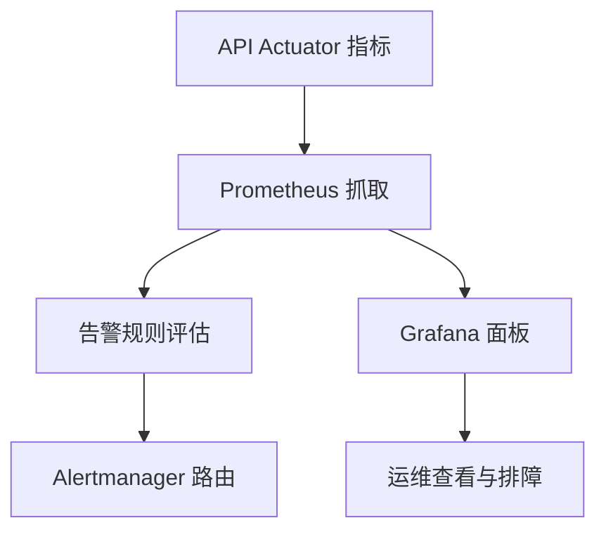

**图示来源**
- [docker/prometheus/prometheus.yml:1-69](file://docker/prometheus/prometheus.yml#L1-L69)
- [docker/prometheus/rules/alert-rules.yml:1-120](file://docker/prometheus/rules/alert-rules.yml#L1-L120)
- [docker/grafana/dashboards/api-overview.json:1-60](file://docker/grafana/dashboards/api-overview.json#L1-L60)

**章节来源**
- [docker/prometheus/prometheus.yml:1-69](file://docker/prometheus/prometheus.yml#L1-L69)
- [docker/prometheus/rules/alert-rules.yml:1-120](file://docker/prometheus/rules/alert-rules.yml#L1-L120)
- [docker/grafana/dashboards/api-overview.json:1-60](file://docker/grafana/dashboards/api-overview.json#L1-L60)

## 环境与配置管理
环境变量通过 `.env` 文件注入，Compose 使用 `${VAR:?error message}` 形式强制缺失时报错，避免弱默认值。必须配置的变量包括 MySQL root 密码、普通用户密码、Redis 密码、JWT_SECRET、Grafana 管理员密码、数据库 URL/用户名/密码（非容器场景）、管理员 OpenID 与初始密码哈希、微信小程序 AppID/Secret 等。

- 前端环境变量：`VITE_API_MODE`、`VITE_API_BASE_URL`、`VITE_APP_VERSION`。
- 后端环境变量：Spring profiles、日志路径、媒体存储根、端口、数据库连接等。
- 安全要求：`.env` 不得提交至版本库，已通过 `.gitignore` 排除。

**章节来源**
- [docker-compose.yml:1-40](file://docker-compose.yml#L1-L40)
- [doc/DEPLOYMENT.md:80-160](file://doc/DEPLOYMENT.md#L80-L160)

## 灾备恢复与扩容策略
灾备恢复围绕 MySQL 与 Redis 展开：
- MySQL：mysqldump 全量备份 + binlog 增量恢复（ROW 格式），支持 PITR；保留最近 7 天备份，可按需调整。
- Redis：BGSAVE 后复制 RDB，结合 AOF 保证数据持久化。
- 恢复流程：先停写 → 导入最新全量 → 回放 binlog → 验证数据 → 恢复服务。

扩容策略：
- 水平扩展 API：多个副本共享同一 MySQL/Redis，通过负载均衡器分发流量。
- 垂直扩展：提升 CPU/内存与 JVM 堆上限，调整连接池与缓存大小。
- 数据层分离：MySQL/Redis 独立节点或集群，监控与备份独立部署。

**章节来源**
- [scripts/backup-mysql.sh:1-120](file://scripts/backup-mysql.sh#L1-L120)
- [docker-compose.yml:40-220](file://docker-compose.yml#L40-L220)
- [doc/DEPLOYMENT.md:80-160](file://doc/DEPLOYMENT.md#L80-L160)

## 性能与容量规划
- API JVM：堆内存占容器内存的 75%，G1 GC，OOM dump 开启，超时与重试合理。
- MySQL：最大连接数、InnoDB buffer pool、慢查询日志、binlog 大小与过期时间需根据负载调优。
- Redis：最大内存与淘汰策略匹配业务热点数据分布。
- 监控指标：QPS、P99/P95、错误率、JVM 内存与线程、数据库连接池使用率。
- 容量建议：小型 2 核 4GB、中型 4 核 8GB、大型 8+ 核 16+ GB，并按 DAU 分级。

**章节来源**
- [apps/api/Dockerfile:60-120](file://apps/api/Dockerfile#L60-L120)
- [docker-compose.yml:40-220](file://docker-compose.yml#L40-L220)
- [doc/DEPLOYMENT.md:1-80](file://doc/DEPLOYMENT.md#L1-L80)
- [docker/grafana/dashboards/api-overview.json:1-60](file://docker/grafana/dashboards/api-overview.json#L1-L60)

## 故障排查指南
常见故障与定位步骤：
- API 不可用：检查 `/actuator/health`、Prometheus `up{job="campuslove-api"}`、容器日志、JVM OOM dump。
- 高延迟：查看 P99/P95 告警、慢查询日志、数据库连接池使用率、Redis 命中率。
- 高错误率：统计 5xx/4xx 比率、关注限流触发次数、第三方依赖熔断状态。
- 数据库连接池耗尽：检查 HikariCP 活跃连接与最大连接，必要时调整池大小或优化 SQL。
- 备份失败：检查 mysqldump 与 gzip 退出码、`MYSQL_PWD` 是否正确、备份目录权限与空间。
- 监控缺失：确认 Prometheus 抓取目标是否 UP，node-exporter 是否启用 monitoring profile。

**章节来源**
- [docker/prometheus/rules/alert-rules.yml:1-120](file://docker/prometheus/rules/alert-rules.yml#L1-L120)
- [scripts/backup-mysql.sh:1-200](file://scripts/backup-mysql.sh#L1-L200)
- [apps/api/Dockerfile:90-131](file://apps/api/Dockerfile#L90-L131)

## 结论
Campus Love 的部署架构以 docker-compose 为核心编排，严格的环境变量注入、最小权限运行、分层镜像构建与完善的监控告警构成其生产稳定性基础。通过 GitHub Actions 实施密钥扫描、依赖审计、代码质量检查、容器镜像漏洞扫描与发布门禁，配合 MySQL/Redis 备份与恢复方案，形成闭环的 DevSecOps 体系。在生产环境中，建议将边缘 Nginx、API、数据层与可观测层解耦部署，按规模逐步拆分节点与引入负载均衡，持续提升系统的可用性与可维护性。