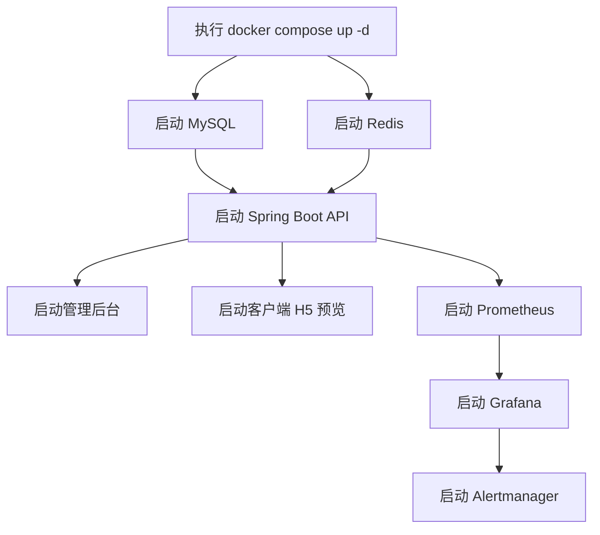

# 快速开始

<cite>
**本文引用的文件**   
- [docker-compose.yml](file://docker-compose.yml)
- [package.json](file://package.json)
- [apps/client/package.json](file://apps/client/package.json)
- [apps/admin/package.json](file://apps/admin/package.json)
</cite>

## 目录
1. [简介](#简介)
2. [环境准备](#环境准备)
3. [从零到运行：最小步骤](#从零到运行最小步骤)
4. [一键启动全部服务](#一键启动全部服务)
5. [本地开发模式](#本地开发模式)
6. [服务访问地址与验证](#服务访问地址与验证)
7. [常见问题排查](#常见问题排查)
8. [第一个功能修改示例](#第一个功能修改示例)
9. [新成员入职检查清单](#新成员入职检查清单)

## 简介
Campus Love 恋爱小程序是一个多端应用，包含以下核心部分：
- 后端 API（Spring Boot）
- MySQL 数据库
- Redis 缓存
- 管理后台（Vue3 + Nginx 静态托管）
- 客户端 H5 预览（uni-app 构建产物由 Nginx 托管）
- 可选监控组件 Prometheus、Grafana、Alertmanager、node-exporter
- MySQL/Redis 定时备份 sidecar

仓库使用 pnpm workspace 管理前端工作区，并使用 docker-compose 编排全部运行时依赖。

## 环境准备
在克隆代码前，请确保本机满足以下条件：
- 操作系统：Windows、macOS 或 Linux 均可
- Node.js：版本大于等于 18，小于 23
- pnpm：建议使用 v11.x
- Docker Desktop：已安装并正在运行
- 端口空闲：宿主机至少保留 3306、6379、8080、5173、5177、3001、9090、9093、9100

Node.js 和 pnpm 版本约束来自根工作区配置；客户端和管理后台也声明了相同的 Node.js 范围。

**章节来源**
- [package.json:39-48](file://package.json#L39-L48)
- [apps/client/package.json:95-104](file://apps/client/package.json#L95-L104)
- [apps/admin/package.json:38-45](file://apps/admin/package.json#L38-L45)

## 从零到运行：最小步骤
这是最快让 Campus Love 跑起来的方式：

1. 克隆仓库
   - 将仓库克隆到本地任意目录
   - 打开终端并进入项目根目录

2. 安装前端依赖
   ```bash
   pnpm install
   ```

3. 初始化运行环境
   - 复制环境变量模板为实际配置文件
   - 填写必要的安全凭据

4. 一键启动全部服务
   ```bash
   docker compose up -d
   ```

5. 等待服务健康就绪
   - 首次启动会拉取镜像、创建数据卷、执行数据库初始化
   - 可通过 `docker compose ps` 查看服务状态

6. 打开浏览器访问客户端 H5
   - 默认地址：http://localhost:5173

完成以上步骤后，你已经获得一个可运行的最小系统：数据库、缓存、后端 API、管理后台和客户端 H5 均已启动。

**章节来源**
- [docker-compose.yml:1-40](file://docker-compose.yml#L1-L40)

## 一键启动全部服务
### 为什么推荐 docker compose
本项目把数据库、缓存、API、管理后台、客户端预览和监控组件都放在同一个编排文件中。使用 `docker compose up -d` 可以：
- 自动按依赖顺序启动服务
- 自动挂载数据卷，避免重启丢失数据
- 统一绑定本地回环地址，降低误暴露风险
- 通过环境变量集中注入密码和域名

### 启动前的环境变量
docker-compose 中大量关键变量使用“强制必填”写法，例如：
- MYSQL_ROOT_PASSWORD
- MYSQL_PASSWORD
- REDIS_PASSWORD
- JWT_SECRET
- GRAFANA_ADMIN_PASSWORD
- ADMIN_OPENID

你需要先准备 `.env` 文件，再启动容器。如果缺少这些变量，`docker compose up` 会直接报错提示，不会用弱默认值启动。

### 一键启动命令
```bash
docker compose up -d
```

### 停止和清理
```bash
# 停止全部服务
docker compose down

# 停止并删除数据卷（谨慎执行，会清空数据库和缓存数据）
docker compose down -v
```

### 只启动部分服务
client 服务被放入 `client-h5` profile；monitoring 相关服务被放入 `monitoring` profile；backup 被放入 `backup` profile。  
如果你只想启动基础链路，也可以显式指定 profile，但当前默认编排已经覆盖 API、Admin、Client、MySQL、Redis 等核心服务。



**图表来源**
- [docker-compose.yml:1-40](file://docker-compose.yml#L1-L40)
- [docker-compose.yml:45-250](file://docker-compose.yml#L45-L250)
- [docker-compose.yml:250-400](file://docker-compose.yml#L250-L400)
- [docker-compose.yml:401-663](file://docker-compose.yml#L401-L663)

**章节来源**
- [docker-compose.yml:1-40](file://docker-compose.yml#L1-L40)
- [docker-compose.yml:45-250](file://docker-compose.yml#L45-L250)
- [docker-compose.yml:250-400](file://docker-compose.yml#L250-L400)
- [docker-compose.yml:401-663](file://docker-compose.yml#L401-L663)

## 本地开发模式
如果你不想运行完整 docker 环境，可以分别启动前端开发服务器。

### 启动客户端 H5 开发服务器
H5 开发模式会使用 uni-app 的 H5 平台，适合浏览器调试：
```bash
pnpm client:dev:h5
```

该脚本会：
- 调用客户端工作区的 `dev:h5`
- 预先生成静态资源
- 启动 Vite/uni-app 开发服务器

如果需要连接真实后端接口而不是 mock，可以使用：
```bash
pnpm client:dev:h5:real
```

### 启动微信小程序开发环境
微信小程序不能直接用浏览器预览，需要微信开发者工具导入编译产物。  
本地开发时，可以先执行：
```bash
pnpm --workspace apps/client run dev:mp-weixin
```

该命令会：
- 执行客户端工作区的 `dev:mp-weixin`
- 生成 mp-weixin 平台产物
- 然后你可以用微信开发者工具导入对应目录进行预览和调试

### 启动管理后台开发服务器
管理后台基于 Vue3 + Vite，可直接在本机启动：
```bash
pnpm --workspace apps/admin run dev
```

默认管理后台在 docker 中通过 Nginx 提供 5177 端口；本地开发时通常由 Vite 直接提供服务，端口以 Vite 默认行为为准。

**章节来源**
- [package.json:6-18](file://package.json#L6-L18)
- [apps/client/package.json:10-44](file://apps/client/package.json#L10-L44)
- [apps/admin/package.json:10-20](file://apps/admin/package.json#L10-L20)

## 服务访问地址与验证
### 默认访问地址
| 服务 | 默认地址 | 说明 |
|---|---|---|
| 客户端 H5 | http://localhost:5173 | uni-app H5 预览 |
| 管理后台 | http://localhost:5177 | Vue3 管理后台 |
| 后端 API | http://localhost:8080 | Spring Boot API |
| Grafana | http://localhost:3001 | 监控面板 |
| Prometheus | http://localhost:9090 | 指标采集 |
| Alertmanager | http://localhost:9093 | 告警路由 |
| node-exporter | http://localhost:9100 | 主机指标采集 |

所有对外端口默认只绑定 `127.0.0.1`，不直接暴露到公网。生产环境应由外层 Nginx 反代 80/443。

### 基本健康检查
你可以通过以下方式确认服务是否正常：

1. 查看容器状态
   ```bash
   docker compose ps
   ```

2. 查看 API 健康端点
   ```bash
   curl http://localhost:8080/actuator/health
   ```

3. 查看管理后台健康端点
   ```bash
   curl http://localhost:5177/healthz
   ```

4. 查看 Prometheus 健康端点
   ```bash
   curl http://localhost:9090/-/healthy
   ```

5. 查看 Alertmanager 健康端点
   ```bash
   curl http://localhost:9093/-/healthy
   ```

6. 查看 node-exporter 健康端点
   ```bash
   curl http://localhost:9100/-/healthy
   ```

### 日志查看
```bash
# 查看全部服务日志
docker compose logs -f

# 只看某个服务
docker compose logs -f api
docker compose logs -f mysql
docker compose logs -f redis
docker compose logs -f admin
docker compose logs -f client
```

**章节来源**
- [docker-compose.yml:1-40](file://docker-compose.yml#L1-L40)
- [docker-compose.yml:250-400](file://docker-compose.yml#L250-L400)
- [docker-compose.yml:401-663](file://docker-compose.yml#L401-L663)

## 常见问题排查
### 问题一：启动时报缺少环境变量
**现象：**  
`docker compose up` 直接报错，提示某个变量未设置，例如 `MYSQL_ROOT_PASSWORD is required`。

**原因：**  
项目移除了安全敏感字段的默认值，强制通过 `.env` 注入。

**解决：**
1. 找到 `.env.example`
2. 复制为 `.env`
3. 填写所有必填字段，包括：
   - MYSQL_ROOT_PASSWORD
   - MYSQL_PASSWORD
   - REDIS_PASSWORD
   - JWT_SECRET
   - GRAFANA_ADMIN_PASSWORD
   - ADMIN_OPENID

JWT_SECRET 要求长度不小于 48 字符，不要填短口令。

**章节来源**
- [docker-compose.yml:18-40](file://docker-compose.yml#L18-L40)
- [docker-compose.yml:201-250](file://docker-compose.yml#L201-L250)

### 问题二：MySQL 一直启动失败
**现象：**  
mysql 容器反复重启，或者健康检查失败。

**排查步骤：**
1. 查看数据库日志
   ```bash
   docker compose logs -f mysql
   ```
2. 检查端口是否被占用
   ```bash
   # Windows PowerShell
   netstat -ano | findstr :3306
   # macOS/Linux
   lsof -i :3306
   ```
3. 检查 `.env` 中的 `MYSQL_ROOT_PASSWORD` 和 `MYSQL_PASSWORD` 是否一致且非空
4. 如果是全新环境，首次初始化可能需要较长时间

**章节来源**
- [docker-compose.yml:45-120](file://docker-compose.yml#L45-L120)

### 问题三：Redis 启动失败
**现象：**  
redis 容器健康检查失败。

**排查步骤：**
1. 查看 redis 日志
   ```bash
   docker compose logs -f redis
   ```
2. 检查 `REDIS_PASSWORD` 是否已配置
3. 检查宿主机 6379 端口是否被占用

**章节来源**
- [docker-compose.yml:120-200](file://docker-compose.yml#L120-L200)

### 问题四：API 无法连接数据库或 Redis
**现象：**  
api 容器启动后不断重启，或日志中出现数据库连接失败、Redis 认证失败。

**排查步骤：**
1. 确认 mysql 和 redis 已经 healthy
2. 检查 `.env` 中：
   - DB_URL
   - DB_USERNAME
   - DB_PASSWORD
   - REDIS_HOST
   - REDIS_PORT
   - REDIS_PASSWORD
3. 确认 API 端口未被占用
4. 查看 API 日志
   ```bash
   docker compose logs -f api
   ```

**章节来源**
- [docker-compose.yml:201-300](file://docker-compose.yml#L201-L300)

### 问题五：客户端 H5 打不开或白屏
**现象：**  
http://localhost:5173 无法访问，或页面空白。

**排查步骤：**
1. 确认 client 容器是否运行
   ```bash
   docker compose ps
   ```
2. 确认客户端 H5 构建产物是否存在
   ```bash
   ls apps/client/dist/build/h5
   ```
3. 如果本地开发，优先使用
   ```bash
   pnpm client:dev:h5
   ```
4. 如果使用 docker，重新构建客户端产物后再启动 client 服务

**章节来源**
- [docker-compose.yml:300-360](file://docker-compose.yml#L300-L360)
- [apps/client/package.json:10-20](file://apps/client/package.json#L10-L20)

### 问题六：端口冲突
**现象：**  
多个服务无法启动，报端口已被占用。

**解决方案：**
- 关闭占用端口的进程
- 或通过环境变量调整端口，例如：
  ```bash
  export CLIENT_PORT=5174
  export ADMIN_PORT=5178
  export API_PORT=8081
  ```

**章节来源**
- [docker-compose.yml:1-40](file://docker-compose.yml#L1-L40)

## 第一个功能修改示例
下面用一个最简单的“文案修改”流程演示如何体验完整的开发流程。

### 目标
修改客户端首页或某个页面的展示文案，例如标题、欢迎语或按钮文字。

### 操作步骤
1. 安装依赖
   ```bash
   pnpm install
   ```

2. 启动客户端 H5 开发服务器
   ```bash
   pnpm client:dev:h5
   ```

3. 打开浏览器访问
   - 默认地址：http://localhost:5173

4. 找到要修改的页面源码
   - 客户端代码位于 `apps/client/src`
   - 根据页面结构定位对应 Vue 文件或组件

5. 修改文案
   - 在对应组件中找到文本内容
   - 修改为你想要的中文文案

6. 保存文件
   - Vite/uni-app 开发服务器会自动热更新
   - 浏览器应刷新显示新文案

7. 验证效果
   - 确认文案已更新
   - 检查是否有控制台报错
   - 检查移动端样式是否正常

8. 提交变更
   - 使用 Git 提交你的修改
   - 编写清晰的提交信息，说明修改了什么页面和文案

### 如果需要同步修改管理后台
管理后台位于 `apps/admin`：
```bash
pnpm --workspace apps/admin run dev
```

修改完成后同样通过浏览器预览验证。

**章节来源**
- [package.json:6-18](file://package.json#L6-L18)
- [apps/client/package.json:10-20](file://apps/client/package.json#L10-L20)
- [apps/admin/package.json:10-20](file://apps/admin/package.json#L10-L20)

## 新成员入职检查清单
新加入的团队成员可以在 10 分钟内完成环境配置并开始开发。请按顺序核对：

### 必须完成的步骤
- [ ] 已安装 Node.js 18+ 且版本小于 23
- [ ] 已安装 pnpm
- [ ] 已安装并启动 Docker Desktop
- [ ] 已克隆仓库到本地
- [ ] 已执行 `pnpm install`
- [ ] 已复制 `.env.example` 为 `.env` 并填写所有必填安全变量
- [ ] 已执行 `docker compose up -d`
- [ ] 已确认 `docker compose ps` 中核心服务处于 running 状态
- [ ] 已访问 http://localhost:5173 确认客户端 H5 可打开
- [ ] 已访问 http://localhost:5177 确认管理后台可打开
- [ ] 已访问 http://localhost:8080/actuator/health 确认 API 健康

### 可选完成的步骤
- [ ] 已使用 `pnpm client:dev:h5` 启动本地 H5 开发服务器
- [ ] 已使用 `pnpm --workspace apps/client run dev:mp-weixin` 生成微信小程序开发产物
- [ ] 已使用微信开发者工具导入 mp-weixin 产物
- [ ] 已访问 http://localhost:3001 打开 Grafana
- [ ] 已访问 http://localhost:9090 打开 Prometheus
- [ ] 已尝试修改一处文案并观察热更新效果

### 遇到问题时的首选动作
1. 查看 `docker compose logs -f`
2. 确认 `.env` 中安全变量是否齐全
3. 检查宿主机端口是否被占用
4. 确认 MySQL 和 Redis 先于 API 启动成功
5. 如果是前端问题，优先使用 `pnpm client:dev:h5` 或 `pnpm --workspace apps/admin run dev` 本地调试

**章节来源**
- [docker-compose.yml:1-40](file://docker-compose.yml#L1-L40)
- [docker-compose.yml:45-250](file://docker-compose.yml#L45-L250)
- [docker-compose.yml:250-400](file://docker-compose.yml#L250-L400)
- [docker-compose.yml:401-663](file://docker-compose.yml#L401-L663)
- [package.json:39-48](file://package.json#L39-L48)