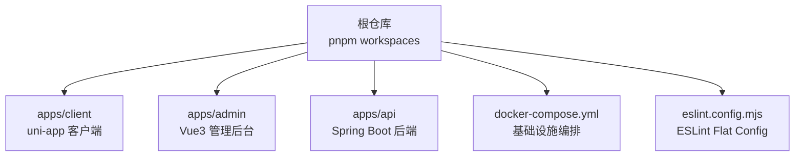
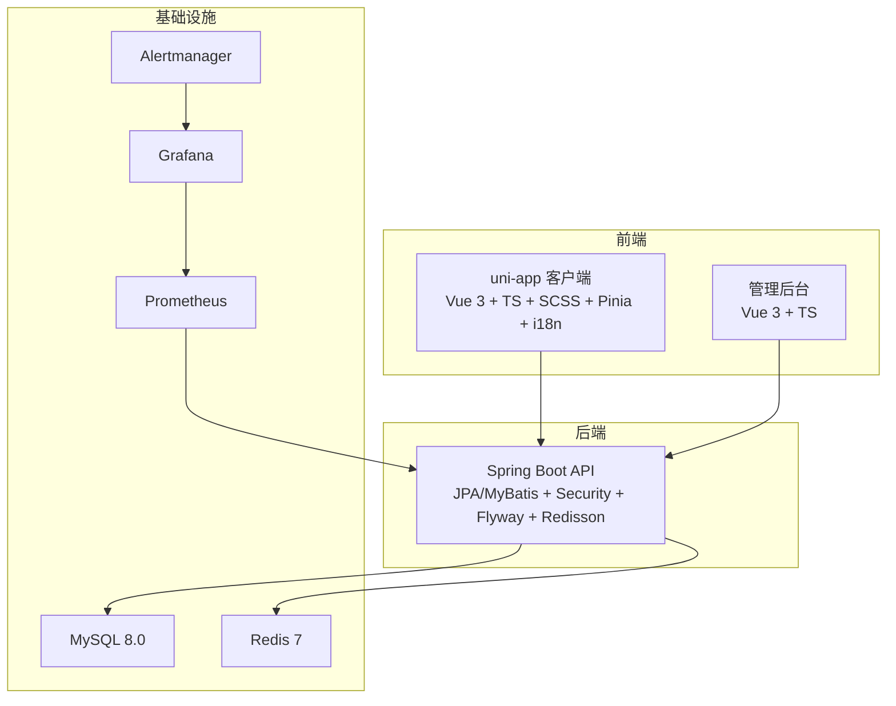
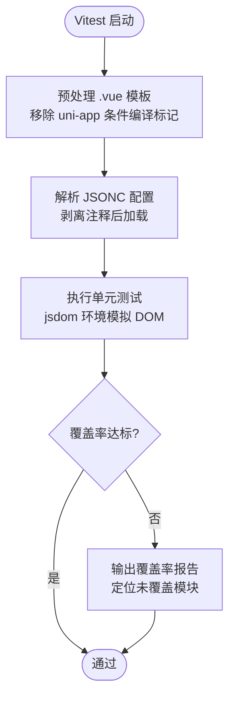
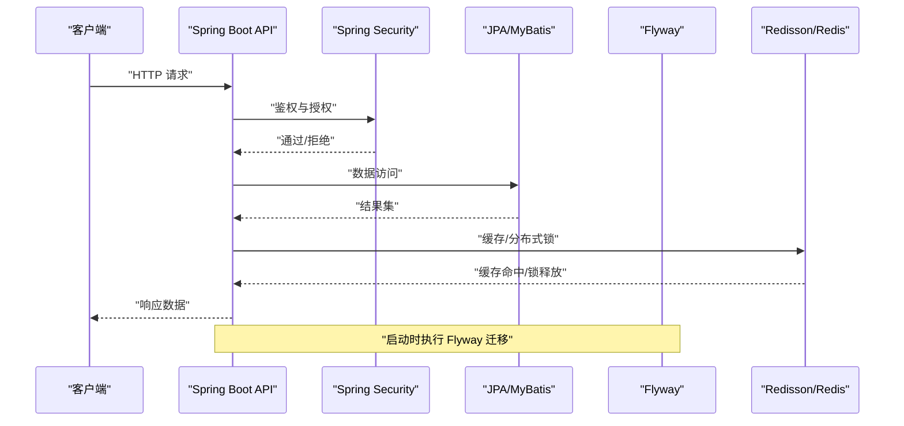
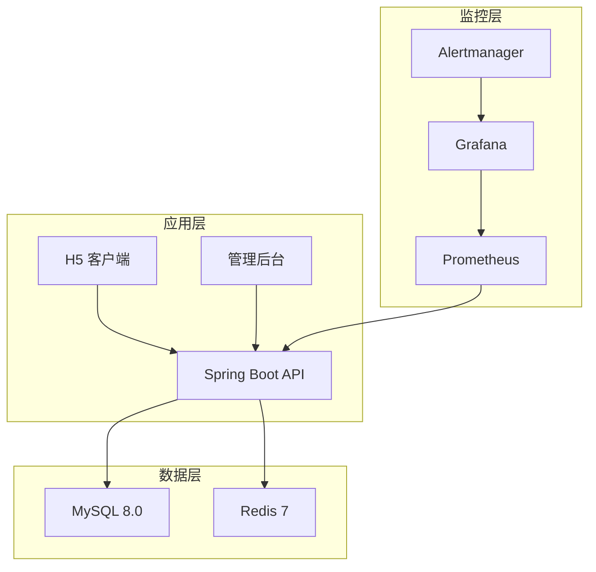
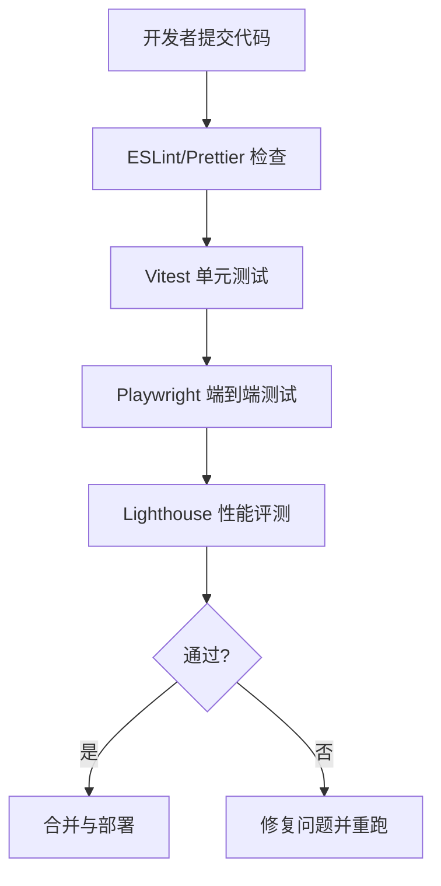
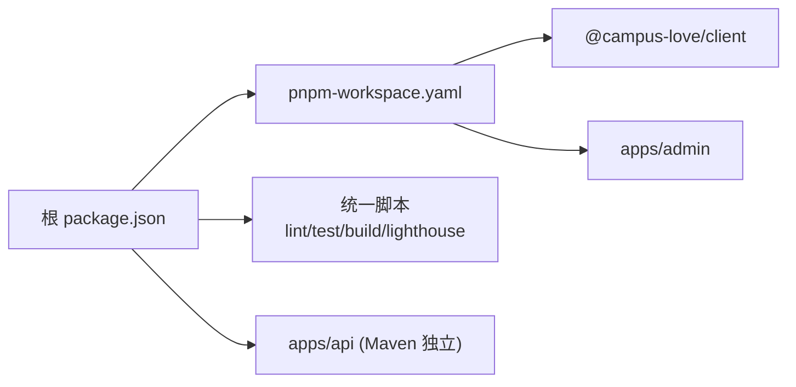

# 技术栈概览

<cite>
**本文引用的文件**
- [package.json](file://package.json)
- [pnpm-workspace.yaml](file://pnpm-workspace.yaml)
- [apps/client/package.json](file://apps/client/package.json)
- [apps/client/vitest.config.ts](file://apps/client/vitest.config.ts)
- [eslint.config.mjs](file://eslint.config.mjs)
- [docker-compose.yml](file://docker-compose.yml)
- [apps/api/pom.xml](file://apps/api/pom.xml)
</cite>

## 目录
1. [简介](#简介)
2. [项目结构](#项目结构)
3. [核心组件](#核心组件)
4. [架构总览](#架构总览)
5. [详细组件分析](#详细组件分析)
6. [依赖关系分析](#依赖关系分析)
7. [性能考量](#性能考量)
8. [故障排查指南](#故障排查指南)
9. [结论](#结论)
10. [附录](#附录)

## 简介
本技术栈概览面向 Campus Love 恋爱小程序，从前端、后端、基础设施到开发工具链进行系统化梳理。重点说明 uni-app 3.0 + Vue 3 + TypeScript + SCSS + Pinia + vue-i18n 在前端的作用与优势；Spring Boot 3.3 + Java 17 + JPA/MyBatis + Spring Security + Flyway + Redisson 在后端的职责与集成方式；MySQL 8.0 + Redis 7 + Docker Compose + Prometheus + Grafana + Alertmanager 等基础设施能力；以及 ESLint + Prettier + Vitest + Playwright + Lighthouse 等开发工具链如何保障质量与可维护性。同时给出 Monorepo（pnpm workspaces）组织策略、版本兼容性与升级建议。

## 项目结构
本项目采用 Monorepo 组织：根级 package.json 通过 pnpm workspaces 管理 apps/client（uni-app H5/微信小程序客户端）、apps/admin（Vue3 管理后台）与 apps/api（Spring Boot 后端）。根脚本统一编排构建、测试、代码检查与性能评测任务。

**图示来源**
- [package.json:1-48](file://package.json#L1-L48)
- [pnpm-workspace.yaml:1-13](file://pnpm-workspace.yaml#L1-L13)
- [docker-compose.yml:1-200](file://docker-compose.yml#L1-L200)
- [eslint.config.mjs:1-200](file://eslint.config.mjs#L1-L200)

**章节来源**
- [package.json:1-48](file://package.json#L1-L48)
- [pnpm-workspace.yaml:1-13](file://pnpm-workspace.yaml#L1-L13)

## 核心组件
- 前端技术栈
  - uni-app 3.0：跨平台应用框架，提供 H5 与微信小程序统一开发体验，配合 Vite 构建链路提升开发效率。
  - Vue 3 + TypeScript：组合式 API、强类型约束，提高可维护性与重构安全。
  - SCSS：样式预处理器，支持模块化与主题变量复用。
  - Pinia：轻量状态管理，与 Vue 3 深度集成，适合跨页面共享数据与缓存。
  - vue-i18n：多语言支持，便于国际化文案管理与切换。
- 后端技术栈
  - Spring Boot 3.3 + Java 17：现代化 Web 框架与长期支持 JDK，生态成熟、性能稳定。
  - JPA/MyBatis：对象关系映射与 SQL 灵活控制结合，适配不同复杂度查询场景。
  - Spring Security：认证授权、接口保护与权限控制。
  - Flyway：数据库版本化管理，保证迁移有序与可回滚。
  - Redisson：Redis 分布式锁与缓存增强，支撑高并发与一致性需求。
- 基础设施
  - MySQL 8.0 + Redis 7：持久化存储与高速缓存。
  - Docker Compose：一键编排本地与 CI 环境，服务依赖清晰。
  - Prometheus + Grafana + Alertmanager：指标采集、可视化与告警闭环。
- 开发工具链
  - ESLint + Prettier：统一代码风格与静态检查。
  - Vitest：快速单元测试，覆盖业务逻辑与组件。
  - Playwright：端到端自动化测试，覆盖关键用户路径。
  - Lighthouse：性能与可访问性评估，持续优化用户体验。

**章节来源**
- [apps/client/package.json:1-104](file://apps/client/package.json#L1-L104)
- [apps/api/pom.xml:1-80](file://apps/api/pom.xml#L1-L80)
- [docker-compose.yml:1-200](file://docker-compose.yml#L1-L200)
- [eslint.config.mjs:1-200](file://eslint.config.mjs#L1-L200)

## 架构总览
系统分为三层：前端（H5/小程序）、后端 API、基础设施（数据库/缓存/监控）。Docker Compose 负责编排所有服务，确保本地与 CI 环境一致。

**图示来源**
- [apps/client/package.json:1-104](file://apps/client/package.json#L1-L104)
- [apps/api/pom.xml:1-80](file://apps/api/pom.xml#L1-L80)
- [docker-compose.yml:1-200](file://docker-compose.yml#L1-L200)

## 详细组件分析

### 前端：uni-app 3.0 + Vue 3 + TypeScript + SCSS + Pinia + vue-i18n
- 选择理由与优势
  - uni-app 3.0 提供 H5 与微信小程序的统一开发模型，减少多端重复实现成本。
  - Vue 3 的组合式 API 与 TypeScript 强类型约束提升可读性与可维护性。
  - SCSS 支持模块化样式与变量复用，利于主题管理与样式治理。
  - Pinia 作为状态管理更轻量和直观，易于在复杂交互中保持状态一致性。
  - vue-i18n 使多语言切换与维护更便捷，满足国际化需求。
- 工程化配置
  - 使用 Vite 构建，单元测试基于 Vitest（jsdom 环境），并通过自定义插件处理 uni-app 条件编译注释与 JSONC 解析。
  - 覆盖率阈值对齐后端标准（语句/分支/函数/行均设定目标值），保证前端质量基线。

**图示来源**
- [apps/client/vitest.config.ts:1-115](file://apps/client/vitest.config.ts#L1-L115)

**章节来源**
- [apps/client/package.json:1-104](file://apps/client/package.json#L1-L104)
- [apps/client/vitest.config.ts:1-115](file://apps/client/vitest.config.ts#L1-L115)

### 后端：Spring Boot 3.3 + Java 17 + JPA/MyBatis + Spring Security + Flyway + Redisson
- 组件作用与集成
  - Spring Boot 3.3 提供 Web、验证、WebSocket、JPA 等 Starter，简化配置。
  - JPA/MyBatis 并行存在：JPA 用于常规实体 CRUD，MyBatis 处理复杂 SQL 或历史遗留模块。
  - Spring Security 保护接口，JWT 鉴权流程贯穿前后端。
  - Flyway 负责数据库版本迁移，保证部署一致性。
  - Redisson 扩展 Redis 能力，提供分布式锁、会话与缓存增强。
- 版本与兼容性
  - Java 17 为 LTS，Spring Boot 3.x 要求 Java 17+，Mockito 5.10+ 解决 JDK 21 下字节码生成兼容问题。
  - 依赖声明包含 mysql-connector-j、Flyway Core/Mysql、JWT 等。

**图示来源**
- [apps/api/pom.xml:1-80](file://apps/api/pom.xml#L1-L80)

**章节来源**
- [apps/api/pom.xml:1-80](file://apps/api/pom.xml#L1-L80)

### 基础设施：MySQL 8.0 + Redis 7 + Docker Compose + Prometheus + Grafana + Alertmanager
- 服务编排与安全
  - docker-compose 定义数据网络与应用网络隔离，限制端口仅绑定本机，避免公网暴露。
  - 强制环境变量注入密码，健康检查通过容器内环境变量传递凭据，避免明文参数。
  - 资源限制与日志轮转，防止资源耗尽与磁盘撑爆。
- 监控与告警
  - Prometheus 采集指标，Grafana 可视化面板，Alertmanager 路由告警通知。
  - 备份 sidecar 定期备份 MySQL，支持恢复与演练。

**图示来源**
- [docker-compose.yml:1-200](file://docker-compose.yml#L1-L200)

**章节来源**
- [docker-compose.yml:1-200](file://docker-compose.yml#L1-L200)

### 开发工具链：ESLint + Prettier + Vitest + Playwright + Lighthouse
- 代码质量
  - ESLint Flat Config 统一规则，针对 Node/TS/Vue 设置差异化的全局与规则等级，禁止危险用法（如 debugger、alert）。
  - Prettier 格式化代码，保持一致风格。
- 测试与验收
  - Vitest 运行单元测试，配置 jsdom 环境与覆盖率阈值。
  - Playwright 进行端到端测试，覆盖登录、消息、发布等关键流程。
  - Lighthouse 评估性能与可访问性，纳入 CI 质量门禁。

**图示来源**
- [eslint.config.mjs:1-200](file://eslint.config.mjs#L1-L200)
- [apps/client/vitest.config.ts:1-115](file://apps/client/vitest.config.ts#L1-L115)

**章节来源**
- [eslint.config.mjs:1-200](file://eslint.config.mjs#L1-L200)
- [apps/client/vitest.config.ts:1-115](file://apps/client/vitest.config.ts#L1-L115)

## 依赖关系分析
Monorepo 通过 pnpm workspaces 管理依赖，根级 package.json 定义工作区与脚本，apps/* 各自维护依赖。根级别还定义了覆盖策略（overrides）与允许构建的包列表，确保构建一致性。

**图示来源**
- [package.json:1-48](file://package.json#L1-L48)
- [pnpm-workspace.yaml:1-13](file://pnpm-workspace.yaml#L1-L13)

**章节来源**
- [package.json:1-48](file://package.json#L1-L48)
- [pnpm-workspace.yaml:1-13](file://pnpm-workspace.yaml#L1-L13)

## 性能考量
- 前端
  - 使用 Vite 与按需引入，减少打包体积。
  - 图片与静态资源优化（压缩、懒加载），SVG 转 PNG 流程在构建阶段执行。
  - 使用 Lighthouse 持续评估 TTI、FCP 等指标，纳入质量门禁。
- 后端
  - JPA 查询优化与索引设计，复杂查询使用 MyBatis 手写 SQL。
  - Redis 缓存热点数据，Redisson 分布式锁避免并发冲突。
  - 连接池与慢查询日志（MySQL）辅助性能调优。
- 基础设施
  - Docker 资源限制与日志轮转，避免内存/CPU 无限增长。
  - Prometheus 指标埋点，Grafana 看板监控关键瓶颈。

[本节为通用指导，不直接分析具体文件]

## 故障排查指南
- 启动失败
  - 检查 docker-compose 环境变量是否注入完整（MYSQL_ROOT_PASSWORD、REDIS_PASSWORD 等），未设置将导致启动失败。
  - 确认端口绑定仅在 127.0.0.1，避免外部干扰。
- 数据库问题
  - 查看 Flyway 迁移记录与错误日志，确认迁移顺序与幂等性。
  - 慢查询日志定位性能瓶颈，调整索引与 SQL。
- 缓存异常
  - 使用 redis-cli 与健康检查命令验证连通性。
  - 关注内存策略（allkeys-lru）与持久化（AOF）开关。
- 前端测试
  - Vitest 环境中 uni-app 条件编译注释需正确剥离，否则模板编译报错。
  - JSONC 解析需启用宽松模式以支持 pages.json 中的注释。

**章节来源**
- [docker-compose.yml:1-200](file://docker-compose.yml#L1-L200)
- [apps/client/vitest.config.ts:1-115](file://apps/client/vitest.config.ts#L1-L115)

## 结论
本技术栈以 uni-app 3.0 为核心驱动跨端前端，Vue 3 + TypeScript + SCSS + Pinia + i18n 构建高质量、可维护的用户界面；后端采用 Spring Boot 3.3 + Java 17 与丰富生态，结合 JPA/MyBatis、Security、Flyway、Redisson 形成稳健的服务层；基础设施通过 Docker Compose 编排 MySQL、Redis 与监控系统，保障开发与生产一致性；开发工具链以 ESLint、Prettier、Vitest、Playwright、Lighthouse 为抓手，持续提升代码质量与用户体验。Monorepo 与 pnpm workspaces 使得多应用协作更高效，版本兼容与升级路径明确，有助于团队长期演进。

## 附录
- 版本兼容性与升级建议
  - 前端
    - uni-app 3.0 与 Vue 3 搭配稳定，注意 @vitejs/plugin-vue 版本覆盖以确保构建一致。
    - TypeScript 5.x 与 Vitest 2.x 协同良好，保持依赖锁定与更新节奏一致。
  - 后端
    - Java 17 + Spring Boot 3.3 为当前推荐组合，Mockito 5.10+ 兼容 JDK 21。
    - Flyway 与 MySQL Connector/J 保持同代次升级，避免迁移兼容问题。
  - 基础设施
    - MySQL 8.0 与 Redis 7 均为主流 LTS 版本，注意字符集与排序规则统一。
    - Prometheus/Grafana/Alertmanager 版本对齐，配置文件与仪表板版本兼容。
  - 工具链
    - ESLint Flat Config 适用于 ESLint 9+，与 TypeScript-Vue 插件协同良好。
    - Lighthouse 与 LHCI 集成 CI，定期回归性能基线。

[本节为通用指导，不直接分析具体文件]