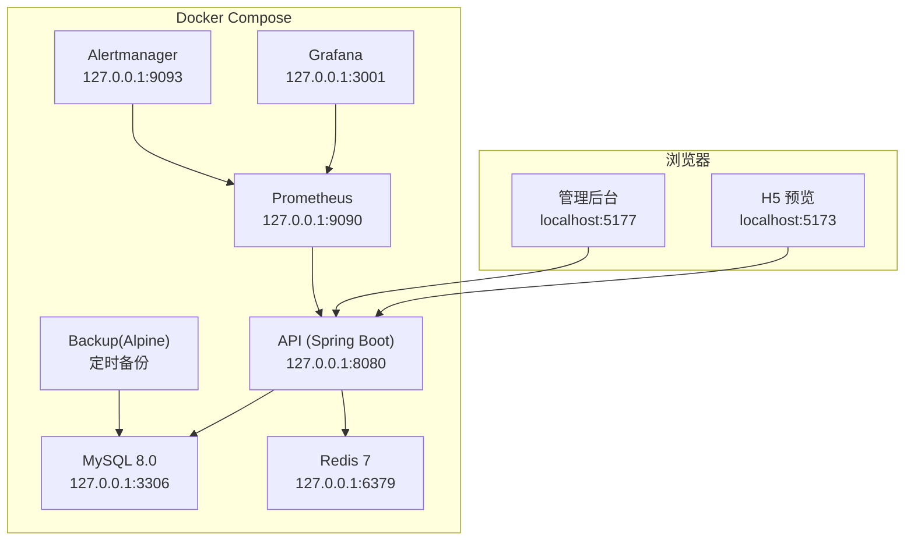

# 环境搭建指南

<cite>
**本文引用的文件**
- [package.json](file://package.json)
- [docker-compose.yml](file://docker-compose.yml)
- [.env.example](file://.env.example)
- [apps/api/.env.example](file://apps/api/.env.example)
- [apps/client/.env.example](file://apps/client/.env.example)
- [apps/admin/.env.development](file://apps/admin/.env.development)
- [database/seed-demo-data.sql](file://database/seed-demo-data.sql)
- [scripts/backup-mysql.sh](file://scripts/backup-mysql.sh)
</cite>

## 目录
1. [简介](#简介)
2. [项目结构与环境概览](#项目结构与环境概览)
3. [核心组件与端口清单](#核心组件与端口清单)
4. [开发环境要求与安装](#开发环境要求与安装)
5. [本地一键启动（Docker Compose）](#本地一键启动docker-compose)
6. [环境变量配置要点](#环境变量配置要点)
7. [数据库初始化与演示数据](#数据库初始化与演示数据)
8. [前端开发与联调](#前端开发与联调)
9. [常见问题排查](#常见问题排查)
10. [推荐工具与 IDE 配置](#推荐工具与-ide-配置)
11. [结论](#结论)

## 简介
本指南面向 Campus Love 恋爱小程序的新手开发者，提供从零开始的环境搭建步骤。内容包括：环境版本要求、依赖安装、环境变量配置、数据库初始化、Docker Compose 一键启动、常见环境问题排查，以及推荐的开发工具与 IDE 配置建议，确保你能快速在本地运行前后端并开展开发。

## 项目结构与环境概览
本项目为多应用仓库，包含客户端（uni-app）、管理后台（Vue3 + nginx）、后端 API（Spring Boot），并通过 Docker Compose 编排 MySQL、Redis、监控（Prometheus/Grafana/Alertmanager）与备份服务。所有对外服务默认仅绑定本机地址，安全且适合本地开发。

图表来源
- [docker-compose.yml:1-200](file://docker-compose.yml#L1-L200)
- [docker-compose.yml:201-400](file://docker-compose.yml#L201-L400)
- [docker-compose.yml:401-663](file://docker-compose.yml#L401-L663)

章节来源
- [docker-compose.yml:1-200](file://docker-compose.yml#L1-L200)
- [docker-compose.yml:201-400](file://docker-compose.yml#L201-L400)
- [docker-compose.yml:401-663](file://docker-compose.yml#L401-L663)

## 核心组件与端口清单
- 客户端 H5 预览：nginx 容器，宿主机 5173
- 管理后台：nginx 容器，宿主机 5177
- 后端 API：Spring Boot，宿主机 8080
- 数据库：MySQL 8.0，宿主机 3306
- 缓存：Redis 7，宿主机 6379
- 监控：Prometheus 9090、Grafana 3001、Alertmanager 9093
- 主机指标：node-exporter 9100
- 备份：Alpine cron sidecar（不占用额外端口）

注意：以上端口均可通过 .env 中的端口变量覆盖，避免冲突。

章节来源
- [.env.example:150-216](file://.env.example#L150-L216)
- [docker-compose.yml:1-200](file://docker-compose.yml#L1-L200)
- [docker-compose.yml:201-400](file://docker-compose.yml#L201-L400)
- [docker-compose.yml:401-663](file://docker-compose.yml#L401-L663)

## 开发环境要求与安装
- Node.js：>=18.0.0 <23.0.0
- Java：17（用于本地运行 Spring Boot API）
- pnpm：11.17.0（由根 packageManager 指定）
- Docker：支持 compose v2
- Docker Compose：随 Docker Desktop 或独立安装

说明
- 项目根 package.json 声明了 engines 与 packageManager，保证团队一致的工具链版本。
- 本地运行 API 需要 Java 17；若使用 Docker Compose 方式，可跳过本地 Java 安装。

章节来源
- [package.json:1-48](file://package.json#L1-L48)

## 本地一键启动（Docker Compose）
推荐使用 Docker Compose 一键拉起全部依赖服务与前后端静态站点。

步骤
1) 复制环境变量模板
- 将仓库根 .env.example 复制为 .env，并按提示填写敏感值（密码、密钥等）。

2) 启动服务
- 在项目根目录执行 docker compose up -d 即可拉起全部服务（包括数据库、缓存、API、管理后台、H5 预览、监控与备份）。

3) 访问服务
- H5 预览：http://localhost:5173
- 管理后台：http://localhost:5177
- API：http://localhost:8080
- Grafana：http://localhost:3001
- Prometheus：http://localhost:9090
- Alertmanager：http://localhost:9093

4) 停止与清理
- 停止：docker compose down
- 删除数据卷（谨慎）：docker compose down -v

注意事项
- 所有服务默认仅绑定 127.0.0.1，避免对外暴露。
- 如需调整端口，请在 .env 中修改对应端口变量后重启。

章节来源
- [docker-compose.yml:1-200](file://docker-compose.yml#L1-L200)
- [docker-compose.yml:201-400](file://docker-compose.yml#L201-L400)
- [docker-compose.yml:401-663](file://docker-compose.yml#L401-L663)
- [.env.example:150-216](file://.env.example#L150-L216)

## 环境变量配置要点
必须配置的关键项（示例见 .env.example）
- JWT_SECRET：JWT 签名密钥，长度建议 >=48 字符
- MYSQL_ROOT_PASSWORD / MYSQL_PASSWORD：数据库密码
- REDIS_PASSWORD：Redis 认证密码
- GRAFANA_ADMIN_PASSWORD：Grafana 管理员密码
- ADMIN_OPENID、ADMIN_NICKNAME、ADMIN_INITIAL_PASSWORD_HASH：首次初始化管理员账号
- WECHAT_APPID / WECHAT_SECRET：微信小程序登录（可选）
- AGNES_API_KEY / AGNES_API_BASE / AGNES_TIMEOUT_MS：AI 生成服务（可选）
- CORS_ALLOWED_ORIGINS：允许的跨域源（开发默认含本地端口）

本地直连 API 的 .env（非 Docker 场景）
- apps/api/.env.example 提供 DB_URL、DB_USERNAME、DB_PASSWORD、REDIS_*、RABBITMQ_* 等直连配置项，适用于本地直接运行 Spring Boot。

客户端环境变量
- apps/client/.env.example 定义了 VITE_API_MODE、VITE_API_BASE_URL、VITE_SENTRY_DSN、WX_APPID 等构建期/运行期变量。
- 管理后台开发环境变量位于 apps/admin/.env.development，指向 /api 代理到本地后端。

章节来源
- [.env.example:1-149](file://.env.example#L1-L149)
- [apps/api/.env.example:1-103](file://apps/api/.env.example#L1-L103)
- [apps/client/.env.example:1-51](file://apps/client/.env.example#L1-L51)
- [apps/admin/.env.development:1-14](file://apps/admin/.env.development#L1-L14)

## 数据库初始化与演示数据
- 数据库：MySQL 8.0，默认库名 campus_love，编码 utf8mb4，排序规则 utf8mb4_0900_ai_ci。
- Flyway 迁移：API 容器挂载 database/flyway/sql 作为迁移目录，首次启动自动执行。
- 初始化脚本：docker-compose 已挂载 ./database/init-mysql.sql 到 MySQL 初始化目录。
- 演示数据：可在数据库中导入 seed 脚本以快速体验功能（如 posts、聊天时间刷新等）。

操作建议
- 首次启动后，等待 MySQL 健康检查通过后再访问 API。
- 如需重置数据库，请谨慎操作（删除数据卷会丢失所有数据）。

章节来源
- [docker-compose.yml:1-200](file://docker-compose.yml#L1-L200)
- [docker-compose.yml:201-400](file://docker-compose.yml#L201-L400)
- [database/seed-demo-data.sql](file://database/seed-demo-data.sql)

## 前端开发与联调
H5 预览
- Docker Compose 模式下：访问 http://localhost:5173，静态资源由 nginx 容器托管。
- 本地开发模式：可使用工作区脚本启动 client dev:h5，并将 VITE_API_BASE_URL 指向本地 API。

管理后台
- Docker Compose 模式下：访问 http://localhost:5177，由 nginx 容器托管。
- 本地开发模式：通过 Vite 代理将 /api 转发到本地 8080，避免跨域问题。

联调要点
- 确保 VITE_API_MODE=real 时，VITE_API_BASE_URL 指向可用的后端。
- 如需接入真实微信环境，参考 apps/client/.env.example 中的 WX_APPID 注入说明。

章节来源
- [apps/client/.env.example:1-51](file://apps/client/.env.example#L1-L51)
- [apps/admin/.env.development:1-14](file://apps/admin/.env.development#L1-L14)
- [docker-compose.yml:201-400](file://docker-compose.yml#L201-L400)

## 常见问题排查
端口冲突
- 现象：某个服务无法启动，日志报 bind 失败。
- 解决：在 .env 中修改对应端口变量（如 API_PORT、CLIENT_PORT、ADMIN_PORT、GRAFANA_PORT、PROMETHEUS_PORT、ALERTMANAGER_PORT、NODE_EXPORTER_PORT），然后 docker compose down && docker compose up -d。

权限问题
- 现象：备份容器或写入目录报错权限不足。
- 解决：确认宿主 ./backups 目录存在且可写；备份容器内以非 root 用户运行，需确保挂载目录归属正确。

网络与连接
- 现象：API 无法连接 MySQL/Redis。
- 解决：确认环境变量 DB_URL、DB_USERNAME、DB_PASSWORD、REDIS_HOST、REDIS_PORT、REDIS_PASSWORD 正确；在 Docker 内部通过服务名访问（如 mysql、redis）。

监控不可用
- 现象：Grafana/Prometheus 无法访问。
- 解决：检查端口是否被占用；确认容器健康检查通过；查看各容器日志定位错误。

备份任务未执行
- 现象：备份目录无新文件。
- 解决：确认 backup 服务已启动且 crond 进程存活；检查 BACKUP_CRON 表达式；查看 /backups/cron.log 日志。

章节来源
- [.env.example:150-216](file://.env.example#L150-L216)
- [docker-compose.yml:401-663](file://docker-compose.yml#L401-L663)
- [scripts/backup-mysql.sh](file://scripts/backup-mysql.sh)

## 推荐工具与 IDE 配置
- Node.js 管理：建议使用 nvm 或 fnm 锁定至项目 engines 范围。
- 包管理器：pnpm 11.17.0（由 packageManager 固定）。
- 容器化：Docker Desktop（启用 Kubernetes 可选），Compose v2。
- IDE：VS Code 推荐插件 ESLint、Prettier、Vue 语言支持、Docker 扩展；Java 开发可使用 IntelliJ IDEA（Spring Boot 支持）。
- 调试：Chrome DevTools 调试 H5；后端可通过远程调试或日志定位。

章节来源
- [package.json:1-48](file://package.json#L1-L48)

## 结论
通过以上步骤，你可以在本地快速搭建 Campus Love 的全栈开发环境，并使用 Docker Compose 一键启动数据库、缓存、前后端与监控服务。按照指南完成环境变量配置与数据库初始化后，即可在 H5 与管理后台进行日常开发与联调。遇到问题时，优先检查端口、网络与权限，再结合容器日志定位具体原因。