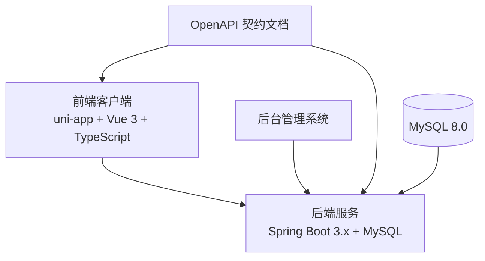
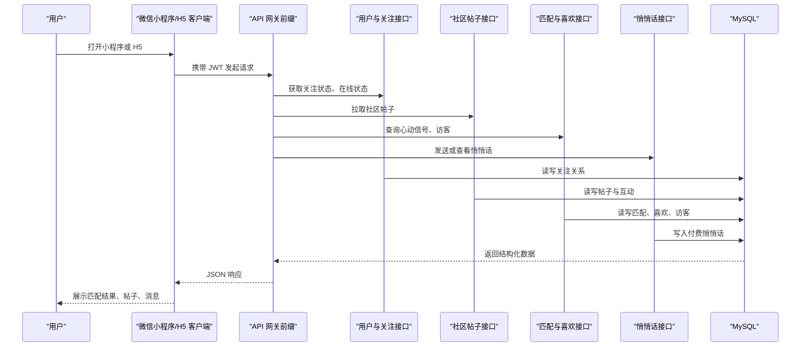
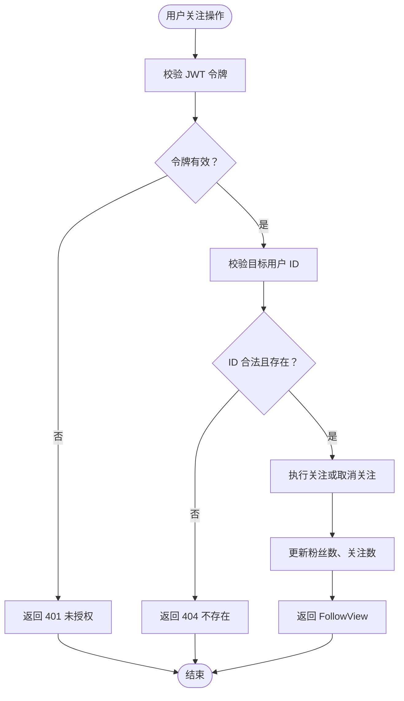
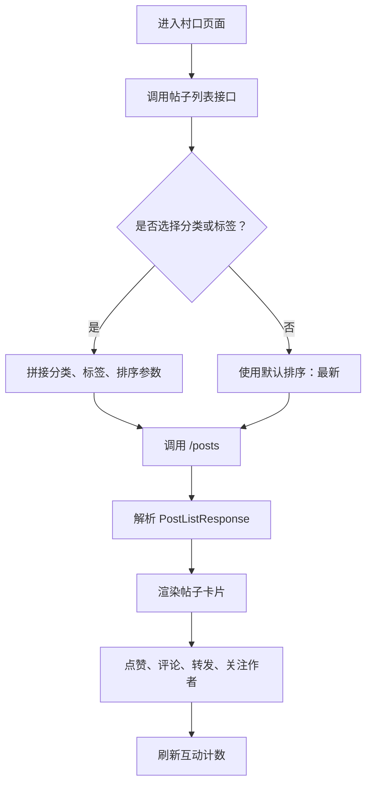
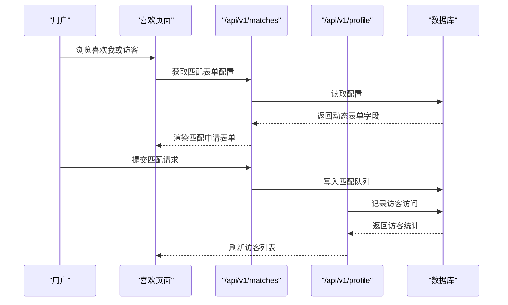
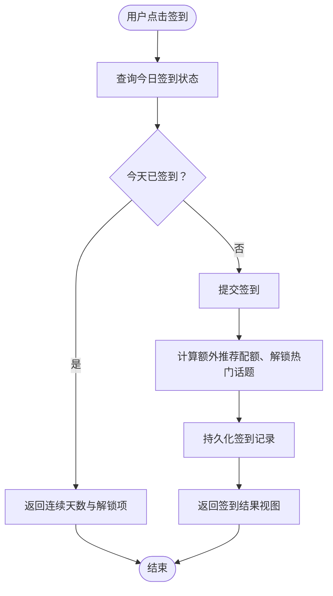
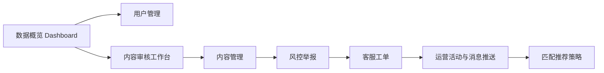
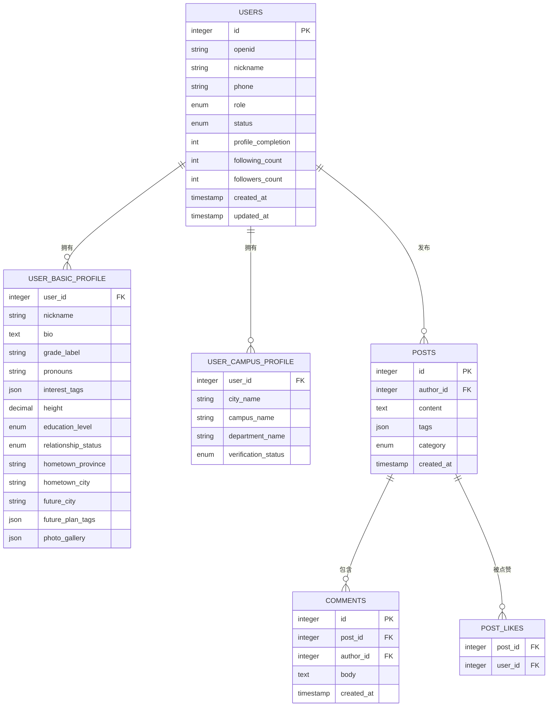
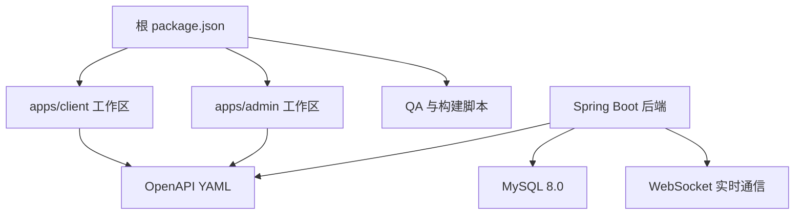

# 项目介绍与目标

<cite>
**本文引用的文件**   
- [doc/overview.md](file://doc/overview.md)
- [doc/proposal.md](file://doc/proposal.md)
- [doc/后台设计方案总览.md](file://doc/后台设计方案总览.md)
- [package.json](file://package.json)
- [docs/openapi/users.yaml](file://docs/openapi/users.yaml)
- [docs/openapi/village.yaml](file://docs/openapi/village.yaml)
- [docs/openapi/recommendations.yaml](file://docs/openapi/recommendations.yaml)
- [docs/openapi/check-in.yaml](file://docs/openapi/check-in.yaml)
- [docs/openapi/likes.yaml](file://docs/openapi/likes.yaml)
- [docs/openapi/whispers.yaml](file://docs/openapi/whispers.yaml)
- [database/seed-demo-data.sql](file://database/seed-demo-data.sql)
</cite>

## 目录
1. [引言](#引言)
2. [项目结构](#项目结构)
3. [核心组件](#核心组件)
4. [架构总览](#架构总览)
5. [详细组件分析](#详细组件分析)
6. [依赖关系分析](#依赖关系分析)
7. [性能与可观测性](#性能与可观测性)
8. [故障排查指南](#故障排查指南)
9. [结论](#结论)
10. [附录：版本、协议与发展路线](#附录版本协议与发展路线)

## 引言
Campus Love 恋爱小程序是一款面向在校大学生的轻量级校园恋爱交友平台。它的产品定位不是泛社交，而是围绕“匹配→破冰→临时匿名聊天→圈子互动→反馈成长”的完整闭环，帮助大学生在真实校园场景中获得低压力、高信任感的社交体验。

项目的核心价值主张可以概括为三点：
- **真实身份优先**：以学校认证作为社交能力门禁，减少虚假账号和无效社交。
- **渐进式社交升温**：从单向曝光、双向喜欢、心动信号到私信和临时匿名聊天，逐步降低社交压力。
- **社区化运营**：通过村口、兴趣圈、每日一问等社区内容，让社交不止于“一对一”，还能拓展到群体互动。

北极星指标是用户引流效率和用户在站内的停留时长；关键约束包括禁止游戏化元素（积分、等级、排行榜、成就徽章、虚拟货币）和禁止电商购物功能，同时要求资料完整度达到 100% 才能解锁全部社交能力，而“寻觅”页始终开放用于引流。

目标用户画像非常明确：**全国在校大学生和研究生**。只有完成学校认证的用户才能使用核心社交功能，非在校生无法进入主要流程。

主要使用场景包括：
- 刚入学或转校后希望认识同校或同城同学。
- 想通过兴趣标签、专业、年级等信息找到潜在匹配对象。
- 希望在匿名保护下开启一段临时对话，再决定是否交换联系方式。
- 在社区里发帖、评论、关注作者，参与兴趣圈和同城活动。
- 通过每日签到、每日一问等轻互动获得持续回访动力。

## 项目结构
仓库是一个前端与后端共存、多应用协作的工程结构，核心位置如下：
- `apps/client`：基于 uni-app 的前端客户端，支持微信小程序与 H5。
- `apps/admin` / `apps/admin-legacy`：后台管理相关工程。
- `apps/api`：基于 Spring Boot 的后端服务，提供 REST API 与实时通信能力。
- `docs/openapi`：OpenAPI 契约文档，定义前后端接口规范。
- `database`：数据库迁移与演示数据种子脚本。
- `scripts`：大量 QA、截图、审计、联调和部署辅助脚本。
- `docker`：Nginx 配置与监控组件编排相关文件。
- `config`：前端基础 TypeScript 配置与 Lighthouse 配置。

**图表来源**
- [package.json:1-48](file://package.json#L1-L48)
- [doc/overview.md:1-47](file://doc/overview.md#L1-L47)

**章节来源**
- [package.json:1-48](file://package.json#L1-L48)
- [doc/overview.md:1-47](file://doc/overview.md#L1-L47)

## 核心组件
Campus Love 的核心业务由五个一级入口构成，它们共同组成一个从冷启动到稳定互动的社交漏斗。

| 入口 | 主要职责 | 对应业务流程阶段 |
|---|---|---|
| 寻觅 | 推荐卡片滑动、每日限量推荐、卡片详情、兴趣标签 | 曝光与初步兴趣表达 |
| 喜欢 | 喜欢我的、访客记录、心动信号、匹配倒计时 | 双向确认与匹配 |
| 村口 | 帖子列表、分类筛选、点赞评论转发、发帖 | 社区内容与群体互动 |
| 消息 | 私信会话、系统通知、临时匿名聊天、联系方式交换 | 破冰与沟通 |
| 我的 | 个人资料、学校认证、资料完整度、推荐策略 | 身份建设、留存与成长 |

其中，“资料未完善”会触发锁定机制：除“寻觅”外，其他 Tab 显示模糊头像并引导用户立即完善资料。这个设计把“身份真实性”和“社交可用性”强绑定，是产品区别于普通交友工具的关键特征。

**章节来源**
- [doc/proposal.md:1-200](file://doc/proposal.md#L1-L200)

## 架构总览
从技术角度看，项目采用前后端分离、契约驱动的开发方式：
- 前端使用 uni-app，一套代码生成微信小程序与 H5。
- 后端使用 Spring Boot 3.x，提供 RESTful API。
- 数据库使用 MySQL 8.0，并通过 Flyway 管理迁移。
- 实时通信使用 WebSocket，支撑私信与临时匿名聊天。
- 认证使用 JWT access token 与 refresh token，结合微信登录。
- 前后端通过 OpenAPI YAML 契约进行接口对齐，并由 Spectral 校验。

**图表来源**
- [docs/openapi/users.yaml:1-80](file://docs/openapi/users.yaml#L1-L80)
- [docs/openapi/village.yaml:1-100](file://docs/openapi/village.yaml#L1-L100)
- [docs/openapi/likes.yaml:1-60](file://docs/openapi/likes.yaml#L1-L60)
- [docs/openapi/whispers.yaml:1-80](file://docs/openapi/whispers.yaml#L1-L80)
- [doc/proposal.md:1-200](file://doc/proposal.md#L1-L200)

## 详细组件分析

### 用户与关注模块
用户模块负责维护用户基本信息、校园身份、关注关系和在线状态。它对外暴露 `/api/v1/users` 系列接口，所有接口均需要有效的 JWT bearer token。

典型能力包括：
- 关注用户：幂等操作，重复调用不会创建重复关系。
- 取消关注：移除当前用户与被关注用户的关注关系。
- 查询关注数量：返回当前用户的粉丝数和关注数。
- 在线状态：配合实时通信能力展示用户是否在线。

**图表来源**
- [docs/openapi/users.yaml:1-80](file://docs/openapi/users.yaml#L1-L80)

**章节来源**
- [docs/openapi/users.yaml:1-80](file://docs/openapi/users.yaml#L1-L80)

### 社区与村口模块
村口是 Campus Love 的社区化核心。OpenAPI 定义了帖子列表、帖子详情、发布帖子等接口，并支持按分类、标签、排序方式和分页查询。

主要特性包括：
- 帖子分类：全部、约会、学习、生活、活动、帮助等。
- 排序方式：最新、最热、推荐。
- 分页参数：页码与每页条数。
- 权限控制：发布和读取通常需要认证。

**图表来源**
- [docs/openapi/village.yaml:1-100](file://docs/openapi/village.yaml#L1-L100)

**章节来源**
- [docs/openapi/village.yaml:1-100](file://docs/openapi/village.yaml#L1-L100)

### 匹配、喜欢与访客模块
匹配模块承担“喜欢→心动信号→匹配”的关键路径。接口覆盖匹配表单配置、创建匹配请求、访客记录等，通常挂载在 `/api/v1/matches` 和 `/api/v1/profile`。

关键点：
- 匹配表单配置：动态决定意图、话题和时间窗口。
- 匹配请求：请求体中的 userId 会被忽略，实际身份来自 JWT，防止跨用户伪造。
- 访客追踪：记录谁看过当前用户资料。
- 心跳与限时：心动信号有 24 小时倒计时，超时后仍可保留匹配关系，但紧迫感促进行动。

**图表来源**
- [docs/openapi/likes.yaml:1-60](file://docs/openapi/likes.yaml#L1-L60)

**章节来源**
- [docs/openapi/likes.yaml:1-60](file://docs/openapi/likes.yaml#L1-L60)

### 每日签到与成长反馈
签到模块通过 `/api/v1/check-in` 记录用户每日签到，并返回连续签到天数、额外推荐配额、热门话题解锁等信息。这属于“反馈成长”闭环的一部分，用来提升用户回访率，但不等同于游戏化积分或虚拟货币。

**图表来源**
- [docs/openapi/check-in.yaml:1-60](file://docs/openapi/check-in.yaml#L1-L60)

**章节来源**
- [docs/openapi/check-in.yaml:1-60](file://docs/openapi/check-in.yaml#L1-L60)

### 推荐与每日一问
推荐模块提供每日问题、回答提交与答案列表能力，同时提供推荐人群接口。OpenAPI 中曾出现历史端点与实际实现不一致的情况，说明项目采用契约驱动开发，并在迭代中不断修正契约与实现的偏差。

核心用途：
- 每日一问：制造轻话题，让用户在不直接社交的压力下表达观点。
- 答案互动：通过回答和查看他人答案，形成弱连接。
- 推荐人群：根据学校、城市、兴趣、时间偏好等条件推荐匹配对象。

**章节来源**
- [docs/openapi/recommendations.yaml:1-80](file://docs/openapi/recommendations.yaml#L1-L80)

### 悄悄话模块
悄悄话是带付费属性的留言能力，同一对用户最多一条有效消息，发送者每日有限额，并使用幂等的 clientRequestId 保证重试安全。钱包扣费与消息创建在同一事务中，创建失败会自动退款。

这一模块体现产品的商业化探索方向，但必须注意它与“严禁虚拟货币交易”的整体约束之间的边界：悄悄话更像一次性付费留言通道，而不是通用虚拟货币体系。

**章节来源**
- [docs/openapi/whispers.yaml:1-80](file://docs/openapi/whispers.yaml#L1-L80)

### 后台管理系统
后台管理系统承担用户管理、内容审核、风控举报、客服工单、运营推送、匹配推荐策略等职责。设计方案强调 12 个一级分类、75 个二级模块的全覆盖率，并以侧边栏加顶栏的统一骨架降低学习成本。

**图表来源**
- [doc/后台设计方案总览.md:1-61](file://doc/后台设计方案总览.md#L1-L61)

**章节来源**
- [doc/后台设计方案总览.md:1-61](file://doc/后台设计方案总览.md#L1-L61)

### 演示数据与身份建模
演示数据种子脚本展示了系统的核心实体关系：用户表、基本资料表、校园资料表、帖子、评论、帖子点赞等。每个演示用户都有学校、专业、兴趣标签、个人简介等字段，便于本地联调时快速构造真实感较强的测试环境。

**图表来源**
- [database/seed-demo-data.sql:1-80](file://database/seed-demo-data.sql#L1-L80)

**章节来源**
- [database/seed-demo-data.sql:1-80](file://database/seed-demo-data.sql#L1-L80)

## 依赖关系分析
从工程层面看，项目依赖关系可以分为四层：

1. **工程层依赖**：根 `package.json` 通过 pnpm workspace 管理 `apps/client` 与 `apps/admin`，并提供统一脚本启动 API 开发、类型检查、OpenAPI lint、Lighthouse 性能检测等。
2. **接口层依赖**：OpenAPI YAML 是前后端的契约来源，前端通过 openapi-typescript 生成类型，后端通过 Spring Controller 实现。
3. **运行时依赖**：前端依赖 uni-app、Vue 3、TypeScript、Pinia；后端依赖 Spring Boot、MySQL、Flyway、WebSocket。
4. **质量依赖**：ESLint、Prettier、Spectral、Vitest、JUnit、Lighthouse、Pytest 等工具贯穿开发、测试和验收。

**图表来源**
- [package.json:1-48](file://package.json#L1-L48)
- [doc/proposal.md:1-200](file://doc/proposal.md#L1-L200)

**章节来源**
- [package.json:1-48](file://package.json#L1-L48)
- [doc/proposal.md:1-200](file://doc/proposal.md#L1-L200)

## 性能与可观测性
项目对性能和可观测性的关注体现在多个层面：
- 根脚本提供 Lighthouse 检测命令，分别针对客户端和后台页面输出性能报告。
- 前端构建产物经过多轮 UI 还原与像素级一致性验证。
- 后端提供 mock 模式 API，便于前端在无真实数据库时冒烟测试。
- 大量 QA 脚本用于自动化截图、状态检查、路由检查、消息数据检查等。

这些手段适合在本地联调和 CI 中组合使用，确保“界面还原度”“接口可达性”“构建零报错”成为交付底线。

**章节来源**
- [package.json:1-48](file://package.json#L1-L48)
- [doc/overview.md:1-47](file://doc/overview.md#L1-L47)

## 故障排查指南
结合仓库现状，常见问题和排查建议如下：

| 问题类型 | 现象 | 排查建议 |
|---|---|---|
| 构建锁死 | Windows 上 dist 目录被占用导致构建失败 | 使用独立输出目录，避免多个构建进程同时写同一目录 |
| Git 引用异常 | 外部工具误删 git refs，HEAD 处于 unborn 状态 | 恢复 HEAD 指向 main 分支，并按提示 reset |
| 静态资源沙箱拦截 | 预构建脚本被沙箱阻止 | 手动复制开发资源，跳过受限制脚本 |
| 工具目录误入暂存区 | 工具或临时目录被 git add | 增强 `.gitignore`，排除 `.claude`、`.design_library`、`.trae` 等目录 |
| 前端类型检查失败 | vue-tsc 或类型脚本报错 | 先运行 OpenAPI 生成，再执行类型检查和单元测试 |
| 接口 404 | 历史契约端点与实现不一致 | 对照 OpenAPI YAML 与后端 Controller，优先修复契约或实现 |
| 小程序与 H5 表现不一致 | 双端样式或逻辑差异 | 使用 uni-app 条件编译检查差异，重点查 tabbar、导航栏、事件兼容 |

**章节来源**
- [doc/overview.md:1-47](file://doc/overview.md#L1-L47)
- [package.json:1-48](file://package.json#L1-L48)

## 结论
Campus Love 恋爱小程序不是一个简单的“左滑右滑”匹配工具，而是一个围绕真实校园身份、渐进式社交升温和社区化运营设计的完整产品。它的优势在于：
- 用学校认证和资料完整度约束保障社交质量。
- 用匹配、临时匿名聊天、圈子、签到等机制构建自然社交路径。
- 用 OpenAPI 契约、多端前端、Spring Boot 后端和丰富脚本体系保障工程质量。
- 用后台管理系统覆盖用户、内容、风控、运营和推荐策略。

对于非技术读者，可以把它理解为“大学校园里更安全、更温和、更有社区氛围的交友入口”。对于技术读者，它是一个具备清晰分层、契约驱动、双端支持和实时通信能力的现代全栈项目。

## 附录：版本、协议与发展路线

### 版本与交付状态
- 项目名称：校园恋爱小程序（Campus Love Mini-Program）。
- 当前仓库版本标识位于根 `package.json`，workspace 名称为 `campus-love-monorepo`。
- 第六轮收官交付中，前端页面还原度达到 11/11，前后端接口对齐，构建与冒烟测试无错误。
- 前端构建产物位于 `apps/client/dist-r5/build/mp-weixin`。

**章节来源**
- [doc/overview.md:1-47](file://doc/overview.md#L1-L47)
- [package.json:1-48](file://package.json#L1-L48)

### 开源协议
当前仓库根目录未检出显式的开源协议文件。因此，在未找到 LICENSE 文件之前，不应假定该项目默认采用 MIT、Apache 2.0 或其他开源协议。使用前应确认仓库所有者是否另有声明。

### 发展路线图
根据需求文档和交付记录，项目演进主线包括：
- 第一阶段：完成小程序单端核心页面与接口对齐。
- 第二阶段：补齐后台管理系统设计与实现，覆盖用户、内容、风控、运营。
- 第三阶段：推进微信小程序与 H5 双端一致体验，强化实时通信和推荐能力。
- 第四阶段：完善社区运营、签到成长、推荐策略和数据分析，支撑长期留存。

这条路线符合“匹配→破冰→临时匿名聊天→圈子互动→反馈成长”的产品闭环，也体现了从 MVP 走向可运营产品的工程节奏。