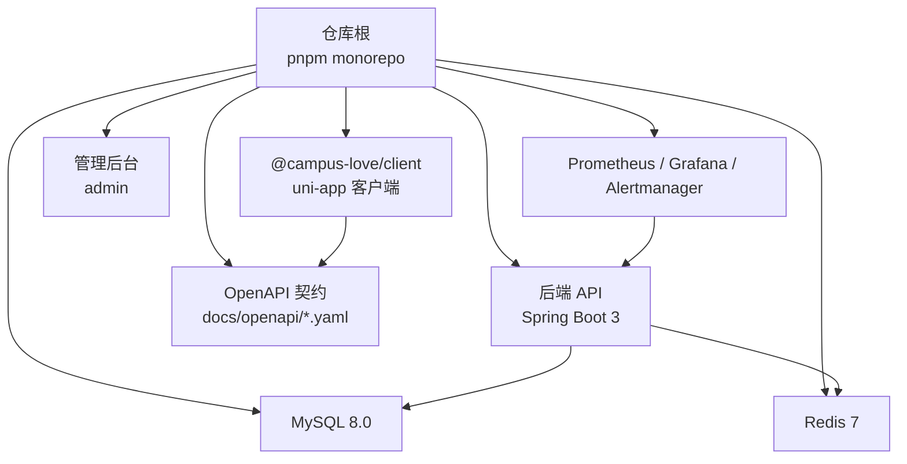
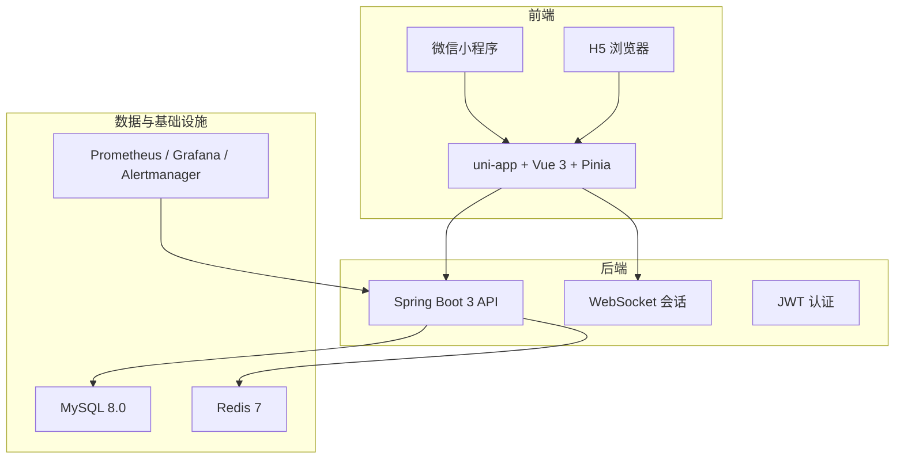
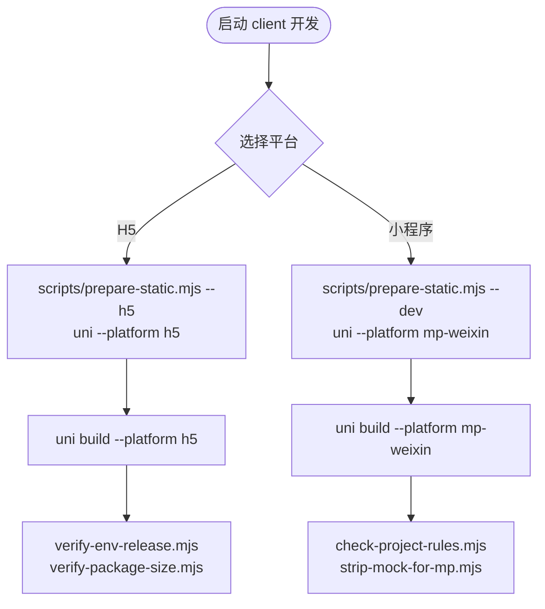
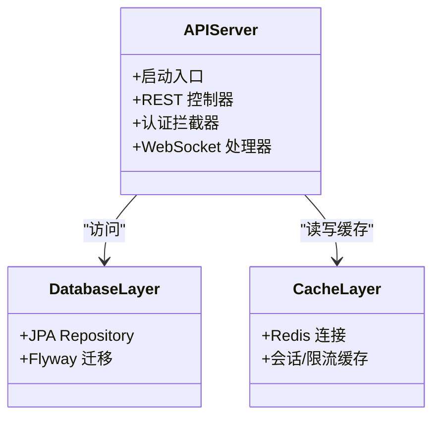
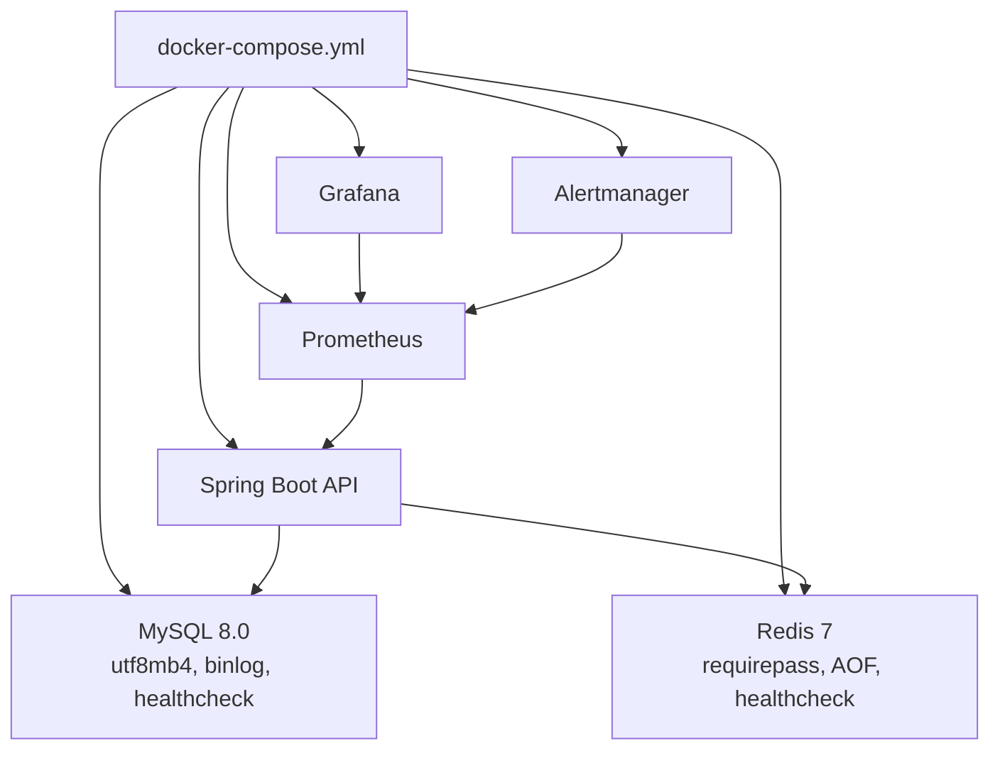
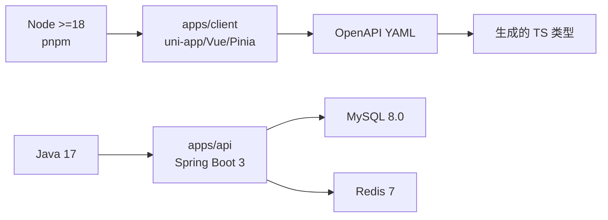

# 项目概览与快速开始

<cite>
**本文引用的文件**   
- [package.json](file://package.json)
- [apps/client/package.json](file://apps/client/package.json)
- [apps/api/pom.xml](file://apps/api/pom.xml)
- [docker-compose.yml](file://docker-compose.yml)
- [doc/overview.md](file://doc/overview.md)
- [doc/proposal.md](file://doc/proposal.md)
</cite>

## 目录
1. [引言](#引言)
2. [项目结构](#项目结构)
3. [核心组件](#核心组件)
4. [架构总览](#架构总览)
5. [详细组件分析](#详细组件分析)
6. [依赖关系分析](#依赖关系分析)
7. [性能与可观测性](#性能与可观测性)
8. [快速开始指南](#快速开始指南)
9. [常见问题排查](#常见问题排查)
10. [结语](#结语)

## 引言
Campus Love 恋爱小程序是一个面向在校大学生的轻量级校园恋爱交友平台。项目以“社交升温漏斗”为主线，把用户从陌生人曝光逐步引导至私信沟通、兴趣圈互动与线下场景，目标是提升用户引流效率与停留时长。项目同时支持微信小程序与 H5 双端运行，后端基于 Spring Boot 3，数据库使用 MySQL，缓存使用 Redis，并通过 Flyway 管理数据库迁移。前端采用 uni-app（Vue 3 + TypeScript），状态管理使用 Pinia，接口契约通过 OpenAPI 驱动生成类型定义，便于前后端协作与自动化测试。

项目已进行多轮验收与回归，最终交付版本在页面还原、前后端接口对齐、错误排查和功能完整性方面达到较高标准；素材全部内聚于仓库，不依赖外部下载。

**章节来源**
- [doc/proposal.md:1-100](file://doc/proposal.md#L1-L100)
- [doc/overview.md:1-47](file://doc/overview.md#L1-L47)

## 项目结构
仓库为 monorepo，根 package.json 通过 pnpm workspaces 聚合前端客户端与管理后台两个工作区；后端服务位于 apps/api；容器编排由 docker-compose.yml 统一描述数据库、缓存、后端 API、管理后台、H5 预览以及监控告警栈。

**图示来源**
- [package.json:1-48](file://package.json#L1-L48)
- [apps/client/package.json:1-104](file://apps/client/package.json#L1-L104)
- [apps/api/pom.xml:1-50](file://apps/api/pom.xml#L1-L50)
- [docker-compose.yml:1-60](file://docker-compose.yml#L1-L60)

**章节来源**
- [package.json:1-48](file://package.json#L1-L48)
- [apps/client/package.json:1-104](file://apps/client/package.json#L1-L104)
- [apps/api/pom.xml:1-50](file://apps/api/pom.xml#L1-L50)
- [docker-compose.yml:1-60](file://docker-compose.yml#L1-L60)

## 核心组件
- 前端客户端：基于 uni-app（Vue 3 + TypeScript），提供微信小程序与 H5 双端能力，内置 Pinia 状态管理、Sentry 前端埋点、Vitest 单元测试与 Playwright E2E 能力。
- 后端 API：基于 Spring Boot 3.x，提供 RESTful 接口，集成 JPA、Flyway 迁移、JWT 认证与 WebSocket 实时通信支撑消息聊天。
- 数据层：MySQL 8.0 作为主存储，Redis 7 作为缓存与会话辅助。
- 运维与可观测性：Docker Compose 编排本地环境，Prometheus、Grafana、Alertmanager 用于指标采集与告警，Nginx 托管静态资源。

**章节来源**
- [apps/client/package.json:1-104](file://apps/client/package.json#L1-L104)
- [apps/api/pom.xml:1-50](file://apps/api/pom.xml#L1-L50)
- [docker-compose.yml:1-60](file://docker-compose.yml#L1-L60)

## 架构总览
系统分为三层：前端客户端、后端 API、数据与基础设施。客户端通过 HTTP/WebSocket 与 API 交互；API 通过 JPA 访问 MySQL，使用 Redis 做缓存与会话增强；部署侧由 Docker Compose 拉起所有依赖服务。

**图示来源**
- [apps/client/package.json:1-104](file://apps/client/package.json#L1-L104)
- [apps/api/pom.xml:1-50](file://apps/api/pom.xml#L1-L50)
- [docker-compose.yml:1-60](file://docker-compose.yml#L1-L60)

## 详细组件分析

### 前端客户端（uni-app + Vue 3）
- 技术栈：uni-app、Vue 3、TypeScript、Pinia、Vitest、Playwright、Storybook、Sentry。
- 构建与模式：支持 dev/h5、dev/mp-weixin、build:h5、build:mp-weixin 等脚本；real/mock/showcase 多种构建模式。
- 功能模块：匹配推荐、喜欢与访客、村口社区圈、消息聊天、签到与成长反馈、个人资料完善与解锁机制。
- 开发体验：openapi-typescript 根据 OpenAPI YAML 生成类型定义，保障前后端契约一致性。

**图示来源**
- [apps/client/package.json:1-104](file://apps/client/package.json#L1-L104)

**章节来源**
- [apps/client/package.json:1-104](file://apps/client/package.json#L1-L104)

### 后端 API（Spring Boot 3）
- 技术栈：Spring Boot 3.3.1、JPA、Flyway、Validation、Web、Mockito 5.10.0+、byte-buddy 1.14.12，Java 17。
- 职责：用户认证、匹配推荐、消息聊天、社区圈内容、反馈与成长配置、官方账号管理等业务接口。
- 数据迁移：Flyway 管理 SQL 迁移脚本，避免手工维护数据库结构。
- 测试：JUnit 5 + MockMvc 覆盖单元与集成用例。

**图示来源**
- [apps/api/pom.xml:1-50](file://apps/api/pom.xml#L1-L50)

**章节来源**
- [apps/api/pom.xml:1-50](file://apps/api/pom.xml#L1-L50)

### 数据与基础设施（MySQL + Redis + 监控）
- MySQL：utf8mb4 字符集与排序规则，开启 binlog 与慢查询日志，健康检查通过 mysqladmin ping。
- Redis：密码保护、LRU 淘汰策略、AOF 持久化，healthcheck 通过 redis-cli PING。
- 监控：Prometheus 采集指标，Grafana 可视化，Alertmanager 路由告警。
- 网络与安全：仅绑定 127.0.0.1，按 data-net/app-net 拆分网络，限制 CPU/内存资源，禁止 latest 镜像默认值。

**图示来源**
- [docker-compose.yml:1-60](file://docker-compose.yml#L1-L60)

**章节来源**
- [docker-compose.yml:1-60](file://docker-compose.yml#L1-L60)

## 依赖关系分析
- Node.js 与包管理器：Node >=18，pnpm@11.17.0，workspaces 聚合 apps/client 与 apps/admin。
- 前端依赖：@dcloudio/uni-app 系列、vue、pinia、sentry、@vueuse/core、vitest、playwright。
- 后端依赖：spring-boot-starter-web/validation/jdbc/data-jpa、flyway-core、junit、mockito、byte-buddy。
- 运行时依赖：MySQL 8.0、Redis 7、可选的 Nginx 托管静态资源。

**图示来源**
- [package.json:1-48](file://package.json#L1-L48)
- [apps/client/package.json:1-104](file://apps/client/package.json#L1-L104)
- [apps/api/pom.xml:1-50](file://apps/api/pom.xml#L1-L50)

**章节来源**
- [package.json:1-48](file://package.json#L1-L48)
- [apps/client/package.json:1-104](file://apps/client/package.json#L1-L104)
- [apps/api/pom.xml:1-50](file://apps/api/pom.xml#L1-L50)

## 性能与可观测性
- 前端：Vitest 单元测试、Playwright E2E、Storybook 组件文档、Sentry 前端监控与回放。
- 后端：JUnit 5 + MockMvc 测试；可通过 Docker Compose 暴露 Prometheus/Grafana 观察服务指标。
- 构建质量：根脚本提供 lighthouse 审计、OpenAPI Spectral 校验、类型检查与构建产物体积校验。

**章节来源**
- [package.json:1-48](file://package.json#L1-L48)
- [apps/client/package.json:1-104](file://apps/client/package.json#L1-L104)
- [docker-compose.yml:1-60](file://docker-compose.yml#L1-L60)

## 快速开始指南

### 环境与前置条件
- Node.js >=18，pnpm 安装器。
- Java 17、Maven（或使用 Maven Wrapper）。
- MySQL 8.0、Redis 7（也可通过 Docker Compose 一键拉起）。

**章节来源**
- [package.json:1-48](file://package.json#L1-L48)
- [apps/api/pom.xml:1-50](file://apps/api/pom.xml#L1-L50)
- [docker-compose.yml:1-60](file://docker-compose.yml#L1-L60)

### 安装依赖
- 根目录执行 pnpm install，安装 monorepo 工作区依赖。
- 前端客户端依赖由 apps/client/package.json 管理，后端依赖由 apps/api/pom.xml 管理。

**章节来源**
- [package.json:1-48](file://package.json#L1-L48)
- [apps/client/package.json:1-104](file://apps/client/package.json#L1-L104)
- [apps/api/pom.xml:1-50](file://apps/api/pom.xml#L1-L50)

### 本地开发环境启动
- 数据库与缓存：推荐使用 docker compose up -d 拉起 MySQL、Redis 与监控服务。
- 后端 API：进入 apps/api 使用 mvn 或 Maven Wrapper 启动服务，默认监听 8080。
- 前端 H5：在根目录执行 npm run client:dev:h5，或进入 apps/client 执行 scripts/prepare-static.mjs 后 uni --platform h5。
- 微信小程序：在 apps/client 执行 dev:mp-weixin 或 dev:mp-weixin:debug，配合微信开发者工具调试。

**章节来源**
- [docker-compose.yml:1-60](file://docker-compose.yml#L1-L60)
- [package.json:1-48](file://package.json#L1-L48)
- [apps/client/package.json:1-104](file://apps/client/package.json#L1-L104)

### 数据库初始化
- 使用 Docker Compose 提供的 init 脚本完成基础库表初始化。
- 应用启动时 Flyway 自动执行 migration 脚本，确保数据库结构与代码一致。

**章节来源**
- [docker-compose.yml:1-60](file://docker-compose.yml#L1-L60)
- [apps/api/pom.xml:1-50](file://apps/api/pom.xml#L1-L50)

### 小程序开发与 H5 调试
- 小程序开发：
  - 执行 apps/client/package.json 中 dev:mp-weixin 或 dev:mp-weixin:debug。
  - 打开微信开发者工具导入对应工程目录。
- H5 调试：
  - 执行 apps/client/package.json 中 dev:h5 或 dev:h5:real。
  - 浏览器访问 http://localhost:5173 查看效果。

**章节来源**
- [apps/client/package.json:1-104](file://apps/client/package.json#L1-L104)

### 常用脚本速查
- 根目录：
  - api:dev：启动后端 API（mock profile）。
  - client:dev:h5：启动 H5 客户端。
  - generate:openapi：根据 OpenAPI YAML 生成前端类型。
  - lint：ESLint 校验前端代码。
  - test：运行原型契约、结构与客户端测试。
- 客户端：
  - typecheck：Vue TypeScript 类型检查。
  - test/test:unit：Vitest 单测。
  - build:mp-weixin/build:h5：构建小程序/H5 产物。

**章节来源**
- [package.json:1-48](file://package.json#L1-L48)
- [apps/client/package.json:1-104](file://apps/client/package.json#L1-L104)

## 常见问题排查
- Windows dist 锁文件：
  - 现象：构建时报错 Device or resource busy。
  - 处理：使用独立输出目录构建，例如 uni build --outDir dist-r5/...，避免 dist 被占用。
- Git 引用异常：
  - 现象：HEAD unborn。
  - 处理：git symbolic-ref HEAD refs/heads/main 并 git reset --mixed main。
- 沙箱脚本拦截 prepare-static.mjs：
  - 处理：手动复制 dev 静态资源，跳过该脚本。
- 工具目录误加入 staged：
  - 处理：增强 .gitignore，排除 .claude/.design_library/.trae 等临时目录。

**章节来源**
- [doc/overview.md:1-47](file://doc/overview.md#L1-L47)

## 结语
本项目以清晰的 monorepo 组织、契约驱动的 OpenAPI、稳定的 Spring Boot 3 后端与跨端 uni-app 前端，构建了面向校园用户的恋爱社交平台。通过 Docker Compose 与监控栈，开发与环境管理更可控；通过多轮验收与回归，页面还原与接口对齐达到高质量标准。建议新成员先阅读 doc/proposal.md 与 doc/overview.md，再依据本快速开始指南搭建本地环境，从 H5 调试入手熟悉前端，随后接入后端 API 与数据库。