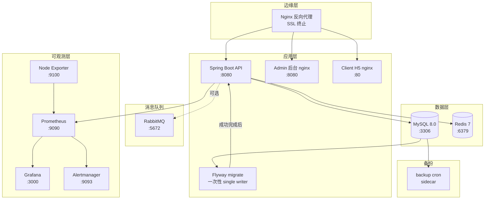

# 部署指南

## 前置要求

### 操作系统

- **生产**：Linux（推荐 Ubuntu 22.04 LTS / Debian 12 / CentOS Stream 9），内核 5.15+
- **开发/测试**：Windows 10/11、macOS 13+、Linux 均可
- **架构**：x86_64（amd64）；arm64 需自行验证镜像兼容性

### 软件依赖

- Node.js `>=18.0.0 <21.0.0`（前端构建，与根目录 `engines` 字段、Dockerfile node:20、CI node 20 一致）
- Java 17+（后端运行）
- MySQL 8.0+（real profile 必需）
- Redis 7+（real profile 必需）
- Maven 3.9+（后端构建，已内置 `mvnw` wrapper）
- pnpm 11.x（前端构建，统一包管理器，见 `packageManager` 字段）
- Docker 24+ & Docker Compose 2.20+（容器化部署）

### 资源要求（生产单节点最小配置）

| 服务规模 | CPU | 内存 | 磁盘 | 备注 |
|----------|-----|------|------|------|
| 小型（< 1k DAU） | 2 核 | 4 GB | 40 GB SSD | API + MySQL + Redis + 监控同机部署 |
| 中型（1k–10k DAU） | 4 核 | 8 GB | 100 GB SSD | 推荐 MySQL/Redis 独立节点 |
| 大型（> 10k DAU） | 8+ 核 | 16+ GB | 200+ GB SSD | 必须拆分节点，启用读写分离与对象存储 |

> 磁盘需预留至少 3 倍 MySQL 数据卷大小（用于备份、Flyway 迁移回滚、日志归档）。
> 监控数据保留：Prometheus 默认 15 天；Grafana 持久化卷未配置容量限制（R4-02137，
> 实际占用以运行监控数据量为准，建议部署机预留足够的卷空间）。

### 网络

- 出网：拉取 Docker 镜像、调用微信 API（`api.weixin.qq.com`）、Agnes AI（`api.agnes-ai.com`）
- 入网：仅开放 80/443（Web）、22（SSH，建议限源 IP）；MySQL/Redis/监控端口不对外
- 微信小程序合法域名：生产环境必须配置 HTTPS 域名，详见「域名与 SSL」小节

## 部署架构图

### 服务依赖（mermaid）



### 启动顺序（depends_on）

```
mysql ─┬─→ migrate(一次性,成功退出) ─┐
redis ─┘                              ├─→ api ─→ admin ─→ client (profile: client-h5)
                                      │        ↑
                                      │        ├─→ prometheus ─→ grafana
                                      │        │                └─→ alertmanager
                                      │        └─→ node-exporter (默认常开)
mysql ─→ backup (profile: backup)
```

- `migrate` 依赖 `mysql` 健康（`condition: service_healthy`），跑 `flyway migrate` 后退出（`restart: "no"`）
- `api` 依赖 `migrate` **成功完成**（`condition: service_completed_successfully`）以及 `mysql`/`redis` 健康
- `admin` 与 `client` 依赖 `api` 健康
- `prometheus` 依赖 `api`（无需等待健康，仅启动顺序）
- `grafana` 与 `alertmanager` 依赖 `prometheus`
- `backup` 依赖 `mysql` 健康（另需只读挂载 `mysql-data` 以归档 binlog）

## 环境变量配置

### 前端环境变量

创建 `apps/client/.env` 文件（mock 模式，无需后端）：

```bash
VITE_API_MODE=mock
VITE_APP_VERSION=v0.1.0
```

创建 `apps/client/.env.real` 文件（真实模式，需要后端）：

```bash
VITE_API_MODE=real
# 本地联调用 http://127.0.0.1:8080/api；生产替换为真实 API 域名（<占位，务必修改>）
VITE_API_BASE_URL=http://127.0.0.1:8080/api
VITE_APP_VERSION=v0.1.0
```

### 后端环境变量

复制 `.env.example` 为 `.env`，按注释提示填写真实值：

```bash
cp .env.example .env
# 编辑 .env 文件，至少配置以下必填项（infra #39 补全）：
# - MYSQL_ROOT_PASSWORD / MYSQL_PASSWORD（数据库密码，compose 强制注入）
# - REDIS_PASSWORD（Redis 密码，compose 强制注入）
# - JWT_SECRET（≥ 48 字符，与 docker-compose.yml 校验提示一致，建议 openssl rand -base64 48 生成）
# - GRAFANA_ADMIN_PASSWORD（Grafana 管理员密码，compose 强制注入）
# - DB_URL / DB_USERNAME / DB_PASSWORD（非容器化部署时使用）
# - ADMIN_OPENID（管理员 OpenID，生产部署必填）
# - ADMIN_INITIAL_PASSWORD_HASH（管理员初始密码 BCrypt 哈希，首次部署必填）
# - WECHAT_APPID / WECHAT_SECRET（小程序部署必填）
```

所有环境变量的语义与默认值参见 `.env.example` 注释。

## 本地开发

### 启动后端（Mock 模式）

```bash
# Windows
cd apps/api
.\mvnw.cmd spring-boot:run -Dspring.profiles.active=mock

# macOS/Linux
cd apps/api
./mvnw spring-boot:run -Dspring.profiles.active=mock
```

后端将在 http://localhost:8080 启动。

### 启动后端（Real 模式）

确保 MySQL / Redis 已启动（可使用 `docker compose up -d mysql redis`），然后：

```bash
cd apps/api
.\mvnw.cmd spring-boot:run -Dspring.profiles.active=real
```

### 启动前端（H5 模式）

```bash
# Mock 模式
pnpm client:dev:h5

# Real 模式
pnpm client:dev:h5:real
```

前端将在 http://localhost:5173 启动。

### 启动 Admin 后台

```bash
cd apps/admin
pnpm install
pnpm dev
```

Admin 后台将在 http://localhost:5177 启动。

## 微信小程序构建

```bash
# Windows
build-mp-weixin.bat

# 或手动构建
pnpm --filter @campus-love/client run build:mp-weixin
```

构建产物在 `apps/client/dist/build/mp-weixin` 目录。
打开微信开发者工具，导入上述目录即可预览。

## 生产部署

### 后端部署

#### 1. 构建 JAR 包

```bash
cd apps/api
.\mvnw.cmd clean package -DskipTests
```

构建产物：`apps/api/target/campus-love-api-0.1.0.jar`

#### 2. 运行（直接 JVM 启动）

**JVM 参数必须在 `-jar` 之前**，否则会被当作应用参数而忽略：

```bash
# 正确写法：JVM 参数（-Xms/-Xmx/-D...）在 -jar 之前
java -Xms512m -Xmx2g \
     -XX:+UseG1GC \
     -XX:MaxGCPauseMillis=200 \
     -XX:+HeapDumpOnOutOfMemoryError \
     -XX:HeapDumpPath=/var/log/campus-love-api/heap-dump.hprof \
     -Dspring.profiles.active=real \
     -Dserver.port=8080 \
     -jar target/campus-love-api-0.1.0.jar

# 错误写法（JVM 参数放在 -jar 之后会被 Spring 当作命令行参数，不生效）：
# java -jar target/campus-love-api-0.1.0.jar -Xms512m -Xmx2g  # ❌ -Xms/-Xmx 不生效
```

#### 3. 敏感配置注入

敏感配置通过环境变量注入（推荐），不要通过命令行参数传递：

```bash
# 通过环境变量（推荐）
export JWT_SECRET="your-production-secret-32-chars-min"
export DB_URL="jdbc:mysql://db-host:3306/campus_love?useSSL=true"
export DB_USERNAME="campus"
export DB_PASSWORD="your-strong-db-password"
export REDIS_PASSWORD="your-redis-password"
export WECHAT_APPID="wx1234567890abcdef"
export WECHAT_SECRET="your-wechat-app-secret"
java -Xms512m -Xmx2g -Dspring.profiles.active=real -jar campus-love-api-0.1.0.jar

# 或通过 .env 文件（需配合 systemd EnvironmentFile 或 docker-compose env_file）
```

### 前端部署

#### 1. 构建 H5 版本

```bash
pnpm install --frozen-lockfile
pnpm --filter @campus-love/client run build:h5:real
# CI 构建验证可用占位档（产物 shippable=no）：build:h5:real:ci
```

构建产物：`apps/client/dist/build/h5`

#### 2. 部署到 Web 服务器

将 `dist/build/h5` 目录部署到 Nginx / Apache / CDN，配置 SPA fallback 到 `index.html`。

参考 `apps/admin/docker/nginx.conf` 配置 API 代理与静态资源托管。

## Docker 部署

### 使用 docker-compose 一键部署

```bash
# 复制环境变量模板并填写真实值
cp .env.example .env
# 编辑 .env，至少修改所有 *PASSWORD* / *SECRET* / *_KEY 字段

# 启动全部服务（API + Admin + MySQL + Redis + 监控）
docker compose up -d

# 查看服务状态
docker compose ps

# 查看日志
docker compose logs -f api

# 停止全部服务
docker compose down
```

### 仅启动基础设施（开发联调）

```bash
# 仅启动 MySQL + Redis，API 与前端在本地运行
docker compose up -d mysql redis
```

### 启动监控告警

```bash
# Prometheus + Grafana + Alertmanager + Node Exporter 都在默认部署里（无 profile 门控）
docker compose up -d

# Grafana 访问地址：http://localhost:3001
# 默认账号：admin / .env 中 GRAFANA_ADMIN_PASSWORD
```

> ✅ **主机指标这条链已经接通（2026-11-01 修）。**
> 此前 `docker/prometheus/prometheus.yml` 里 `job_name: node-exporter` 那段是注释状态，
> 而 `HostDiskHigh` / `HostMemoryHigh` / `HostCpuHigh` / `BackupNeverCompleted` 查的正是
> `node_*`、`node_backup_*`：Prometheus 不评估空向量 ⇒ **四条规则永不触发、也不报错**
> （和 2026-10-29 那条 `spring_boot_health_status` 死告警同一类）。当时的登记方式是
> "规则里写 INERT-WITHOUT-SCRAPE 前置声明 + 文档教运维自己补第二步"，而不是把 job 打开。
> 现在 job 常开，node-exporter 也和 prometheus 一样不再受 profile 门控
> （R4-00486 用注释防 target 长期 DOWN，前提是容器只在 profile 里起；两边现在同档，
> 容器与抓取要么都在、要么都不在）。
>
> 部署后自检（任一条为空就说明这条链又是哑的）：
>
> ```bash
> curl -s 'http://localhost:9090/api/v1/query?query=up%7Bjob=%22node-exporter%22%7D' | grep -o '"value":\[[^]]*\]'
> curl -s 'http://localhost:9090/api/v1/query?query=count(node_filesystem_avail_bytes)' | grep -o '[0-9.]*\]'
> ```
>
> `BackupNeverCompleted` 还剩一个自己的前置：`node_backup_*` 由 backup 容器里的脚本
> 写进 textfile 目录，所以必须 `--profile backup` 起备份（见下一节），否则指标同样为空。
>
> ⚠️ 这次「常开」带来的唯一新前置：`node-exporter` 挂的是宿主根
> （`/:/host:ro,rslave`，只读、`cap_drop: ALL`、端口只绑 `127.0.0.1`）。
> 普通 Docker Engine 的服务器允许这种只读绑定；**rootless Docker / 不允许挂 `/` 的宿主**
> 会在 `docker compose up -d` 时报挂载失败。那种环境要么给 node-exporter 换一个
> 可用的 `--path.rootfs`，要么把该服务单独停用——但请记住停用之后 `/targets` 里
> `job=node-exporter` 会长年 DOWN，且四条主机/备份告警重新变成哑的：
> `tests/monitoring-wiring.spec.mjs` 第 6b 节不许「注释抓取任务」这条退路回来，
> 所以真要停用必须连规则一起按实情改写，而不是靠注释蒙过门。
>
> 接线状态由 `npm run test:monitoring` 钉住：job 被重新注释 ⇒ 门红；规则里还挂着
> `INERT-WITHOUT-SCRAPE=node-exporter` 这种过期声明 ⇒ 同样门红；node-exporter 与
> prometheus 的 profile 档位被改成不一致 ⇒ 也门红。

### 启动数据库备份

> ⚠️ `backup` 在 `profiles: [backup]` 下，`docker compose up -d` **不会**启动它。
> 备份不是默认开的——必须显式带上 `--profile backup`，否则等于系统没有备份。

```bash
# 启动 backup 服务（每日凌晨 2 点自动备份，可通过 BACKUP_CRON 修改）
docker compose --profile backup up -d

# 手动触发一次备份（容器内脚本挂载点为 /backup.sh，infra #38 修正）
docker compose --profile backup exec backup /backup.sh

# dry-run：打印将执行的全部动作（含加密/binlog/保留），不写任何文件、不连库
docker compose --profile backup run --rm backup /backup.sh --dry-run

# 开启加密的一次性备份（密钥只在部署机环境里注入，绝不写进 compose/仓库）
BACKUP_ENCRYPT=true BACKUP_ENCRYPTION_KEY='<从密钥管理注入>' \
  docker compose --profile backup run --rm backup /backup.sh
```

### Docker Compose 服务清单（与 `docker-compose.yml` 对齐）

> 权威源以 `docker-compose.yml` 为准，本表变更须同步更新 compose 文件与 `.env.example`。

| 服务 | 镜像 | 宿主机端口（默认） | 容器端口 | Profile | 健康检查 | 日志驱动 |
|------|------|---------------------|----------|---------|----------|----------|
| `mysql` | `mysql:8.0.39` | `${MYSQL_PORT:-3306}` | 3306 | 默认 | `mysqladmin ping` (10s/5s/10次/start 30s) | json-file (10m×5) |
| `redis` | `redis:7.2.5-alpine` | `${REDIS_PORT:-6379}` | 6379 | 默认 | `redis-cli ping` (10s/5s/5次/start 10s) | json-file (10m×5) |
| `migrate` | `flyway/flyway:10.10.0-alpine` | - | - | 默认（一次性，`restart: "no"`） | 无（跑完即退出，供 api 依赖其成功完成） | json-file (10m×3) |
| `api` | `${IMAGE_PREFIX:-campus-love}/api:${TAG:-dev}` | `${API_PORT:-8080}` | 8080 | 默认 | `curl /actuator/health` (30s/5s/5次/start 90s) | json-file (10m×5) |
| `admin` | `${IMAGE_PREFIX:-campus-love}/admin:${TAG:-dev}` | `${ADMIN_PORT:-5177}` | 8080 | 默认 | `curl /healthz` (30s/5s/3次/start 10s) | json-file (10m×5) |
| `client` | `nginx:1.27.3-alpine` | `${CLIENT_PORT:-5173}` | 80 | `client-h5` | `wget /` (30s/5s/3次/start 10s) | json-file (10m×5) |
| `prometheus` | `prom/prometheus:v2.55.0` | `${PROMETHEUS_PORT:-9090}` | 9090 | 默认 | `wget /-/healthy` (30s/5s/3次) | json-file (10m×5) |
| `grafana` | `grafana/grafana:11.3.0` | `${GRAFANA_PORT:-3001}` | 3000 | 默认 | `wget /api/health` (30s/5s/3次/start 30s) | json-file (10m×5) |
| `alertmanager` | `prom/alertmanager:v0.27.0` | `${ALERTMANAGER_PORT:-9093}` | 9093 | 默认 | `wget /-/healthy` (30s/5s/3次) | json-file (10m×5) |
| `node-exporter` | `prom/node-exporter:v1.8.2` | `${NODE_EXPORTER_PORT:-9100}` | 9100 | 默认 | `wget /-/healthy` (30s/5s/3次/start 10s) | json-file (10m×5) |
| `backup` | `alpine:3.19.4` | - | - | `backup` | `pgrep crond` (60s/5s/3次/start 30s) | json-file (10m×3) |

> ⚠️ **`backup` 这一行的镜像是有坑的，别只看表面**：alpine 仓库里的 `mysql-client~10.11`
> 是 **MariaDB 血统**（compose 文件自己的注释就这么写的），而服务端是 `mysql:8.0.39`。
> MariaDB 的 `mysqldump` 不认识 `--set-gtid-purged`、它的 `mysqlbinlog` 解析不了 MySQL 8
> 的 binlog 事件。`scripts/backup-mysql.sh` 现在会先探测血统：探测到 MariaDB 即**硬失败**
> 并点名修法（换 `mysql:8.0.39` 镜像 / `BACKUP_MYSQLDUMP_BIN` 指对二进制 /
> 自担风险 `BACKUP_ALLOW_MARIADB_DUMP=true`）。在这三条都没落实前，
> **不要假设每日备份是成功的**——判据只有一个：`docker compose logs backup` 里出现
> `BACKUP-STATUS=OK exit=0` 与 `PITR-COVERAGE … gaps=none`。

> **健康检查说明**：`interval/timeout/retries/start_period` 格式。`mysql` 与 `redis` 的 healthcheck 分别通过容器环境变量 `MYSQL_PWD` / `REDISCLI_AUTH` 传递密码，密码不出现在进程参数中（infra #3）。
>
> **日志驱动说明**：所有服务统一使用 `json-file` 日志驱动，通过 `max-size` 与 `max-file` 限制单文件大小（10MB）与轮转文件数（5 个，backup 为 3 个），避免日志撑满磁盘。
>
> **Profile 说明**：
> - 默认启动：`mysql`、`redis`、`migrate`（一次性迁移）、`api`、`admin`、`prometheus`、`grafana`、`alertmanager`、`node-exporter`
> - `--profile client-h5`：追加 `client`（H5 预览，mp-weixin 产物需在微信开发者工具中导入）
> - （2026-11-01 起 `monitoring` 这个 profile 已不存在：`node-exporter` 改为与
>   `prometheus` 同档常开。旧文档里的 `--profile monitoring` 现在是无效果的空 flag，
>   写它反而会让运维以为"没带这个 flag 就没有主机指标"。）
> - `--profile backup`：追加 `backup`（MySQL 定时备份 cron sidecar）。⚠️ **`docker compose up -d` 不会启动 backup**，
>   等于没有备份；必须显式 `docker compose --profile backup up -d`（见「启动数据库备份」）。
> - `migrate` 无 profile（始终参与默认启动），它是 `api` 的 `service_completed_successfully` 前置；
>   因此把它挪进 profile 会让 `api` 起不来——保持默认。

> 启动顺序与依赖关系见本文档开头「部署架构图 → 启动顺序」小节。

### 这条链路是在哪个环境里被证明的（CI ≠ compose）

同一段迁移/鉴权链，CI 与本编排用的 **MySQL 认证与 JDBC 参数并不一致**，所以"CI 绿"不等于
"compose 起得来"，反之亦然（2026-10-31 复审明确记录下来，别再拿一边的绿去背书另一边）：

| 维度 | `.github/workflows/ci.yml`（db-integration / e2e-real） | `docker-compose.yml` |
|------|------|------|
| 镜像 | `mysql:8.0.39` | `mysql:8.0.39` |
| 认证插件 | **默认 `caching_sha2_password`**（services 只给 env，没有 command/options 覆盖） | `--default-authentication-plugin=mysql_native_password`（compose:104） |
| JDBC URL | `…?useUnicode=true&characterEncoding=UTF-8&serverTimezone=Asia/Shanghai`（ci.yml:328/367/793） | `…&useSSL=false&allowPublicKeyRetrieval=true&rewriteBatchedStatements=true`（compose:284） |
| 已证明的 | Flyway 从空库建链、real profile 鉴权链 —— **在 caching_sha2 + 无 allowPublicKeyRetrieval 的组合下** | 本机的 compose 链路 **从未证明过**：本机 Docker 引擎停机 |

推论与注意：

1. `allowPublicKeyRetrieval=true` 只在 **caching_sha2_password** 首次取公钥时才需要。compose
   把服务器强制成 `mysql_native_password`，所以那边的 URL 带不带它都不影响结果——两处不一致
   **今天不是 bug**，但它是"两份真相"：哪天 compose 去掉 `--default-authentication-plugin`
   （MySQL 8.4 起该参数已被 `authentication_policy` 取代），宿主侧连库就会变成需要取公钥，
   而带 `allowPublicKeyRetrieval=true` 的那条 URL 才连得上。
2. 反过来，若照 CI 的 URL 去连 compose 里的 8.4+ 服务器 → 取不到公钥 → 连接失败。
   真要升 MySQL 8.4，这两处必须一起改，并且**只能在真实容器里验一次**才算数。
3. 因此：本仓当前的"迁移/real profile 可跑通"这一结论，证据来源是 CI；
   compose 侧的等价性目前只有静态门（`npm run test:deployment-config` 等）在管，
   运行时证据为 0（见文末「未证明」清单）。

### 环境变量清单（与 `.env.example` 对齐）

> 完整字段与默认值见 `.env.example`。以下为 docker-compose.yml 中实际引用的变量：

| 变量名 | 必填 | 默认值 | 用途 | 对应服务 |
|--------|------|--------|------|----------|
| `MYSQL_ROOT_PASSWORD` | ✅ | - | MySQL root 密码（healthcheck 与 backup 服务复用） | mysql、backup |
| `MYSQL_DATABASE` | - | `campus_love` | MySQL 初始化数据库名 | mysql、api、backup |
| `MYSQL_USER` | - | `campus` | MySQL 业务用户名 | mysql、api |
| `MYSQL_PASSWORD` | ✅ | - | MySQL 业务用户密码（api 中作为 DB_PASSWORD） | mysql、api |
| `MYSQL_PORT` | - | `3306` | MySQL 宿主机端口 | mysql |
| `REDIS_PASSWORD` | ✅ | - | Redis 认证密码 | redis、api |
| `REDIS_PORT` | - | `6379` | Redis 宿主机端口 | redis |
| `JWT_SECRET` | ✅ | - | JWT 签名密钥（≥ 48 字符） | api |
| `JWT_EXPIRATION_MS` | - | `86400000` | JWT 有效期（毫秒） | api |
| `APP_AES_SECRET` | ✅（real） | - | AES-GCM 加密密钥（≥ 32 字符；AesEncryptor real 档 fail-fast） | api |
| `WEBSOCKET_ALLOWED_ORIGIN_PATTERNS` | ✅（real） | - | WebSocket 允许的 Origin 模式（WebSocketConfig real 档 fail-fast） | api |
| `APP_MEDIA_QUERY_TOKEN_STRICT` | - | `true` | 媒体 `?token=` 只接受 media scope；完整会话 JWT 不得进 URL | api |
| `WECHAT_APPID` | ✅（真机/发布） | - | 微信小程序 AppID（服务端 code2session 使用） | api |
| `WECHAT_SECRET` | ✅（真机/发布） | - | 微信小程序 AppSecret | api |
| `CORS_ALLOWED_ORIGINS` | - | `http://localhost:5173,http://localhost:5174,http://localhost:5177`（仅本地；生产必须注入真实域名，R4-02094） | CORS 白名单 | api |
| `AGNES_API_KEY` | - | - | Agnes AI 服务密钥 | api |
| `AGNES_API_BASE` | - | `https://api.agnes-ai.com/api` | Agnes AI 服务地址 | api |
| `AGNES_TIMEOUT_MS` | - | `30000` | Agnes AI 超时 | api |
| `ADMIN_OPENID` | ✅（生产） | **无默认值** | 管理员 OpenID。compose 两处（`migrate` 与 `api`）都用 `${ADMIN_OPENID:?…}` 读取：未设置或空串 ⇒ compose 直接中止，一行迁移都不会跑（旧文档"默认空"描述的是已废弃的 `:-` 写法，2026-10-31 更正；`apps/api/src/main/resources/application-real.yml` 的 114、133 行同样去掉了默认值） | migrate、api |
| `ADMIN_NICKNAME` | - | `系统管理员` | 管理员昵称 | api |
| `ADMIN_INITIAL_PASSWORD_HASH` | ✅（real） | - | 管理员初始密码 BCrypt 哈希（real 档 AdminPasswordValidator fail-fast；不得使用仓库内出现过的口令） | api |
| `RABBITMQ_HOST` / `RABBITMQ_PORT` / `RABBITMQ_USERNAME` / `RABBITMQ_PASSWORD` | - | 空（本编排未部署 MQ，应用自动降级；启用 MQ 时必填强凭据，禁止 guest，R4-02089） | RabbitMQ 连接（可选） | api |
| `API_PORT` | - | `8080` | API 宿主机端口 | api |
| `ADMIN_PORT` | - | `5177` | Admin 宿主机端口 | admin |
| `CLIENT_PORT` | - | `5173` | Client H5 宿主机端口 | client |
| `GRAFANA_ADMIN_USER` | - | `admin` | Grafana 管理员账号 | grafana |
| `GRAFANA_ADMIN_PASSWORD` | ✅ | - | Grafana 管理员密码 | grafana |
| `GRAFANA_PORT` | - | `3001` | Grafana 宿主机端口 | grafana |
| `PROMETHEUS_PORT` | - | `9090` | Prometheus 宿主机端口 | prometheus |
| `ALERTMANAGER_PORT` | - | `9093` | Alertmanager 宿主机端口 | alertmanager |
| `NODE_EXPORTER_PORT` | - | `9100` | Node Exporter 宿主机端口 | node-exporter |
| `BACKUP_RETENTION_DAYS` | - | `7`（脚本内单一真相源） | 备份保留窗口（天）；compose 只透传、不再自带默认，避免与脚本重复写死 | backup |
| `BACKUP_KEEP_COUNT` | - | `7`（脚本内单一真相源） | 每类产物至少保留份数（下限，防止删光最近备份）（S4-3） | backup |
| `BACKUP_ENCRYPT` | - | `false` | 置真则备份落盘前 AES-256 加密（S4-3） | backup |
| `BACKUP_ENCRYPTION_KEY` | - | 无（**无默认值**） | 加密密钥；`BACKUP_ENCRYPT` 为真而此项缺失时脚本硬失败、绝不落明文。切勿写进 compose/仓库，仅部署机 .env/密钥管理注入（S4-3） | backup |
| `BACKUP_BINLOG_ARCHIVE` | - | `true` | 归档 `mysql-bin.*` 以支撑 PITR（S4-3）；关闭则不做 binlog、也不给 mysqldump 加坐标开关。**开启时脚本会强制校验覆盖**：拿不到坐标、binlog 目录没挂载、归档有缺口 ⇒ exit 3（2026-10-31） | backup |
| `BACKUP_MYSQLDUMP_BIN` / `BACKUP_MYSQLBINLOG_BIN` | - | 空（= PATH 上的 `mysqldump` / `mysqlbinlog`） | 指定要用的客户端二进制（血统/版本对不上时的修法之一，2026-10-31） | backup |
| `BACKUP_ALLOW_MARIADB_DUMP` | - | `false` | alpine 的 `mysql-client` 是 MariaDB 血统：默认**拒绝运行**并点名修法；置真才继续（绕开不支持的开关，且放弃 mysqlbinlog 层校验） | backup |
| `BACKUP_ALERT_URL` | - | 空 | 备份失败时直发的告警入口（如 `http://alertmanager:9093/api/v2/alerts`）。空 + 无 textfile 目录 ⇒ 脚本每次打 `LOUDD WARN`：失败只有 cron.log 一个去处 | backup |
| `BACKUP_TEXTFILE_DIR` | - | `/mnt/node-textfile` | node-exporter textfile collector 目录，落 `node_backup_last_success_timestamp_seconds` / `node_backup_last_exit_code`（compose 已把宿主 `./backups/node-textfile` 同时挂给 backup 与 node-exporter） | backup、node-exporter |
| `MYSQL_BINLOG_DIR` | - | `/var/lib/mysql` | backup 容器内 binlog 源目录（= 只读挂载的 mysql-data 卷）（S4-3） | backup |
| `BACKUP_CRON` | - | `0 2 * * *` | 备份 cron 表达式（由 backup 服务启动命令写入 crontab） | backup |
| `BACKUP_DIR` | - | `/backups` | 备份存储目录（容器内，与宿主 `./backups` bind 挂载对齐） | backup |
| `FLYWAY_ENABLED` | - | compose 下 api 为 `false`；`application-real.yml` 直跑为 `true` | api 启动时迁移开关（S3-2 single writer：compose 关闭，由 `migrate` 服务负责）。置 `true` 可退回单容器启动即迁移 | api |
| `TAG` | - | `dev` | Docker 镜像 tag（生产必须注入 git sha / release tag，禁止 latest） | api、admin |

> **安全提示**（P1.19）：docker-compose.yml 中所有密码字段使用 `${VAR:?error message}` 形式，未设置环境变量时 `docker compose up` 会失败（强制注入，无弱默认值兜底）。必填字段：`MYSQL_ROOT_PASSWORD` / `MYSQL_PASSWORD` / `REDIS_PASSWORD` / `JWT_SECRET` / `GRAFANA_ADMIN_PASSWORD`。

> 数据库初始化详见下方「数据库初始化」小节；备份恢复详见「启动数据库备份」小节与 `doc/RUNBOOKS.md#备份与恢复`。

### 镜像签名验证（P3-D.2）

CI 流水线在 `security-scan` job 中使用 [cosign](https://github.com/sigstore/cosign)
对构建产物 `${IMAGE_PREFIX}/api` / `${IMAGE_PREFIX}/admin` 镜像进行签名。部署端可在拉取镜像后
验证签名，确保镜像未被篡改。`IMAGE_PREFIX` 在本地 compose 默认 `campus-love`，
在 CI 默认 `ghcr.io/<owner>/<repo>`；三处必须使用同一前缀。

**部署端验证签名：**

```bash
# 1. 安装 cosign（见 https://github.com/sigstore/cosign/releases）
#    或使用容器（R4-02088：固定版本标签，禁止 latest 不可复现镜像）：
#    docker run --rm gcr.io/projectsigstore/cosign:v2.4.1 verify ...

# 2. 导入公钥（与 CI 中 COSIGN_PRIVATE_KEY 对应的公钥）
#    将 cosign.pub 放到部署机（不入库）
export COSIGN_PUB_PATH=/etc/campus-love/cosign.pub

# 3. 验证镜像签名（R4-02087：CI 推送地址由 IMAGE_PREFIX 派生，
#    与 ci.yml metadata-action 镜像地址对齐）
export IMAGE_PREFIX=ghcr.io/<your-ghcr-namespace>/<repo>
cosign verify --key $COSIGN_PUB_PATH $IMAGE_PREFIX/api:ci-<commit-sha>
cosign verify --key $COSIGN_PUB_PATH $IMAGE_PREFIX/admin:ci-<commit-sha>
# 验证通过返回 0，并在输出中显示签名者与证书信息；失败返回非 0
```

**在 docker-compose 中强制验证（部署脚本示例）：**

```bash
# 拉取镜像后先验证签名，通过再 docker compose up
TAG=ci-abc1234
export IMAGE_PREFIX=ghcr.io/<your-ghcr-namespace>/<repo>
cosign verify --key /etc/campus-love/cosign.pub $IMAGE_PREFIX/api:$TAG || exit 1
cosign verify --key /etc/campus-love/cosign.pub $IMAGE_PREFIX/admin:$TAG || exit 1
IMAGE_PREFIX=$IMAGE_PREFIX TAG=$TAG docker compose up -d api admin
```

**密钥配置说明：**

- 仓库管理员需在 GitHub repo Settings → Secrets and variables → Actions 中添加：
  - `COSIGN_PRIVATE_KEY`：cosign 私钥（`cosign generate-key-pair` 生成的 `cosign.key` 内容）
  - `COSIGN_PASSWORD`：私钥口令
- 对应公钥 `cosign.pub` 分发给部署方，用于部署端验证
- 未配置 secrets 时，CI 中签名步骤自动跳过（PR 场景不影响构建）

## 数据库初始化与迁移（S3-2：single writer）

**迁移不再由 api 启动时执行**：多副本（N 个 api 容器同时 boot）会并发抢跑同一批 DDL，
在 `flyway_schema_history` 上产生竞态/重复执行。现在由一个**一次性 `migrate` 服务**作为
唯一写入者，跑完即退出；`api` 通过
`depends_on: migrate: {condition: service_completed_successfully}` 等它成功后才启动。

`migrate` 用的是**官方 Flyway CLI 镜像**（与仓内既有 CLI 方式同源：`database/flyway/flyway.toml`
+ `scripts/launcher/run-flyway.ps1`）。宿主侧也有一条等价路径：
`apps/api/pom.xml` 现已声明 `flyway-maven-plugin`（2026-10-30 补；参数取环境变量
`DB_URL/DB_USERNAME/DB_PASSWORD`），因此 `./mvnw flyway:info|migrate|repair` 可直接使用——
此前文档写了这些命令而 pom 里没有插件，照做只会得到
"No plugin found for prefix 'flyway'"。两条路径注入的占位符值必须一致。
compose 给 api 注入 `FLYWAY_ENABLED=false` 关闭其启动时迁移（`application-real.yml` 的
`spring.flyway.enabled` 默认仍为 `true`，供本地 real 直跑使用）。

### 首次启动（空库）

`docker compose up -d` 时 compose 先等 `mysql` 健康，再拉起 `migrate` 跑
`flyway migrate`：空库上 `baselineOnMigrate=false`，Flyway 从头应用
`database/flyway/sql` 下**全部**版本化迁移；管理员占位符（`admin_openid` /
`admin_password_hash`）**无默认值**，缺失即迁移失败（fail-fast，杜绝弱账号），
因此首次部署必须在 `.env` 配置 `ADMIN_OPENID` 与 `ADMIN_INITIAL_PASSWORD_HASH`。
`migrate` 成功退出（exit 0）后 `api` 才会启动。

### 手动运行迁移 / 查看状态 / 修复

一次性服务可被 `docker compose run` 复用来跑其它 flyway 子命令（`run` 会用你给的参数
覆盖 service 的默认 `command`）：

```bash
# 状态（等价于 flyway info）——single writer 视图，不启 api
docker compose run --rm migrate info

# 手动补跑一次迁移（例如滚动发布中单独触发）
docker compose run --rm migrate migrate

# checksum 校验
docker compose run --rm migrate validate

# 迁移历史表损坏（失败/重复）时：社区版无 undo，先备份再 repair，
# 然后从备份恢复或人工补偿（见「升级与回滚 → 数据库回滚」）
docker compose run --rm migrate repair
```

> repair / info 也可在宿主用仓库既有 CLI：`scripts/launcher/run-flyway.cmd info|migrate|validate|repair`
> （连接串走环境变量，仓内并不存在 flyway.user.toml 这种文件）。两条路径注入的**占位符值必须一致**。

> 若要临时退回「api 启动即迁移」的单容器形态（不推荐多副本）：设 `FLYWAY_ENABLED=true`，
> api 会以自身 datasource 与挂载的 `./database/flyway/sql:/app/db/migration` 在 boot 时迁移。


## 配置文件分离（Task 8.4.5）

后端配置文件按以下原则分离：

| 文件 | 用途 | 是否包含敏感信息 |
|------|------|------------------|
| `application.yml` | 主配置，包含非敏感默认值与环境变量占位 | 否 |
| `application-mock.yml` | Mock profile 配置（开发环境） | 否 |
| `application-real.yml` | Real profile 配置（数据库/Redis/Flyway） | 否（仅占位符） |
| `application-secret.yml` | 敏感配置（密钥/密码），**不入库** | 是 |

**敏感配置注入方式（按优先级）：**

1. **环境变量**（推荐）：通过 `JWT_SECRET` / `DB_PASSWORD` 等环境变量注入
2. **密钥管理服务**（生产）：通过 Vault / AWS Secrets Manager / Kubernetes Secrets 注入
3. **`.env` 文件**（本地开发）：项目根目录的 `.env` 文件，已加入 `.gitignore`

**禁止做法：**

- ❌ 将真实密钥硬编码到 `application.yml` / `application-real.yml`
- ❌ 将含密钥的 `.env` 文件提交到版本控制系统
- ❌ 在 Dockerfile 中通过 `ENV` 指令硬编码密钥

## 验证部署

### 1. 健康检查

```bash
curl http://localhost:8080/actuator/health
# 期望返回：{"status":"UP"}
```

### 2. 接口验证

```bash
# 无需认证的接口（R4-02086：原 /api/v1/auth/health 不存在，改用 Spring Boot Actuator 健康端点）
curl http://localhost:8080/actuator/health

# 需要认证的接口（先获取 JWT）
TOKEN=$(curl -X POST http://localhost:8080/api/v1/auth/admin/login \
  -H "Content-Type: application/json" \
  -d '{"username":"admin","password":"your-password"}' | jq -r '.data.token')
curl -H "Authorization: Bearer $TOKEN" http://localhost:8080/api/v1/profile/me
```

### 3. Swagger UI（仅 ADMIN 可访问）

> R4-02090：生产环境默认关闭 Swagger UI（docker-compose.yml `SWAGGER_UI_ENABLED=false`），
> 验证前需在 .env 设置 `SWAGGER_UI_ENABLED=true` 并重启 api 服务。

访问 http://localhost:8080/swagger-ui.html，使用管理员账号获取 JWT 后点击 "Authorize" 按钮填入。

### 4. 监控面板

- Prometheus：http://localhost:9090
- Grafana：http://localhost:3001
- Alertmanager：http://localhost:9093

## 备份与恢复（P3-D.3 + S4-3）

### 备份策略

`backup` 服务（`docker-compose.yml` 中 `profiles: [backup]`）基于 alpine + cron 实现，
每天 02:00（容器内 `TZ=Asia/Shanghai`）自动执行 `scripts/backup-mysql.sh`，产出：

- MySQL 全量备份：`./backups/<db>-<YYYYMMDD-HHMMSS>.sql.gz`
  （`BACKUP_ENCRYPT=true` 时为 `.sql.gz.enc`，AES-256-CBC + PBKDF2；加密请求但缺
  `BACKUP_ENCRYPTION_KEY` 时脚本在写任何文件前硬失败，**不会**留下明文）
- Redis RDB 备份：`./backups/redis-<YYYYMMDD-HHMMSS>.rdb`（或 `.rdb.enc`）
- binlog 归档（S4-3，PITR 用）：`./backups/binlogs/mysql-bin.<n>.gz`（或 `.gz.enc`）；
  同时 mysqldump 以 `--master-data=2` 在备份头部记录快照对应的 binlog 坐标

**保留策略**：窗口由 `BACKUP_RETENTION_DAYS`（默认 7）与 `BACKUP_KEEP_COUNT`
（默认 7，每类产物最少保留份数）共同决定；二者的默认值**只在脚本里定义一处**
（compose 只透传）。清理覆盖所有落盘类型（`.sql.gz`/`.sql.gz.enc`/`.rdb`/`.rdb.enc`/
binlog 归档），避免加密或 binlog 引入后新产物永不轮转。

**手动触发备份**：见上方「启动数据库备份」小节。

```bash
# 立即执行一次备份（不等待 cron 调度）
docker compose --profile backup run --rm backup /backup.sh

# dry-run 模式（仅打印不实际执行）
docker compose --profile backup run --rm backup /backup.sh --dry-run
```

**查看备份日志**：

```bash
# cron 日志（backup 容器内 /backup/cron.log）
docker compose logs backup
# 或进入容器查看
docker compose exec backup cat /backup/cron.log 2>/dev/null || true
```

### MySQL 恢复（全量）

**首选：用 `scripts/restore-mysql.sh`**（2026-10-31 新增；默认 dry-run，只有 `--apply` 才写库；
口令走 `--defaults-extra-file` 的临时 0600 文件，不进进程参数；目标库默认是影子库
`campus_love_drill`，指向 `campus_love` 会被直接拒绝，除非显式 `--allow-live-target`）。

```bash
# 0. 先跑 dry-run：打印计划 + 位置算式（PITR-COVERAGE 行），什么都不做
set -a; . ./.env; set +a          # ⚠️ shell 不会自动 source .env，不写这步 MYSQL_* 全是空的
MYSQL_PASSWORD="${MYSQL_ROOT_PASSWORD}" \
  scripts/restore-mysql.sh --artifact ./backups/campus_love-<YYYYMMDD-HHMMSS>.sql.gz

# 1. 停 API 避免恢复期间有写入
docker compose stop api

# 2. 真执行（先在影子库演练成功，再谈生产）
MYSQL_PASSWORD="${MYSQL_ROOT_PASSWORD}" \
  scripts/restore-mysql.sh --artifact ./backups/campus_love-<YYYYMMDD-HHMMSS>.sql.gz \
    --target-schema campus_love_drill --apply

# 3. 验证关键表行数
docker compose exec mysql sh -c 'MYSQL_PWD="$MYSQL_ROOT_PASSWORD" mysql -uroot campus_love_drill \
  -e "SELECT COUNT(*) FROM users; SELECT COUNT(*) FROM posts;"'
```

手工路径（仅在脚本不可用时）——注意三条规矩：口令不进进程参数、`.env` 要自己 source、
容器内 mysql 客户端用 `MYSQL_PWD` 而不是 `-p`：

```bash
set -a; . ./.env; set +a
gunzip -c ./backups/campus_love-<YYYYMMDD-HHMMSS>.sql.gz \
  | docker compose exec -T -e MYSQL_PWD="${MYSQL_ROOT_PASSWORD}" mysql sh -c 'mysql -uroot campus_love_drill'
```

> 恢复期间不要重复跑 `migrate`：全量备份已含 `flyway_schema_history`，导入后迁移状态
> 随之还原；若导入后又手动 `migrate`，以历史表为准，不会重放已应用迁移。

### 按时间点恢复（PITR，S4-3）

前置：备份为 `BACKUP_BINLOG_ARCHIVE=true` 产出，且同目录有 `<artifact>.manifest`
（2026-10-31 起由脚本写出：`dump_binlog_file` / `dump_binlog_pos` / `archived_binlogs` /
`mysqlbinlog_verified` / `artifact_sha256`）。归档文件名是
**`mysql-bin.<NNNNNN>.gz` 或 `.gz.enc`**——不是裸的 `mysql-bin.<NNNNNN>`：
旧文档写 `mysqlbinlog … ./backups/binlogs/mysql-bin.<NNNNNN>`，那个路径从来不存在，
照抄必然失败（本轮修掉的三处断链之一）。

```bash
# 首选：restore 脚本自己算覆盖（dump 坐标 ↔ 归档首末文件 ↔ 缺口），
# 覆盖不足会直接拒绝执行；位置参数从 manifest/SQL 头部读，不用手抄
set -a; . ./.env; set +a
MYSQL_PASSWORD="${MYSQL_ROOT_PASSWORD}" scripts/restore-mysql.sh \
  --artifact ./backups/campus_love-<YYYYMMDD-HHMMSS>.sql.gz \
  --point-in-time '2026-10-31 15:30:00' --target-schema campus_love_drill      # 先看计划
# ……确认 PITR-COVERAGE 那行 gaps=none 之后，把上面的 --target-schema 配上 --apply 再跑一遍
```

手工路径（顺序固定：**先解密 → 再 gunzip → 才喂给 mysqlbinlog**，且必须先落成真实文件，
`mysqlbinlog` 不接受 stdin）：

```bash
set -a; . ./.env; set +a
TMPD=$(mktemp -d); trap 'rm -rf "$TMPD"' EXIT
# 1. 读快照坐标（加密产物先解密）
{ [ "${BACKUP##*.}" = enc ] && openssl enc -d -aes-256-cbc -md sha256 -pbkdf2 -pass env:BACKUP_ENCRYPTION_KEY -in "$BACKUP" | gunzip || gunzip -c "$BACKUP"; } \
  | head -60 | grep -E 'CHANGE MASTER TO'
# 2. 归档解密/解压到临时目录（明文只留在 $TMPD，用完即删）
for f in ./backups/binlogs/mysql-bin.*.gz*; do
  case "$f" in
    *.enc) openssl enc -d -aes-256-cbc -md sha256 -pbkdf2 -pass env:BACKUP_ENCRYPTION_KEY -in "$f" | gunzip > "$TMPD/$(basename "${f%.enc}")" ;;
    *.gz)  gunzip -c "$f" > "$TMPD/$(basename "${f%.gz}")" ;;
  esac
done
# 3. 重放（第一个文件带 --start-position=快照位置；口令仍走 MYSQL_PWD / defaults 文件）
docker compose exec -T -e MYSQL_PWD="${MYSQL_ROOT_PASSWORD}" mysql sh -c 'mysql -uroot campus_love_drill' \
  < <(mysqlbinlog --start-position=<POS> --stop-datetime='2026-10-31 15:30:00' "$TMPD"/mysql-bin.*)
```

> ⚠️ 具体坐标/文件序号以本次备份的 manifest 与 `CHANGE MASTER TO` 为准；多个连续 binlog
> 文件需按编号顺序一并传给 mysqlbinlog（上面的 `"$TMPD"/mysql-bin.*` glob 已按序展开）。
> 恢复务必先在**影子库演练**，确认无误再上生产——演练记录写进
> `doc/RUNBOOKS.md#演练日志`（截至 2026-10-31：**0 次**，所以下面这些还没被验证过：
> 归档能否被 mysqlbinlog 解析、事件重放有无主键冲突、耗时是否满足 RTO）。
> 另外 `--set-gtid-purged=OFF` 的产物在开了 GTID 的复制拓扑上不能这么直接灌，本编排没配
> 复制，所以这一条既没验证也不需要——真上复制拓扑时要重新评估。

**部分恢复（仅单表）**：从解压后的 SQL 中提取该表的 `DROP TABLE/CREATE TABLE/INSERT INTO`
片段，先在影子库导，确认行数与外键关系后再决定是否动生产库。不要在生产库上直接跑 sed 抽取。

### Redis 恢复

⚠️ Redis RDB 恢复会覆盖现有数据，请在确认无关键 session 后操作。

```bash
# 0. .env 不会自动进 shell（本仓所有恢复/运维命令段的通用前置）
set -a; . ./.env; set +a

# 1. 停止 redis 服务
docker compose stop redis

# 2. 将备份的 dump.rdb 复制到 redis-data 卷（覆盖现有 RDB）
#    加密备份（.rdb.enc）先解密再落盘：
#    openssl enc -d -aes-256-cbc -md sha256 -pbkdf2 -pass env:BACKUP_ENCRYPTION_KEY -in /backups/redis-<ts>.rdb.enc > /data/dump.rdb
#    ⚠️ 版本按本仓的 pin 规矩写死（compose 里 backup 用的就是 alpine:3.19.4），不要用浮动 tag。
docker run --rm -v campus-redis-data:/data -v "$(pwd)/backups:/backups" alpine:3.19.4 \
  sh -c "cp /backups/redis-<YYYYMMDD-HHMMSS>.rdb /data/dump.rdb && chmod 644 /data/dump.rdb"

# 3. 重启 redis（启动时自动加载 dump.rdb）
docker compose up -d redis

# 4. 验证数据 ——⚠️ 不要用 `-a "$REDIS_PASSWORD"`：口令会出现在进程参数里（同机任何
#    进程可读 /proc/<pid>/cmdline），本仓 compose 的 redis healthcheck 就是为此才用
#    REDISCLI_AUTH（docker-compose.yml:170-171）。这里保持同一规矩：
docker compose exec redis sh -c 'REDISCLI_AUTH="$REDIS_PASSWORD" redis-cli --no-auth-warning DBSIZE'
```

**注意**：
- Redis AOF（`appendonly yes`）开启时，重启会优先从 AOF 恢复。如需强制使用 RDB 恢复，
  需先删除 `appendonly.aof` 文件，或临时关闭 AOF。
- 恢复后建议 `redis-cli BGREWRITEAOF` 重写 AOF 与 RDB 对齐。

### 备份保留策略

| 配置项 | 默认值（脚本内单一真相源） | 说明 |
|--------|--------|------|
| `BACKUP_RETENTION_DAYS` | `7` | 过期清理窗口（天）；早于此且超出 keep 份数的产物被删 |
| `BACKUP_KEEP_COUNT` | `7` | 每类产物最少保留份数（下限），防止把最近备份也删光（S4-3） |
| `BACKUP_ENCRYPT` | `false` | 落盘前 AES-256 加密（S4-3）；true 且无密钥 → 脚本硬失败不落明文 |
| `BACKUP_ENCRYPTION_KEY` | 无（**无默认值**） | 加密密钥；仅在部署机 .env/密钥管理注入，**绝不**写进 compose/仓库 |
| `BACKUP_BINLOG_ARCHIVE` | `true` | 归档 binlog 支撑 PITR（S4-3）；关闭则无归档、mysqldump 也不加 `--master-data` |
| `BACKUP_CRON` | `0 2 * * *` | cron 表达式（每天 02:00，由启动命令写入 crontab） |
| `BACKUP_DIR` | `/backups`（compose 注入，容器内） | 备份存储目录，对应宿主 `./backups`（infra #16：与 backup-mysql.sh 的 BACKUP_DIR 对齐；脚本默认 `/backups`，compose 亦注入 `/backups`） |

> compose 里 `BACKUP_RETENTION_DAYS`/`BACKUP_KEEP_COUNT` 只透传、不再自带 `:-7`；
> 留空即由脚本内默认值兜底——保留数字只出现在脚本一处。

**异地备份与异地保留（S4-3）**：将 `./backups` 定期同步到对象存储（OSS/S3）或异地服务器，
避免单机故障导致备份丢失：

```bash
# 示例：每日同步到 S3，并对远端施加与本脚本一致的保留（本地脚本【管不到】远端副本！）
rclone sync ./backups remote:campus-love-backups/ --transfers 4 \
  --min-age 7d --delete-during   # 远端也按 7 天过期，否则异地副本永不轮转会无限增长
```

⚠️ `backup-mysql.sh` 的保留**只清理 `BACKUP_DIR`（宿主 `./backups`）**，**不会**过期任何
异地副本。异地目标的保留必须在同步工具里单独配置（如 rclone `--min-age`/生命周期规则、
S3 生命周期策略），否则异地副本会无限累积。异地恢复同样先解密再按上文流程处理。

恢复流程与备份可用性的完整灾难恢复步骤见 `doc/RUNBOOKS.md#备份与恢复`，
**每次恢复演练请登记到 `doc/RUNBOOKS.md#演练日志`**；下线处置见 `doc/RUNBOOKS.md#api-下线`。

## 域名与 SSL

### 域名规划

生产环境建议至少配置以下域名（均可通过 Nginx 反向代理复用同一台主机）：

| 域名 | 用途 | 后端服务 | 备注 |
|------|------|----------|------|
| `api.campuslove.example.com` | 后端 API | `api:8080` | 微信小程序合法域名必须 HTTPS |
| `admin.campuslove.example.com` | Admin 后台 | `admin:8080` | 内部运营使用，可限源 IP |
| `www.campuslove.example.com`（或根域） | H5 客户端 | `client:80` | 可选，仅 H5 部署时需要 |
| `grafana.campuslove.example.com` | Grafana 监控面板 | `grafana:3000` | 强烈建议内网或限源访问 |

> 微信小程序「服务器域名」配置：登录 mp.weixin.qq.com → 开发管理 → 开发设置 → 服务器域名，将 `https://api.campuslove.example.com` 添加到 request 合法域名。

### SSL 证书申请

#### 方式一：Let's Encrypt（免费，推荐）

```bash
# 1. 安装 certbot（Ubuntu/Debian）
sudo apt install -y certbot python3-certbot-nginx

# 2. 申请证书（需先配置好 Nginx 80 端口解析到本机）
sudo certbot --nginx -d api.campuslove.example.com -d admin.campuslove.example.com -d www.campuslove.example.com

# 3. 自动续期（certbot 默认安装 systemd timer）
sudo systemctl status certbot.timer
sudo certbot renew --dry-run
```

证书文件路径：`/etc/letsencrypt/live/<domain>/fullchain.pem`、`privkey.pem`。

#### 方式二：商业证书 / 自签证书

```bash
# 商业证书：将 CA 颁发的 fullchain.pem 与 privkey.pem 放到 /etc/nginx/ssl/
# 自签证书（仅开发/测试）：
openssl req -x509 -nodes -days 365 -newkey rsa:2048 \
  -keyout /etc/nginx/ssl/selfsigned.key \
  -out /etc/nginx/ssl/selfsigned.crt \
  -subj "/C=CN/ST=Beijing/L=Beijing/O=Campus Love/CN=api.campuslove.example.com"
```

### Nginx SSL 终止配置

外层 Nginx 反向代理负责 SSL 终止，后端服务保持 HTTP：

```nginx
# /etc/nginx/conf.d/campus-love.conf
server {
    listen 80;
    server_name api.campuslove.example.com admin.campuslove.example.com;
    # HTTP 强制跳转 HTTPS
    return 301 https://$host$request_uri;
}

server {
    listen 443 ssl http2;
    server_name api.campuslove.example.com;

    ssl_certificate     /etc/letsencrypt/live/api.campuslove.example.com/fullchain.pem;
    ssl_certificate_key /etc/letsencrypt/live/api.campuslove.example.com/privkey.pem;
    ssl_protocols       TLSv1.2 TLSv1.3;
    ssl_ciphers         HIGH:!aNULL:!MD5;
    ssl_session_cache   shared:SSL:10m;
    ssl_session_timeout 10m;

    # HSTS
    add_header Strict-Transport-Security "max-age=31536000; includeSubDomains" always;

    client_max_body_size 50m;

    location /api/ {
        proxy_pass http://127.0.0.1:8080/api/;
        proxy_http_version 1.1;
        proxy_set_header Host $host;
        proxy_set_header X-Real-IP $remote_addr;
        proxy_set_header X-Forwarded-For $proxy_add_x_forwarded_for;
        proxy_set_header X-Forwarded-Proto $scheme;
        proxy_set_header Upgrade $http_upgrade;
        proxy_set_header Connection "upgrade";
        proxy_read_timeout 60s;
    }
}

server {
    listen 443 ssl http2;
    server_name admin.campuslove.example.com;

    ssl_certificate     /etc/letsencrypt/live/admin.campuslove.example.com/fullchain.pem;
    ssl_certificate_key /etc/letsencrypt/live/admin.campuslove.example.com/privkey.pem;
    ssl_protocols       TLSv1.2 TLSv1.3;

    # Admin 限源 IP（可选）
    # allow 203.0.113.0/24;
    # deny  all;

    location / {
        proxy_pass http://127.0.0.1:5177/;
        proxy_set_header Host $host;
        proxy_set_header X-Real-IP $remote_addr;
        proxy_set_header X-Forwarded-For $proxy_add_x_forwarded_for;
    }
}
```

> 容器内的 `apps/admin/docker/nginx.conf` 与 `docker/client-nginx.conf` 已配置 SPA fallback、gzip、安全响应头、`/api/` 反代；外层 Nginx 仅负责 SSL 终止与域名路由，将流量转发到对应宿主机端口（8080/5177/5173）。

## Nginx 配置

### 容器内 Nginx（已内置）

| 服务 | 配置文件 | 监听端口 | 职责 |
|------|----------|----------|------|
| `admin` | `apps/admin/docker/nginx.conf` | 8080 | SPA fallback、gzip、**只反代 `/api/`** 到 `API_UPSTREAM` |
| `client` | `docker/client-nginx.conf` | 80 | H5 静态托管、`/api/` 反代、SPA fallback |

两者均通过环境变量 `API_UPSTREAM` 注入后端地址（默认 `host.docker.internal:8080` / `api:8080`）。

> ⚠️ **不要"顺手补上" `/actuator/` 的反代**（本表旧文写着 `/api/` 与 `/actuator/` 两条，
> 那是错的：`apps/admin/docker/nginx.conf` 的 88-89 行只有 `/api/`）。原因不是"没必要"，
> 而是**加了就是一个公开漏洞**：
> `SecurityConfig` 对 `/actuator/prometheus` 走的是**来源地址白名单**
> （`MetricsScrapeAuthorizationManager`，判定只看 `remoteAddr`，见 `docker-compose.yml` 的
> `METRICS_SCRAPE_ALLOWLIST`，默认放通 `172.16.0.0/12,10.0.0.0/8,192.168.0.0/16`），
> 而不是登录态。一旦 admin 的 nginx 反代 `/actuator/`，来自公网请求的 `remoteAddr` 在 api
> 容器看来是**那个 nginx 容器的内网地址**（落在上面网段内）⇒ 白名单命中 ⇒
> `/actuator/prometheus` 对外公开可读（业务指标、登录失败率、JVM/连接池规模全在外面），
> 其它 `/actuator/**` 仍要求 ROLE_ADMIN 所以不会一起漏——这正是"看起来无害的一行配置"。
> 要暴露指标请走防火墙/内网 + 抓取白名单网段，不要经过任何面向公网的 location。

### 外层 Nginx（生产推荐）

生产环境建议在宿主机或独立反向代理节点部署外层 Nginx，统一负责：

1. **SSL 终止**：见「域名与 SSL」小节
2. **域名路由**：根据 `Host` 头转发到不同后端服务
3. **负载均衡**：多实例 API 时使用 `upstream` 块

```nginx
upstream campus_api {
    server 127.0.0.1:8080 max_fails=3 fail_timeout=30s;
    # 多实例扩展：
    # server 127.0.0.1:8081 max_fails=3 fail_timeout=30s;
    keepalive 32;
}

server {
    listen 443 ssl http2;
    server_name api.campuslove.example.com;

    # ... SSL 配置同上 ...

    location /api/ {
        proxy_pass http://campus_api/api/;
        proxy_http_version 1.1;
        proxy_set_header Connection "";
        proxy_set_header Host $host;
        proxy_set_header X-Real-IP $remote_addr;
        proxy_set_header X-Forwarded-For $proxy_add_x_forwarded_for;
        proxy_set_header X-Forwarded-Proto $scheme;
        proxy_read_timeout 60s;
        proxy_connect_timeout 30s;
    }
}
```

### Nginx 健康检查

外层 Nginx 自身可用性可通过 `doc/RUNBOOKS.md#通用第一步` 中的 `nginx -t` 与 `systemctl status nginx` 验证；后端服务健康检查由 Docker Compose healthcheck 与 Prometheus blackbox 探针负责。

## 监控与告警

### 监控栈组件

| 组件 | 镜像 | 端口 | 配置文件 | 职责 |
|------|------|------|----------|------|
| Prometheus | `prom/prometheus:v2.55.0` | 9090 | `docker/prometheus/prometheus.yml` | 指标采集与告警评估 |
| Grafana | `grafana/grafana:11.3.0` | 3000 | `docker/grafana/provisioning/` | 可视化面板 |
| Alertmanager | `prom/alertmanager:v0.27.0` | 9093 | `docker/alertmanager/alertmanager.yml` | 告警路由与通知 |
| Node Exporter | `prom/node-exporter:v1.8.2` | 9100 | - | 主机指标采集 |

### 抓取目标

Prometheus 默认抓取以下目标（详见 `docker/prometheus/prometheus.yml`）：

- `campuslove-api`：`http://api:8080/actuator/prometheus`（Spring Boot Actuator）
- `node-exporter`：`http://node-exporter:9100/metrics`（主机 CPU/内存/磁盘）
- `mysql-exporter`（可选）：`http://mysql-exporter:9104/metrics`
- `redis-exporter`（可选）：`http://redis-exporter:9121/metrics`
- `blackbox-http`：外部依赖（微信 API、Agnes AI）与内部服务（Admin 后台）可用性探针
- `prometheus`：自身指标

### 告警规则

告警规则定义在 `docker/prometheus/rules/alert-rules.yml`，主要类别：

- **服务可用性**：`ApiDown` / `MysqlDown` / `RedisDown` / `AdminDown`
- **主机资源**：`HostDiskHigh`（>85%）、`HostMemoryHigh`（>90%）、`HostCpuHigh`（>80%）
- **JVM**：`JvmMemoryHigh`、`JvmGcPauseHigh`
- **业务**：`MatchSuccessRateLow`、`ChatMessageLatencyHigh`、`AuthFailureSpike`

### 告警路由

Alertmanager 按严重级路由（详见 `docker/alertmanager/alertmanager.yml`）：

| 级别 | 接收者 | 等待 | 重复间隔 | 渠道 |
|------|--------|------|----------|------|
| `critical` | `critical-email` | 0s | 1h | ⚠ 当前未配置任何渠道（见下节） |
| `warning` | `warning-webhook` | 30s | 4h | ⚠ 同上 |
| `info` / 其它 | `null-pager` | - | - | 静默丢弃（默认 receiver） |

### 通知渠道配置（当前状态：没有可达渠道，且这是显式声明的）

`docker/alertmanager/alertmanager.yml` 的文件头有一条哨兵注释
`# ⚠ # NO-ALERT-CHANNEL-CONFIGURED`，代码与配置的事实是：

- `route.receiver` = `null-pager`（静默丢弃）；
- `critical-email` 的 `smtp` 段整段注释、`warning-webhook` 指向未部署的地址；
- `tests/monitoring-wiring.spec.mjs` 会把「哨兵存在」与「配置里没有可用渠道」绑成一对，
  所以这份状态不可能悄悄漂成「看起来配好了」。

因此**本栈当前不会把任何告警发到外部**。`critical` 级告警现在只存在于 Alertmanager
自己的界面与 Prometheus 规则里——这一点必须写明白，早前一版文档在这里列了
`SMTP_HOST` / `DINGTALK_CRITICAL_WEBHOOK` / `FEISHU_WARNING_WEBHOOK` 等 `.env` 变量，
读起来像"填了就有通知"，而**没有任何代码读取这些变量**（alertmanager.yml 是静态文件，
compose 也不做模板替换）。那是文档在替实现撒谎，已删。

要真的接上渠道，用不污染主配置、不把凭据写进 git 的方式：

1. 以 `docker/alertmanager/alertmanager.yml` 为底稿复制一份站点专用配置，
   填 `route.receiver`、`receivers[].email_configs`（`smtp_smarthost` / `smtp_from` /
   `smtp_hello` / `to`）或 `webhook_configs`；
2. 口令与 token **只走文件**，不写字面值：`smtp_auth_password` 改用 `password_file`、
   webhook 的 `basic_auth`/`authorization` 改用 `password_file` / `credentials_file`，
   这样凭据不会出现在进程参数、日志或 `docker inspect` 输出里；
3. 用覆盖文件挂载它（默认不加载，主配置与主 compose 不动）：

   ```bash
   export ALERTMANAGER_CONFIG_FILE=/etc/campus-love/alertmanager.site.yml
   export ALERT_SECRETS_DIR=/run/secrets
   docker compose -f docker-compose.yml -f docker-compose.alerting.yml up -d alertmanager
   ```

   `docker-compose.alerting.yml` 对这两个变量用的是 `${VAR:?}`，缺任一即拒绝启动——
   它不会退回去静默用主配置（那会让人误以为渠道已生效）。
4. 验证：`curl -s localhost:9093/api/v2/alerts | jq length` 有告警、
   `amtool check-config $ALERTMANAGER_CONFIG_FILE` 通过、
   然后按 doc/RUNBOOKS.md 的演练日志记一次真实触达。

站点配置是主配置的**副本**，二者会漂移：主配置改动时（尤其 `tests/monitoring-wiring.spec.mjs`
涉及的 receiver/route）必须同步站点副本，这是这套「单文件、不做合并」机制的代价，
因为 Alertmanager 不支持多文件合并配置，而它的字符串字段能否做 `${ENV}` 插值随版本而异，
本机 Docker 引擎未运行、我无法在真容器里验证，所以不写"看着能跑"的插值。

### Grafana 面板

Grafana 启动后通过 `docker/grafana/provisioning/` 自动加载：

- 数据源：Prometheus（`http://prometheus:9090`）
- 仪表盘：`docker/grafana/dashboards/` 下的 JSON 文件

访问 `http://localhost:3001`，使用 `.env` 中配置的 `GRAFANA_ADMIN_USER` / `GRAFANA_ADMIN_PASSWORD` 登录。

### 验证监控可用

```bash
# 1. Prometheus 抓取目标状态
curl http://localhost:9090/api/v1/targets | jq '.data.activeTargets[] | {job: .labels.job, health: .health}'

# 2. Alertmanager 告警状态
curl http://localhost:9093/api/v2/alerts | jq '.[] | {alertname: .labels.alertname, state: .status.state}'

# 3. Grafana 数据源健康
curl -u admin:$GRAFANA_ADMIN_PASSWORD http://localhost:3001/api/health
```

## 日志收集

### Docker 日志驱动

所有服务统一使用 `json-file` 日志驱动，配置见 `docker-compose.yml`：

```yaml
logging:
  driver: json-file
  options:
    max-size: "10m"    # 单文件最大 10MB
    max-file: "5"      # 保留 5 个轮转文件（backup 为 3）
```

### 查看日志

```bash
# 实时查看某服务日志
docker compose logs -f api

# 查看最近 100 行
docker compose logs --tail 100 api

# 按时间过滤
docker compose logs --since 30m api
```

### 应用日志

后端 Spring Boot 日志配置在 `apps/api/src/main/resources/logback-spring.xml`：

- 默认输出到 `logs/campus-love-api.log`，按天滚动，保留 30 天
- 敏感字段（token / password / openid）自动脱敏
- 容器内路径 `/app/logs`，通过卷 `campus-api-logs` 持久化到宿主 `./logs/api`

### 日志归档与导出

```bash
# 导出最近 7 天 API 日志到本地
docker compose exec api sh -c 'tar -czf - /app/logs/*.log.*' > api-logs-$(date +%Y%m%d).tar.gz

# 或使用 docker logs 导出
docker compose logs --since 7d api > api-logs-$(date +%Y%m%d).log
```

> 生产环境长期保留建议接入集中式日志系统（ELK / Loki + Grafana），通过 `fluentd` 日志驱动或 Filebeat 采集。

## 升级与回滚

### 升级前检查

1. **备份**：触发一次手动备份，确认 `./backups` 下有最新的 `.sql.gz` / `.rdb`
2. **变更日志**：查阅 `CHANGELOG.md` 与 `README.md#发布窗口`，确认本次升级范围
3. **镜像签名**（如启用 cosign）：验证新镜像签名
   ```bash
   # 校验的就是 compose 会拉的那个名字：compose 只读 TAG（本仓没有 TAG_NEW / TAG_ROLLBACK）
   export TAG=ci-abc1234          # 本次要上线的版本（升级前检查阶段就先钉好）
   cosign verify --key /etc/campus-love/cosign.pub $IMAGE_PREFIX/api:$TAG
   cosign verify --key /etc/campus-love/cosign.pub $IMAGE_PREFIX/admin:$TAG
   ```
4. **数据库迁移预演**：在 staging 用一次性 `migrate` 服务预演：`docker compose run --rm migrate info`
   查看待应用迁移（不在容器里跑时，宿主侧 `./mvnw flyway:info` 等价可用）、
   `docker compose run --rm migrate migrate` 演练，确认无破坏性 DDL

### 滚动升级（Docker Compose）

Docker Compose 默认按依赖顺序逐个重启服务，可借助 `--no-deps` 避免连带重启：

```bash
# 1. 拉取新镜像 ——⚠️ compose 只读 TAG 这一个变量，没有 TAG_NEW
#    （2026-10-31 修正：原写法 `export TAG_NEW=ci-abc1234` 之后 `docker compose pull api`
#     拉的是 services.api.image = ${IMAGE_PREFIX:-campus-love}/api:${TAG:-dev}，
#     也就是 campus-love/api:dev ——新版本根本没被拉下来，而命令会"成功"。）
export TAG=ci-abc1234
docker compose pull api admin

# 2. 仅升级 API（不重启 mysql/redis）
docker compose up -d --no-deps api

# 3. 验证 API 健康（约 90s 后）
curl http://localhost:8080/actuator/health

# 4. 升级 Admin
docker compose up -d --no-deps admin

# 5. 升级 Client H5（如启用 client-h5 profile）
docker compose --profile client-h5 up -d --no-deps client

# 6. 把钉住 Versions 落到 .env（否则下一条命令、下一个 shell 又回到 dev）
grep -q '^TAG=' .env && sed -i "s/^TAG=.*/TAG=${TAG}/" .env || printf 'TAG=%s\n' "${TAG}" >> .env
```

> **为什么必须第 6 步**：`export TAG=…` 只对当前 shell 有效。compose 每次都会重新插值，
> 没写进 `.env` 的话，`docker compose ps` 显示的还是旧标签、`up -d` 会把容器换回 `:dev`。
> 想临时试某个 tag 而不改 `.env`，用行内变量：`TAG=ci-abc1234 docker compose up -d --no-deps api`
> （行内变量优先级高于 `.env`，但对**下一条**命令无效）。
>
> **确认插值真的生效**（不需要 Docker 引擎，纯客户端）：
> `docker compose config | grep -E '^\s+image:'` 会打印 compose 解析后的镜像名；
> 若显示 `:dev` 而你以为在升 `ci-abc1234`，就是 TAG 没传到 compose。
> 本机 Docker 引擎停机，这条命令**未在此环境执行过**（判点由
> `npm run test:deployment-config` 静态钉住：文档里出现的变量必须真的被 compose 插值）。

> 迁移由一次性 `migrate` 服务在 `api` 之前完成（single writer），**不再在 API 启动时执行**。
> 滚动升级 `api` 时（`--no-deps`）不会触发迁移；需要新 schema 时先
> `docker compose run --rm migrate migrate`，成功后再滚 `api`。若迁移失败，`migrate` 非零退出，
> `api` 因 `service_completed_successfully` 不满足而不会起，旧实例仍在（`--no-deps` 已隔离）。

### 回滚步骤

#### 镜像回滚（无破坏性 DDL 时）

compose 读的变量只有 `TAG` 一个（`docker-compose.yml` 里 `services.api/admin.image` 两处插值），
所以"回滚"＝把 TAG 改回上一个稳定标签，再让 compose 重建这两个容器。
`export TAG_ROLLBACK=…` 那种写法**没有任何作用**（旧文档如此，2026-10-31 已更正）：

```bash
# 0. 先确认当前跑的是哪个 tag（回滚目标要从这里挑，不要凭记忆）
docker compose images api admin        # 或：docker compose config | grep -E '^\s+image:'

# 1. 把 TAG 钉回上一个稳定版本（同一个变量，没有第二个名字）
export TAG=ci-previous1234

# 2. 确认 compose 解析出来的名字真的是它（纯客户端，不依赖引擎）
docker compose config | grep -E '^\s+image:' | grep -E '/(api|admin):'
#    期望看到 campus-love/api:ci-previous1234 —— 若仍是 :dev 说明 TAG 没传进来

# 3. 只滚 api / admin，不动 mysql/redis
docker compose up -d --no-deps api
docker compose up -d --no-deps admin

# 4. 验证 + 把钉住的版本写回 .env（不写回去，下一个 shell / 下次 up 又会变回 dev）
curl -fsS http://localhost:8080/actuator/health
sed -i "s/^TAG=.*/TAG=${TAG}/" .env
```

> ⚠️ 本机 Docker 引擎停机，上面第 2/3 步在这里**没有执行过**；`docker compose config` 的
> 插值部分是纯客户端行为（不需要引擎），但本仓没把它当作证据——判点由
> `npm run test:deployment-config` 静态核对「文档里 `docker compose …` 命令用到的每个变量，
> compose 必须真的插值」。

#### 数据库回滚（Flyway 不支持自动回滚）

Flyway 社区版不支持 undo 迁移，需手动恢复：

```bash
# 1. 停止 API
docker compose stop api

# 2. 从备份恢复 MySQL —— 用脚本（默认 dry-run，先看清位置算式再 --apply）
set -a; . ./.env; set +a
MYSQL_PASSWORD="${MYSQL_ROOT_PASSWORD}" scripts/restore-mysql.sh \
  --artifact ./backups/campus_love-<YYYYMMDD-HHMMSS>.sql.gz --target-schema campus_love --apply
#    ↑ 只有影子库演练成功之后才允许 --target-schema campus_love（脚本会拒绝，需 --allow-live-target）

# 3. 回滚到旧镜像（compose 只读 TAG，见「镜像回滚」）
export TAG=ci-previous1234
docker compose up -d api
```

> ⚠️ 数据库回滚会丢失自备份点之后的所有数据；建议在低峰期操作，并提前通知用户。

### 蓝绿部署 / 灰度发布

> ⚠️ 现状（2026-10-31 更正）：**本仓没有 `docker-compose.green.yml` /
> `docker-compose.blue.yml`**（旧文档引用了这两个不存在的文件）。仓库里存在的覆盖文件只有
> `docker-compose.alerting.yml`（告警渠道，需显式 `-f` 才加载）。
> 也就是说"蓝绿"目前只是**设计意图**，没有任何可执行产物：
> - 想做蓝绿，至少还需要：两套 service 定义（或两套 compose project + `-p`）、
>   外层 Nginx `upstream` 的热切换、以及**同一份 schema 能被两个版本同时跑**的迁移策略
>   （本仓 Flyway 社区版无 undo，见上「数据库回滚」）；
> - 灰度（按用户 ID hash 路由 10%→50%→100%）同样没有实现落点：路由层在外层 Nginx，
>   而外层 Nginx 的配置在本仓只有示例片段，没有可部署文件。
> 在补齐这些之前，本节不构成任何"可以按文档操作"的承诺；现行发布判定只看
> CI Release Gate 与 `npm run test:release-gate`（见 `README.md#发布窗口`）。

### 升级后验证

```bash
# 1. 健康检查
curl http://localhost:8080/actuator/health | jq

# 2. 关键接口冒烟测试
TOKEN=$(curl -sX POST http://localhost:8080/api/v1/auth/admin/login \
  -H "Content-Type: application/json" \
  -d '{"username":"admin","password":"'$ADMIN_PASSWORD'"}' | jq -r '.data.token')
curl -sH "Authorization: Bearer $TOKEN" http://localhost:8080/api/v1/profile/me | jq

# 3. 监控指标对比
# Prometheus 查询：http_server_requests_seconds_count（升级前后对比）
```

## 故障排查

### 应用启动失败

1. 检查日志：`docker compose logs api` 或 `apps/api/logs/campus-love-api.log`
2. 验证环境变量：`echo $JWT_SECRET` / `echo $DB_PASSWORD`
   （注意 shell **不会**自动 source `.env`：先 `set -a; . ./.env; set +a`，否则这里全是空值，
   看起来像"变量丢了"其实是没加载）
3. 验证数据库连通性：`mysql -h 127.0.0.1 -u campus --password` （交互输入口令，别把口令写进参数）
4. 验证 Redis 连通性：`REDISCLI_AUTH="$REDIS_PASSWORD" redis-cli -h 127.0.0.1 --no-auth-warning ping`
   （`-a "$REDIS_PASSWORD"` 是禁止写法：口令进进程参数，同机任何进程读 `/proc/<pid>/cmdline` 就能看到）

### 数据库迁移失败

1. 查看 Flyway 状态：`docker compose run --rm migrate info`
   （api 运行镜像是 JRE、**不含 mvnw**，所以这条命令只能在宿主的仓库目录里跑，
   不要写 `docker compose exec api ./mvnw flyway:info`）
2. 迁移历史损坏（失败项/校验和不符）时先做一次可用备份，再 `docker compose run --rm migrate repair`；
   社区版无 undo，改不动的按「升级与回滚 → 数据库回滚」从备份恢复
3. 参考 `doc/RUNBOOKS.md#备份与恢复` 进行数据恢复（含 PITR 与加密解密步骤）

### 更多文档

- 数据库恢复：`doc/RUNBOOKS.md#备份与恢复`
- CI/CD 流程：`.github/workflows/ci.yml`
- 发布检查清单：`README.md#发布窗口`（现行判定：CI Release Gate + `npm run test:release-gate`；
  历史模板见 `git show aefd8a72^:docs/release-checklist-template.md`，该目录已在瘦身时下线）
